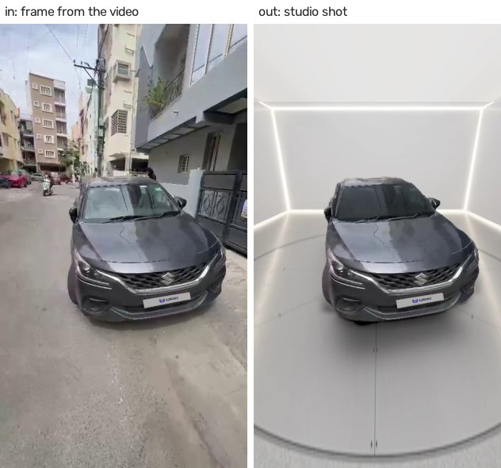
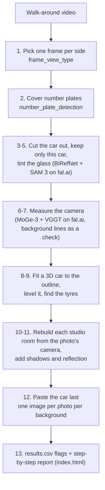

# car_demo_img docs

This repo turns a walk-around video of a car, or a folder of car photos, into studio shots of that car. Four tools
chain together:

1. **frame_view_type** names the side of the car each frame shows.
2. **number_plate_detection** covers every number plate.
3. **background_changer** cuts the car out and stands it in a 3D studio room, seen from the photo's own camera.
4. **video_pipeline** drives the whole chain from one video.

The car's own pixels are evidence of its condition, so they are never redrawn. The only changes allowed are one
rigid rotation, one plain downscale, a crop at a photo edge, and (by a decision made in Nov 2026) a fixed dark tint
on the windows.



## What's here

| File | For whom | What it covers |
|---|---|---|
| [pipeline-steps.md](pipeline-steps.md) | engineers | Every step of the current flow. For each step: what it does, what problem it solves, its input and output, and a picture from a real run. |
| [glossary.md](glossary.md) | everyone | The terms used in the step write-up, in plain language. |
| [images/](images/) | — | Pictures from the end-to-end run of 24 Nov 2026 on `sample_vid.mp4`. The plates are covered in every picture. |

The user guides live next to each tool: [background_changer](../background_changer/README.md),
[number_plate_detection](../number_plate_detection/README.md) and [frame_view_type](../frame_view_type/README.md).
Research notes are in each tool's own `docs/` folder, for example
[glass-cutout-camera-options.md](../background_changer/docs/glass-cutout-camera-options.md), which chose the hosted
models used below.

## The flow in one picture



`video_pipeline/e2e_steps.py` runs this whole flow on one video and writes a report with a picture for every step.
`video_pipeline/make_video.py` is the older variant: it takes 5 frames a second, skips step 1 and turns the results
back into an mp4 (see the end of [pipeline-steps.md](pipeline-steps.md#variant-make_videopy-video-in-video-out)).

## Models

Where it says "fal.ai", the model is an open model run on fal.ai's servers. It costs about $0.04 per photo, and
every hosted step falls back to the laptop if fal fails. Everything else runs on the laptop's CPU.

| Step | Model | Where it runs | What it gives |
|---|---|---|---|
| 1 | `veerupandey/view_classifier` (ConvNeXt-Small) | laptop, PyTorch | which of 8 sides a frame shows, with a probability for each side |
| 2 | YOLOv9-tiny plate detector (`yolo-v9-t-384-license-plate-end2end`) | laptop, ONNX | a box round each plate; the plate's 4 corners are then found with plain OpenCV |
| 3 | BiRefNet v2 ("General Use (Dynamic)", 2048 px) | fal.ai; local BiRefNet-lite as the fallback | the cut-out mask |
| 4-5 | SAM 3, with the prompts "car", "car window" and "windshield" | fal.ai | this car alone, and its windows |
| 6 | MoGe-3 | fal.ai | per photo: focal length, the floor, and from it the camera's height, pitch and roll |
| 6 | VGGT-1B | fal.ai | all photos together: one focal length and the angle between shots |
| 6-12 | none: OpenCV, NumPy, SciPy | laptop | lines, 3D pose fit, levelling, tyres, room rendering, shadows |

**Measured run (24 Nov 2026, `sample_vid.mp4`, 464×832 portrait, 6 sides × 3 backgrounds):**

| Step | Time |
|---|---|
| Step 1 | 18.8 s |
| Step 2 | 2.4 s |
| Steps 3-12 | 677.6 s, of which about 44 s per photo is waiting on fal |
| fal usage | 37 calls, about $0.23 in all (SAM 3 $0.12, MoGe-3 $0.09, BiRefNet $0.01, VGGT $0.01) |

A rerun on the same frames is served from the cache and costs $0.

## Run it

```powershell
cd video_pipeline
..\background_changer\.venv\Scripts\python e2e_steps.py
```

Settings are in [e2e.toml](../video_pipeline/e2e.toml): the video, the sampling step (0.5 s), the car model, the
backgrounds and hosted on/off. The report is written to `video_pipeline/output/e2e_<video>/index.html`. The fal key
is read from `FAL_KEY` or from `background_changer\.env`.
