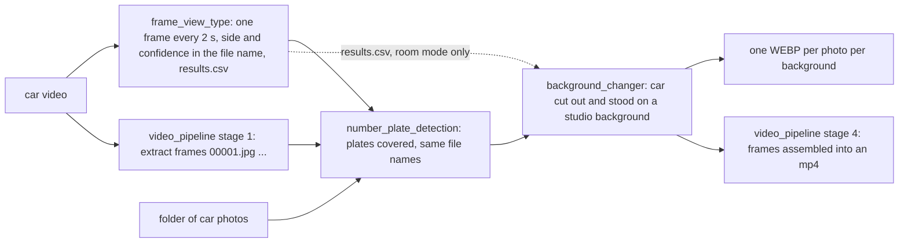

# car_bg_changer docs

This repo turns a walk-around video of a car, or a folder of car photos, into studio shots of that car. Four projects chain together. `frame_view_type` keeps one frame every 2 s and names the side of the car it shows. `number_plate_detection` finds each number plate and covers exactly its shape, with a branded image warped onto its 4 corners and matched to its lighting, or with a solid colour. `background_changer` cuts the car out and stands it on a studio background; in room mode (the default) it measures each photo's camera, fits a 3D outline of the car, and re-renders the background as a 3D room from that same camera. `video_pipeline` runs plate masking and background change on frames it extracts itself and puts the results back into a video. background_changer never redraws the car's own pixels: at most one rigid rotation and one plain downscale ([findings.md:19-20](../background_changer/docs/findings.md#L19-L20)). video_pipeline may then resize a whole result once more to fit its video frame ([make_video.py:87-98](../video_pipeline/make_video.py#L87-L98)). Everything runs on a CPU; no GPU is needed.

## Flow

- **frame_view_type to plates.** Frames are saved as `<time>s_<side>_<conf>pct.jpg` ([classify_video.py:177](../frame_view_type/classify_video.py#L177)). The plate tool's default input is `../frame_view_type/output/sample_vid` ([config.toml:7](../number_plate_detection/config.toml#L7)), and it keeps the file names ([mask_plates.py:258](../number_plate_detection/mask_plates.py#L258)).
- **Plates to background.** background_changer's default `images_folder` is `../number_plate_detection/output/sample_vid` ([config.toml:13](../background_changer/config.toml#L13)), so plates are covered before the cut-out. It reads the side and confidence back from each file name ([probe.py:16-33](../background_changer/bg_changer/probe.py#L16-L33)).
- **results.csv, room mode only.** In room mode background_changer looks for `frame_view_type/output/<same folder name>/results.csv` ([batch.py:56-60](../background_changer/car_fit_to_bg/batch.py#L56-L60), [change_background.py:806-807](../background_changer/change_background.py#L806-L807)) and uses its 8 probabilities as a soft yaw prior ([pose.py:176-183](../background_changer/car_fit_to_bg/pose.py#L176-L183)); without a row, the file-name label is turned into one ([pose.py:200-206](../background_changer/car_fit_to_bg/pose.py#L200-L206)). Flat mode uses only the label, or the cut-out's width/height ratio when there is none ([yaw.py:32-54](../background_changer/bg_changer/yaw.py#L32-L54)). Room mode is the default ([config.toml:35](../background_changer/config.toml#L35)).
- **video_pipeline.** It samples 5 frames per second of the first 10 s ([config.toml:16-23](../video_pipeline/config.toml#L16-L23)), runs `mask_plates.py --overlay --auto-brightness --brightness-smoothing N` (N = `brightness_smoothing`, 5 as shipped), then `change_background.py --background-view room`, then writes an `mp4v` mp4 ([make_video.py:128-174](../video_pipeline/make_video.py#L128-L174)). Stages 1-3 are skipped when their output is already complete; a frame with no result repeats the previous one ([make_video.py:145-160](../video_pipeline/make_video.py#L145-L160)).

> Note: video_pipeline does not run frame_view_type; it only reuses its `sample_vid.mp4` ([config.toml:6](../video_pipeline/config.toml#L6)). Its frames are named `00001.jpg` ([make_video.py:67](../video_pipeline/make_video.py#L67)) in a folder called `frames` ([make_video.py:105](../video_pipeline/make_video.py#L105)), so background_changer finds no label, no results.csv and no time in the name. Each frame is fitted with no view prior and flagged `no-view-label` ([batch.py:92-93](../background_changer/car_fit_to_bg/batch.py#L92-L93)), and a frame with weak background lines cannot borrow roll and pitch from its neighbours ([batch.py:83](../background_changer/car_fit_to_bg/batch.py#L83)). See [video_pipeline: no view labels](video_pipeline/README.md#no-view-labels-in-this-pipeline).

> Note: [number_plate_detection/README.md:27](../number_plate_detection/README.md#L27) gives the default input as `Final_zoomed_car`; the code reads `sample_vid` from [config.toml:7](../number_plate_detection/config.toml#L7).

## Models at a glance

Three ML models, one per project; video_pipeline has none. No second model cleans up the cut-out ([03-cutout-refinement.md](background_changer/03-cutout-refinement.md)), and the 3D room is rendered with NumPy and OpenCV, with no neural network ([render.py:1](../background_changer/room3d/render.py#L1)). Both ONNX models use only the `CPUExecutionProvider`, and the PyTorch model loads with `map_location="cpu"`. Speeds were measured on an Intel i5-1240P laptop, CPU only.

| Project | Model | Role | Licence | Runtime | Size and speed | Code |
|---|---|---|---|---|---|---|
| frame_view_type | `veerupandey/view_classifier`, ConvNeXt-Small, checkpoint `joint_v2_best.pt` | Which of 8 sides a frame shows, with confidence; plus a sin/cos angle | MIT code; the weights' training-data terms are not all stated ([05-view-classifier-deep-dive.md:157](../frame_view_type/docs/05-view-classifier-deep-dive.md#L157)) | PyTorch 2.9.1, CPU only | 198 MB; ~0.8 s per sampled 4K frame, plus ~19 s to read a 38 s 4K video ([README.md:90-91](../frame_view_type/README.md#L90-L91)) | [classify_video.py:94-97](../frame_view_type/classify_video.py#L94-L97) |
| number_plate_detection | `yolo-v9-t-384-license-plate-end2end` (YOLOv9-tiny, 384 px input, open-image-models) | A box round each plate; one class, NMS inside the ONNX graph ([findings.md:29](../number_plate_detection/docs/findings.md#L29)); confidence threshold 0.25 | MIT | ONNX Runtime via `open-image-models[onnx]==0.6.0`; 4 intra-op threads, 1 inter-op | 7.4 MB; ~85 ms per 4K frame to find, fit and cover, of which the detector ~50 ms ([README.md:170](../number_plate_detection/README.md#L170)) | [detector.py:14-19](../number_plate_detection/plate_masker/detector.py#L14-L19), [detector.py:89-101](../number_plate_detection/plate_masker/detector.py#L89-L101) |
| background_changer | BiRefNet general-lite (rembg name `birefnet-general-lite`) | Soft 0..1 alpha of the car: the cut-out | MIT (BiRefNet and rembg) | ONNX Runtime 1.31.1 via `rembg[cpu]==2.0.86`; 4 intra-op threads | ~220 MB; ~17 s per 4K image warm ([findings.md:42](../background_changer/docs/findings.md#L42)); ~12-17 s per photo in a run, up to ~45 s ([README.md:383](../background_changer/README.md#L383)) | [segment.py:22-23](../background_changer/bg_changer/segment.py#L22-L23), [segment.py:169-178](../background_changer/bg_changer/segment.py#L169-L178) |
| all | none: classical OpenCV, NumPy, SciPy | Plate corners and brightness, mask clean-up, camera from background lines (LSD), 3D pose fit, room rendering, video I/O | Apache-2.0 (OpenCV), BSD (NumPy, SciPy) | CPU | - | [corners.py:599](../number_plate_detection/plate_masker/corners.py#L599), [plate_brightness_detector/detector.py:100](../number_plate_detection/plate_brightness_detector/detector.py#L100), [segment.py:115](../background_changer/bg_changer/segment.py#L115), [lines.py:38-45](../background_changer/car_fit_to_bg/lines.py#L38-L45), [pose.py:474](../background_changer/car_fit_to_bg/pose.py#L474), [render.py:64](../background_changer/room3d/render.py#L64) |

> Note: the spyne notes give the cut-out as about 13-17 s per frame, up to ~31 s ([spyne-360-spin-findings.md:495](../background_changer/docs/spyne-360-spin-findings.md#L495)); the README says up to ~45 s.

- **View classifier accuracy** is the author's: 94.1% 8-way on the CFV test set (7 cars), 82.9% on UnsupCar ([05-view-classifier-deep-dive.md:94-98](../frame_view_type/docs/05-view-classifier-deep-dive.md#L94-L98)). It has not been measured on our footage.
- **Plate detector:** on 20 4K test frames it found the main car's plate in all 12 frames where it is visible ([README.md:176](../number_plate_detection/README.md#L176)). Two small plates behind showroom glass were missed at the default 0.25 and caught at 0.15 ([README.md:178](../number_plate_detection/README.md#L178)).
- **BiRefNet lite** looks the same as BiRefNet general at the 1920×1080 output ([findings.md:29](../background_changer/docs/findings.md#L29)) and is about 4× faster at 4 threads: ~17 s against ~66 s ([findings.md:42-43](../background_changer/docs/findings.md#L42-L43)).

## docs/

- [README.md](README.md): this index.

## docs/background_changer/

- [README.md](background_changer/README.md): overview of the cut-out, camera, 3D fit and rendering, and an index.
- [01-models-and-options.md](background_changer/01-models-and-options.md): every model and approach used and considered.
- [02-car-cutout-model.md](background_changer/02-car-cutout-model.md): the BiRefNet cut-out model.
- [03-cutout-refinement.md](background_changer/03-cutout-refinement.md): classical clean-up of the mask; no second model.
- [04-car-dimensions-and-orientation.md](background_changer/04-car-dimensions-and-orientation.md): `cars.json`, the 3D proxy and the yaw.
- [05-camera-angle.md](background_changer/05-camera-angle.md): roll, pitch, focal, distance, height, levelling and tyre lock.
- [06-3d-room-rendering.md](background_changer/06-3d-room-rendering.md): rooms, output camera, ray-casting, fills, grounding and composite.
- Project notes: [README.md](../background_changer/README.md), [findings.md](../background_changer/docs/findings.md), [spyne-360-spin-findings.md](../background_changer/docs/spyne-360-spin-findings.md).

## docs/frame_view_type/

- [README.md](frame_view_type/README.md): overview, output, how background_changer uses it, and an index.
- [01-model-and-options.md](frame_view_type/01-model-and-options.md): the view_classifier model and every option compared.
- [02-how-it-works.md](frame_view_type/02-how-it-works.md): step by step through `classify_video.py`, with every setting.
- Project notes: [README.md](../frame_view_type/README.md), [research notes](../frame_view_type/docs/README.md) ([problem](../frame_view_type/docs/01-problem-definition.md), [options](../frame_view_type/docs/02-options-compared.md), [datasets](../frame_view_type/docs/03-datasets.md), [recommendation](../frame_view_type/docs/04-recommendation-and-next-steps.md), [deep dive](../frame_view_type/docs/05-view-classifier-deep-dive.md)).

## docs/number_plate_detection/

- [README.md](number_plate_detection/README.md): overview of detection, fitting and masking, and an index.
- [01-model-and-options.md](number_plate_detection/01-model-and-options.md): the YOLOv9 detector and the alternatives.
- [02-exact-plate-fit.md](number_plate_detection/02-exact-plate-fit.md): from the detector's box to the plate's 4 corners, and the warp.
- [03-multi-colour-plates.md](number_plate_detection/03-multi-colour-plates.md): plates of every colour.
- [04-auto-brightness.md](number_plate_detection/04-auto-brightness.md): matching the overlay's brightness to the plate.
- Project notes: [README.md](../number_plate_detection/README.md), [findings.md](../number_plate_detection/docs/findings.md), [plate_brightness_detector/README.md](../number_plate_detection/plate_brightness_detector/README.md), [test plates](../number_plate_detection/assets/test_plates/README.md).

## docs/video_pipeline/

- [README.md](video_pipeline/README.md): how video_pipeline extracts frames, runs number_plate_detection and background_changer on them, and assembles the mp4. It does not run frame_view_type.
- Project files (no README of its own): [make_video.py](../video_pipeline/make_video.py), [config.toml](../video_pipeline/config.toml).
