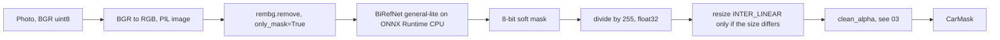

# The car cut-out model: BiRefNet general-lite

## In short

- One ML model cuts the car out of each photo: **BiRefNet general-lite** (Swin-Tiny backbone, per [findings.md:28](../../background_changer/docs/findings.md#L28)), selected by the rembg name `"birefnet-general-lite"` ([segment.py:22](../../background_changer/bg_changer/segment.py#L22)).
- It runs through **rembg 2.0.86** on **ONNX Runtime 1.31.1**, CPU only (`CPUExecutionProvider`), with `intra_op_num_threads = threads`, default 4 ([requirements.txt:3-4](../../background_changer/requirements.txt#L3-L4), [segment.py:169-171](../../background_changer/bg_changer/segment.py#L169-L171)). No GPU and no torch.
- The model is loaded once per run. Each photo gets one call, `rembg.remove(rgb, session=..., only_mask=True)`, which returns a soft 8-bit mask. We turn it into a float alpha (0..1) at the photo's size ([segment.py:173-182](../../background_changer/bg_changer/segment.py#L173-L182)).
- That raw mask is not yet "this car only". The classical clean-up that follows is in [03-cutout-refinement.md](03-cutout-refinement.md). No second model is used.
- Speed: about 17 s per 4K photo at 4 threads on the team laptop (Intel i5-1240P, CPU). 4 threads is faster than 8 or than ONNX Runtime's own choice.

## How it works



1. **The settings are read.** `model` comes from `--model`, else `model` in `config.toml`, else `DEFAULT_MODEL` ([change_background.py:715](../../background_changer/change_background.py#L715)). `threads` comes from `--threads`, else the config, else `DEFAULT_THREADS` = 4 ([change_background.py:716](../../background_changer/change_background.py#L716)). `edge_shrink` comes from the config only ([change_background.py:718](../../background_changer/change_background.py#L718)). `threads` and `edge_shrink` must be whole numbers, 0 or more ([change_background.py:738-743](../../background_changer/change_background.py#L738-L743)). `model` must be text in quotes ([change_background.py:136-138](../../background_changer/change_background.py#L136-L138)).
2. **The packages are checked.** `onnxruntime` and `rembg` are imported up front. If either is missing, the script exits with a hint to use the `.venv` ([change_background.py:795-799](../../background_changer/change_background.py#L795-L799)).
3. **The model is loaded once.** `CarSegmenter(model, edge_shrink, threads)` is built before the first photo, and the load time is printed ([change_background.py:837-843](../../background_changer/change_background.py#L837-L843)). Inside `CarSegmenter.__init__` ([segment.py:162-171](../../background_changer/bg_changer/segment.py#L162-L171)):
   - `onnxruntime` and `rembg` are imported here, not at the top of the module, so compose-only code and the tests need no model packages ([segment.py:163-165](../../background_changer/bg_changer/segment.py#L163-L165)).
   - `opts = ort.SessionOptions()` and `opts.intra_op_num_threads = threads` ([segment.py:169-170](../../background_changer/bg_changer/segment.py#L169-L170)). `threads = 0` leaves the count to ONNX Runtime.
   - `self.session = new_session(model, providers=["CPUExecutionProvider"], sess_opts=opts)` ([segment.py:171](../../background_changer/bg_changer/segment.py#L171)). No other provider is listed, so no GPU is ever tried.
   - On the first run rembg downloads the weights: about 220 MB for `birefnet-general-lite`, about 970 MB for `birefnet-general`. After that everything works offline ([README.md:87](../../background_changer/README.md#L87)).
   - An unknown model name makes rembg raise `ValueError`. The script turns it into a message that suggests `birefnet-general-lite` or `birefnet-general` ([change_background.py:840-842](../../background_changer/change_background.py#L840-L842)).
4. **One model call per photo.** `raw_alpha` ([segment.py:173-182](../../background_changer/bg_changer/segment.py#L173-L182)):
   - converts the OpenCV BGR image to an RGB PIL image ([segment.py:177](../../background_changer/bg_changer/segment.py#L177));
   - calls `remove(rgb, session=self.session, only_mask=True)` ([segment.py:178](../../background_changer/bg_changer/segment.py#L178)). Nothing else is passed: no `alpha_matting`, no `post_process_mask`, no `bgcolor`. rembg's own matting and mask post-processing therefore stay off (their defaults in rembg's API), and rembg returns the mask only, not an RGBA cut-out.
   - Inside rembg (not in this repo): BiRefNet works at its own fixed input size, about 1024×1024 per the rembg/BiRefNet docs, and the mask is scaled back to the photo's size. This repo never sets that size.
5. **Mask to float alpha.** The 8-bit mask is divided by 255 to give float32 0..1 ([segment.py:179](../../background_changer/bg_changer/segment.py#L179)). If its shape differs from the photo's, it is resized back with `cv2.INTER_LINEAR` ([segment.py:180-181](../../background_changer/bg_changer/segment.py#L180-L181)). rembg normally returns the photo's size already (per rembg, not checked in this repo), so this is a guard.
6. **Clean-up.** `cut_out` passes the raw alpha and `edge_shrink` to `clean_alpha` ([segment.py:184-185](../../background_changer/bg_changer/segment.py#L184-L185)). See [03-cutout-refinement.md](03-cutout-refinement.md). If no pixel reaches 0.5, `NoCarFound` is raised and the photo is skipped with the note `skipped: the model found no object in the image` ([segment.py:119-121](../../background_changer/bg_changer/segment.py#L119-L121), [change_background.py:864-869](../../background_changer/change_background.py#L864-L869)).
7. **Timing and saving.** The time of steps 4-6 is the `segment_s` column of `results.csv` ([change_background.py:863-870](../../background_changer/change_background.py#L863-L870), [README.md:274](../../background_changer/README.md#L274)). With `save_cutouts = true`, the car is written at full resolution as a BGRA lossless WEBP to `<output_folder>\<images folder name>\cutouts\<photo>.webp` ([change_background.py:873-874](../../background_changer/change_background.py#L873-L874)). The 4th channel is `rint(alpha × 255)` over the `crop` box ([compose.py:72-76](../../background_changer/bg_changer/compose.py#L72-L76)). `quality=101` means lossless ([change_background.py:277-278](../../background_changer/change_background.py#L277-L278)).
8. **The model is freed in room mode.** After stage 1 (every photo cut out and its lines measured), the segmenter is deleted and `gc.collect()` runs, so fitting and rendering get the memory ([change_background.py:897-899](../../background_changer/change_background.py#L897-L899)). In flat mode it lives to the end of the run.

**Other entry points load the same model.**
- The Python API `BackgroundChanger` builds `CarSegmenter(model, edge_shrink, threads)` with the same defaults ([bg_changer/\_\_init\_\_.py:44-47](../../background_changer/bg_changer/__init__.py#L44-L47)). `CarSegmenter().cut_out(image)` can also be used directly ([README.md:336](../../background_changer/README.md#L336)).
- `tools/check_room.py` builds its own, with fixed arguments (see [Mask cache](#mask-cache-in-toolscheck_roompy) below).
- `video_pipeline` runs `change_background.py` without `--model` or `--threads`, so `background_changer/config.toml` decides ([make_video.py:141-143](../../video_pipeline/make_video.py#L141-L143)). See [docs/video_pipeline/README.md](../video_pipeline/README.md).

## The maths and constants

```
rgb       = cvtColor(image_bgr, BGR2RGB)                  # segment.py:177
mask_u8   = rembg.remove(rgb, session, only_mask=True)    # segment.py:178, values 0..255
raw_alpha = float32(mask_u8) / 255                        # segment.py:179, steps of 1/255
if raw_alpha.shape != (H, W):
    raw_alpha = resize(raw_alpha, (W, H), INTER_LINEAR)   # segment.py:180-181
car       = clean_alpha(raw_alpha, edge_shrink)           # segment.py:185, see 03
```

| Name | Value | Meaning | Code |
|---|---|---|---|
| `DEFAULT_MODEL` | `"birefnet-general-lite"` | rembg model name when neither `--model` nor the config sets one | [segment.py:22](../../background_changer/bg_changer/segment.py#L22) |
| `DEFAULT_THREADS` | `4` | ONNX Runtime `intra_op_num_threads`; `0` = ONNX Runtime decides | [segment.py:23](../../background_changer/bg_changer/segment.py#L23) |
| `DEFAULT_EDGE_SHRINK` | `2` | px at source resolution; passed through to `clean_alpha` ([03](03-cutout-refinement.md)) | [segment.py:24](../../background_changer/bg_changer/segment.py#L24) |
| `providers` | `["CPUExecutionProvider"]` | CPU only, fixed in code | [segment.py:171](../../background_changer/bg_changer/segment.py#L171) |
| `only_mask` | `True` | rembg returns the mask only; no other rembg option is passed | [segment.py:178](../../background_changer/bg_changer/segment.py#L178) |
| Mask scale | `÷ 255.0`, float32 | 8-bit mask to alpha 0..1, in steps of 1/255 | [segment.py:179](../../background_changer/bg_changer/segment.py#L179) |
| Size guard | `cv2.INTER_LINEAR` | Resize to the photo's H×W, only if the shape differs | [segment.py:180-181](../../background_changer/bg_changer/segment.py#L180-L181) |
| Model input size | about 1024×1024 | Per rembg/BiRefNet docs, not set in this repo | [README.md:389](../../background_changer/README.md#L389), [spyne notes:429](../../background_changer/docs/spyne-360-spin-findings.md#L429) |
| Weights | ~220 MB lite, ~970 MB general | Downloaded by rembg on first use | [README.md:87](../../background_changer/README.md#L87) |
| Cut-out file | lossless WEBP (`quality=101`), alpha `rint(α × 255)` | Full-resolution check image in `cutouts\` | [change_background.py:874](../../background_changer/change_background.py#L874), [compose.py:75](../../background_changer/bg_changer/compose.py#L75) |
| `check_room` cache | 16-bit PNG, `rint(α × 65535)`, read back `÷ 65535` | Cached clean alpha for the review tool | [check_room.py:79-81](../../background_changer/tools/check_room.py#L79-L81), [check_room.py:91-94](../../background_changer/tools/check_room.py#L91-L94) |
| `check_room` segmenter | `CarSegmenter("birefnet-general-lite", 2, 4)` | Fixed arguments; `config.toml` is not read | [check_room.py:84](../../background_changer/tools/check_room.py#L84) |

**Pixels the mask covers at 4K.** A 3840×2160 frame has about 8.3 million pixels. A 1024×1024 mask has about 1.05 million. So, per the docs' input size, the fine edge of a 4K cut-out is upsampled from roughly 8× fewer pixels. The spyne notes call it "the 1024² mask" ([spyne notes:429](../../background_changer/docs/spyne-360-spin-findings.md#L429)).

## Settings and command-line flags

| Setting | Default | CLI flag | Effect | Code |
|---|---|---|---|---|
| `model` | `"birefnet-general-lite"` | `--model NAME` | rembg model name. `"birefnet-general"` is the documented alternative. | [config.toml:87-89](../../background_changer/config.toml#L87-L89), [change_background.py:697](../../background_changer/change_background.py#L697) |
| `threads` | `4` | `--threads N` | ONNX Runtime `intra_op_num_threads`. `0` = automatic (printed as `threads=auto`). | [config.toml:91-92](../../background_changer/config.toml#L91-L92), [change_background.py:698](../../background_changer/change_background.py#L698), [change_background.py:843](../../background_changer/change_background.py#L843) |
| `edge_shrink` | `2` | none | Pulls the soft edge in by this many source pixels; `0` = off. Used by the clean-up, see [03](03-cutout-refinement.md). | [config.toml:94-96](../../background_changer/config.toml#L94-L96), [change_background.py:718](../../background_changer/change_background.py#L718) |
| `save_cutouts` | `true` | none | Writes each car alone, transparent, full resolution, to `cutouts\` | [config.toml:101-102](../../background_changer/config.toml#L101-L102), [change_background.py:720](../../background_changer/change_background.py#L720) |

- Command-line options win over `config.toml` for one run ([README.md:233](../../background_changer/README.md#L233)).
- Any rembg model name is passed straight through (for example `isnet-general-use` or `u2net`). Only the two BiRefNet models have measured speeds and a side-by-side comparison in the notes, and the error hint names only those two.

## Speed and threads

**Thread count.** Measured on one 4K frame after a warm-up run, Intel i5-1240P laptop, CPU only ([findings.md:38-43](../../background_changer/docs/findings.md#L38-L43)):

| Model | 4 threads | 8 threads | ONNX default (`threads = 0`) |
|---|---|---|---|
| `birefnet-general-lite` | **~17 s** | ~20 s | ~35 s |
| `birefnet-general` | ~66 s | ~100-120 s | ~81 s |

**Why fewer threads is faster here.** The i5-1240P has 4 performance (P) cores and 8 efficiency (E) cores. By default ONNX Runtime spreads the model over all of them. Each layer's work is split over the threads, and the slow E-cores hold the fast P-cores back ([findings.md:38](../../background_changer/docs/findings.md#L38)). With 4 threads the work can stay on the 4 P-cores. So the defaults are `model = "birefnet-general-lite"` and `threads = 4`. On a desktop CPU with only performance cores, try `threads = 0` ([findings.md:45](../../background_changer/docs/findings.md#L45)).

**Per run.** Same laptop ([README.md:378-383](../../background_changer/README.md#L378-L383)):

| Step | Time |
|---|---|
| Load the model | ~8-13 s, once per run |
| Cut the car out | ~12-17 s per photo typically; the first photos and a busy or hot laptop up to ~45 s |

> Note: the spyne notes measured ≈ 13-17 s per frame, up to ~31 s ([spyne notes:495](../../background_changer/docs/spyne-360-spin-findings.md#L495)). The README's "up to ~45 s" is the higher of the two.

- Timings vary a lot with heat and power mode. The first image after loading is always slower (warm-up) ([findings.md:45](../../background_changer/docs/findings.md#L45)).
- **Small photos are not much faster.** The model works at its own fixed input size, so a 464×832 phone frame is not much faster to cut out than a 4K frame ([README.md:389](../../background_changer/README.md#L389)).
- **lite vs general.** At 4 threads, 66 s vs 17 s is about 3.9×.

> Note: [config.toml:88](../../background_changer/config.toml#L88) and [README.md:201](../../background_changer/README.md#L201) say "about 4×" slower; [README.md:389](../../background_changer/README.md#L389) says "4-5×"; the 66-122 s range in [findings.md:29](../../background_changer/docs/findings.md#L29) gives about 4-7×.

- Cutting out and the 3D fit are nearly all of a run's time. Both happen once per photo, however many backgrounds are chosen ([README.md:389](../../background_changer/README.md#L389)).

## Mask cache in tools/check_room.py

`change_background.py` has no mask cache: every run cuts every photo out again. The review tool `tools/check_room.py` does cache, so re-runs skip the model ([README.md:238-246](../../background_changer/README.md#L238-L246)).

- **Where.** `background_changer\output\check_room\_masks\<folder>\<photo stem>.png` ([check_room.py:14](../../background_changer/tools/check_room.py#L14), [check_room.py:31](../../background_changer/tools/check_room.py#L31), [check_room.py:160](../../background_changer/tools/check_room.py#L160)).
- **What.** The clean full-frame alpha, after `clean_alpha` (it calls `CarSegmenter.cut_out`), not the raw model mask ([check_room.py:85-87](../../background_changer/tools/check_room.py#L85-L87)).
- **Format.** One-channel 16-bit PNG, value `clip(rint(alpha × 65535), 0, 65535)` ([check_room.py:91-94](../../background_changer/tools/check_room.py#L91-L94)). Read back with `IMREAD_UNCHANGED` and `÷ 65535` ([check_room.py:79-81](../../background_changer/tools/check_room.py#L79-L81)).
- **Reuse rule.** The file exists and its height and width equal the photo's ([check_room.py:78-81](../../background_changer/tools/check_room.py#L78-L81)). Otherwise the segmenter is built on the first miss only, as `CarSegmenter("birefnet-general-lite", 2, 4)` (model, `edge_shrink`, threads), and the new alpha is written ([check_room.py:82-87](../../background_changer/tools/check_room.py#L82-L87)).
- **Errors.** A photo that fails (unreadable, or no car found) is listed as skipped and nothing is cached ([check_room.py:173-181](../../background_changer/tools/check_room.py#L173-L181)).
- **Cut sides from the cache.** `check_room.py` recomputes them with `batch.cut_sides` (alpha ≥ 0.5, 3 px from the edge) ([check_room.py:195](../../background_changer/tools/check_room.py#L195), [batch.py:117-121](../../background_changer/car_fit_to_bg/batch.py#L117-L121)).
- **Stale masks.** The cache key is only the file stem and the size. It does not record the model, `edge_shrink` or the clean-up code. After changing any of these, delete `_masks\<folder>\`.

## What the raw mask is not good enough for

The model marks the most salient object(s), not "the car" ([segment.py:3](../../background_changer/bg_changer/segment.py#L3), [findings.md:24](../../background_changer/docs/findings.md#L24)). On dealer car-park photos its raw output has these problems. Each is fixed by classical clean-up in [03-cutout-refinement.md](03-cutout-refinement.md):

- **Other cars.** Parked cars in the background are picked up too (frame 0024 has one on each side) ([findings.md:51](../../background_changer/docs/findings.md#L51)).
- **Posts.** A lamp post or sign pole behind the car touches its outline and joins the same blob (frame 0012: a post sticking out of the roof) ([findings.md:56](../../background_changer/docs/findings.md#L56)).
- **See-through windows.** Glass often comes out partly transparent, so the new studio would show through the car ([findings.md:59](../../background_changer/docs/findings.md#L59)).
- **Soft interior.** Alpha below 1 inside the body would blend real car pixels with the new background ([findings.md:60](../../background_changer/docs/findings.md#L60)).
- **Fringe and halos.** A thin fringe of the old background on the soft edge (blue sky on a white roof), and faint halos of other objects ([findings.md:60](../../background_changer/docs/findings.md#L60), [segment.py:126-127](../../background_changer/bg_changer/segment.py#L126-L127)).

## Options we had

Background-removal models give a soft alpha (0 = background, 1 = object). Comparison from [findings.md:26-34](../../background_changer/docs/findings.md#L26-L34); speeds on the i5-1240P, CPU. For every model and approach in the project, see [01-models-and-options.md](01-models-and-options.md).

| Option | Licence | Edges | CPU speed, size | Verdict | Why |
|---|---|---|---|---|---|
| **BiRefNet general-lite** (`birefnet-general-lite`) | MIT | Clean wheel arches, mirrors, bonnet line | ~17 s/image warm at 4 threads; ~220 MB; Swin-Tiny | **Used (default)** | Looks the same as BiRefNet general at the output size, about 4× faster. Permissive, CPU only, no torch. |
| BiRefNet general (`birefnet-general`) | MIT | Same as lite at 1920×1080 output (compared side by side, zoomed) | 66-122 s/image; ~970 MB; Swin-Large | Selectable, not default | No visible gain at this output size. Use it if the output size is raised a lot. |
| ISNet general-use | Apache-2.0 | Softer; can nibble thin parts | Fast; ~170 MB | Not used | Edges worse than BiRefNet |
| U²-Net | Apache-2.0 | Blobby | Fast | Not used | Older; superseded by ISNet and BiRefNet |
| BRIA RMBG-2.0 | **CC BY-NC 4.0** | Very good | Medium | **Rejected** | Non-commercial licence |
| YOLO-seg (Ultralytics) | **AGPL-3.0** | Coarse (low-resolution mask head) | Fast | **Rejected** | Copyleft licence and edge quality |
| SAM / SAM 2 | Apache-2.0 | Coarse at 4K | Slow encoder | Not used | Needs a point or box prompt. Salient-object removal plus `clean_alpha` already isolates the car. |

**Run-time options.**

| Option | Verdict | Why |
|---|---|---|
| ONNX Runtime CPU, 4 threads | **Used** | Fastest measured on this laptop (table above) |
| `threads = 0` (ONNX Runtime decides) | Not default | ~35 s vs ~17 s here. Worth trying on a CPU with only performance cores. |
| GPU through ONNX Runtime DirectML or OpenVINO (Iris Xe) | Not tried | Any speed-up is unverified ([spyne notes:500](../../background_changer/docs/spyne-360-spin-findings.md#L500)). The provider list is fixed to CPU in [segment.py:171](../../background_changer/bg_changer/segment.py#L171). |
| rembg `alpha_matting`, `post_process_mask` | Not used | Only `only_mask=True` is passed. The clean-up is our own ([03](03-cutout-refinement.md)). |

## Limits

- **Slow, CPU only.** ~12-17 s per 4K photo typically ([README.md:383](../../background_changer/README.md#L383)). Using a GPU needs a code change: the provider is fixed to `CPUExecutionProvider`.
- **Fixed model input size.** About 1024×1024 per the rembg/BiRefNet docs (not set or checked in this repo). Fine edges at 4K are upsampled, and small photos are not much faster. Edge-refinement ideas (guided filter, colour clean-up of the soft band) are documented but not built ([spyne notes:426-430](../../background_changer/docs/spyne-360-spin-findings.md#L426-L430)); see [03](03-cutout-refinement.md).
- **Not car-specific.** It segments the salient object(s). Neighbouring cars, posts and glass need the clean-up in [03](03-cutout-refinement.md). A neighbour that touches the car in the photo stays in the cut-out.
- **8-bit mask.** rembg hands back 0..255, so the alpha comes in steps of 1/255.
- **Model name not restricted.** Any rembg name loads; only the two BiRefNet models were timed and compared side by side in the notes.
- **First run needs the internet** to download the weights. The download folder is rembg's own default; this repo never sets it.

> Note: [README.md:87](../../background_changer/README.md#L87) names `%USERPROFILE%\.rembg\models\`. The code sets no path, so rembg's own default applies. rembg has used `%USERPROFILE%\.u2net\` (set by the `U2NET_HOME` environment variable) for this; neither folder was checked against rembg 2.0.86, which is not installed here.

- **No test loads the model.** The tests need no model ([README.md:366](../../background_changer/README.md#L366)). They test the clean-up on synthetic masks ([test_compose.py:33-57](../../background_changer/tests/test_compose.py#L33-L57)). The rembg call, the thread setting and the download are exercised only by real runs.
- **check_room masks can go stale** after a model, `edge_shrink` or clean-up change (see [Mask cache](#mask-cache-in-toolscheck_roompy)).

## Further reading

- [Overview of background_changer docs](README.md); [every model and option](01-models-and-options.md); [mask clean-up](03-cutout-refinement.md).
- [background_changer/docs/findings.md: Cutting the car out](../../background_changer/docs/findings.md#cutting-the-car-out) and [Speed: fewer threads is faster on this laptop](../../background_changer/docs/findings.md#speed-fewer-threads-is-faster-on-this-laptop).
- [background_changer/README.md: Settings](../../background_changer/README.md#settings-in-configtoml), [Checking without the model](../../background_changer/README.md#checking-without-the-model), [Speed](../../background_changer/README.md#speed).
- [background_changer/docs/spyne-360-spin-findings.md: 7.5 Grounding and appearance](../../background_changer/docs/spyne-360-spin-findings.md#75-grounding-and-appearance-with-the-car-layer-locked) (edge-fringe ideas) and [7.9 CPU feasibility](../../background_changer/docs/spyne-360-spin-findings.md#79-cpu-feasibility-on-this-laptop-i5-1240p-16-gb-no-gpu).
- Code: [bg_changer/segment.py](../../background_changer/bg_changer/segment.py), [change_background.py](../../background_changer/change_background.py), [tools/check_room.py](../../background_changer/tools/check_room.py).
