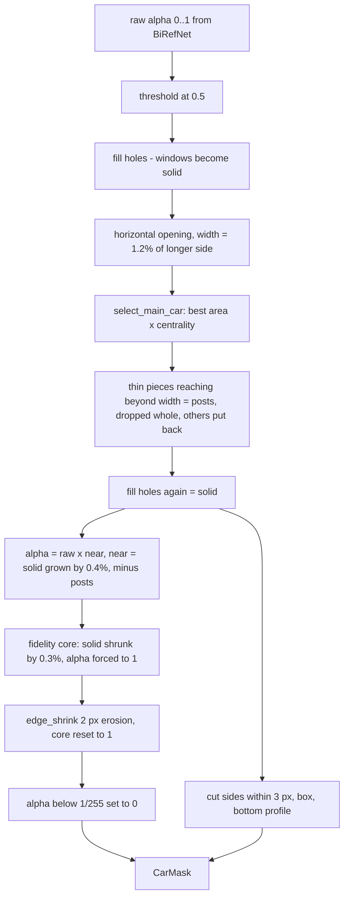

# Cut-out refinement: classical clean-up, no second model

Answers: "what is the other enhancement model we use for proper cropping?"

## In short

- **There is no second ML model.** BiRefNet general-lite gives one soft mask ([02](02-car-cutout-model.md)). Everything after that is classical OpenCV/NumPy in one function, [`clean_alpha`](../../background_changer/bg_changer/segment.py#L115-L147).
- `clean_alpha` makes the mask "this car only": threshold at 0.5, fill the windows, cut off thin posts, keep the biggest central blob, keep a thin soft rim, force the inside to alpha = 1, and pull the edge in by 2 px.
- **Room mode adds a check, not a fix.** After the 3D fit, the mask is compared with the fitted 3D car ([pose.py:412](../../background_changer/car_fit_to_bg/pose.py#L412-L439)). Large leftovers only add flags to `results.csv`. The mask is never edited.
- The red tail-lamp cue is a hand-coded colour rule (Lab a* > 25), not a model either.
- `requirements.txt` pins no other model package: only rembg, ONNX Runtime, OpenCV, NumPy, Pillow, SciPy and pytest ([requirements.txt:3](../../background_changer/requirements.txt#L3-L9)).

## How it works

### clean_alpha, step by step

Input: the model's soft alpha, float 0..1, at the photo's own size. `CarSegmenter.raw_alpha` gets it from one `rembg.remove(..., only_mask=True)` call, divides by 255 and resizes with `INTER_LINEAR` if the size differs ([segment.py:173](../../background_changer/bg_changer/segment.py#L173-L182)). No other `remove()` option is passed, so rembg's own alpha matting and mask post-processing are not switched on. `longer = max(h, w)` of the photo sets every relative size below ([segment.py:117](../../background_changer/bg_changer/segment.py#L117-L118)).

1. **Threshold at 0.5.** `binary = raw_alpha >= 0.5` ([segment.py:119](../../background_changer/bg_changer/segment.py#L119)). If no pixel passes, `NoCarFound` is raised ([segment.py:120](../../background_changer/bg_changer/segment.py#L120-L121)). The photo is then skipped with the note "skipped: the model found no object in the image" ([change_background.py:864](../../background_changer/change_background.py#L864-L869)).
2. **Fill holes first.** `fill_holes` draws every outer contour (`RETR_EXTERNAL`) filled, so every hole inside a blob becomes solid ([segment.py:108](../../background_changer/bg_changer/segment.py#L108-L112)). This runs *before* post removal ([segment.py:122](../../background_changer/bg_changer/segment.py#L122-L123)). A thin pillar between two see-through windows is then part of a solid block and is never taken for a post.
3. **Drop thin posts (`drop_posts`).** A lamp post or sign pole behind the car touches its outline in the photo and joins the same blob ([segment.py:83](../../background_changer/bg_changer/segment.py#L83-L105)).
   - `width = max(3, round(POST_WIDTH * longer))`, with `POST_WIDTH = 0.012`: 46 px at 3840 ([segment.py:27](../../background_changer/bg_changer/segment.py#L27), [segment.py:123](../../background_changer/bg_changer/segment.py#L123)).
   - A morphological opening with a horizontal line, `MORPH_RECT (width, 1)`, removes everything narrower than `width` side to side ([segment.py:94](../../background_changer/bg_changer/segment.py#L94)).
   - If the opening removes everything, the code falls back to `select_main_car` on the unopened mask and removes no posts ([segment.py:95](../../background_changer/bg_changer/segment.py#L95-L96)).
   - Otherwise the main car is picked from the opened mask (step 4) ([segment.py:97](../../background_changer/bg_changer/segment.py#L97)). `thin` = mask minus main car, split into 8-connected pieces. With no pieces, the main car is returned as it is ([segment.py:98](../../background_changer/bg_changer/segment.py#L98-L101)).
   - **A piece is a post if any of its pixels lies outside the main car dilated by a disk of radius `width`.** In other words, it reaches further than `width` px out of the car. Posts are dropped whole, base included ([segment.py:102](../../background_changer/bg_changer/segment.py#L102-L103)).
   - Shorter pieces are the car's own edge details (rounded tyre bottoms, corners). They go back in, and `select_main_car` runs again on main car + those pieces ([segment.py:104](../../background_changer/bg_changer/segment.py#L104-L105)).
   - **Why one direction only.** Mirrors, wipers and roof rails stick out sideways, so they are wide side to side and survive the horizontal opening. A round opening also caught posts, but it cut off wing mirrors whose stalks look thin ([findings.md, "From model alpha to this car only"](../../background_changer/docs/findings.md#from-model-alpha-to-this-car-only), line 57).

   > Note: findings.md:56 and README.md:401 say "1.2 % of the image width". The code uses the image's **longer** side ([segment.py:118](../../background_changer/bg_changer/segment.py#L118), [segment.py:123](../../background_changer/bg_changer/segment.py#L123)). Same result for landscape photos; for the 464×832 portrait `sample_vid` the code uses 10 px, the width rule would give 6 px.

4. **Keep the main car (`select_main_car`).** It runs inside step 3: on the opened mask, again on main car + restored pieces, and in the fallback ([segment.py:60](../../background_changer/bg_changer/segment.py#L60-L80)).
   - Split into 8-connected blobs. No blob: `NoCarFound` ([segment.py:63](../../background_changer/bg_changer/segment.py#L63-L65)).
   - Score each blob as `area * (1 - 0.5 * off_centre)`, where `off_centre` = distance from the blob's centroid to the image centre ÷ half the image diagonal (0 = centre, 1 = corner). A blob in a corner loses up to half its weight ([segment.py:66](../../background_changer/bg_changer/segment.py#L66-L73)).
   - Keep the best blob, plus every blob whose bounding box lies wholly inside the best blob's box ([segment.py:74](../../background_changer/bg_changer/segment.py#L74-L80)).
   - This is what drops parked cars in the background (frame 0024 of the EQB video has one on each side; [findings.md](../../background_changer/docs/findings.md#from-model-alpha-to-this-car-only), line 51).

   > Note: the docstring ([segment.py:61](../../background_changer/bg_changer/segment.py#L61)) and findings.md:54 say "small" blobs inside the box. The code has no size limit.

5. **Fill holes again: `solid`.** The post-free car is hole-filled once more ([segment.py:124](../../background_changer/bg_changer/segment.py#L124)). Windows are now fully opaque, so the glass keeps its original pixels (reflections, interior) instead of showing the studio through the car. `solid` is used for the core, the box, the cut sides and the bottom profile.
6. **Soft alpha only near the outline.** `near = dilate(solid, disk(max(1, round(EDGE_KEEP * longer))))`, with `EDGE_KEEP = 0.004`: 15 px at 3840. A removed post, dilated by a fixed 2 px disk to cover its anti-aliased rim, is taken out of `near`. Then `alpha = raw_alpha * near` ([segment.py:126](../../background_changer/bg_changer/segment.py#L126-L130)). This removes faint halos of other objects and any leftover post.
7. **The fidelity core.** `core = erode(solid, disk(max(1, round(CORE_BAND * longer))))`, with `CORE_BAND = 0.003`: 12 px at 3840. Then `alpha = max(alpha, core)` ([segment.py:131](../../background_changer/bg_changer/segment.py#L131-L133)). Inside the core alpha is exactly 1. The compositor copies such pixels unchanged ([compose.py:41](../../background_changer/bg_changer/compose.py#L41-L42)), so only the outer band (about 5 px after downscaling, per findings.md:60) and the soft rim outside the outline are blended.
8. **Edge shrink.** If `edge_shrink > 0` (default 2 px at source resolution), the float alpha gets a grey-level erosion with `disk(edge_shrink)` (a 5×5 ellipse for 2). Each pixel takes the lowest alpha within 2 px, so the soft edge moves in by 2 px. The core is then reset to 1 ([segment.py:134](../../background_changer/bg_changer/segment.py#L134-L136)). This drops a fringe of the old background, such as blue sky on a white roof. `edge_shrink` is set in `config.toml` only (no command-line flag) and must be a whole number ≥ 0 ([config.toml:94](../../background_changer/config.toml#L94-L96), [change_background.py:718](../../background_changer/change_background.py#L718), [change_background.py:738](../../background_changer/change_background.py#L738-L739)).
9. **Zero the dust.** `alpha < 1/255` is set to 0 ([segment.py:137](../../background_changer/bg_changer/segment.py#L137)).
10. **Cut sides.** The car counts as cut off on a side if `solid` has any pixel within `BORDER_TOL = 3` px of that photo edge ([segment.py:139](../../background_changer/bg_changer/segment.py#L139-L145)). Room mode skips cars cut at the bottom or on two or more sides ([batch.py:124](../../background_changer/car_fit_to_bg/batch.py#L124-L131), [change_background.py:540](../../background_changer/change_background.py#L540-L547)); placement of cut cars is in [06](06-3d-room-rendering.md).
11. **Box, crop and bottom profile.** `box` = bounding box of `solid` (used for placement); `crop` = bounding box of `alpha > 0` (what gets copied). `bottom` = the lowest `solid` row in each column of the box, −1 where a column is empty ([segment.py:146](../../background_changer/bg_changer/segment.py#L146-L156)). `probe_car` uses `bottom` for tyre contacts and the lowest point ([probe.py:85](../../background_changer/bg_changer/probe.py#L85-L100)).

### What clean_alpha returns

`CarMask` ([segment.py:35](../../background_changer/bg_changer/segment.py#L35-L47)); all coordinates in source pixels, x2/y2 exclusive.

| Field | Meaning | Used by |
|---|---|---|
| `alpha` | float32 H×W, 0..1; exactly 1 in the core | cut-out file, line camera, 3D fit, composite |
| `box` | bounding box of `solid` | placement, `probe_car` |
| `crop` | bounding box of `alpha > 0` | what is copied and saved |
| `cut` | left/right/top/bottom → touches that edge | skip rules, flat-mode `cut-*` flags |
| `bottom` | lowest solid row per box column, −1 if empty | tyre contacts, lowest point |

Where the cleaned alpha goes next:
- **Saved cut-out.** With `save_cutouts = true`, `cutouts\<photo>.webp` gets BGRA lossless WEBP over `crop`, alpha = `round(alpha * 255)` ([change_background.py:873](../../background_changer/change_background.py#L873-L874), [compose.py:72](../../background_changer/bg_changer/compose.py#L72-L76)). It is the quickest way to check a cut-out.
- **Background lines.** `alpha >= 0.5` masks the car out of the line detection ([lines.py:259](../../background_changer/car_fit_to_bg/lines.py#L259-L261), [lines.py:73](../../background_changer/car_fit_to_bg/lines.py#L73-L78)); see [05](05-camera-angle.md).
- **3D fit and yaw.** The same alpha is the silhouette the 3D proxy is fitted to; see [04](04-car-dimensions-and-orientation.md).
- **Composite.** `alpha == 1` pixels are copied, `0 < alpha < 1` pixels are blended; see [06](06-3d-room-rendering.md).

### Room mode: residual-blob checks

These run at the end of the 3D pose fit, so only in room mode (the default, [config.toml:35](../../background_changer/config.toml#L35)). They **label** the result. They never change the alpha, the saved cut-out or the composite: the blobs are used nowhere outside `pose.py`.

1. **Same mask as the cut-out.** The fit gets the cleaned full-frame alpha ([change_background.py:557](../../background_changer/change_background.py#L557)). A photo with fewer than 400 solid pixels, or a car covering more than 90% of the frame, is skipped with a `FitError` ([car_fit_to_bg/\_\_init\_\_.py:110](../../background_changer/car_fit_to_bg/__init__.py#L110-L114)).
2. **Working raster.** The car's box (`alpha >= 0.5`) is padded by 30% on each side, clipped to the frame, and scaled so the car's longer side is 480 px (`REFINE_LONG`). The alpha is `INTER_AREA`-resized and stored × 255 as uint8 ([pose.py:46](../../background_changer/car_fit_to_bg/pose.py#L46), [pose.py:285](../../background_changer/car_fit_to_bg/pose.py#L285-L299), [pose.py:486](../../background_changer/car_fit_to_bg/pose.py#L486)).
3. **Fitted proxy.** The 3D proxy is drawn at the final pose, anti-aliased. Its top row, bottom row and column range come from its pixels > 127 ([pose.py:570](../../background_changer/car_fit_to_bg/pose.py#L570-L576)). The proxy itself is in [04](04-car-dimensions-and-orientation.md).
4. **Differences.** `m = mask >= 128`, `pr = proxy >= 128`. Both are compared with a tolerance: an odd elliptical kernel `k` from 2% of the proxy's height. `extra` = mask pixels outside the dilated proxy; `missing` = proxy pixels outside the dilated mask ([pose.py:414](../../background_changer/car_fit_to_bg/pose.py#L414-L421)).
5. **Blobs.** Each difference is split into 8-connected blobs. `share` = blob area ÷ the mask's area on the raster. Blobs under 1% are ignored ([pose.py:422](../../background_changer/car_fit_to_bg/pose.py#L422-L426)).
6. **Classify** each blob, tests in this order ([pose.py:427](../../background_changer/car_fit_to_bg/pose.py#L427-L437)):

   | Blob | Test | Kind | What it usually is |
   |---|---|---|---|
   | missing | any | `occluder` | Part of the fitted car the cut-out does not cover: something in front of the car, or a part the model dropped |
   | extra | centroid y in the top 15% of the proxy's height | `merged-object` | Something standing on or behind the roof |
   | extra | centroid y below `bottom_row - 0.02 * height` | `reflection` (flag `mask-reflection`) | Floor reflection or shadow taken as car |
   | extra | centroid x left or right of the proxy's columns | `neighbour-car` | Another car touching the main one in the photo |
   | extra | anything else | `merged-object` | An object merged into the body |

7. **Refit without big extras.** Extra blobs with `share > 0.08` are joined, dilated with an odd ellipse from 3% of the proxy's height, and left out of the IoU. The pose is fitted again from the current one ([pose.py:577](../../background_changer/car_fit_to_bg/pose.py#L577-L586)). The refit always replaces the previous pose.
8. **Flag.** Every blob with `share > 0.03` adds its kind to the flags, `reflection` renamed `mask-reflection`, no duplicates ([pose.py:587](../../background_changer/car_fit_to_bg/pose.py#L587-L591)). The flags come from the blobs found before the refit; they are not recomputed.
9. **Into results.csv.** The pose flags join the photo's flags ([car_fit_to_bg/\_\_init\_\_.py:128](../../background_changer/car_fit_to_bg/__init__.py#L128)), then every room-mode row's `flags` column ([change_background.py:453](../../background_changer/change_background.py#L453), [change_background.py:465](../../background_changer/change_background.py#L465-L472)) and the console line ([change_background.py:602](../../background_changer/change_background.py#L602)). README: "check `cutouts\`" ([README.md:305](../../background_changer/README.md#output)).

Flat mode runs no such check.

### The red tail-lamp cue is a rule, not a model

The front/back hint reads the source pixels inside `alpha >= 0.5`. The crop is scaled down to at most 420 px tall, only the largest blob is used, and Lab a* > 25 counts as red ([pose.py:216](../../background_changer/car_fit_to_bg/pose.py#L216-L241)). Details in [04](04-car-dimensions-and-orientation.md).

## The maths and constants

### clean_alpha

`L` = the photo's longer side in px. `_disk(r)` is an elliptical kernel of size `2r + 1` ([segment.py:55](../../background_changer/bg_changer/segment.py#L55-L57)).

| Name | Value | Meaning | Code |
|---|---|---|---|
| threshold | `0.5` | `raw_alpha >= 0.5` is "car" for blobs, holes, box and cut sides | [segment.py:119](../../background_changer/bg_changer/segment.py#L119) |
| `POST_WIDTH` | `0.012` of `L`, min 3 px | Opening width; also how far a thin piece may reach out of the car before it counts as a post | [segment.py:27](../../background_changer/bg_changer/segment.py#L27), [:123](../../background_changer/bg_changer/segment.py#L123) |
| off-centre weight | `0.5` | Corner blob keeps half its area as score | [segment.py:71](../../background_changer/bg_changer/segment.py#L71) |
| connectivity | 8 | Blobs and thin pieces | [segment.py:63](../../background_changer/bg_changer/segment.py#L63), [:99](../../background_changer/bg_changer/segment.py#L99) |
| `EDGE_KEEP` | `0.004` of `L`, min 1 px | Soft alpha kept this far outside `solid` | [segment.py:26](../../background_changer/bg_changer/segment.py#L26), [:128](../../background_changer/bg_changer/segment.py#L128) |
| post rim | 2 px | Removed posts are grown by this before they are cut out of `near` | [segment.py:129](../../background_changer/bg_changer/segment.py#L129) |
| `CORE_BAND` | `0.003` of `L`, min 1 px | Width of the blended band inside the outline | [segment.py:25](../../background_changer/bg_changer/segment.py#L25), [:132](../../background_changer/bg_changer/segment.py#L132) |
| `DEFAULT_EDGE_SHRINK` | 2 px (source) | Grey erosion radius of the soft edge; 0 = off. Not scaled with `L` | [segment.py:24](../../background_changer/bg_changer/segment.py#L24), [:134](../../background_changer/bg_changer/segment.py#L134-L136) |
| alpha floor | `1/255` | Lower alpha becomes 0 | [segment.py:137](../../background_changer/bg_changer/segment.py#L137) |
| `BORDER_TOL` | 3 px | `solid` this close to an edge = cut there | [segment.py:28](../../background_changer/bg_changer/segment.py#L28), [:139](../../background_changer/bg_changer/segment.py#L139-L145) |

The relative sizes at three photo sizes (Python `round`):

| Photo | `L` | Post width | Soft rim (`EDGE_KEEP`) | Core band (`CORE_BAND`) | `edge_shrink` |
|---|---|---|---|---|---|
| EQB frames, 3840×2160 | 3840 | 46 px | 15 px | 12 px | 2 px |
| 1920×1080 | 1920 | 23 px | 8 px | 6 px | 2 px |
| `sample_vid`, 464×832 | 832 | 10 px | 3 px | 2 px | 2 px |

Formulas, as in the code:
- Main-blob score: `score = area * (1 - 0.5 * hypot(cx - W/2, cy - H/2) / hypot(W/2, H/2))` ([segment.py:66](../../background_changer/bg_changer/segment.py#L66-L71)).
- Post width: `width = max(3, round(0.012 * max(H, W)))`; opening kernel `MORPH_RECT (width, 1)` ([segment.py:94](../../background_changer/bg_changer/segment.py#L94), [:123](../../background_changer/bg_changer/segment.py#L123)).
- Post test: `far = thin & ~dilate(main, _disk(width))`; every thin piece containing a `far` pixel is a post ([segment.py:102](../../background_changer/bg_changer/segment.py#L102-L103)).
- Final alpha ([segment.py:128](../../background_changer/bg_changer/segment.py#L128-L137)):
  - `near = dilate(solid, _disk(max(1, round(0.004 * L)))) & ~dilate(posts, _disk(2))`
  - `core = erode(solid, _disk(max(1, round(0.003 * L))))`
  - `a = max(raw * near, core)`
  - if `s = edge_shrink > 0`: `a = erode(a, _disk(s))`, then `a[core] = 1`
  - `a[a < 1/255] = 0`
- Cut sides: `left = any(solid[:, :3])`, `right = any(solid[:, W-3:])`, `top = any(solid[:3, :])`, `bottom = any(solid[H-3:, :])` ([segment.py:139](../../background_changer/bg_changer/segment.py#L139-L145)).
- Bottom profile: `bottom[x] = y1 + (h - 1 - argmax(cols[::-1, x]))` where the column has solid pixels, else −1 ([segment.py:150](../../background_changer/bg_changer/segment.py#L150-L156)).

### Residual-blob checks (room mode)

`h` = proxy height in raster px = `bottom_row - top_row`.

| Name | Value | Meaning | Code |
|---|---|---|---|
| `REFINE_LONG` | 480 px | The car's longer side on the working raster | [pose.py:46](../../background_changer/car_fit_to_bg/pose.py#L46) |
| raster padding | 30% per side | Around the car's box, clipped to the frame | [pose.py:285](../../background_changer/car_fit_to_bg/pose.py#L285-L292) |
| mask / proxy threshold | 128 of 255 | Binary mask and proxy | [pose.py:414](../../background_changer/car_fit_to_bg/pose.py#L414-L415) |
| tolerance kernel | `max(3, int(round(0.02 * h)) \| 1)` | Odd ellipse; differences closer than this to the other outline are ignored | [pose.py:417](../../background_changer/car_fit_to_bg/pose.py#L417-L418) |
| detect | `share >= 0.01` | Smaller blobs ignored; `share` = blob area ÷ mask area | [pose.py:424](../../background_changer/car_fit_to_bg/pose.py#L424-L426) |
| top zone | `cy < top_row + 0.15 * h` | Extra blob → `merged-object` | [pose.py:430](../../background_changer/car_fit_to_bg/pose.py#L430-L431) |
| bottom zone | `cy > bottom_row - 0.02 * h` | Extra blob → `reflection` | [pose.py:432](../../background_changer/car_fit_to_bg/pose.py#L432-L433) |
| side zone | `cx < x_min` or `cx > x_max` of the proxy | Extra blob → `neighbour-car` | [pose.py:434](../../background_changer/car_fit_to_bg/pose.py#L434-L435) |
| flag | `share > 0.03` | Blob kind added to `flags` | [pose.py:588](../../background_changer/car_fit_to_bg/pose.py#L588-L591) |
| refit | `share > 0.08`, extra only | Blob left out of the IoU and the pose refitted | [pose.py:577](../../background_changer/car_fit_to_bg/pose.py#L577-L586) |
| refit mask kernel | `max(3, int(round(0.03 * h)) \| 1)` | Odd ellipse that grows the ignored area | [pose.py:582](../../background_changer/car_fit_to_bg/pose.py#L582-L583) |

The IoU used by the fit is a soft IoU on the uint8 rasters, `sum(min(a, b)) / sum(max(a, b))`, with optional `keep` weights for the refit ([pose.py:159](../../background_changer/car_fit_to_bg/pose.py#L159-L163)).

## What we measured

Measured on an Intel i5-1240P laptop, CPU only:
- **Cut-out time per photo** (model + `clean_alpha`; `segment_s` in `results.csv` times both, [change_background.py:863](../../background_changer/change_background.py#L863-L870)): ~12-17 s typical ([README "Speed"](../../background_changer/README.md#speed)). The clean-up is not timed on its own; the model dominates ([02](02-car-cutout-model.md)).

  > Note: README.md:383 says the first photos or a hot laptop can take up to ~45 s; the spyne notes (spyne-360-spin-findings.md:495) measured 13-17 s, up to ~31 s.

- **On the photos** ([findings.md](../../background_changer/docs/findings.md#from-model-alpha-to-this-car-only)): the two parked cars in EQB frame 0024 are removed; the post sticking out of the roof in frame 0012 is removed; in `sample_vid` frame 0000 a car down the street touches the Baleno's roof outline and is kept (findings.md:158).

No measured counts of the room-mode mask flags are in the notes.

## Options we had

| Option | Licence | Verdict | Why |
|---|---|---|---|
| **Classical clean-up in `clean_alpha`** (OpenCV, NumPy) | already dependencies | **Used** | No extra model or download; never redraws car pixels; covers parked cars, posts, windows and halos |
| Round opening for posts | n/a | Rejected | Also cut off wing mirrors with thin-looking stalks ([findings.md](../../background_changer/docs/findings.md#from-model-alpha-to-this-car-only), line 57) |
| See-through windows (no hole fill) | n/a | Rejected | The studio would show through the car; filled holes keep the real glass, reflections and interior (findings.md:59) |
| rembg's built-in alpha matting / mask post-processing | rembg MIT | Not used | `remove()` is called with `only_mask=True` only ([segment.py:178](../../background_changer/bg_changer/segment.py#L178)) |
| Edge colour decontamination: foreground estimation only in the `0 < alpha < 1` band ([Photoroom fast-foreground-estimation](https://github.com/Photoroom/fast-foreground-estimation), [PyMatting](https://github.com/pymatting/pymatting), BiRefNet's `refine_foreground`, rembg's `decontaminate`) | not checked in the notes | Idea, not built | Changes the colour of edge pixels (alpha = 1 pixels stay unchanged). "Colour clean-up of the semi-transparent edge band" is listed as an open team decision ([spyne notes, 7.5](../../background_changer/docs/spyne-360-spin-findings.md#75-grounding-and-appearance-with-the-car-layer-locked), lines 426-428; [section 8](../../background_changer/docs/spyne-360-spin-findings.md#8-open-decisions-for-the-team), (c)) |
| Guided filter to refine the ~1024² model mask at 4K, instead of `edge_shrink` | n/a | Idea, not built | Would stop `edge_shrink` trimming real edge pixels (spyne:429). Not tried |
| Glass masks: [HITL car-parts dataset](https://humansintheloop.org/resources/datasets/car-parts-and-car-damages-dataset/), Ultralytics carparts-seg, zero-shot CLIPSeg or Grounded-SAM | HITL CC0; Ultralytics AGPL-3.0; others not checked | Idea, needs approval | Glass tint or see-through touches car pixels, and a cracked windscreen is damage (spyne:438-444; open decision (d)). Ultralytics is copyleft (spyne:507). Would also add a second model |
| A second segmentation model (SAM / SAM 2) as a refiner | Apache-2.0 | Not used | Coarse at 4K, slow encoder, needs a point or box prompt; see [01](01-models-and-options.md) |
| Edit the mask from the residual-blob check | n/a | Not done | The code only flags and README.md:305 asks the user to check `cutouts\`. The proxy is a simple SUV/hatch/sedan shape (README "Known limits"), not a car-accurate outline |

The hard rule behind every "not built": car pixels must not be redrawn ([findings.md, "The job"](../../background_changer/docs/findings.md#the-job), lines 9-16).

> Note: spyne-360-spin-findings.md:426 says "our code today resizes RGB and straight alpha separately". That is still true for flat mode ([compose.py:53](../../background_changer/bg_changer/compose.py#L53-L54)). Room mode now averages edge-pixel colour weighted by alpha ([level.py:110](../../background_changer/car_fit_to_bg/level.py#L110-L116)); see [06](06-3d-room-rendering.md).

## Limits

- **A neighbouring car touching the main car** joins the same blob and is **kept** in the cut-out. Room mode flags it (`neighbour-car`, or `merged-object` if its centre is high or within the car's columns); flat mode does not ([README "Known limits"](../../background_changer/README.md#known-limits), line 400; findings.md:182).
- **Thick posts stay.** A pillar or tree trunk wider than 1.2% of the photo's longer side touching the car is not removed (findings.md:183).
- **Thin vertical car parts go.** An old-style whip antenna would be removed like a post. Shark-fin antennas are wide enough to stay (findings.md:183).
- **Short posts stay.** A thin piece reaching no more than the post width out of the car (46 px at 4K) is taken for a car detail and put back.
- **Thin horizontal things stay.** A rail or cable touching the car is wide side to side, so the horizontal opening keeps it, as it keeps mirrors.
- **Windows are always opaque.** Original glass is kept, but nothing is see-through ([segment.py:122](../../background_changer/bg_changer/segment.py#L122-L124)).
- **The edge is trimmed, not cleaned.** `edge_shrink` also removes real edge pixels, and there is no colour decontamination of the soft band. `edge_shrink` is in source pixels, so it is relatively larger on small photos (2 px vs a 2 px core band at `L` = 832).
- **Mask detail is limited by the model's input size.** README "Speed" says the model works at its own fixed size; the spyne notes (line 429) call it "the 1024² mask". Our code never sets it.
- **Mask flags only label.** They exist in room mode only. They come from the pose before the >8% refit, and the refit always replaces the pose. The slope refit (`refit_with_roll`) does not carry the ignore mask: it fits with the big blob counted again and keeps the old blobs ([pose.py:616](../../background_changer/car_fit_to_bg/pose.py#L616-L630)).

## Tests

Model-free; run from `background_changer` with `.venv\Scripts\python -m pytest tests`. The synthetic photo is 2000×1000, so the post width is 24 px.

| Test | What it checks |
|---|---|
| [test_compose.py:33](../../background_changer/tests/test_compose.py#L33-L42) `test_clean_alpha_keeps_main_car_only_and_fills_windows` | A smaller off-centre "parked car" is removed; a window at alpha 0.2 comes out at exactly 1; `box` within 2 px of the body; no cut sides; `bottom` has one entry per box column |
| [test_compose.py:45](../../background_changer/tests/test_compose.py#L45-L57) `test_post_behind_roof_is_cut_whole_but_mirror_and_pillars_stay` | A 16 px post standing 200 px above the roof is removed whole; a mirror on a thin stalk stays at alpha 1; a 16 px pillar between see-through windows stays solid; a 16 px wide tyre bottom poking 15 px below the body stays |
| [test_probe.py:30](../../background_changer/tests/test_probe.py#L30-L37) | A body running off the right edge gives `cut == ("right",)`; the bottom profile finds the lower tyre |
| [test_room_mode.py:167](../../background_changer/tests/test_room_mode.py#L167-L188) | Cars cut at the bottom or on two sides are skipped without a fit (uses a hand-made `CarMask.cut`) |

`clean_alpha` also builds the synthetic cars for the placement, grounding, probe and scaler tests ([conftest.py:32](../../background_changer/tests/conftest.py#L32)). There is **no test for the residual-blob checks** and none with the real model.

## Further reading

- [docs/background_changer/README.md](README.md): overview and index of these notes.
- [02-car-cutout-model.md](02-car-cutout-model.md): the BiRefNet model that makes the raw mask.
- [01-models-and-options.md](01-models-and-options.md): every model and approach used and considered.
- [04-car-dimensions-and-orientation.md](04-car-dimensions-and-orientation.md): the 3D proxy, yaw and the red tail-lamp cue.
- [background_changer/docs/findings.md, "From model alpha to this car only"](../../background_changer/docs/findings.md#from-model-alpha-to-this-car-only): the original write-up of the clean-up.
- [background_changer/docs/spyne-360-spin-findings.md, 7.5](../../background_changer/docs/spyne-360-spin-findings.md#75-grounding-and-appearance-with-the-car-layer-locked) and [section 8](../../background_changer/docs/spyne-360-spin-findings.md#8-open-decisions-for-the-team): edge-fringe and glass ideas, open decisions.
- [background_changer/README.md, "Output"](../../background_changer/README.md#output) and ["Known limits"](../../background_changer/README.md#known-limits): the `flags` list and cut-out limits.
