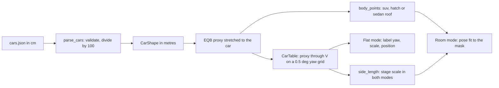
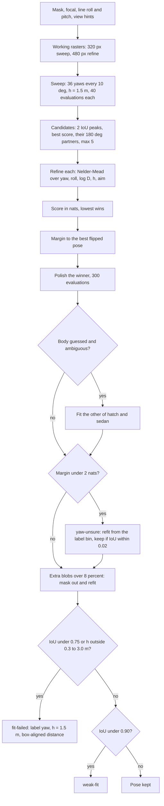

# Car dimensions and orientation

## In short

- The car's real size comes from `cars.json`, in centimetres. It is checked, divided by 100 and kept as a `CarShape` in metres.
- One hand-measured 3D proxy of the 2024 Mercedes-Benz EQB is stretched to those dimensions. No learned 3D model is involved.
- **Flat mode** takes the yaw from the view label in the file name. It looks the proxy up through a fixed capture camera V (4.70 m away, 16.08° down), which gives the car's height, lowest row and box offset on the stage.
- **Room mode** fits the yaw (with camera roll, distance, height and aim) by rendering the proxy through the photo's own camera and matching it to the cut-out mask. The label, the classifier and the red tail lamps mainly break the front/back tie; the label also stands in when the fit is unsure or fails.
- Both modes size the car the same way: a side view of any car spans the scene's `side_px`.

## How it works

### Loading the car

1. **Read the file.** `cars_file` in `config.toml`, default `ROOT/cars.json` ([change_background.py:76](../../background_changer/change_background.py#L76), [change_background.py:746](../../background_changer/change_background.py#L746)). A path set in `config.toml` is relative to the config's folder ([change_background.py:139-141](../../background_changer/change_background.py#L139-L141)). The file is read as UTF-8, BOM allowed ([cars.py:79](../../background_changer/bg_changer/cars.py#L79)).
2. **Validate each entry.** The rules are in the [cars.json table](#carsjson-rules) below. Any error stops the run with a message naming the car ([change_background.py:747-754](../../background_changer/change_background.py#L747-L754)).
3. **Convert to metres.** Every dimension is divided by 100 into a frozen `CarShape(length, width, height, wheelbase, name, body)` ([cars.py:69-70](../../background_changer/bg_changer/cars.py#L69-L70), [carmodel.py:97-106](../../background_changer/bg_changer/carmodel.py#L97-L106)). The cars are kept by their trimmed, lower-case `carModel` ([cars.py:66](../../background_changer/bg_changer/cars.py#L66)).
4. **Check again in metres.** `CarShape` rejects non-positive values, a wheelbase that is not shorter than the length, a length outside 1.0-20.0 m and a height outside 0.5-6.0 m ([carmodel.py:108-116](../../background_changer/bg_changer/carmodel.py#L108-L116)). This also guards a `CarShape` built directly from Python.
5. **Choose the car.** `car` in `config.toml`, or `--car` on the command line, which wins ([change_background.py:689](../../background_changer/change_background.py#L689), [change_background.py:745](../../background_changer/change_background.py#L745)). The name is matched ignoring case and surrounding spaces ([cars.py:85-91](../../background_changer/bg_changer/cars.py#L85-L91)). No car, or an unknown one, stops the run with the list of available names ([change_background.py:749-752](../../background_changer/change_background.py#L749-L752)). The shipped `config.toml` chooses the Baleno ([config.toml:16](../../background_changer/config.toml#L16)).
6. **Build one `CarTable`** from the chosen shape for the whole run ([change_background.py:755](../../background_changer/change_background.py#L755)).

**Width means the body width without mirrors** ([cars.py:11](../../background_changer/bg_changer/cars.py#L11), [carmodel.py:99](../../background_changer/bg_changer/carmodel.py#L99)).

The repo ships two cars ([cars.json:1-18](../../background_changer/cars.json#L1-L18)):

| carModel | length | width | height | WheelBase | body |
|---|---|---|---|---|---|
| Mercedes-Benz EQB 2024 | 468.4 | 183.4 | 166.7 | 282.9 | suv |
| Maruti Suzuki Baleno 2022 | 399.0 | 174.5 | 150.0 | 252.0 | hatch |

The Baleno is the Indian-market model, 1500 mm tall ([findings.md: Low-resolution input](../../background_changer/docs/findings.md#low-resolution-input-sample_vid-and-the-background-scaler)).

### Building the proxy

1. **Start from the EQB.** The reference is the 2024 EQB measured from the walkaround frames: lower body with apron and bumpers, greenhouse with a sloped windscreen, roof rails, mirrors and four tyres ([carmodel.py:11-14](../../background_changer/bg_changer/carmodel.py#L11-L14)). Its numbers are in the [reference proxy table](#reference-proxy-eqb-metres).
2. **Sample the body in sections along X.** 60 evenly spaced sections run from the rear tip to the front tip, plus two sections at each kink ([carmodel.py:58-63](../../background_changer/bg_changer/carmodel.py#L58-L63)). Each section has a bottom and a top height on both sides; consecutive sections form convex slabs.
3. **Stretch it to the car.** X is mapped piecewise-linearly through the rear tip, the two axles and the front tip, so overhangs and wheelbase stretch separately. Y scales with width, Z with height ([carmodel.py:134-145](../../background_changer/bg_changer/carmodel.py#L134-L145)).
4. **Add four tyres** at the stretched axles and track. Each tyre touches the floor at z = 0 ([carmodel.py:146-153](../../background_changer/bg_changer/carmodel.py#L146-L153)).
5. **Derive contacts and footprint.** Contacts are the four tyre floor points, in the order FL, FR, RL, RR ([carmodel.py:156-159](../../background_changer/bg_changer/carmodel.py#L156-L159)). The footprint is a rounded rectangle used for shadows ([carmodel.py:161-171](../../background_changer/bg_changer/carmodel.py#L161-L171)); see [06-3d-room-rendering.md](06-3d-room-rendering.md).
6. **Room mode only: apply the body preset.** `suv` keeps the EQB roof; `hatch` and `sedan` replace the roof line ([pose.py:65-78](../../background_changer/car_fit_to_bg/pose.py#L65-L78)). Flat mode always projects `CarShape.points()`, the EQB roof ([carmodel.py:226](../../background_changer/bg_changer/carmodel.py#L226)).
7. **Room mode only: guess the body when `cars.json` has none.** Height at least 1.60 m gives `suv`; otherwise length under 4.10 m gives `hatch`, else `sedan` ([pose.py:81-84](../../background_changer/car_fit_to_bg/pose.py#L81-L84)). The photo is flagged `body-guessed` and `body_source = guess` ([__init__.py:118-122](../../background_changer/car_fit_to_bg/__init__.py#L118-L122)). Both shipped cars set `body`, so they never take this path.
8. **Room mode only: try the other body when the guess is unsure.** A guessed car under 1.60 m tall and under 4.30 m long also gets the other of hatch/sedan fitted ([pose.py:87-88](../../background_changer/car_fit_to_bg/pose.py#L87-L88), [__init__.py:123-124](../../background_changer/car_fit_to_bg/__init__.py#L123-L124)). The rule is in [Decision thresholds](#decision-thresholds-room-mode).

**Coordinates.** Car frame: X forward, Y left, Z up, origin = the middle of the wheelbase on the floor ("footprint centre"). Yaw 0 = the front faces the camera, 90 = the right side, 180 = the rear, 270 = the left side, as the view classifier uses them ([carmodel.py:16-18](../../background_changer/bg_changer/carmodel.py#L16-L18), [pose.py:17-18](../../background_changer/car_fit_to_bg/pose.py#L17-L18)).

### Flat mode: yaw and size

The car's pixels may only be scaled down and moved in flat mode. So the car keeps the walkaround's viewpoint: close (about 3.4-4.6 m) and about 16° down. The capture camera V models that viewpoint ([carmodel.py:3-9](../../background_changer/bg_changer/carmodel.py#L3-L9)). It is a constant of the method, not an input.

1. **Read the label.** The file name `<time>s_<label>_<conf>pct`, for example `0012.0s_right_95pct`, gives the view label and the classifier's confidence in percent ([probe.py:16-33](../../background_changer/bg_changer/probe.py#L16-L33)). `frame_view_type` writes these names ([classify_video.py:177](../../frame_view_type/classify_video.py#L177)); see [frame_view_type](../frame_view_type/README.md).
2. **Label to yaw.** The yaw is the label's bin centre, with an uncertainty `sigma` of 15°, or 25° when the confidence is under 60% (flag `low-conf-label`) ([yaw.py:16-21](../../background_changer/bg_changer/yaw.py#L16-L21), [yaw.py:32-37](../../background_changer/bg_changer/yaw.py#L32-L37)).
3. **No label.** `sigma` = 30°, flag `no-view-label`. A cut-off car gets 90°. Otherwise the bin whose predicted aspect, divided by 1.05, best matches the photo's aspect wins ([yaw.py:40-47](../../background_changer/bg_changer/yaw.py#L40-L47)). Left/right and front-left/front-right look alike, so the side may be wrong.
4. **Override.** The Python API's `yaw_deg` gives `sigma` = 3° ([yaw.py:52-53](../../background_changer/bg_changer/yaw.py#L52-L53), [bg_changer/__init__.py:67](../../background_changer/bg_changer/__init__.py#L67)). The command line never passes one ([change_background.py:333](../../background_changer/change_background.py#L333)).
5. **Look up the view.** `CarTable` projects the proxy through V for every yaw on a 0.5° grid (720 yaws) and interpolates linearly in between ([carmodel.py:216-257](../../background_changer/bg_changer/carmodel.py#L216-L257)). Each `ViewRow` holds the roof row `top`, the lowest row `low`, the extremes `x0`/`x1`, the column of the lowest point `low_x`, and the four contacts' columns, rows, local scales and visibility ([carmodel.py:174-203](../../background_changer/bg_changer/carmodel.py#L174-L203)). All values are in **anchor metres**: `px = anchor + px_per_m * value` ([carmodel.py:20-21](../../background_changer/bg_changer/carmodel.py#L20-L21)).
6. **Stage scale.** `px_per_m = side_px * size / side_length`, with `side_length` the proxy's silhouette width at yaw 90 ([base.py:63](../../background_changer/bg_changer/scenes/base.py#L63), [carmodel.py:259-261](../../background_changer/bg_changer/carmodel.py#L259-L261)). So a side view of any car spans `side_px`. Every car fills the stage the same way; the dimensions set its proportions and how strongly its near end comes forward in end views ([cars.py:11-13](../../background_changer/bg_changer/cars.py#L11-L13)).
7. **Shrink the stage for big cars.** When a background is loaded, every view (yaw 0-355 in 5° steps) must keep a margin from the left, right and top edges, and its lowest row must stay above a limit. If not, `size` is multiplied by 0.97, up to 60 times, with a warning ([scenes/\_\_init\_\_.py:22-23](../../background_changer/bg_changer/scenes/__init__.py#L22-L23), [scenes/\_\_init\_\_.py:30-67](../../background_changer/bg_changer/scenes/__init__.py#L30-L67)). This lowers `px_per_m` for every photo on that background. Separately, `background_scaler` shrinks a background (and its `side_px`) instead of enlarging small cars ([rescale.py:53](../../background_changer/background_scaler/rescale.py#L53), [README: Small photos](../../background_changer/README.md#small-photos-background_scaler)).
8. **Scale the photo.** `s = min(1, px_per_m * h_rel(yaw) / H_photo)`, where `h_rel = low - top` and `H_photo` is the car's solid height in the photo ([placement.py:109-114](../../background_changer/bg_changer/placement.py#L109-L114), [placement.py:133-137](../../background_changer/bg_changer/placement.py#L133-L137)). The car is never enlarged; above 1.01 it is flagged `scale-capped`. If the photo cuts the car at the top or bottom, width is used instead (formula below).
9. **Place it vertically.** The bottom edge of the car's lowest solid row lands on `anchor_y + px_per_m * low(yaw)` ([placement.py:145-151](../../background_changer/bg_changer/placement.py#L145-L151)).
10. **Place it horizontally.** The box centre goes to `anchor_x + px_per_m * cx_smoothed(yaw, sigma)`, a Gaussian-weighted mean of the predicted box-centre offset over the yaw's uncertainty ([placement.py:162-164](../../background_changer/bg_changer/placement.py#L162-L164), [carmodel.py:263-270](../../background_changer/bg_changer/carmodel.py#L263-L270)). A wrong label near an end view therefore does not throw the car sideways.
11. **Cut-off cars** (`cut_frames`, flat default `"anchor"`; `"frame"` means the same ([change_background.py:722-726](../../background_changer/change_background.py#L722-L726))):
    - **Cut on a side and at top/bottom:** not placed. `cut_frames = "skip"`: any cut photo is left out ([placement.py:97-106](../../background_changer/bg_changer/placement.py#L97-L106)).
    - **Only the bottom cut, `"anchor"`:** the photo's lowest row is the photo edge, so the intact roof is pinned at `anchor_y + px_per_m * top(yaw)` instead ([placement.py:148-149](../../background_changer/bg_changer/placement.py#L148-L149)). With `"centre"` the car is still pinned by its lowest row, which is the photo edge.

      > Note: the README says a bottom-cut car "is placed by its intact roof" without the `"anchor"` condition ([README.md: Flat mode](../../background_changer/README.md#flat-mode)).
    - **One side cut, `"anchor"`:** the uncut edge goes where the whole car's edge would be, moved inward by a small bias for the 5% narrower photos ([placement.py:153-161](../../background_changer/bg_changer/placement.py#L153-L161)). With `"centre"`, or with both sides cut, the box centre rule applies.
12. **Guard and check.** The car is moved at most 100 px (times the background's `px_scale`) to keep it on the canvas and above `max_lowest_row` (flag `near-edge`); whatever still sticks out is flagged `cropped` ([placement.py:166-180](../../background_changer/bg_changer/placement.py#L166-L180), [base.py:86-88](../../background_changer/bg_changer/scenes/base.py#L86-L88)). The `hw` check flags `hw-mismatch` when width and height disagree with the proxy ([placement.py:206-207](../../background_changer/bg_changer/placement.py#L206-L207), [placement.py:219-221](../../background_changer/bg_changer/placement.py#L219-L221)).
13. **Floor effects follow the pasted car.** V's predicted drawing is mapped onto the pasted car by its ends and lowest point, so shadows follow the real car even when the label's yaw is off ([placement.py:184-231](../../background_changer/bg_changer/placement.py#L184-L231)). Grounding itself is in [06-3d-room-rendering.md](06-3d-room-rendering.md).

**Why height, not width.** Width is cut off in 5 of the 20 EQB frames, and height scatters less (2.4% vs 2.9%) ([findings.md: Per frame](../../background_changer/docs/findings.md#per-frame)). Real photos also come out about 5% narrower than V predicts at equal height (`ASPECT_BIAS` = 1.05), so width needs a correction that height does not.

**What V predicts.** Through V the EQB's `h_rel` is 2.494 anchor metres for a front view, 2.151 for a side view and 2.756 for a rear view ([test_carmodel.py:19-24](../../background_changer/tests/test_carmodel.py#L19-L24)). Front views come out taller than side views, and rear views taller still, because the near end swings toward the camera. On background_1 (about 233 px/m) that is about 581 px (front), 501 px (side) and 642 px (rear). The older note rounds these to front ≈ 580, side ≈ 500 and rear ≈ 640 ([findings.md: Per frame](../../background_changer/docs/findings.md#per-frame)).

### Room mode: the pose fit

Room mode measures the angle instead of trusting the label. It renders the proxy (with its body preset) through the photo's own pinhole camera and fits it to the cut-out mask. The focal length and the line camera's roll and pitch come from [05-camera-angle.md](05-camera-angle.md); the principal point is the frame centre `((W-1)/2, (H-1)/2)` ([__init__.py:115](../../background_changer/car_fit_to_bg/__init__.py#L115), [pose.py:296](../../background_changer/car_fit_to_bg/pose.py#L296)).

**Unknowns per photo** ([pose.py:1-7](../../background_changer/car_fit_to_bg/pose.py#L1-L7), [pose.py:345-402](../../background_changer/car_fit_to_bg/pose.py#L345-L402)):

| Unknown | Meaning | Initial simplex step |
|---|---|---|
| yaw | which way the car faces, degrees | 3.0° |
| roll | camera roll relative to the car's floor, degrees | 1.0° |
| log D | log of the distance from the camera to the footprint centre, metres | 0.03 |
| h | camera height above the car's floor, metres; angle down `delta = asin(h / D)` | 0.08 m |
| aim x, aim y | the pixel where the footprint centre appears (working px) | 1.5 px, 1.5 px |

**Before the fit.**
- A photo with fewer than 400 solid car pixels, or a car covering more than 90% of the frame, is not fitted ([__init__.py:35-36](../../background_changer/car_fit_to_bg/__init__.py#L35-L36), [__init__.py:110-114](../../background_changer/car_fit_to_bg/__init__.py#L110-L114)).
- A photo cut at the bottom, or cut on two or more sides, is not placed; with `cut_frames = "skip"` any cut photo is left out ([batch.py:124-131](../../background_changer/car_fit_to_bg/batch.py#L124-L131), [change_background.py:540-548](../../background_changer/change_background.py#L540-L548)).
- Photos with strong background lines are fitted first, so their camera heights can help the weak-line photos ([change_background.py:526-527](../../background_changer/change_background.py#L526-L527), [change_background.py:558-560](../../background_changer/change_background.py#L558-L560)).

**The search** ([pose.py:474-613](../../background_changer/car_fit_to_bg/pose.py#L474-L613)):

1. **Working rasters.** The mask's box plus 30% padding is cut out and scaled so the car's long side is 320 px for the sweep and 480 px for refinement. The focal is scaled to match ([pose.py:285-299](../../background_changer/car_fit_to_bg/pose.py#L285-L299), [pose.py:485-486](../../background_changer/car_fit_to_bg/pose.py#L485-L486)).
2. **Priors.** Strong lines give priors on the camera's pitch and roll; weak lines give a prior on the camera height. The same priors are used for every refinement, so all candidates are judged by one energy ([pose.py:490-495](../../background_changer/car_fit_to_bg/pose.py#L490-L495)).
3. **Sweep.** 36 yaws, 0 to 350 in 10° steps, at a fixed camera height of 1.5 m. Each is a short Nelder-Mead fit (40 evaluations) from a box-aligned start, with yaw and height fixed. Roll is fixed to the lines' roll when the lines are strong, otherwise free. The sweep uses no priors ([pose.py:501-508](../../background_changer/car_fit_to_bg/pose.py#L501-L508)).
4. **Box-aligned start.** For a given yaw and height, the distance is chosen so the proxy, scaled to the mask's box, agrees with `f / D`. The aim puts the box centre (or the uncut side) and the lowest point (or the roof, if the bottom is cut) on the mask ([pose.py:303-326](../../background_changer/car_fit_to_bg/pose.py#L303-L326)).
5. **Candidates.** The 2 best circular local maxima of the sweep's IoU, plus the sweep yaw with the best score (hints included). For each of these, the best-scoring yaw within ±40° of its 180° partner is added. Candidates closer than 15° are merged (best score first) and at most 5 are kept ([pose.py:510-520](../../background_changer/car_fit_to_bg/pose.py#L510-L520)).
6. **Refine.** Each candidate is refitted on the 480 px raster with Nelder-Mead over all six unknowns (250 evaluations). The top candidate also gets a second start at yaw + 8° ([pose.py:522-534](../../background_changer/car_fit_to_bg/pose.py#L522-L534)).
7. **Score and pick.** Each refined pose is scored in nats; the lowest wins ([pose.py:497-499](../../background_changer/car_fit_to_bg/pose.py#L497-L499), [pose.py:537-539](../../background_changer/car_fit_to_bg/pose.py#L537-L539)).
8. **Margin and flip check.** The margin is how many nats the winner beats the best pose turned round. `flip-ambiguous` is set when a pose near the exact flip fits about as well ([pose.py:540-544](../../background_changer/car_fit_to_bg/pose.py#L540-L544)).
9. **Polish.** The winner is refitted (300 evaluations, start height clamped to 1.05-2.15 m) and the refit is kept unless its energy is higher ([pose.py:546-550](../../background_changer/car_fit_to_bg/pose.py#L546-L550)).
10. **Other body.** For a guessed, ambiguous body, the other of hatch/sedan is fitted from the polished pose ([pose.py:551-558](../../background_changer/car_fit_to_bg/pose.py#L551-L558)).
11. **Unsure yaw.** Under 2 nats of margin the fit is flagged `yaw-unsure`. If the file name has a label, a fit started at the label's bin (300 evaluations) replaces the winner when its IoU is within 0.02 ([pose.py:561-567](../../background_changer/car_fit_to_bg/pose.py#L561-L567)).
12. **Residual blobs.** Leftovers between the mask and the fitted proxy are classified. Extra mask blobs over 8% of the car's area are masked out and the pose is refitted; blobs over 3% raise flags ([pose.py:412-439](../../background_changer/car_fit_to_bg/pose.py#L412-L439), [pose.py:569-591](../../background_changer/car_fit_to_bg/pose.py#L569-L591)).
13. **Quality.** IoU and camera height decide `fit-failed`, `weak-fit` and `camera-height-at-bound` ([pose.py:593-605](../../background_changer/car_fit_to_bg/pose.py#L593-L605)). A failed fit is placed with the label's yaw.
14. **Report.** `yaw_change` against the label, `yaw-vs-label` above 24°, and `fit_margin` (only when below 90) go to `results.csv` ([change_background.py:449-460](../../background_changer/change_background.py#L449-L460)).

**Where the hints come from.**
- **Classifier probabilities.** `frame_view_type/output/<images folder name>/results.csv`, if it exists ([batch.py:56-60](../../background_changer/car_fit_to_bg/batch.py#L56-L60)), read once per run ([change_background.py:807-811](../../background_changer/change_background.py#L807-L811)). Rows are matched by file stem; the `prob_<label>` columns give the 8 bin probabilities ([pose.py:186-197](../../background_changer/car_fit_to_bg/pose.py#L186-L197)).
- **File-name label.** Without a classifier row, the label gets `p = clamp(conf/100, 0.3, 0.95)` (conf 60 when missing) and each other bin `(1 - p)/7` ([pose.py:200-206](../../background_changer/car_fit_to_bg/pose.py#L200-L206), [batch.py:63-69](../../background_changer/car_fit_to_bg/batch.py#L63-L69)).
- The file-name label is also passed on its own, for the `yaw-unsure` label refit and the `fit-failed` fallback.
- **Neither:** the prior is 0, the outline alone decides, and the photo is flagged `no-view-label` ([batch.py:92-93](../../background_changer/car_fit_to_bg/batch.py#L92-L93)).
- **Red tail lamps.** Red pixels on the car, and which end they sit at, penalise poses that contradict them ([pose.py:216-263](../../background_changer/car_fit_to_bg/pose.py#L216-L263)). A red car switches the cue off.

> Note: the classifier's `angle_deg` column is read ([pose.py:193](../../background_changer/car_fit_to_bg/pose.py#L193)) but never used. Only the 8 bin probabilities and the file-name bin label drive the yaw.

**After the fit.** The levelling step may refit the pose with the car's own roll on a slope (`car-on-slope`), and the tyre contact lock runs only when IoU is at least 0.90 and the fit did not fail ([__init__.py:135-163](../../background_changer/car_fit_to_bg/__init__.py#L135-L163), [__init__.py:176-180](../../background_changer/car_fit_to_bg/__init__.py#L176-L180)). Both are in [05-camera-angle.md](05-camera-angle.md).

**Size on the stage in room mode.** The same stage rule, in room units: `sigma = (side_px * size / side_length) / room.px_per_unit_at(S)` room units per car metre, with `side_length` taken through V as in flat mode ([__init__.py:183](../../background_changer/car_fit_to_bg/__init__.py#L183)) and without flat mode's automatic shrink ([place.py:54-56](../../background_changer/car_fit_to_bg/place.py#L54-L56), [place.py:110-111](../../background_changer/car_fit_to_bg/place.py#L110-L111), [change_background.py:422-429](../../background_changer/change_background.py#L422-L429)). The rest is in [06-3d-room-rendering.md](06-3d-room-rendering.md).

**A background without a room** in room mode gets the flat placement, with the fitted yaw at `sigma` = 10° and `cut_frames = "anchor"` ([change_background.py:583-586](../../background_changer/change_background.py#L583-L586), [change_background.py:612-616](../../background_changer/change_background.py#L612-L616), [change_background.py:637](../../background_changer/change_background.py#L637)).

## The maths and constants

### cars.json rules

| Rule | Value | Meaning | Code |
|---|---|---|---|
| Format | non-empty JSON array of objects | one object per car | [cars.py:44-50](../../background_changer/bg_changer/cars.py#L44-L50) |
| `carModel` | required, non-empty text, trimmed | key spelled exactly; `carmodel` fails | [cars.py:51-54](../../background_changer/bg_changer/cars.py#L51-L54) |
| `length`, `width`, `height`, `WheelBase` | required, cm | key matched in any capitalisation (only these four) | [cars.py:23](../../background_changer/bg_changer/cars.py#L23), [cars.py:31-36](../../background_changer/bg_changer/cars.py#L31-L36) |
| Number check | int or float, > 0; `true`/`false` rejected | | [cars.py:37-39](../../background_changer/bg_changer/cars.py#L37-L39) |
| Millimetre check | `max(length, width, height) > 2000` | "looks like millimetres" error | [cars.py:57-58](../../background_changer/bg_changer/cars.py#L57-L58) |
| Metre check | `max(length, width, height) < 20` | "looks like metres" error | [cars.py:59-60](../../background_changer/bg_changer/cars.py#L59-L60) |
| Wheelbase | `WheelBase < length` | | [cars.py:61-62](../../background_changer/bg_changer/cars.py#L61-L62) |
| `body` | optional; `suv`, `hatch` or `sedan`, trimmed, any case | key spelled exactly | [cars.py:24](../../background_changer/bg_changer/cars.py#L24), [cars.py:63-65](../../background_changer/bg_changer/cars.py#L63-L65) |
| Duplicates | same `carModel` ignoring case and spaces | error | [cars.py:66-68](../../background_changer/bg_changer/cars.py#L66-L68) |
| cm to m | divide by 100 | into `CarShape` | [cars.py:69-70](../../background_changer/bg_changer/cars.py#L69-L70) |
| `CarShape` checks | all > 0; wheelbase < length; 1.0 <= length <= 20.0 m; 0.5 <= height <= 6.0 m | second, metre-level check | [carmodel.py:108-116](../../background_changer/bg_changer/carmodel.py#L108-L116) |

The millimetre and metre checks look at length, width and height only, not at `WheelBase`.

### Reference proxy (EQB, metres)

| Name | Value | Meaning | Code |
|---|---|---|---|
| `REF_LENGTH`, `REF_WIDTH`, `REF_HEIGHT`, `REF_WHEELBASE` | 4.684, 1.834, 1.667, 2.829 | 2024 EQB | [carmodel.py:36](../../background_changer/bg_changer/carmodel.py#L36) |
| `REF_XF`, `REF_XR` | +2.3135, -2.3705 | front and rear tips; overhangs 0.899 and 0.956 | [carmodel.py:37](../../background_changer/bg_changer/carmodel.py#L37) |
| `REF_HALF_W` | 0.917 | plan half-width | [carmodel.py:38](../../background_changer/bg_changer/carmodel.py#L38) |
| `REF_HALF_TRACK` | 0.7925 | half the track | [carmodel.py:39](../../background_changer/bg_changer/carmodel.py#L39) |
| `REF_TYRE_R`, `REF_TYRE_W` | 0.358, 0.235 | tyre radius and width (235/55R18, about 716 mm across) | [carmodel.py:40](../../background_changer/bg_changer/carmodel.py#L40) |
| `FRONT_OVERHANG_SHARE` | 0.4846 | `(2.3135 - 2.829/2) / (4.684 - 2.829)` = 0.899 / 1.855 | [carmodel.py:41](../../background_changer/bg_changer/carmodel.py#L41) |
| `FOOTPRINT_CORNER_R` | 0.35 | footprint corner radius (shadows) | [carmodel.py:42](../../background_changer/bg_changer/carmodel.py#L42) |
| `SECTION_STEP` | 0.08 | sets the number of sections: `ceil(4.684 / 0.08) + 1` = 60 | [carmodel.py:43](../../background_changer/bg_changer/carmodel.py#L43), [carmodel.py:60](../../background_changer/bg_changer/carmodel.py#L60) |
| `TYRE_POINTS` | 48 | points per tyre circle | [carmodel.py:44](../../background_changer/bg_changer/carmodel.py#L44) |
| Breakpoints | 1.95, -1.95, 2.15, 1.10, XF - 0.40, XR + 0.30 | each adds sections at b - 0.0001 and b + 0.0001 | [carmodel.py:58-61](../../background_changer/bg_changer/carmodel.py#L58-L61) |
| Plan corners | r 0.40 at the front, r 0.30 at the rear | rounded plan outline | [carmodel.py:47-53](../../background_changer/bg_changer/carmodel.py#L47-L53) |
| Lower body bottom | z 0.30 for x > 1.95 (apron), 0.40 for x < -1.95 (rear bumper), 0.20 elsewhere (sills) | | [carmodel.py:65](../../background_changer/bg_changer/carmodel.py#L65) |
| Lower body top | z 1.08 (beltline); bonnet x 1.10-2.15 falls 1.08 to 0.92; nose x >= 2.15 falls 0.92 to 0.75 at the tip | | [carmodel.py:66-70](../../background_changer/bg_changer/carmodel.py#L66-L70) |
| Greenhouse | x -2.32 to 1.10; base z 1.08, half-width `min(0.84, plan)` | | [carmodel.py:76-77](../../background_changer/bg_changer/carmodel.py#L76-L77) |
| Roof and windscreen | z 1.64 for x <= 0.35; `z = 1.08 + 0.56 * (1.10 - x) / 0.75` for x > 0.35 | sloped windscreen | [carmodel.py:78](../../background_changer/bg_changer/carmodel.py#L78) |
| Greenhouse top width | `0.84 - 0.20 * (z - 1.08) / 0.56` | 0.84 at the beltline to 0.64 at the roof | [carmodel.py:79](../../background_changer/bg_changer/carmodel.py#L79) |
| Roof rails | boxes x -2.0 to 0.25, abs(y) 0.53 to 0.59, z 1.64 to 1.667 | | [carmodel.py:84-90](../../background_changer/bg_changer/carmodel.py#L84-L90) |
| Mirrors | boxes x 0.85 to 1.05, abs(y) 0.88 to 1.01, z 0.98 to 1.16 | | [carmodel.py:84-90](../../background_changer/bg_changer/carmodel.py#L84-L90) |

The sections are evenly spaced, so the real spacing is 4.684 / 59 = 0.0794 m. With the 12 breakpoint sections there are 72 sections, 48 of them inside the greenhouse (the first at x = -2.2911, the last at 1.0999). The proxy has 896 vertices.

> Note: `SECTION_STEP` is 0.08 m but only sets the count; the spacing is 0.0794 m, and the first greenhouse section is at -2.2911, not -2.32.

> Note: the [carmodel.py:14](../../background_changer/bg_changer/carmodel.py#L14) docstring rounds the front-overhang share to 48.5%; the constant is 0.4846.

### Stretch rules

| Name | Formula | Meaning | Code |
|---|---|---|---|
| Front tip | `front_tip = WB/2 + 0.4846 * (L - WB)` | front overhang keeps the EQB's share | [carmodel.py:118-120](../../background_changer/bg_changer/carmodel.py#L118-L120) |
| Rear tip | `rear_tip = front_tip - L` | | [carmodel.py:122-124](../../background_changer/bg_changer/carmodel.py#L122-L124) |
| X | piecewise linear through `(-2.3705, -1.4145, +1.4145, +2.3135)` to `(rear_tip, -WB/2, +WB/2, front_tip)` | overhangs and wheelbase stretch separately | [carmodel.py:134-138](../../background_changer/bg_changer/carmodel.py#L134-L138) |
| Y, Z | `y = y_ref * W / 1.834`, `z = z_ref * H / 1.667` | | [carmodel.py:143-145](../../background_changer/bg_changer/carmodel.py#L143-L145) |
| Track | `half_track = 0.7925 * W / 1.834` | track = 0.864 W | [carmodel.py:126-128](../../background_changer/bg_changer/carmodel.py#L126-L128) |
| Tyre | `r = 0.358 * H / 1.667`; half width `0.5 * 0.235 * W / 1.834` | diameter = 0.43 H | [carmodel.py:130-132](../../background_changer/bg_changer/carmodel.py#L130-L132), [carmodel.py:146-147](../../background_changer/bg_changer/carmodel.py#L146-L147) |
| Tyres | centres `(±WB/2, ±half_track, r)`; two 48-point circles each, at y = centre ± half width | touch the floor at z = 0 | [carmodel.py:148-153](../../background_changer/bg_changer/carmodel.py#L148-L153) |
| Contacts | `(±WB/2, ±half_track, 0)`, order FL, FR, RL, RR | tyre floor points | [carmodel.py:156-159](../../background_changer/bg_changer/carmodel.py#L156-L159) |
| Contact visible | side or end faces V: `sin(yaw)` or `cos(yaw)` beyond ±0.17 (about 10°) | | [carmodel.py:206-213](../../background_changer/bg_changer/carmodel.py#L206-L213) |
| Footprint | rounded rectangle rear tip to front tip, ±W/2, corner `0.35 * W / 1.834` | shadows | [carmodel.py:161-171](../../background_changer/bg_changer/carmodel.py#L161-L171) |

Worked example, computed from `carmodel.py`:

| | EQB | Baleno |
|---|---|---|
| L x W x H, WB (m) | 4.684 x 1.834 x 1.667, 2.829 | 3.99 x 1.745 x 1.50, 2.52 |
| Front / rear overhang (m) | 0.899 / 0.956 | 0.712 / 0.758 |
| Half-track (m) | 0.7925 | 0.754 |
| Tyre radius (m) | 0.358 | 0.322 |
| `side_length` through V (anchor m) | 5.786 | 4.857 |
| `h_rel` at yaw 0 / 90 / 180 (anchor m) | 2.494 / 2.151 / 2.756 | 2.095 / 1.905 / 2.226 |

### Body presets (room mode)

| Preset | Roof line: reference x to roof z | Other changes | Code |
|---|---|---|---|
| `suv` | the EQB: flat 1.64 back to the tailgate | none | [pose.py:65-68](../../background_changer/car_fit_to_bg/pose.py#L65-L68) |
| `hatch` | x -2.32, -1.90, -0.90, 0.10, 1.10 to z 1.12, 1.50, 1.64, 1.64, 1.08 | roof narrowed; no roof rails | [pose.py:60](../../background_changer/car_fit_to_bg/pose.py#L60), [pose.py:68-77](../../background_changer/car_fit_to_bg/pose.py#L68-L77) |
| `sedan` | x -2.32, -1.75, -1.20, -0.80, 0.10, 1.10 to z 1.08, 1.12, 1.55, 1.64, 1.64, 1.08 | roof narrowed; no roof rails | [pose.py:61](../../background_changer/car_fit_to_bg/pose.py#L61), [pose.py:68-77](../../background_changer/car_fit_to_bg/pose.py#L68-L77) |
| Roof half-width (hatch, sedan) | `min(plan half-width, 0.84 - 0.20 * (clip(z, 1.08, 1.64) - 1.08) / 0.56)` | | [pose.py:70](../../background_changer/car_fit_to_bg/pose.py#L70) |
| "No roof rails" | rails capped at `1.60 * H / 1.667` and clipped to `map_x([-0.9, 0.10])` | they sink into the flat roof | [pose.py:75-77](../../background_changer/car_fit_to_bg/pose.py#L75-L77) |
| Guess | H >= 1.60 m: suv; else L < 4.10 m: hatch; else sedan | only when `cars.json` has no `body` | [pose.py:81-84](../../background_changer/car_fit_to_bg/pose.py#L81-L84) |
| Ambiguous | guessed, H < 1.60 m and L < 4.30 m | the other of hatch/sedan is fitted too | [pose.py:87-88](../../background_changer/car_fit_to_bg/pose.py#L87-L88) |

### Capture camera V and the stage (flat mode)

| Name | Value | Meaning | Code |
|---|---|---|---|
| `CAPTURE_DISTANCE_M` | 4.70 m | slant distance from V to the footprint centre | [carmodel.py:31](../../background_changer/bg_changer/carmodel.py#L31) |
| `CAPTURE_ELEVATION_DEG` | 16.08° | V looks down this much; height `4.70 * sin(16.08°)` = 1.30 m, 4.52 m along the floor | [carmodel.py:32](../../background_changer/bg_changer/carmodel.py#L32) |
| V's focal | `px_per_m * 4.70` | | [carmodel.py:274-275](../../background_changer/bg_changer/carmodel.py#L274-L275) |
| `ASPECT_BIAS` | 1.05 | photos are about 5% narrower than V predicts at equal height | [carmodel.py:33](../../background_changer/bg_changer/carmodel.py#L33) |
| Yaw grid | 0.5° (720 yaws), linear interpolation | `CarTable` | [carmodel.py:219-231](../../background_changer/bg_changer/carmodel.py#L219-L231), [carmodel.py:244-257](../../background_changer/bg_changer/carmodel.py#L244-L257) |
| `BIN_DEG` | front 0, front-right 45, right 90, back-right 135, back 180, back-left 225, left 270, front-left 315 | label to yaw | [yaw.py:16-17](../../background_changer/bg_changer/yaw.py#L16-L17) |
| `LABEL_SIGMA` | 15° | label with conf >= 60% | [yaw.py:18](../../background_changer/bg_changer/yaw.py#L18) |
| `LOW_CONF`, `LOW_CONF_SIGMA` | 60%, 25° | below 60%: `low-conf-label` | [yaw.py:19-20](../../background_changer/bg_changer/yaw.py#L19-L20) |
| `SHAPE_SIGMA` | 30° | no label: yaw from the aspect ratio | [yaw.py:21](../../background_changer/bg_changer/yaw.py#L21) |
| Override sigma | 3° | Python API only | [yaw.py:52-53](../../background_changer/bg_changer/yaw.py#L52-L53) |
| Room fallback sigma | 10° | room mode, background without a room | [change_background.py:616](../../background_changer/change_background.py#L616) |
| `HW_RANGE` | 0.90 to 1.18 | accepted `hw` for an uncut frame (expected 1.05 ± 0.04) | [placement.py:23](../../background_changer/bg_changer/placement.py#L23) |
| One-side-cut width check | pasted width > 1.02 x predicted width | `hw-mismatch` | [placement.py:206-207](../../background_changer/bg_changer/placement.py#L206-L207) |
| `MAX_GUARD_SHIFT` | 100 px (x `px_scale`) | largest move to keep the car on the canvas | [placement.py:24](../../background_changer/bg_changer/placement.py#L24), [base.py:88](../../background_changer/bg_changer/scenes/base.py#L88) |
| `CAP_TOL` | 0.01 | `scale-capped` only above 1% enlargement | [placement.py:25](../../background_changer/bg_changer/placement.py#L25) |
| `MODULE_MARGIN`, `GENERIC_MARGIN` | 40 px, 120 px | margin every view keeps in the automatic shrink | [scenes/\_\_init\_\_.py:22-23](../../background_changer/bg_changer/scenes/__init__.py#L22-L23) |
| Shrink step | `size * 0.97`, up to 60 times; views at yaw 0-355 every 5°; lowest row <= `min(H - 30, max_lowest_row)` | automatic stage shrink | [scenes/\_\_init\_\_.py:30-50](../../background_changer/bg_changer/scenes/__init__.py#L30-L50) |
| `[scene.<name>] size` | default 1.0, allowed 0.2-3.0 | multiplies `side_px` in both modes | [base.py:47](../../background_changer/bg_changer/scenes/base.py#L47), [change_background.py:215](../../background_changer/change_background.py#L215) |
| `[scene.<name>] side_fill` | default 0.66 (generic), allowed 0.1-1.0 | `side_px = side_fill * picture width` | [base.py:178-179](../../background_changer/bg_changer/scenes/base.py#L178-L179), [generic.py:18](../../background_changer/bg_changer/scenes/generic.py#L18) |

Stage numbers at `size` = 1.0, before any shrink:

| Scene | `side_px` | Anchor (px) | EQB px/m | Baleno px/m | Code |
|---|---|---|---|---|---|
| background_1 | 1348 (about 73% of the 1761 px rim) | (958.8, 764.0) | 233.0 | 277.5 | [background_1.py:10-11](../../background_changer/bg_changer/scenes/background_1.py#L10-L11), [background_1.py:35-36](../../background_changer/bg_changer/scenes/background_1.py#L35-L36) |
| background_2 | 1243 | (960, 780) | 214.8 | 255.9 | [background_2.py:47](../../background_changer/bg_changer/scenes/background_2.py#L47), [background_2.py:52-53](../../background_changer/bg_changer/scenes/background_2.py#L52-L53) |
| background_3 | 1232 | (960, 685) | 212.9 | 253.7 | [background_3.py:24](../../background_changer/bg_changer/scenes/background_3.py#L24), [background_3.py:35-36](../../background_changer/bg_changer/scenes/background_3.py#L35-L36) |
| generic | 0.66 x width | (0.5 W, 0.72 H) | depends on width | depends on width | [generic.py:17-18](../../background_changer/bg_changer/scenes/generic.py#L17-L18), [generic.py:25-28](../../background_changer/bg_changer/scenes/generic.py#L25-L28), [generic.py:41-42](../../background_changer/bg_changer/scenes/generic.py#L41-L42) |

background_1 also keeps the car's lowest row no lower than row 946, 40 px above the near rim ([background_1.py:44](../../background_changer/bg_changer/scenes/background_1.py#L44)).

> Note: the [carmodel.py:260](../../background_changer/bg_changer/carmodel.py#L260) docstring says the EQB's side length is 5.809. The proxy gives 5.786, which [test_carmodel.py:24](../../background_changer/tests/test_carmodel.py#L24) asserts (±0.01).

> Note: the scene docstrings give the EQB at 232, ~214 and ~212 px/m ([background_1.py:11](../../background_changer/bg_changer/scenes/background_1.py#L11), [background_2.py:8](../../background_changer/bg_changer/scenes/background_2.py#L8), [background_3.py:9](../../background_changer/bg_changer/scenes/background_3.py#L9)). These equal `side_px / 5.809`, the docstring side length; with the code's 5.786 the stage scale is 233.0, 214.8 and 212.9 px/m.

> Note: README.md lists `side_fill` only for backgrounds without scene code ([README.md: Settings](../../background_changer/README.md#settings-in-configtoml)). In code `with_overrides` applies it to the three calibrated scenes too ([base.py:178-179](../../background_changer/bg_changer/scenes/base.py#L178-L179)).

### Pose fit (room mode)

| Name | Value | Meaning | Code |
|---|---|---|---|
| `TAU` | 0.02 IoU per nat | converts energy to nats | [pose.py:39](../../background_changer/car_fit_to_bg/pose.py#L39) |
| `ZN` | 0.08 m | near plane; pieces crossing it are clipped | [pose.py:40](../../background_changer/car_fit_to_bg/pose.py#L40), [pose.py:140-156](../../background_changer/car_fit_to_bg/pose.py#L140-L156) |
| Pieces | 71 lower-body slabs, 47 greenhouse slabs, 2 roof rails, 2 mirrors, 4 tyres | each drawn as an anti-aliased filled convex hull | [pose.py:49-59](../../background_changer/car_fit_to_bg/pose.py#L49-L59) |
| `H_SWEEP` | 1.5 m | camera height in the sweep and box-aligned starts | [pose.py:41](../../background_changer/car_fit_to_bg/pose.py#L41) |
| `H_LIMITS` | 1.0-2.2 m | allowed height with weak lines | [pose.py:41](../../background_changer/car_fit_to_bg/pose.py#L41) |
| `H_LIMITS_STRONG` | 0.5-3.0 m | allowed height with strong lines | [pose.py:44](../../background_changer/car_fit_to_bg/pose.py#L44) |
| `H_DEFAULT_PRIOR` | N(1.5 m, 0.25 m) | weak lines, no folder median | [pose.py:45](../../background_changer/car_fit_to_bg/pose.py#L45) |
| Folder height prior | N(median h, 0.25 m) from at least 3 fits with strong lines, IoU >= 0.9, not failed | weak lines | [batch.py:109-114](../../background_changer/car_fit_to_bg/batch.py#L109-L114) |
| Line priors | pitch N(line pitch, 3°), roll N(line roll, 3°) | strong lines: roll known and conf >= 0.5 | [pose.py:492-493](../../background_changer/car_fit_to_bg/pose.py#L492-L493), [lines.py:60-62](../../background_changer/car_fit_to_bg/lines.py#L60-L62) |
| `SWEEP_LONG`, `REFINE_LONG` | 320 px, 480 px | the car's long side in the working rasters | [pose.py:46](../../background_changer/car_fit_to_bg/pose.py#L46) |
| Window padding | 30% of the mask box on each side | | [pose.py:285](../../background_changer/car_fit_to_bg/pose.py#L285), [pose.py:290-291](../../background_changer/car_fit_to_bg/pose.py#L290-L291) |
| Sweep | 36 yaws, 10° apart; 40 evaluations; yaw and h fixed | | [pose.py:502-505](../../background_changer/car_fit_to_bg/pose.py#L502-L505) |
| Start distances | 48 geometric steps from `max(hypot(h, ext_view + 0.25), h / 0.95)` to 40 m | box-aligned start | [pose.py:310](../../background_changer/car_fit_to_bg/pose.py#L310) |
| Candidates | 2 IoU peaks + best score + partners within ±40° of the flip; > 15° apart; max 5 | | [pose.py:511-520](../../background_changer/car_fit_to_bg/pose.py#L511-L520) |
| Refinement | 250 evaluations; extra start at yaw + 8° for the top candidate | | [pose.py:524-534](../../background_changer/car_fit_to_bg/pose.py#L524-L534) |
| Nelder-Mead | steps 3.0°, 1.0°, 0.03, 0.08 m, 1.5 px, 1.5 px; `xatol` 1e-3; `fatol` 1e-5 | `scipy.optimize.minimize` | [pose.py:393-395](../../background_changer/car_fit_to_bg/pose.py#L393-L395) |
| Invalid pose | energy 1.0 when h is outside its limits, D not in (h / 0.97, 80) or abs(roll) >= 30° | | [pose.py:373-374](../../background_changer/car_fit_to_bg/pose.py#L373-L374) |
| Camera inside the car | energy `1 + need - dh` | keeps the camera outside the car's extent | [pose.py:375-378](../../background_changer/car_fit_to_bg/pose.py#L375-L378) |
| Polish | 300 evaluations, start h clamped to 1.05-2.15 m | | [pose.py:547-550](../../background_changer/car_fit_to_bg/pose.py#L547-L550) |
| Blob classification | blobs > 1% of the car area; dilation 2% of the proxy height | `occluder`, `merged-object`, `mask-reflection`, `neighbour-car` | [pose.py:412-439](../../background_changer/car_fit_to_bg/pose.py#L412-L439) |
| Blob refit | extra blobs > 8%, masked out after dilation by 3% of the proxy height | refit is kept without comparison | [pose.py:577-586](../../background_changer/car_fit_to_bg/pose.py#L577-L586) |
| Blob flags | blobs > 3% | | [pose.py:587-591](../../background_changer/car_fit_to_bg/pose.py#L587-L591) |
| `max_seconds` | 120 s | `fit-slow` flag only; the search never stops early | [pose.py:535-536](../../background_changer/car_fit_to_bg/pose.py#L535-L536) |

### Hints: classifier, label, red tail lamps

| Name | Value | Meaning | Code |
|---|---|---|---|
| Log-prior spread | 25° per bin, `k = 1 / rad(25°)^2` = 5.25 | von Mises mixture over the 8 bins | [pose.py:176-183](../../background_changer/car_fit_to_bg/pose.py#L176-L183) |
| Log-prior floor | 0.05 | the prior never goes below `log(0.05)` = -3.0 nats | [pose.py:176](../../background_changer/car_fit_to_bg/pose.py#L176) |
| Label probability | `clamp(conf/100, 0.3, 0.95)`, conf 60 if missing; `(1 - p)/7` elsewhere | file-name label without a classifier row | [pose.py:200-206](../../background_changer/car_fit_to_bg/pose.py#L200-L206) |
| Red: car pixels | alpha >= 0.5, at least 50 px | | [pose.py:218-221](../../background_changer/car_fit_to_bg/pose.py#L218-L221) |
| Red: working size | car box scaled so it is at most 420 px tall (never enlarged); largest 8-connected part kept | | [pose.py:222-230](../../background_changer/car_fit_to_bg/pose.py#L222-L230) |
| Red pixel | Lab a* > 25 (OpenCV `a - 128`) | | [pose.py:231-232](../../background_changer/car_fit_to_bg/pose.py#L231-L232) |
| Red end | red >= 0.2% of the car: -1 if over 80% of red pixels lie in the left 30% of the car's width, +1 for the right 30%, else 0 | | [pose.py:236-240](../../background_changer/car_fit_to_bg/pose.py#L236-L240) |
| Red car | red share > 0.15 | cue switched off | [pose.py:241](../../background_changer/car_fit_to_bg/pose.py#L241), [pose.py:247-248](../../background_changer/car_fit_to_bg/pose.py#L247-L248) |
| Penalty: front with red | +3 nats when red share >= 0.002 and `cos(yaw) > 0.5` | red seen, front faces the camera | [pose.py:251-253](../../background_changer/car_fit_to_bg/pose.py#L251-L253) |
| Penalty: wrong end | +4 nats when the red end is opposite the projected rear tip (tips at half height, both in front of the near plane, apart by more than 5% of the car's width) | | [pose.py:254-260](../../background_changer/car_fit_to_bg/pose.py#L254-L260) |
| Penalty: rear without red | +1.5 nats when red share < 0.0005 and `cos(yaw) < -0.5` | | [pose.py:261-262](../../background_changer/car_fit_to_bg/pose.py#L261-L262) |

**How strong the hints are.** One nat is 0.02 IoU. The classifier prior spans `log(0.05)` = -3.0 to `log(1.05)` = +0.05 nats, so it can move a pose by at most about 3 nats, or 0.06 IoU. With p = 0.95 it costs 0.37 nats at 22.5° from the bin, 1.34 at 45° and 2.81 at 180°. The red-lamp penalties of 3, 4 and 1.5 nats equal 0.06, 0.08 and 0.03 IoU.

### Decision thresholds (room mode)

| Name | Value | Effect | Code |
|---|---|---|---|
| Margin | lowest score among refined poses within ±45° of winner + 180°, minus the winner's; 99 if none | written as `fit_margin` only when below 90 | [pose.py:540-541](../../background_changer/car_fit_to_bg/pose.py#L540-L541), [change_background.py:460](../../background_changer/change_background.py#L460) |
| `UNSURE_NATS` | 2.0 | margin below this: `yaw-unsure`, label refit | [pose.py:42](../../background_changer/car_fit_to_bg/pose.py#L42), [pose.py:562-567](../../background_changer/car_fit_to_bg/pose.py#L562-L567) |
| Label wins | label fit IoU >= current IoU - 0.02 | `yaw_source = label` | [pose.py:566-567](../../background_changer/car_fit_to_bg/pose.py#L566-L567) |
| `flip-ambiguous` | a refined pose within ±20° of the exact flip with IoU >= winner - 0.01 | flag only; hidden from the console | [pose.py:542-544](../../background_changer/car_fit_to_bg/pose.py#L542-L544), [change_background.py:90](../../background_changer/change_background.py#L90) |
| Body switch | other body's IoU > kept IoU + 0.01 | body switched | [pose.py:555-556](../../background_changer/car_fit_to_bg/pose.py#L555-L556) |
| `body-ambiguous` | other body's IoU within ±0.01 of the kept one | flag | [pose.py:557-558](../../background_changer/car_fit_to_bg/pose.py#L557-L558) |
| `FAIL_IOU` | IoU < 0.75, or h outside `H_PLAUSIBLE` 0.3-3.0 m | `fit-failed`: label's bin yaw (`label-fallback`; fitted yaw if no label), h = 1.5 m, box-aligned D, roll = line roll if strong else fitted roll | [pose.py:42-43](../../background_changer/car_fit_to_bg/pose.py#L42-L43), [pose.py:596-603](../../background_changer/car_fit_to_bg/pose.py#L596-L603) |
| `[fit] on_fail` | `"place"` (default) or `"skip"` | `"skip"` leaves failed fits out | [change_background.py:574-578](../../background_changer/change_background.py#L574-L578) |
| `WEAK_IOU` | IoU < 0.90 | `weak-fit`; no tyre contact lock | [pose.py:604-605](../../background_changer/car_fit_to_bg/pose.py#L604-L605), [__init__.py:176](../../background_changer/car_fit_to_bg/__init__.py#L176) |
| `camera-height-at-bound` | h within 0.02 m of its limits | flag | [pose.py:593-595](../../background_changer/car_fit_to_bg/pose.py#L593-L595) |
| `YAW_CHANGE_LISTED` | 24° between fitted yaw and the label's bin | `yaw-vs-label` | [change_background.py:89](../../background_changer/change_background.py#L89), [change_background.py:455-458](../../background_changer/change_background.py#L455-L458) |

### Formulas

| Name | Formula | Meaning | Code |
|---|---|---|---|
| cm to m | `L = length/100`, `W = width/100`, `H = height/100`, `WB = WheelBase/100` | `CarShape` in metres | [cars.py:69-70](../../background_changer/bg_changer/cars.py#L69-L70) |
| V projection | `s = -X cos(yaw) + Y sin(yaw)`; `t = X sin(yaw) + Y cos(yaw)`; `up = Z cos(d) + s sin(d)`; `dep = D + s cos(d) - Z sin(d)`; `du = D t / dep`; `dv = -D up / dep`; D = 4.70, d = 16.08° | car point to anchor metres; `px = anchor + px_per_m * (du, dv)` | [carmodel.py:233-242](../../background_changer/bg_changer/carmodel.py#L233-L242) |
| `h_rel` | `h_rel(yaw) = low - top = max(dv) - min(dv)` over the proxy's vertices | predicted height | [carmodel.py:189-191](../../background_changer/bg_changer/carmodel.py#L189-L191), [carmodel.py:226-227](../../background_changer/bg_changer/carmodel.py#L226-L227) |
| Side length | `side_length = x1(90) - x0(90)` | silhouette width of a pure side view | [carmodel.py:259-261](../../background_changer/bg_changer/carmodel.py#L259-L261) |
| Stage scale | `px_per_m = side_px * size / side_length` | a side view spans `side_px` | [base.py:63](../../background_changer/bg_changer/scenes/base.py#L63) |
| Flat scale | `s = min(1, px_per_m * h_rel / H_photo)`; cut at top/bottom: `s = min(1, px_per_m * w_rel / (1.05 * W_photo))` | car only scaled down | [placement.py:109-114](../../background_changer/bg_changer/placement.py#L109-L114), [placement.py:137](../../background_changer/bg_changer/placement.py#L137) |
| Ground pin | `y_lowest = anchor_y + px_per_m * low(yaw)`; roof pin `y_roof = anchor_y + px_per_m * top(yaw)` | vertical placement | [placement.py:147-151](../../background_changer/bg_changer/placement.py#L147-L151) |
| Smoothed centre | `x_centre = anchor_x + px_per_m * sum(g(o) cx(yaw + o)) / sum(g(o))`, `g(o) = exp(-o^2 / (2 sigma^2))`, o from -2 sigma to +2 sigma in 0.5° steps | horizontal placement | [carmodel.py:263-270](../../background_changer/bg_changer/carmodel.py#L263-L270) |
| Cut-edge bias | `bias = 0.5 * (1 - 1/1.05) * px_per_m * w_rel` (about 2.4% of the predicted width) | uncut edge moved inward | [placement.py:154-161](../../background_changer/bg_changer/placement.py#L154-L161) |
| hw | `hw = (w_rel / W_photo) / (h_rel / H_photo)` | flag `hw-mismatch` outside 0.90-1.18 | [placement.py:219-221](../../background_changer/bg_changer/placement.py#L219-L221) |
| Shape yaw | bin minimising `abs(log(aspect(bin) / 1.05) - log(W_photo / H_photo))` | no label | [yaw.py:45-46](../../background_changer/bg_changer/yaw.py#L45-L46) |
| Angle down | `delta = asin(h / D)` | room camera elevation | [pose.py:379](../../background_changer/car_fit_to_bg/pose.py#L379) |
| View extent | `need = abs(cos yaw) * L/2 + abs(sin yaw) * W/2 + 0.15`, `dh = sqrt(D^2 - h^2)` | camera must be at least `need` away along the floor | [pose.py:166-168](../../background_changer/car_fit_to_bg/pose.py#L166-L168), [pose.py:375-378](../../background_changer/car_fit_to_bg/pose.py#L375-L378) |
| Start distance | D minimising `abs(log(f / (k D)))`, k = mask box height / projected height (width if cut at top/bottom) | box-aligned start | [pose.py:310-316](../../background_changer/car_fit_to_bg/pose.py#L310-L316) |
| Soft IoU | `IoU = sum(min(r, m)) / (sum(r) + sum(m) - sum(min(r, m)))` on uint8 rasters | outline overlap | [pose.py:159-163](../../background_changer/car_fit_to_bg/pose.py#L159-L163), [pose.py:354-358](../../background_changer/car_fit_to_bg/pose.py#L354-L358) |
| Energy | `e = -IoU + 0.01 ((pitch_implied - line_pitch)/3)^2 + 0.01 ((roll - line_roll)/3)^2` (strong lines) or `e = -IoU + 0.01 ((h - h0)/0.25)^2` (weak lines) | minimised by Nelder-Mead; `0.01 = TAU * 0.5` | [pose.py:383-390](../../background_changer/car_fit_to_bg/pose.py#L383-L390) |
| Score | `score = e / 0.02 - logprior(yaw) + red_penalty` | nats, lower is better | [pose.py:497-499](../../background_changer/car_fit_to_bg/pose.py#L497-L499) |
| Log-prior | `logprior(yaw) = log(0.05 + sum_b p_b exp(k (cos(yaw - b) - 1)))`, `k = 1 / rad(25°)^2` | classifier or label hint; 0 when unknown | [pose.py:176-183](../../background_changer/car_fit_to_bg/pose.py#L176-L183) |
| Margin | `min(score_q - score_win)` over refined q with `abs(wrap(yaw_q - yaw_win - 180)) <= 45` | how clearly the yaw beats the car turned round | [pose.py:540-541](../../background_changer/car_fit_to_bg/pose.py#L540-L541) |
| Yaw change | `abs(((yaw - BIN_DEG[label] + 180) mod 360) - 180)` | fitted yaw vs label | [change_background.py:456](../../background_changer/change_background.py#L456) |
| Room stage scale | `sigma = (side_px * size / side_length) / room.px_per_unit_at(S)` | room units per car metre | [place.py:54-56](../../background_changer/car_fit_to_bg/place.py#L54-L56) |

> Note: the [pose.py:11](../../background_changer/car_fit_to_bg/pose.py#L11) docstring gives the refinement height as 1.0-2.2 m. That is the weak-line range only; with strong lines the code allows 0.5-3.0 m ([pose.py:44](../../background_changer/car_fit_to_bg/pose.py#L44), [pose.py:492-493](../../background_changer/car_fit_to_bg/pose.py#L492-L493)).

> Note: the [pose.py:13](../../background_changer/car_fit_to_bg/pose.py#L13) docstring puts the line priors only in a final refit. In code they apply to every refinement, the polish and the extra refits; only the sweep runs without them ([pose.py:490-495](../../background_changer/car_fit_to_bg/pose.py#L490-L495)).

> Note: README.md says the outline "is turned through every angle" ([README.md: room mode](../../background_changer/README.md#how-the-car-is-placed-room-mode)). The code sweeps 36 yaws 10° apart, then refines at most 5 candidates continuously.

## Options we had

| Option | Licence | Verdict | Why |
|---|---|---|---|
| Hand-built EQB proxy, stretched per car | own code (numpy, OpenCV) | Used | Metric shape from the real dimensions; through V it reproduces Spyne's spin to about 6 px RMS; cheap to render as convex pieces. |
| Each background's own camera for the flat proxy | own code | Rejected | Farther and flatter (background_1: 6.5 m, 8.7° down). Height and width would disagree by up to 23%: 1.109 ± 0.091 vs 1.053 ± 0.038 through V, over 15 uncut frames. |
| Fixed capture camera V | own code | Used in flat mode | Models the walkaround's viewpoint; nobody has to supply camera details. |
| Fit every photo to one box (first version) | own code | Rejected | Forced every view to one height and stood cars 2.3 m in front of the turntable centre ([findings.md](../../background_changer/docs/findings.md#why-fit-to-a-box-looked-wrong)). |
| Size from width | own code | Only for top/bottom-cut photos | Width is cut in 5 of 20 frames and scatters more (2.9% vs 2.4%). |
| Label bin centre as the yaw | own code | Used in flat mode | Simple and needs no fit; up to about 24° off, which the user accepted. |
| Fitted yaw from the silhouette | own code + SciPy (BSD-3-Clause) | Used in room mode | Labels were off by up to 177° on `sample_vid`. |
| Nelder-Mead (`scipy.optimize.minimize`) | BSD-3-Clause | Used | Derivative-free, which suits an IoU computed from a rasterised render. |
| Classifier's continuous `angle_deg` | from `frame_view_type` | Not used | Read from `results.csv` but ignored; only the 8 bin probabilities enter the prior. |

For every model and approach across the project, see [01-models-and-options.md](01-models-and-options.md).

## Measured results

From the older notes, not re-measured here. Speeds were measured on an Intel i5-1240P laptop, CPU only.

- **V vs Spyne:** the proxy through V reproduces Spyne's spin of the EQB video to about 6 px RMS ([findings.md](../../background_changer/docs/findings.md#two-cameras-that-meet-at-the-stage-centre)).
- **Aspect bias:** photos are about 5% narrower than V predicts at equal height; the ratio is 1.053 ± 0.038 over 15 uncut frames (same section).
- **Flat-mode labels:** off by up to about 24° on the EQB frames, for example `0014 back-right` is really about 111° and `0032 left 47%` about 297° ([findings.md: Per frame](../../background_changer/docs/findings.md#per-frame)). On `sample_vid` the labels were off by up to 177° ([findings.md: Room mode](../../background_changer/docs/findings.md#room-mode-fitting-each-photo-and-re-rendering-the-background)).
- **Room-mode yaw:** 0 front/back flips on 32 placeable frames; yaw within 2.9° RMS (Baleno) and 1.4-1.7° (EQB) of a video-pooled fit. The worst, the half-car close-up Baleno 0006, was about 30° off and was caught by the margin test (`yaw-unsure`) (same section).
- **Speed:** the 3D fit takes about 10-20 s per photo, once whatever the number of backgrounds; flat placement takes about 1 s per background ([README.md: Speed](../../background_changer/README.md#speed)).

> Note: the [pose.py:8](../../background_changer/car_fit_to_bg/pose.py#L8) docstring says the search was tested on 34 frames without a flip; findings.md says 32 placeable frames.

## Limits

- **Flat mode's yaw is a bin centre.** The 8 labels are 45° apart, so the yaw can be off by up to about 24° ([yaw.py:3-5](../../background_changer/bg_changer/yaw.py#L3-L5)). Only the smoothed horizontal centre softens this.
- **Flat mode has one viewpoint.** It always uses the EQB roof line and the fixed camera V. Photos shot higher or closer (`sample_vid`: 21-47° down) keep their own viewpoint and can float on the background.
- **Narrow end views of a lower car** come out `hw-mismatch` (1.20-1.27 on `sample_vid`), because size comes from height ([findings.md](../../background_changer/docs/findings.md#low-resolution-input-sample_vid-and-the-background-scaler)).
- **One shape with three roofs.** Unusual bodies or half-car close-ups can be fitted some degrees off (flagged `yaw-unsure` or `weak-fit`).
- **The outline is nearly symmetric front-to-back.** Room mode relies on the classifier prior and the red tail lamps to choose. A red car switches the lamp cue off.
- **Weak background lines** leave the height to a prior: the folder median, or N(1.5, 0.25) m. See [05-camera-angle.md](05-camera-angle.md).
- **The margin is measured before the last refits.** The polish, the other-body test, the label refit and the blob refit can all change the pose after the margin is computed. The blob refit is kept without comparison, and nothing re-checks the yaw afterwards ([pose.py:539-586](../../background_changer/car_fit_to_bg/pose.py#L539-L586)).
- **Cut photos in room mode.** A car cut at the bottom, or on two or more sides, is not placed. Flat mode places bottom-cut cars by the roof (with `"anchor"`) and skips only cars cut on a side and at top/bottom.
- **`fit-slow` only reports.** The search never stops early.
- **Unit checks catch only the obvious.** Any largest dimension between 20 and 2000 passes as centimetres; `CarShape` then needs a length of 1.0-20.0 m and a height of 0.5-6.0 m.

## Further reading

- [Background changer overview](README.md), and the sibling topics: [01 models and options](01-models-and-options.md), [02 cut-out model](02-car-cutout-model.md), [03 cut-out refinement](03-cutout-refinement.md), [05 camera angle](05-camera-angle.md), [06 3D room rendering](06-3d-room-rendering.md).
- [frame_view_type](../frame_view_type/README.md): the view classifier that writes the labels and `results.csv`.
- [findings.md: Two cameras that meet at the stage centre](../../background_changer/docs/findings.md#two-cameras-that-meet-at-the-stage-centre) and [Per frame](../../background_changer/docs/findings.md#per-frame): why V, why height.
- [findings.md: Room mode](../../background_changer/docs/findings.md#room-mode-fitting-each-photo-and-re-rendering-the-background): the pose fit as first written up.
- [spyne-360-spin-findings.md](../../background_changer/docs/spyne-360-spin-findings.md): the EQB's dimensions and the walkaround measurements behind V.
- [README.md: Flat mode](../../background_changer/README.md#flat-mode), [How the car is placed (room mode)](../../background_changer/README.md#how-the-car-is-placed-room-mode) and [Output](../../background_changer/README.md#output): the user-facing description and the `results.csv` columns.
