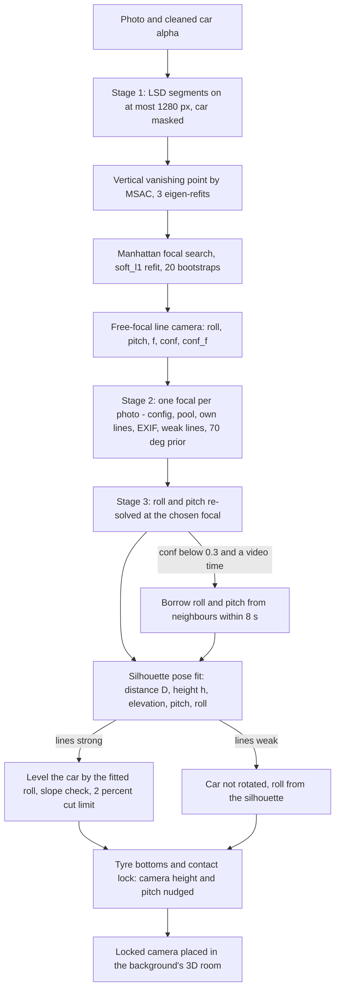

# Camera angle: roll, pitch, focal, distance and height

Part of the [background_changer docs](README.md). Room mode only (`background_view = "room"`, [config.toml:30-35](../../background_changer/config.toml#L30-L35)). Code: [`car_fit_to_bg/`](../../background_changer/car_fit_to_bg).

## In short

Room mode re-renders the background from each photo's own camera, so it must first measure that camera. **No learned calibration model is used.** Roll, pitch and focal length come from straight lines in the photo's background (OpenCV LSD, a vertical vanishing point by MSAC, a Manhattan focal search), with one focal shared by photos of the same size. Distance and camera height come from fitting the car's real-size 3D proxy to its silhouette. The car is then levelled by one rigid rotation, and the virtual camera (never the car) is nudged so the predicted tyre contacts land on the tyres in the photo.

## How it works

A run has three stages over the whole folder ([batch.py:1-9](../../background_changer/car_fit_to_bg/batch.py#L1-L9)):

1. **Measure** every photo: its line camera at a free focal ([batch.py:42-45](../../background_changer/car_fit_to_bg/batch.py#L42-L45)).
2. **Choose one focal per photo**, pooled over photos of the same size ([batch.py:48-53](../../background_changer/car_fit_to_bg/batch.py#L48-L53)).
3. **Fit** each photo: roll and pitch re-solved at that focal, video neighbours, the silhouette pose, levelling and the tyre lock ([batch.py:72-97](../../background_changer/car_fit_to_bg/batch.py#L72-L97)). Photos whose stage-1 lines are strong go first, so their camera heights can help the weak ones ([change_background.py:526-527](../../background_changer/change_background.py#L526-L527)).

### 1. Find line segments, with the car masked out

The car is curved and reflective, so only the background (buildings, kerbs, poles, LED strips) is used.

- **Downscale.** `k = min(1, 1280 / long side)`; the photo is resized with `INTER_AREA` when `k < 1`. The car mask is `alpha >= 0.5`, resized with `INTER_NEAREST` ([lines.py:257-261](../../background_changer/car_fit_to_bg/lines.py#L257-L261)). A 464x832 video still is not resized.
- **Detector.** OpenCV's Line Segment Detector, created once with `cv2.LSD_REFINE_STD` ([lines.py:41-45](../../background_changer/car_fit_to_bg/lines.py#L41-L45)), run on the grey image ([lines.py:70](../../background_changer/car_fit_to_bg/lines.py#L70)).
- **Short segments dropped.** Minimum length `max(15, 0.05 * S)` px, where `S` is half the working long side: 32 px at 1280 px ([lines.py:68](../../background_changer/car_fit_to_bg/lines.py#L68), [lines.py:72](../../background_changer/car_fit_to_bg/lines.py#L72)).
- **Car segments dropped.** The mask is dilated with a 7x7 kernel (3 px each way). Each segment is sampled at 5 evenly spaced points, ends included. It is dropped when 40% or more of them (2 of 5) fall on the dilated car ([lines.py:73-78](../../background_changer/car_fit_to_bg/lines.py#L73-L78)).
- **Normalised coordinates.** `p_n = (p - c) / S` with the principal point `c = ((W-1)/2, (H-1)/2)`, the frame centre ([lines.py:69](../../background_changer/car_fit_to_bg/lines.py#L69), [lines.py:79](../../background_changer/car_fit_to_bg/lines.py#L79)). There is no lens-distortion term anywhere.
- **Per-segment tolerance.** `th = clip(2 / L, 0.75 deg, 3 deg)` with `L` in working px: a turn about the midpoint that moves each end about 1 px. Segments over about 153 px get the 0.75 deg floor ([lines.py:85](../../background_changer/car_fit_to_bg/lines.py#L85)).
- Fewer than 3 segments left: no line camera ([lines.py:209-210](../../background_changer/car_fit_to_bg/lines.py#L209-L210)).

The mask is BiRefNet's alpha after the classical clean-up (see [02](02-car-cutout-model.md) and [03](03-cutout-refinement.md)). Stage 1 gets the segmenter's full-frame alpha ([change_background.py:876](../../background_changer/change_background.py#L876)). Stage 3 gets an alpha rebuilt from the kept crop, on the frame re-read from disk ([change_background.py:432-439](../../background_changer/change_background.py#L432-L439), [change_background.py:549-557](../../background_changer/change_background.py#L549-L557)).

### 2. The vertical vanishing point, by MSAC

Vertical edges in the world meet at one image point, the vertical vanishing point (VP). Where it sits gives roll and pitch.

- **Candidates:** segments within 40 deg of image-vertical; at least 3 are needed ([lines.py:142-145](../../background_changer/car_fit_to_bg/lines.py#L142-L145)).
- **Hypotheses:** 800 random pairs, each segment drawn with probability proportional to its length (seed 0). Pairs that pick one segment twice are dropped. Each pair's VP is the cross product of the two lines ([lines.py:146-150](../../background_changer/car_fit_to_bg/lines.py#L146-L150)).
- **Plausibility** ([lines.py:104-114](../../background_changer/car_fit_to_bg/lines.py#L104-L114), applied at [lines.py:151](../../background_changer/car_fit_to_bg/lines.py#L151)). Measured from the **image centre**, in units of `S`:
  - the VP must lie within 40 deg of the vertical through the centre;
  - below the centre (camera looking down) it must be more than **0.5 S** away; above the centre (looking up) more than **3.0 S**;
  - a VP at infinity (`v_w = 0`) always passes the distance test.

  At a 1280 px working size that is 320 px below or 1920 px above the centre. On a 464x832 still (`S = 416`) it is 208 px, so an accepted VP can lie inside the frame.
- **Score:** length-weighted MSAC, `sum(L * max(0, 1 - (E / th)^2))`, where `E` is the angle between a segment and the line from its midpoint to the VP ([lines.py:93-101](../../background_changer/car_fit_to_bg/lines.py#L93-L101)). The best hypothesis wins ([lines.py:154](../../background_changer/car_fit_to_bg/lines.py#L154)).
- **Eigen-refits:** up to 3. The inliers' interpretation-plane normals (built with a pseudo-focal of 1.2) form a length-weighted scatter matrix, and the VP is its smallest-eigenvalue eigenvector. The loop stops below 2 inliers, and a refit is kept only if it is still plausible ([lines.py:155-165](../../background_changer/car_fit_to_bg/lines.py#L155-L165)).
- No plausible VP: no line camera ([lines.py:152-153](../../background_changer/car_fit_to_bg/lines.py#L152-L153), [lines.py:212-213](../../background_changer/car_fit_to_bg/lines.py#L212-L213)).

### 3. The focal length, by a Manhattan search

Roll and pitch from the vertical VP depend on the focal. At each trial focal, the two orthogonal horizontal directions of a box-shaped (Manhattan) world predict where horizontal edges should point. The focal at which most horizontal segments agree wins.

- **Horizontal segments:** not vertical inliers, more than 5 deg off the vertical VP; the 500 longest are kept ([lines.py:214-216](../../background_changer/car_fit_to_bg/lines.py#L214-L216)).
- **Coarse grid:** 60 fields of view from 25 to 120 deg across the long side, `f_n = 1 / tan(FOV / 2)` (0.577 S to 4.51 S). At each focal, roll and pitch come from the vertical VP, and the direction angle `alpha` runs 0-89.5 deg in 0.5 deg steps. Each segment counts against the nearer of the two horizontal VPs; the best `alpha` is kept ([lines.py:168-174](../../background_changer/car_fit_to_bg/lines.py#L168-L174), [lines.py:217](../../background_changer/car_fit_to_bg/lines.py#L217), [lines.py:221-223](../../background_changer/car_fit_to_bg/lines.py#L221-L223)).
- **Fine grid:** 17 focals over `best_f * [0.92 .. 1.08]` (1% steps), and `alpha` from -1.5 to +1.4 deg around the coarse best in 0.1 deg steps ([lines.py:224-226](../../background_changer/car_fit_to_bg/lines.py#L224-L226)).
- **Peak sharpness:** `sharp = clip((peak / side - 1) / 0.3, 0, 1)`. `peak` is the best **coarse** score. `side` is the larger of the coarse score curve, interpolated in log f, at `f / 1.25` and `f * 1.25` around the **fine** winner `f` ([lines.py:227-229](../../background_changer/car_fit_to_bg/lines.py#L227-L229)). A peak 30% above its sides gives `sharp = 1`.
- **No search** when a focal is given (stage 3) or there are fewer than 5 horizontal segments ([lines.py:218](../../background_changer/car_fit_to_bg/lines.py#L218)). The focal is then the given one, or `S / tan(35 deg)` (70 deg across the long side), and `conf_f = 0` ([lines.py:230-232](../../background_changer/car_fit_to_bg/lines.py#L230-L232), [lines.py:250](../../background_changer/car_fit_to_bg/lines.py#L250)).

### 4. Robust refit and bootstrap confidences

- **Refit:** `x = [roll, pitch, alpha, log f]`, with `log f` left out when the focal is fixed. Two rounds of: label every segment to the nearest of the 3 Manhattan VPs if its error is under `th`, else outlier (only vertical candidates may join the vertical VP); then `scipy.optimize.least_squares` with `loss="soft_l1"`, `f_scale=2.0`. The residual is `sin(angle) * L / 1.41` ([lines.py:177-203](../../background_changer/car_fit_to_bg/lines.py#L177-L203)).
- **Bootstrap:** 20 resamples (seed 1). Each resamples the segments with replacement within each VP class, keeps the labels and re-solves once. Outliers are never resampled. The standard deviations give `sd_roll`, `sd_pitch`, `sd_logf`; with fewer than 2 resamples all are 0.5 ([lines.py:234-244](../../background_changer/car_fit_to_bg/lines.py#L234-L244), `n_boot` at [lines.py:254](../../background_changer/car_fit_to_bg/lines.py#L254)).
- **Confidences** ([lines.py:245-250](../../background_changer/car_fit_to_bg/lines.py#L245-L250)):
  - `sup = min(1, n_vert / 8) * min(1, sum(L_vert) / (2 S))`: enough vertical inliers, long enough in total;
  - `conf = sup * exp(-(sd_roll / 1 deg)^2 - (sd_pitch / 2 deg)^2)` for roll and pitch;
  - `conf_f = sup * sharp * min(1, n_horiz / 15) * exp(-(sd_logf / 0.08)^2)` for the focal, or 0 when it was fixed.
- With a fixed focal, `log f` is a constant in every resample, so `sd_logf = 0` carries no information.

### 5. Roll and pitch from the vertical VP

- The camera-frame "down" direction is `d = normalise(v_x, v_y, v_w * f)`, flipped so `d_y >= 0`. Then `roll = atan2(d_x, d_y)` and `pitch = asin(d_z)` ([lines.py:121-124](../../background_changer/car_fit_to_bg/lines.py#L121-L124)).
- In pixels, `d` is proportional to `(x_v - c_x, y_v - c_y, f)`. For a VP below the centre at distance `r` from it: `roll = atan2(x_v - c_x, y_v - c_y)` and `tan(pitch) = f / r`.
- **Conventions:** pitch > 0 looks down; roll > 0 means the horizon rises to the right; principal point at the frame centre ([lines.py:9-10](../../background_changer/car_fit_to_bg/lines.py#L9-L10)).
- The inverse, `d = (sin r cos p, cos r cos p, sin p)`, builds the 3 Manhattan VPs for the search and refit ([lines.py:117-138](../../background_changer/car_fit_to_bg/lines.py#L117-L138)).
- `line_camera` returns the focal in full-resolution px, `f / k` ([lines.py:267](../../background_changer/car_fit_to_bg/lines.py#L267)). ValueError, LinAlgError, FloatingPointError, too few segments or no VP give `source = "none"` and the flag `no-lines` ([lines.py:263-266](../../background_changer/car_fit_to_bg/lines.py#L263-L266)).
- The fit overlay's cyan horizon is `y_h = c_y - f * tan(pitch)` at the centre column, rising right by `tan(roll)` per px ([__init__.py:210-215](../../background_changer/car_fit_to_bg/__init__.py#L210-L215)). It is drawn from the stage-3 (or borrowed) line camera.

### 6. Choose one focal per photo (stage 2)

One video's frames share one lens, and a single frame's line focal is noisy. So the focal is pooled per image size, with fallbacks. `choose_focal` takes the first that applies ([lines.py:311-329](../../background_changer/car_fit_to_bg/lines.py#L311-L329)):

| # | `focal_source` | Used when | Flag | Code |
|---|---|---|---|---|
| 1 | `config` | `[fit] focal` is a number (px at the photo's size). The one number is used for every photo, whatever its size. | | [lines.py:315-316](../../background_changer/car_fit_to_bg/lines.py#L315-L316) |
| 2 | `pooled` | The folder pool has a focal for this exact (W, H) | | [lines.py:318-322](../../background_changer/car_fit_to_bg/lines.py#L318-L322) |
| 2b | `lines` | A pool exists, but the photo's own confident focal (`conf_f >= 0.5`) is more than 20% off it: `abs(ln(f_own / f_pool)) > ln 1.20`. It keeps its own. | `lens-change` | [lines.py:320-321](../../background_changer/car_fit_to_bg/lines.py#L320-L321) |
| 3 | `lines` | No pool for this size; own `conf_f >= 0.5` | | [lines.py:323-324](../../background_changer/car_fit_to_bg/lines.py#L323-L324) |
| 4 | `exif` | An EXIF 35 mm-equivalent focal | | [lines.py:325-326](../../background_changer/car_fit_to_bg/lines.py#L325-L326) |
| 5 | `lines-weak` | Own line focal with `conf_f >= 0.15` | `focal-weak` | [lines.py:327-328](../../background_changer/car_fit_to_bg/lines.py#L327-L328) |
| 6 | `prior` | Nothing else: 70 deg across the long side | `focal-prior` | [lines.py:329](../../background_changer/car_fit_to_bg/lines.py#L329) |

When a pool exists for the size, EXIF and weak line focals are never used.

> Note: the module docstrings ([lines.py:12-14](../../background_changer/car_fit_to_bg/lines.py#L12-L14), [batch.py:5-6](../../background_changer/car_fit_to_bg/batch.py#L5-L6)) and [README.md:93](../../background_changer/README.md#how-the-car-is-placed-room-mode) list the order without step 5 (`lines-weak`). The code has it, as do findings.md and the README's `focal_source` column.

- **The pool** ([lines.py:291-308](../../background_changer/car_fit_to_bg/lines.py#L291-L308)), per exact (W, H):
  - only photos with a line focal and `conf_f >= 0.5`; at least 3;
  - each weighted `w = conf_f / max(sd_logf, 0.01)^2`;
  - the cluster is the photo whose +-8% neighbourhood (`abs(ln f - ln f_i) <= ln 1.08`) holds the most weight (ties to the earliest photo); it must hold at least 3 photos;
  - the pooled focal is the weighted median of `ln f` over that cluster.
- **EXIF** ([lines.py:272-284](../../background_changer/car_fit_to_bg/lines.py#L272-L284)): tag `0xA405` (FocalLengthIn35mmFilm), from the Exif sub-IFD `0x8769` or the main IFD, read with Pillow. `f_px = f35 * hypot(W, H) / 43.27`: the image diagonal matched to the 43.27 mm diagonal of a 36x24 mm frame. Any read error gives no EXIF focal. Video stills usually have none.
- **Prior** ([lines.py:287-288](../../background_changer/car_fit_to_bg/lines.py#L287-L288)): `f = 0.5 * max(W, H) / tan(35 deg)`, about 0.714 x the long side. For a portrait photo this is the vertical field of view.
- `[fit] focal = "auto"` (default) or a number ([config.toml:125-128](../../background_changer/config.toml#L125-L128), parsed at [change_background.py:174-189](../../background_changer/change_background.py#L174-L189) and [change_background.py:808-809](../../background_changer/change_background.py#L808-L809)). The console prints the lenses found ([change_background.py:530-535](../../background_changer/change_background.py#L530-L535)).
- `tools/check_room.py --per-photo` turns pooling off ([check_room.py:188](../../background_changer/tools/check_room.py#L188)).

### 7. Re-solve roll and pitch at the chosen focal (stage 3a)

A pitch measured at one focal is wrong at another: for a VP on the centre line, `tan(pitch)` scales with `f`. So `line_camera` runs again on the frame with `f_full` = the chosen focal: no focal search, `conf_f = 0` ([batch.py:77-80](../../background_changer/car_fit_to_bg/batch.py#L77-L80), [lines.py:262](../../background_changer/car_fit_to_bg/lines.py#L262)). Any exception gives a camera with the flag `lines-error`. This stage-3 camera is the one used from here on.

### 8. Borrow from video neighbours (stage 3b)

A video frame that faces a blank wall can borrow the tilt of nearby frames, since a hand-held phone turns slowly.

- **Trigger:** the stage-3 roll is missing or `conf < 0.3`, and the file name gives a time ([batch.py:81-83](../../background_changer/car_fit_to_bg/batch.py#L81-L83)). `change_background.py` always passes `video=True` ([change_background.py:560](../../background_changer/change_background.py#L560)).
- **Time:** from the file-name stem only, regex `^(\d+(?:\.\d+)?)s_`: `0012.0s_right_95pct` is 12.0 s ([lines.py:36](../../background_changer/car_fit_to_bg/lines.py#L36), [lines.py:332-334](../../background_changer/car_fit_to_bg/lines.py#L332-L334)). That is the naming of `frame_view_type`'s stills (see [frame_view_type docs](../frame_view_type/README.md)). A stem without the prefix neither borrows nor lends.
- **Neighbours:** every other frame with a roll, `conf >= 0.3` and `abs(dt) <= 8 s`. Weight `conf * exp(-(dt / 4 s)^2)`; roll and pitch are weighted means ([lines.py:337-350](../../background_changer/car_fit_to_bg/lines.py#L337-L350)).
- **Which cameras:** the neighbours' **stage-1 free-focal** cameras (their stage-1 roll, pitch and conf), not their stage-3 re-solves. Each neighbour's pitch is first moved to **this** photo's chosen focal: `pitch' = atan(tan(pitch) * f_new / f_old)` ([batch.py:85](../../background_changer/car_fit_to_bg/batch.py#L85), [batch.py:100-106](../../background_changer/car_fit_to_bg/batch.py#L100-L106)).
- **Result:** a camera with `conf = 0.5`, `conf_f = 0`, `source = "neighbours"`, flag `roll-from-neighbours` ([batch.py:86-88](../../background_changer/car_fit_to_bg/batch.py#L86-L88)). `conf = 0.5` meets the strong threshold, so borrowed roll does rotate the car.
- `tools/check_room.py --per-photo` turns borrowing off ([check_room.py:204](../../background_changer/tools/check_room.py#L204)).

### 9. Strong or weak lines: who sets the roll

Lines are **strong** when the roll is known and `conf >= 0.5` (`WEAK_LINES`, [lines.py:34](../../background_changer/car_fit_to_bg/lines.py#L34), [lines.py:60-62](../../background_changer/car_fit_to_bg/lines.py#L60-L62)).

- **Strong:** the line roll and pitch become 3 deg Gaussian priors in the pose fit, and the car's pixels are levelled by the fitted roll.
- **Weak** (after any borrowing): no roll or pitch prior. Roll is a free parameter of the silhouette fit, started at 0, and the camera height gets a prior instead ([pose.py:492-495](../../background_changer/car_fit_to_bg/pose.py#L492-L495), [pose.py:503-505](../../background_changer/car_fit_to_bg/pose.py#L503-L505)). The car's pixels are **not rotated** (`theta = 0`, flag `roll-from-silhouette`). The room is rendered through the pose's own rolled camera, so the background tilts to match the car ([__init__.py:132-133](../../background_changer/car_fit_to_bg/__init__.py#L132-L133), [__init__.py:161-163](../../background_changer/car_fit_to_bg/__init__.py#L161-L163), [__init__.py:169](../../background_changer/car_fit_to_bg/__init__.py#L169)).
- `roll_source` in results.csv: `neighbours` if borrowed, else `lines` if strong, else `silhouette` ([change_background.py:466](../../background_changer/change_background.py#L466)).

### 10. Distance, height and elevation from the silhouette

The lines give angles but no scale. The car proxy has the car's real size (`cars.json` plus a body preset, see [04](04-car-dimensions-and-orientation.md)). Matching its outline to the cut-out at the chosen focal fixes how far away the camera was and how high, in metres ([pose.py:1-6](../../background_changer/car_fit_to_bg/pose.py#L1-L6)).

- **Unknowns:** yaw, roll, distance `D` (camera to the car's footprint centre), camera height `h` above the car's floor, and the aim (the pixel where the footprint centre appears). Elevation is `delta = asin(h / D)` ([pose.py:379](../../background_changer/car_fit_to_bg/pose.py#L379), [pose.py:401](../../background_changer/car_fit_to_bg/pose.py#L401)).
- **Pitch is not free.** It follows from aim, roll and elevation (`implied_pitch`, [pose.py:125-130](../../background_changer/car_fit_to_bg/pose.py#L125-L130); the rotation is built in [pose.py:99-116](../../background_changer/car_fit_to_bg/pose.py#L99-L116)). With the aim at the image centre, pitch = elevation.
- **Energy** (Nelder-Mead, [pose.py:370-395](../../background_changer/car_fit_to_bg/pose.py#L370-L395)): `-IoU` plus priors in nats scaled by `TAU = 0.02` IoU per nat ([pose.py:39](../../background_changer/car_fit_to_bg/pose.py#L39)):
  - strong lines: `pitch` prior on the implied pitch and `roll` prior, both sigma 3 deg; `h` within [0.5, 3.0] m ([pose.py:493](../../background_changer/car_fit_to_bg/pose.py#L493));
  - weak lines: `h` prior, `h` within [1.0, 2.2] m ([pose.py:495](../../background_changer/car_fit_to_bg/pose.py#L495)).
- **Hard limits** ([pose.py:373-378](../../background_changer/car_fit_to_bg/pose.py#L373-L378)): `h` inside its range; `h / 0.97 < D < 80 m`; `abs(roll) < 30 deg`; horizontal distance `sqrt(D^2 - h^2)` at least the car's half-extent at that yaw + 0.15 m (camera outside the car). A violation scores 1.0 (or 1 + the shortfall).
- **Search** (yaw details in [04](04-car-dimensions-and-orientation.md)):
  - sweep: 36 yaws (10 deg steps), yaw fixed, `h` fixed at 1.5 m, 40 evaluations, on a raster where the car's long side is 320 px; **no priors**; roll fixed to the line roll when lines are strong, free from 0 when weak ([pose.py:501-505](../../background_changer/car_fit_to_bg/pose.py#L501-L505));
  - starting distance: 48 geometric steps from `max(hypot(h, half-extent + 0.25), h / 0.95)` to 40 m, matching `f / scale` to `D`; aim from the mask box, honouring cut sides ([pose.py:303-326](../../background_changer/car_fit_to_bg/pose.py#L303-L326));
  - refine: up to 5 candidates, 250 evaluations, 480 px raster, with the priors ([pose.py:523-534](../../background_changer/car_fit_to_bg/pose.py#L523-L534));
  - polish: 300 evaluations from the winner, start height clamped to [1.05, 2.15] m, kept only if the energy improved ([pose.py:547-550](../../background_changer/car_fit_to_bg/pose.py#L547-L550)).
  - The alternate body preset, the `yaw-unsure` label refit and the residual-blob refit can still replace the pose ([pose.py:551-591](../../background_changer/car_fit_to_bg/pose.py#L551-L591)); see [04](04-car-dimensions-and-orientation.md).
- **Height prior for weak lines:** the folder prior is `N(median h, 0.25 m)` over earlier fits that did not fail, had strong lines and IoU >= 0.9, from at least 3 of them ([batch.py:109-114](../../background_changer/car_fit_to_bg/batch.py#L109-L114)); otherwise the default `N(1.5 m, 0.25 m)` ([pose.py:45](../../background_changer/car_fit_to_bg/pose.py#L45)). `h_source` is `fit` (strong), `folder` or `default` ([change_background.py:573](../../background_changer/change_background.py#L573)). The run order uses the stage-1 strength ([change_background.py:527](../../background_changer/change_background.py#L527)); the height pool uses the stage-3 strength, which includes borrowed cameras ([change_background.py:569-570](../../background_changer/change_background.py#L569-L570)).
- **At bound:** flag `camera-height-at-bound` when `h` ends within 0.02 m of its range limit ([pose.py:593-595](../../background_changer/car_fit_to_bg/pose.py#L593-L595)).
- **Failure:** `fit-failed` when IoU < 0.75 or `h` is outside [0.3, 3.0] m. The camera then gets the label's yaw (if any), `h = 1.5 m`, `D` and aim from the box start, and the line roll if the lines are strong ([pose.py:596-603](../../background_changer/car_fit_to_bg/pose.py#L596-L603)). IoU below 0.90 is `weak-fit` ([pose.py:604-605](../../background_changer/car_fit_to_bg/pose.py#L604-L605)). `[fit] on_fail = "skip"` drops failed photos ([change_background.py:574-578](../../background_changer/change_background.py#L574-L578)).
- **Outputs:** the reported pitch is read from the final rotation (`cam_angles`); the reported roll is the fitted roll parameter. Both are relative to the **car's floor**, not gravity ([pose.py:446](../../background_changer/car_fit_to_bg/pose.py#L446), [pose.py:451](../../background_changer/car_fit_to_bg/pose.py#L451), [pose.py:607-609](../../background_changer/car_fit_to_bg/pose.py#L607-L609)). The camera centre in car metres is `C_car = -R^T t` ([__init__.py:129-130](../../background_changer/car_fit_to_bg/__init__.py#L129-L130)).

> Note: the [pose.py](../../background_changer/car_fit_to_bg/pose.py#L11-L13) module docstring says refinement uses `h` in [1.0, 2.2] m and that the line priors come in at a final refit. In code, strong lines allow [0.5, 3.0] m and the same priors are used from the refine stage on ([pose.py:490-495](../../background_changer/car_fit_to_bg/pose.py#L490-L495)).

### 11. Level the car

A rolled phone tilts the car's floor in the photo. One rotation of the car's pixels about the frame centre makes the floor level, and the camera is rotated with it, so the car, the proxy and the room still agree ([level.py:1-12](../../background_changer/car_fit_to_bg/level.py#L1-L12)).

- **Angle:** `theta_full = roll_of(R_pc) = atan2(g_x, g_y)` with `g = -R[:, 2]`, the car's down axis in the camera ([level.py:122-125](../../background_changer/car_fit_to_bg/level.py#L122-L125), [__init__.py:136](../../background_changer/car_fit_to_bg/__init__.py#L136)). This is the fitted pose roll, which the line roll pulls on through its 3 deg prior.
- **Car on a cross-slope** ([__init__.py:137-160](../../background_changer/car_fit_to_bg/__init__.py#L137-L160)). Checked when the lines are strong, the car is not cut, the fit did not fail and the yaw is within 15 deg of 0/90/180/270 ([level.py:193-194](../../background_changer/car_fit_to_bg/level.py#L193-L194)). `tau` = the tilt of the levelled mask's bottom line minus the tilt of the proxy drawn through the levelled camera. Each tilt runs from the lowest point of the left third of the bottom outline to the lowest point of the right third ([level.py:172-190](../../background_changer/car_fit_to_bg/level.py#L172-L190)).

  | Case | Result | Code |
  |---|---|---|
  | `1 <= abs(tau) <= 8` deg, refit IoU >= old IoU - 0.02 | Refit with roll = pose roll + `tau`; `car_roll = tau`; new `theta_full`; flag `car-on-slope` | [__init__.py:143-154](../../background_changer/car_fit_to_bg/__init__.py#L143-L154) |
  | `1 <= abs(tau) <= 8` deg, refit IoU drops more than 0.02 | Old pose kept; flag `possible-slope` | [__init__.py:155-156](../../background_changer/car_fit_to_bg/__init__.py#L155-L156) |
  | `abs(tau) > 8` deg | Flag `possible-slope` | [__init__.py:157-158](../../background_changer/car_fit_to_bg/__init__.py#L157-L158) |
  | `abs(tau) < 1` deg, or a tilt cannot be measured | Nothing | [__init__.py:141-143](../../background_changer/car_fit_to_bg/__init__.py#L141-L143) |
  | Strong lines, but cut, failed, or yaw not near an end/side view | Flag `possible-slope` if `abs(pose roll - line roll) > 3` deg | [__init__.py:159-160](../../background_changer/car_fit_to_bg/__init__.py#L159-L160) |

  The refit (`refit_with_roll`) fixes the roll, keeps the line-pitch prior (sigma 3 deg), uses the weak-line height range [1.0, 2.2] m even with strong lines, and clamps the start height to [1.05, 2.15] m ([pose.py:616-630](../../background_changer/car_fit_to_bg/pose.py#L616-L630)).
- **Cut edges:** on a cut photo the angle is reduced, `k` from 1 to 0 in 41 steps, until no slanted cut edge spans more than 2% of the visible car (width for left/right cuts, height for top/bottom). Reduced: flag `partial-level` ([level.py:128-169](../../background_changer/car_fit_to_bg/level.py#L128-L169), [__init__.py:164](../../background_changer/car_fit_to_bg/__init__.py#L164), [__init__.py:167-168](../../background_changer/car_fit_to_bg/__init__.py#L167-L168)).
- **Snap:** below 0.5 deg the angle is 0 everywhere, and the car is a plain, bit-identical crop ([__init__.py:165-166](../../background_changer/car_fit_to_bg/__init__.py#L165-L166), [level.py:57-58](../../background_changer/car_fit_to_bg/level.py#L57-L58)).
- **Camera:** `R_lev = Rz(theta) @ R_pc`, with the applied `theta` ([__init__.py:169](../../background_changer/car_fit_to_bg/__init__.py#L169)). With partial levelling the remaining roll stays in the camera, and the room is rendered with it.
- **Resampling** ([level.py:53-94](../../background_changer/car_fit_to_bg/level.py#L53-L94)): `p' = c + Rot(theta)(p - c)` about the frame centre. Colour is premultiplied Lanczos-4, `L4(alpha * colour) / L4(alpha)` (0 where `L4(alpha) < 1/255`), clamped to the min/max of the 3x3 source car pixels, so no ringing and no new colours. Alpha is bilinear, clipped to [0, 1]; below 1/255 it becomes 0, above `1 - 1e-4` it becomes 1. A source crop with an 8 px margin and a 6 px canvas pad keep the remaps small. The one later `INTER_AREA` downscale is covered in [06](06-3d-room-rendering.md).

### 12. Tyre-contact lock

The proxy's tyre contacts should touch the floor exactly where the photo's tyres do. The camera is nudged to make them meet; **the car's pixels never move** ([ground.py:10-12](../../background_changer/car_fit_to_bg/ground.py#L10-L12)).

**Tyre bottoms** ([ground.py:87-155](../../background_changer/car_fit_to_bg/ground.py#L87-L155)), on the levelled car canvas, through the levelled camera:

| Rule | Value | Code |
|---|---|---|
| Facing tyres only | A side faces when `abs(sin yaw) > 0.17`, an end when `abs(cos yaw) > 0.17`; the contact must be in front of the 0.08 m near plane. Otherwise `hidden`. | [ground.py:104](../../background_changer/car_fit_to_bg/ground.py#L104), [ground.py:111-113](../../background_changer/car_fit_to_bg/ground.py#L111-L113), [carmodel.py:206-213](../../background_changer/bg_changer/carmodel.py#L206-L213) |
| Side and 3/4 views | Near-side pair only (FR, RR when `sin yaw > 0.17`; FL, RL when `sin yaw < -0.17`); others `far`. The contact moves to the patch's outer edge (half a tyre width). | [ground.py:117-124](../../background_changer/car_fit_to_bg/ground.py#L117-L124) |
| End views | `abs(sin yaw) <= 0.17` (within about 9.8 deg of front or rear): both facing tyres, and **no occlusion test** (the proxy's full-width bumper would hide tyres that really show) | [ground.py:105-106](../../background_changer/car_fit_to_bg/ground.py#L105-L106), [ground.py:125-127](../../background_changer/car_fit_to_bg/ground.py#L125-L127) |
| Occlusion (non-end views) | Another proxy piece covers the contact by more than `max(2, 0.06 * px per m)` px: `occluded` | [ground.py:70-84](../../background_changer/car_fit_to_bg/ground.py#L70-L84), [ground.py:127-130](../../background_changer/car_fit_to_bg/ground.py#L127-L130) |
| Bottom profile | Lowest solid row (alpha >= 0.5) per column, median-filtered (size 5) | [ground.py:93-99](../../background_changer/car_fit_to_bg/ground.py#L93-L99) |
| Search window | Columns within `r_px` of the predicted column; `r_px = max(2, tyre radius * f / z)` | [ground.py:114-115](../../background_changer/car_fit_to_bg/ground.py#L114-L115), [ground.py:131-133](../../background_changer/car_fit_to_bg/ground.py#L131-L133) |
| Cut guard | Columns within 4 px of a left/right cut edge dropped; none left: `cut` | [ground.py:134-141](../../background_changer/car_fit_to_bg/ground.py#L134-L141) |
| Bump test | The lowest point must be at least `0.12 * r_px` below the highest bottom point within `max(3, 1.5 * r_px)` columns | [ground.py:143-149](../../background_changer/car_fit_to_bg/ground.py#L143-L149) |
| Acceptance | Bump, found row minus predicted row in [-2 px, 0.15 x car height], column within `r_px`: `found`. Bump but out of range: `implausible`; no bump: `hidden`. | [ground.py:150-153](../../background_changer/car_fit_to_bg/ground.py#L150-L153) |

> Note: the [ground.py](../../background_changer/car_fit_to_bg/ground.py#L6-L7) docstring says the bottom lies "0-15%" of the car's height below the prediction; the code accepts from 2 px above. findings.md explains the near-side rule: searching far tyres snapped them to bumpers and aprons.

**The lock** ([ground.py:158-190](../../background_changer/car_fit_to_bg/ground.py#L158-L190)) runs only when pose IoU >= 0.90 and the fit did not fail ([__init__.py:176-180](../../background_changer/car_fit_to_bg/__init__.py#L176-L180)):

- parameters `dh` (camera height `C_z *= 1 + dh`) and `dp` (pitch in degrees, `R' = Rx(dp) @ R`);
- residuals: predicted contact rows minus found tyre-bottom rows (px), plus regularisers `2 * dh / 0.05` and `2 * dp`: a 5% height change or a 1 deg pitch change costs like a 2 px miss;
- `scipy.optimize.least_squares` with the default linear loss and bounds `abs(dh) <= 0.15`, `abs(dp) <= 3 deg`;
- `lock_mode`: `height+pitch` with 2 or more found tyres; `height` (dp = 0) with 1; `none` with none, or when the lock is skipped ([__init__.py:180](../../background_changer/car_fit_to_bg/__init__.py#L180));
- `at_bound` when a parameter ends over 0.99 of its bound.

The locked camera `(R_lock, C_lock)` is the one placed in the background's 3D room ([place.py:59-68](../../background_changer/car_fit_to_bg/place.py#L59-L68)). Placement, ray-casting and shadows are in [06](06-3d-room-rendering.md). After rendering, `contact_residual_px` is the largest remaining row miss times the output scale, and `contact-mismatch` is flagged above 1% of the output height ([place.py:188-196](../../background_changer/car_fit_to_bg/place.py#L188-L196), [place.py:34](../../background_changer/car_fit_to_bg/place.py#L34)).

## The maths and constants

### Formulas

| Name | Formula | Meaning | Code |
|---|---|---|---|
| Normalised point | `p_n = (p - c) / S`, `c = ((W-1)/2, (H-1)/2)`, `S = max(W, H) / 2` | Working px to unit-free coordinates | [lines.py:68-69](../../background_changer/car_fit_to_bg/lines.py#L68-L69), [lines.py:79](../../background_changer/car_fit_to_bg/lines.py#L79) |
| Segment tolerance | `th = clip(2 / L, 0.75 deg, 3 deg)` | About 1 px at each end | [lines.py:85](../../background_changer/car_fit_to_bg/lines.py#L85) |
| Error to a VP | `E = asin(abs(dir x u) / abs(u))`, `u = V_xy - mid * V_w` | Angle between a segment and the line from its midpoint to the VP | [lines.py:93-97](../../background_changer/car_fit_to_bg/lines.py#L93-L97) |
| MSAC score | `score(V) = sum(L * max(0, 1 - (E / th)^2))` | Length-weighted support | [lines.py:100-101](../../background_changer/car_fit_to_bg/lines.py#L100-L101) |
| Down vector | `d = normalise(x_v - c_x, y_v - c_y, f)`, flipped so `d_y >= 0` | Gravity in camera coordinates | [lines.py:121-124](../../background_changer/car_fit_to_bg/lines.py#L121-L124) |
| Roll, pitch | `roll = atan2(d_x, d_y)`, `pitch = asin(d_z)` | VP below the centre: `tan(pitch) = f / r` | [lines.py:121-124](../../background_changer/car_fit_to_bg/lines.py#L121-L124) |
| Inverse | `d = (sin r cos p, cos r cos p, sin p)` | Builds the Manhattan VPs | [lines.py:117-118](../../background_changer/car_fit_to_bg/lines.py#L117-L118) |
| Horizontal VPs | `e1 = normalise(x - d_x * d)`, `e2 = d x e1`, `h1 = cos(a) e1 + sin(a) e2`, `h2 = -sin(a) e1 + cos(a) e2` | Two orthogonal floor directions at angle `a` | [lines.py:127-138](../../background_changer/car_fit_to_bg/lines.py#L127-L138) |
| Focal grid | `f_n = 1 / tan(FOV / 2)`, FOV in 25..120 deg (60 values); fine `f * [0.92 .. 1.08]` (17) | Focals tried, across the long side | [lines.py:221](../../background_changer/car_fit_to_bg/lines.py#L221), [lines.py:224](../../background_changer/car_fit_to_bg/lines.py#L224) |
| Sharpness | `sharp = clip((peak / side - 1) / 0.3, 0, 1)`, `side = max(s(f / 1.25), s(f * 1.25))` | How distinct the focal peak is | [lines.py:227-229](../../background_changer/car_fit_to_bg/lines.py#L227-L229) |
| Refit residual | `sin(angle) * L / 1.41`, soft_l1, f_scale 2 | Robust VP refit | [lines.py:192](../../background_changer/car_fit_to_bg/lines.py#L192), [lines.py:197](../../background_changer/car_fit_to_bg/lines.py#L197) |
| Support | `sup = min(1, n_vert / 8) * min(1, sum(L_vert) / (2 S))` | Enough vertical evidence | [lines.py:245-247](../../background_changer/car_fit_to_bg/lines.py#L245-L247) |
| Roll/pitch confidence | `conf = sup * exp(-(sd_roll / 1 deg)^2 - (sd_pitch / 2 deg)^2)` | 0-1 | [lines.py:249](../../background_changer/car_fit_to_bg/lines.py#L249) |
| Focal confidence | `conf_f = sup * sharp * min(1, n_horiz / 15) * exp(-(sd_logf / 0.08)^2)`, 0 if fixed | 0-1 | [lines.py:250](../../background_changer/car_fit_to_bg/lines.py#L250) |
| Pool weight | `w = conf_f / max(sd_logf, 0.01)^2` | Inverse variance, scaled by confidence | [lines.py:300](../../background_changer/car_fit_to_bg/lines.py#L300) |
| Pool | cluster `abs(ln f_j - ln f_best) <= ln 1.08`; `f = exp(weighted median of ln f)` | The folder's lens per image size | [lines.py:301-307](../../background_changer/car_fit_to_bg/lines.py#L301-L307) |
| Lens change | `abs(ln(f_own / f_pool)) > ln 1.20` | Another lens or zoom | [lines.py:320](../../background_changer/car_fit_to_bg/lines.py#L320) |
| EXIF focal | `f_px = f35 * hypot(W, H) / 43.27` | 35 mm-equivalent, matched on the diagonal | [lines.py:284](../../background_changer/car_fit_to_bg/lines.py#L284) |
| Prior focal | `f_px = 0.5 * max(W, H) / tan(35 deg)` | 70 deg across the long side | [lines.py:287-288](../../background_changer/car_fit_to_bg/lines.py#L287-L288) |
| Pitch at another focal | `pitch' = atan(tan(pitch) * f_new / f_old)` | Neighbour pitch moved to this photo's focal | [batch.py:104](../../background_changer/car_fit_to_bg/batch.py#L104) |
| Neighbour weight | `w_j = conf_j * exp(-((t_j - t_i) / 4 s)^2)`; `roll_i = sum(w_j roll_j) / sum(w_j)`, same for pitch | Time-weighted borrowing | [lines.py:343-350](../../background_changer/car_fit_to_bg/lines.py#L343-L350) |
| Elevation | `delta = asin(h / D)` | Angle down to the footprint centre (`elev_deg`) | [pose.py:379](../../background_changer/car_fit_to_bg/pose.py#L379) |
| Implied pitch | `a = normalise(aim_x - c_x, aim_y - c_y, f)`, `A = a_x sin(roll) + a_y cos(roll)`, `B = a_z`, `pitch = asin(sin(delta) / hypot(A, B)) - atan2(A, B)` | Camera pitch from aim, roll and elevation | [pose.py:125-130](../../background_changer/car_fit_to_bg/pose.py#L125-L130) |
| Pose angles | `g = -R[:, 2]`, `pitch = asin(g_z)`, `roll = atan2(g_x, g_y)` | Relative to the car's floor; `roll_of` is the same roll | [pose.py:119-122](../../background_changer/car_fit_to_bg/pose.py#L119-L122), [level.py:122-125](../../background_changer/car_fit_to_bg/level.py#L122-L125) |
| Pose energy | `e = -IoU + 0.02 * 0.5 * ((pitch_implied - pitch_lines) / 3)^2 + 0.02 * 0.5 * ((roll - roll_lines) / 3)^2` (strong) or `+ 0.02 * 0.5 * ((h - h0) / sigma_h)^2` (weak) | Nelder-Mead objective | [pose.py:381-390](../../background_changer/car_fit_to_bg/pose.py#L381-L390) |
| Camera centre | `C_car = -R^T t`, `t = Rc (0, 0, D)` | Camera position in car metres; `C_car[2]` is the height | [pose.py:113-116](../../background_changer/car_fit_to_bg/pose.py#L113-L116), [__init__.py:129-130](../../background_changer/car_fit_to_bg/__init__.py#L129-L130) |
| Levelling | `p' = c + Rot(theta)(p - c)`, `R_lev = Rz(theta) R` | One rigid rotation; the camera turns with it | [level.py:36-42](../../background_changer/car_fit_to_bg/level.py#L36-L42), [__init__.py:169](../../background_changer/car_fit_to_bg/__init__.py#L169) |
| Levelled colour | `clamp(L4(alpha * c) / L4(alpha), min3x3, max3x3)` where `L4(alpha) >= 1/255`, else 0 | No ringing, no new colours | [level.py:76-89](../../background_changer/car_fit_to_bg/level.py#L76-L89) |
| Car tilt | `atan2(v_i - v_j, u_j - u_i)`, lowest points of the left and right thirds | + rises to the right | [level.py:172-181](../../background_changer/car_fit_to_bg/level.py#L172-L181) |
| Contact lock | `min sum((v_pred_i - v_found_i)^2) + (2 dh / 0.05)^2 + (2 dp)^2`, `C'_z = C_z (1 + dh)`, `R' = Rx(dp) R` | Height and pitch nudged onto the tyres | [ground.py:168-185](../../background_changer/car_fit_to_bg/ground.py#L168-L185) |

### Lines and vanishing points

| Name | Value | Meaning | Code |
|---|---|---|---|
| `work_long` | 1280 px | Long side for line detection | [lines.py:253](../../background_changer/car_fit_to_bg/lines.py#L253) |
| LSD refine | `LSD_REFINE_STD` | OpenCV's standard refinement | [lines.py:44](../../background_changer/car_fit_to_bg/lines.py#L44) |
| Minimum length | `max(15, 0.05 S)` px | 32 px at 1280 | [lines.py:72](../../background_changer/car_fit_to_bg/lines.py#L72) |
| Car dilation | 7x7 | Keeps segments off the car's edge | [lines.py:74](../../background_changer/car_fit_to_bg/lines.py#L74) |
| Car overlap | 5 samples, dropped at >= 40% | 2 of 5 on the car | [lines.py:75-78](../../background_changer/car_fit_to_bg/lines.py#L75-L78) |
| Vertical window | 40 deg | Candidate verticals and VP direction | [lines.py:142](../../background_changer/car_fit_to_bg/lines.py#L142), [lines.py:114](../../background_changer/car_fit_to_bg/lines.py#L114) |
| Minimum verticals | 3 | Else no VP | [lines.py:144](../../background_changer/car_fit_to_bg/lines.py#L144) |
| `n_hyp` | 800 pairs, seed 0 | MSAC hypotheses | [lines.py:141](../../background_changer/car_fit_to_bg/lines.py#L141), [lines.py:146](../../background_changer/car_fit_to_bg/lines.py#L146) |
| VP radius | > 0.5 S below / > 3.0 S above the centre | Plausible vertical VP | [lines.py:111-114](../../background_changer/car_fit_to_bg/lines.py#L111-L114) |
| Eigen-refits | 3, pseudo-focal 1.2 | VP polish | [lines.py:155-162](../../background_changer/car_fit_to_bg/lines.py#L155-L162) |
| Horizontal gap | > 5 deg off the vertical VP | Horizontal candidates | [lines.py:215](../../background_changer/car_fit_to_bg/lines.py#L215) |
| Horizontal cap | 500 longest | Search speed | [lines.py:216](../../background_changer/car_fit_to_bg/lines.py#L216) |
| Minimum horizontals | 5 | Else the focal is fixed | [lines.py:218](../../background_changer/car_fit_to_bg/lines.py#L218) |
| `alpha` grid | 0-89.5 deg, 0.5 deg; fine +-1.5 deg, 0.1 deg | Horizontal direction | [lines.py:217](../../background_changer/car_fit_to_bg/lines.py#L217), [lines.py:225](../../background_changer/car_fit_to_bg/lines.py#L225) |
| Focal range | FOV 25-120 deg (60); fine 0.92-1.08 (17) | 0.577 S to 4.51 S | [lines.py:221](../../background_changer/car_fit_to_bg/lines.py#L221), [lines.py:224](../../background_changer/car_fit_to_bg/lines.py#L224) |
| Sharpness | side at x1.25, scale 0.3 | Peak test | [lines.py:228-229](../../background_changer/car_fit_to_bg/lines.py#L228-L229) |
| Fixed focal default | `S / tan(35 deg)` | 70 deg across the long side | [lines.py:231](../../background_changer/car_fit_to_bg/lines.py#L231) |
| Refit | 2 rounds, soft_l1, `f_scale = 2.0` | Robust least squares | [lines.py:197-199](../../background_changer/car_fit_to_bg/lines.py#L197-L199) |
| `n_boot` | 20, seed 1 | Bootstrap resamples | [lines.py:254](../../background_changer/car_fit_to_bg/lines.py#L254), [lines.py:234](../../background_changer/car_fit_to_bg/lines.py#L234) |
| sd fallback | 0.5 | Fewer than 2 resamples | [lines.py:244](../../background_changer/car_fit_to_bg/lines.py#L244) |
| Confidence scales | `n_vert` 8, `sd_roll` 1 deg, `sd_pitch` 2 deg, `n_horiz` 15, `sd_logf` 0.08 | See formulas | [lines.py:247-250](../../background_changer/car_fit_to_bg/lines.py#L247-L250) |

### Focal choice, strength and neighbours

| Name | Value | Meaning | Code |
|---|---|---|---|
| `POOL_CONF` | 0.5 | `conf_f` a focal needs to count, alone or pooled | [lines.py:28](../../background_changer/car_fit_to_bg/lines.py#L28) |
| `POOL_MIN` | 3 | Photos needed for a pool, and in its cluster | [lines.py:29](../../background_changer/car_fit_to_bg/lines.py#L29) |
| `POOL_TOL` | ln 1.08 | +-8% cluster | [lines.py:30](../../background_changer/car_fit_to_bg/lines.py#L30) |
| `LENS_TOL` | ln 1.20 | Over 20% off the pool: `lens-change` | [lines.py:31](../../background_changer/car_fit_to_bg/lines.py#L31) |
| `PRIOR_HFOV_LONG` | 70 deg | Prior field of view across the long side | [lines.py:32](../../background_changer/car_fit_to_bg/lines.py#L32) |
| `WEAK_FOCAL_CONF` | 0.15 | Lowest `conf_f` for `lines-weak` | [lines.py:33](../../background_changer/car_fit_to_bg/lines.py#L33) |
| 35 mm diagonal | 43.27 mm | EXIF conversion | [lines.py:284](../../background_changer/car_fit_to_bg/lines.py#L284) |
| `WEAK_LINES` | 0.5 | `conf` for strong lines | [lines.py:34](../../background_changer/car_fit_to_bg/lines.py#L34) |
| Borrow trigger | `conf < 0.3` or no roll | Weak enough to borrow | [batch.py:81](../../background_changer/car_fit_to_bg/batch.py#L81) |
| `NEIGHBOUR_CONF`, `NEIGHBOUR_WINDOW_S`, `NEIGHBOUR_TAU_S` | 0.3, 8 s, 4 s | Who may lend, how far, weight scale | [lines.py:35](../../background_changer/car_fit_to_bg/lines.py#L35) |
| Borrowed `conf` | 0.5 | Counts as strong | [batch.py:87](../../background_changer/car_fit_to_bg/batch.py#L87) |
| `VIDEO_NAME` | `^(\d+(?:\.\d+)?)s_` | Video time from the file name | [lines.py:36](../../background_changer/car_fit_to_bg/lines.py#L36) |

### Pose (camera part)

| Name | Value | Meaning | Code |
|---|---|---|---|
| `TAU` | 0.02 IoU per nat | Weight of the priors | [pose.py:39](../../background_changer/car_fit_to_bg/pose.py#L39) |
| `ZN` | 0.08 m | Near plane for the proxy and the tyres | [pose.py:40](../../background_changer/car_fit_to_bg/pose.py#L40) |
| `H_SWEEP` | 1.5 m | Fixed height in the sweep; height of a failed fit | [pose.py:41](../../background_changer/car_fit_to_bg/pose.py#L41) |
| `H_LIMITS` | 1.0-2.2 m | Height range, weak lines (and the slope refit) | [pose.py:41](../../background_changer/car_fit_to_bg/pose.py#L41) |
| `H_LIMITS_STRONG` | 0.5-3.0 m | Height range, strong lines | [pose.py:44](../../background_changer/car_fit_to_bg/pose.py#L44) |
| `H_DEFAULT_PRIOR` | 1.5 m, sigma 0.25 m | Weak lines with no folder prior | [pose.py:45](../../background_changer/car_fit_to_bg/pose.py#L45) |
| Folder prior | median h, sigma 0.25 m, >= 3 fits (not failed, strong, IoU >= 0.9) | Weak lines | [batch.py:109-114](../../background_changer/car_fit_to_bg/batch.py#L109-L114) |
| Line priors | sigma 3 deg on roll and implied pitch | Strong lines | [pose.py:493](../../background_changer/car_fit_to_bg/pose.py#L493) |
| `FAIL_IOU`, `WEAK_IOU` | 0.75, 0.90 | `fit-failed`, `weak-fit` | [pose.py:42](../../background_changer/car_fit_to_bg/pose.py#L42) |
| `H_PLAUSIBLE` | 0.3-3.0 m | Outside: `fit-failed` | [pose.py:43](../../background_changer/car_fit_to_bg/pose.py#L43) |
| At-bound margin | 0.02 m | `camera-height-at-bound` | [pose.py:594](../../background_changer/car_fit_to_bg/pose.py#L594) |
| Distance | `h / 0.97 < D < 80 m` | Hard limit | [pose.py:373](../../background_changer/car_fit_to_bg/pose.py#L373) |
| Roll | `abs(roll) < 30 deg` | Hard limit | [pose.py:373](../../background_changer/car_fit_to_bg/pose.py#L373) |
| Clearance | half-extent + 0.15 m | Camera stays outside the car | [pose.py:375-378](../../background_changer/car_fit_to_bg/pose.py#L375-L378) |
| Start distance | 48 steps, up to 40 m | Box-aligned start | [pose.py:310](../../background_changer/car_fit_to_bg/pose.py#L310) |
| `SWEEP_LONG`, `REFINE_LONG` | 320, 480 px | The car's long side in the working rasters | [pose.py:46](../../background_changer/car_fit_to_bg/pose.py#L46) |
| Evaluations | 40 sweep, 250 refine, 300 polish | Nelder-Mead budgets | [pose.py:504](../../background_changer/car_fit_to_bg/pose.py#L504), [pose.py:531](../../background_changer/car_fit_to_bg/pose.py#L531), [pose.py:547](../../background_changer/car_fit_to_bg/pose.py#L547) |
| Polish start height | clamped to 1.05-2.15 m | Also in the slope refit | [pose.py:547](../../background_changer/car_fit_to_bg/pose.py#L547), [pose.py:622](../../background_changer/car_fit_to_bg/pose.py#L622) |

### Levelling and the tyre lock

| Name | Value | Meaning | Code |
|---|---|---|---|
| `MIN_DEG` | 0.5 deg | Smaller angles are not applied | [level.py:25](../../background_changer/car_fit_to_bg/level.py#L25) |
| `MAX_CUT_CROP` | 0.02 | Share of the visible car a slanted cut edge may span | [level.py:26](../../background_changer/car_fit_to_bg/level.py#L26) |
| `CAR_ROLL_RANGE` | 1-8 deg | Car-on-slope refit range | [level.py:27](../../background_changer/car_fit_to_bg/level.py#L27) |
| `END_SIDE_TOL` | 15 deg | Slope check only near 0/90/180/270 | [level.py:28](../../background_changer/car_fit_to_bg/level.py#L28) |
| Slope refit tolerance | IoU drop <= 0.02 | Accept the refit | [__init__.py:148](../../background_changer/car_fit_to_bg/__init__.py#L148) |
| Slope roll gap | 3 deg | `possible-slope` outside the check | [__init__.py:159](../../background_changer/car_fit_to_bg/__init__.py#L159) |
| Cut steps | 41 (k = 1 to 0) | Partial levelling | [level.py:164](../../background_changer/car_fit_to_bg/level.py#L164) |
| Crop margin, pad | 8 px, 6 px | Rotation canvas | [level.py:68](../../background_changer/car_fit_to_bg/level.py#L68), [level.py:53](../../background_changer/car_fit_to_bg/level.py#L53) |
| `LOCK_IOU` | 0.90 | Lock only above this IoU | [__init__.py:35](../../background_changer/car_fit_to_bg/__init__.py#L35) |
| `LOCK_BOUNDS` | 0.15 (height, relative), 3.0 deg (pitch) | Lock bounds | [ground.py:41](../../background_changer/car_fit_to_bg/ground.py#L41) |
| Regularisers | `2 * dh / 0.05`, `2 * dp` | Keep the nudge small | [ground.py:179](../../background_changer/car_fit_to_bg/ground.py#L179), [ground.py:183](../../background_changer/car_fit_to_bg/ground.py#L183) |
| `at_bound` | > 0.99 of a bound | Reported in the lock info | [ground.py:189](../../background_changer/car_fit_to_bg/ground.py#L189) |
| End view | `abs(sin yaw) <= 0.17` | Both facing tyres, no occlusion test | [ground.py:106](../../background_changer/car_fit_to_bg/ground.py#L106) |
| Tyre search | median 5; `r_px >= 2`; bump `0.12 r_px` over `max(3, 1.5 r_px)`; row window -2 px to 0.15 car height; cut guard 4 px | Tyre-bottom rules | [ground.py:98-150](../../background_changer/car_fit_to_bg/ground.py#L98-L150) |
| `CONTACT_MISMATCH` | 0.01 of output height | `contact-mismatch` | [place.py:34](../../background_changer/car_fit_to_bg/place.py#L34) |

## What results.csv reports

Room-mode columns about the camera ([change_background.py:103-108](../../background_changer/change_background.py#L103-L108), filled at [change_background.py:463-485](../../background_changer/change_background.py#L463-L485)). The pose values are those **before** the contact lock; the lock's `dh` and `dp` are not reported.

| Column | Holds | Code |
|---|---|---|
| `roll` | Fitted camera roll relative to the car's floor (deg); the refit's roll after `car-on-slope` | [change_background.py:476](../../background_changer/change_background.py#L476) |
| `roll_source` | `neighbours`, `lines` (strong stage-3 lines) or `silhouette` | [change_background.py:466](../../background_changer/change_background.py#L466) |
| `car_roll` | `tau` applied by the slope refit, else 0 | [change_background.py:476](../../background_changer/change_background.py#L476) |
| `pitch` | Camera pitch relative to the car's floor, from the pose rotation | [change_background.py:477](../../background_changer/change_background.py#L477) |
| `focal_px`, `focal_source` | Chosen focal (full-resolution px) and its source | [change_background.py:477](../../background_changer/change_background.py#L477) |
| `cam_dist_m`, `cam_height_m` | `D` and `h` | [change_background.py:478](../../background_changer/change_background.py#L478) |
| `h_source` | `fit`, `folder` or `default` | [change_background.py:479](../../background_changer/change_background.py#L479), [change_background.py:573](../../background_changer/change_background.py#L573) |
| `elev_deg` | `delta = asin(h / D)` | [change_background.py:479](../../background_changer/change_background.py#L479) |
| `level_deg` | Rotation applied to the car's pixels (after the cut limit and the 0.5 deg snap) | [change_background.py:479](../../background_changer/change_background.py#L479) |
| `tyres_found`, `lock_mode` | Found tyre bottoms; `height+pitch`, `height` or `none` | [change_background.py:481](../../background_changer/change_background.py#L481) |
| `contact_residual_px` | Largest remaining contact miss, output px; empty when no tyre was measured | [change_background.py:470](../../background_changer/change_background.py#L470), [change_background.py:482](../../background_changer/change_background.py#L482) |

Camera flags:

| Flag | Set when | Code |
|---|---|---|
| `focal-prior` | The 70 deg prior was used | [lines.py:329](../../background_changer/car_fit_to_bg/lines.py#L329) |
| `focal-weak` | A line focal with `0.15 <= conf_f < 0.5` was used | [lines.py:327-328](../../background_changer/car_fit_to_bg/lines.py#L327-L328) |
| `lens-change` | Own confident focal more than 20% off the pool; own kept | [lines.py:320-321](../../background_changer/car_fit_to_bg/lines.py#L320-L321) |
| `roll-from-neighbours` | Roll and pitch borrowed from video neighbours | [batch.py:87-88](../../background_changer/car_fit_to_bg/batch.py#L87-L88) |
| `roll-from-silhouette` | Lines still weak; car not rotated | [__init__.py:161-163](../../background_changer/car_fit_to_bg/__init__.py#L161-L163) |
| `no-lines` | Stage-3 line camera: fewer than 3 segments, no plausible VP, or a numeric error | [lines.py:263-266](../../background_changer/car_fit_to_bg/lines.py#L263-L266) |
| `lines-error` | Any other exception in stage 1 or stage 3 | [change_background.py:492-496](../../background_changer/change_background.py#L492-L496), [batch.py:79-80](../../background_changer/car_fit_to_bg/batch.py#L79-L80) |
| `camera-height-at-bound` | `h` within 0.02 m of its range limit | [pose.py:593-595](../../background_changer/car_fit_to_bg/pose.py#L593-L595) |
| `car-on-slope`, `possible-slope`, `partial-level` | See step 11 | [__init__.py:137-168](../../background_changer/car_fit_to_bg/__init__.py#L137-L168) |
| `contact-mismatch` | Lock residual above 1% of the output height | [place.py:195-196](../../background_changer/car_fit_to_bg/place.py#L195-L196) |

Stage-1 focal flags reach the row through the photo's `Measured.flags` ([batch.py:94-96](../../background_changer/car_fit_to_bg/batch.py#L94-L96)); the stage-3 camera's flags through `fit_photo` ([__init__.py:117](../../background_changer/car_fit_to_bg/__init__.py#L117)).

## Options we had

| Option | Licence | Verdict | Why |
|---|---|---|---|
| **Vanishing points from OpenCV LSD segments** | Apache-2.0 (OpenCV) | **Used** for roll, pitch, focal | Classical and deterministic; nothing to download; under 1 s per photo on the CPU. Needs straight background edges. |
| **Fit of the real-size car proxy to the silhouette** | in-repo | **Used** for distance, height, elevation, and roll when lines are weak | The only metric source: the proxy has the car's `cars.json` size. |
| EXIF 35 mm-equivalent focal | - | Fallback (step 4) | Video stills usually have none ([lines.py:273](../../background_changer/car_fit_to_bg/lines.py#L273)). Ranks below confident and pooled line focals. |
| Fixed 70 deg field of view | - | Last fallback, flagged | Can be far off: `sample_vid`'s lens is about 366 px on 832 px, about 97 deg across the long side, while the prior gives 594 px. |
| Perspective Fields (learned roll, pitch, FOV) | Not established | Not used | Listed in the Spyne notes; licence not established; its demo hard-codes `.cuda()` ([spyne notes 7.9-7.10](../../background_changer/docs/spyne-360-spin-findings.md#79-cpu-feasibility-on-this-laptop-i5-1240p-16-gb-no-gpu)). |
| GeoCalib (learned intrinsics and gravity) | Weights CC-BY-4.0 | Not used | Listed in the Spyne notes as CPU-feasible; not built. `car_fit_to_bg` imports only cv2, numpy, scipy. |
| fSpy (manual vanishing points) | GPL | Not used | Manual work per photo, copyleft. |
| COLMAP / GLOMAP structure-from-motion | BSD | Not used | Spyne-notes Track A idea; needs many overlapping frames, while room mode must also handle a single photo. |

Design choices inside the chosen approach:

| Option | Verdict | Why |
|---|---|---|
| Weak lines: rotate the car by the silhouette's roll | Rejected | "the silhouette's roll is not trusted with the car's pixels; the room is rendered with that roll instead" ([__init__.py:132-133](../../background_changer/car_fit_to_bg/__init__.py#L132-L133)). |
| Contact lock: move the car onto the floor | Rejected | Car pixels may get one rotation and one downscale only; the floor is brought to the tyres ([ground.py:11-12](../../background_changer/car_fit_to_bg/ground.py#L11-L12)). |
| Search all four tyres | Rejected | Far tyres snapped to bumpers and aprons ([findings.md](../../background_changer/docs/findings.md#room-mode-fitting-each-photo-and-re-rendering-the-background)). |
| One focal per frame, no pooling | Rejected for folders | The line focal is within about 3-7% in only about 3 frames in 4 (findings.md); pooling with a lens-change escape is the default. |

## Limits

- **Needs straight background lines.** A blank wall, open sky or a close-up that fills the frame gives weak or no lines. Then roll comes from the silhouette, the focal from EXIF or the 70 deg prior, and the height from a prior.
- **Pinhole camera.** Principal point fixed at the frame centre; no lens-distortion model ([lines.py:9-10](../../background_changer/car_fit_to_bg/lines.py#L9-L10)). Ultra-wide phone video (f about 366 px on 464x832) is treated as distortion-free; whether that footage bends lines was not measured.
- **Manhattan assumption for the focal.** It needs two orthogonal horizontal directions and at least 5 horizontal segments; otherwise the focal is fixed and `conf_f = 0`.
- **Pooling is keyed on the exact pixel size.** Portrait and landscape shots of one lens pool separately. `[fit] focal` applies one number to every photo, whatever its size.
- **Threshold gap.** Borrowing needs `conf < 0.3`, strength needs `conf >= 0.5`. A frame with `0.3 <= conf < 0.5` neither borrows nor levels: it falls back to `roll-from-silhouette`.
- **Borrowed roll counts as strong** (`conf = 0.5`) and rotates the car's pixels.
- **Neighbours lend stage-1 cameras**, and all their pitches move to the current photo's focal, even if a neighbour ended up with another focal (`lens-change`).
- **Video time comes only from the file name.** A renamed still never borrows. frame_view_type's `results.csv` has a `time_s` column, but it is not used for this ([pose.py:193-194](../../background_changer/car_fit_to_bg/pose.py#L193-L194)).
- **Distance and height scale with the focal and the car's size.** A wrong focal, wrong `cars.json` dimensions or the wrong body preset scale `D` and `h`.
- **Height ranges.** Strong lines allow 0.5-3.0 m, weak lines 1.0-2.2 m; the polish start and the slope refit clamp to about 1.05-2.15 m.
- **results.csv shows the pre-lock camera.** The room is rendered with the locked camera, whose height (up to +-15%) and pitch (up to +-3 deg) changes are not in the CSV, only `lock_mode`.
- **No lock below IoU 0.90 or on a failed fit**, and end views often find no tyre behind the bumpers.
- **Slope check only for uncut photos near an end or side view** (+-15 deg).
- **Levelling can be partial** to keep a slanted cut edge within 2% of the car.
- **EXIF diagonal convention is untested.** No test covers `exif_focal_px`.
- Photos that never reach the camera fit: fewer than 400 car pixels, a car over 90% of the frame, bottom cuts, or cuts on two sides ([__init__.py:110-114](../../background_changer/car_fit_to_bg/__init__.py#L110-L114), [batch.py:124-131](../../background_changer/car_fit_to_bg/batch.py#L124-L131)).

## Checks and measured results

**Tests** ([tests/test_car_fit.py](../../background_changer/tests/test_car_fit.py)), no model needed:

- synthetic box edges from a known camera (800x600, f 640 px, roll 3 deg, pitch 12 deg, 5 bootstraps): roll and pitch within 0.7 deg, focal within 6% ([test_car_fit.py:235-259](../../background_changer/tests/test_car_fit.py#L235-L259));
- a uniform image gives no line camera ([test_car_fit.py:221-222](../../background_changer/tests/test_car_fit.py#L221-L222));
- two lenses (366 px and 700 px) at one image size are not pooled, and the odd one gets `lens-change` ([test_car_fit.py:225-232](../../background_changer/tests/test_car_fit.py#L225-L232));
- a known pose is recovered: yaw within 3 deg, `D` within 5%, IoU > 0.95 ([test_car_fit.py:49-53](../../background_changer/tests/test_car_fit.py#L49-L53));
- a 3 deg roll is levelled once and tracked everywhere; below 0.5 deg the car is a plain crop ([test_car_fit.py:76](../../background_changer/tests/test_car_fit.py#L76), [test_car_fit.py:131](../../background_changer/tests/test_car_fit.py#L131), [test_car_fit.py:152](../../background_changer/tests/test_car_fit.py#L152)).

**Measured on the project's videos** (from the older notes, not the code):

- the line focal comes out within about +-3-7% where the lines constrain it, about 3 frames in 4 ([findings.md, room mode](../../background_changer/docs/findings.md#room-mode-fitting-each-photo-and-re-rendering-the-background));
- `sample_vid` (464x832 portrait, Baleno): f about 366 px, 2-5 m away, 21-47 deg down, rolled up to 7 deg ([findings.md](../../background_changer/docs/findings.md#low-resolution-input-sample_vid-and-the-background-scaler));
- Baleno frame 0014 stands on about a 7.5 deg cross-slope and is refitted to it (findings.md, room mode);
- EQB frame 0024's line focal was 48% off, which set the 0.15 `lines-weak` cut-off ([lines.py:33](../../background_changer/car_fit_to_bg/lines.py#L33)).

**Speed**, measured on an Intel i5-1240P laptop, CPU only ([README, Speed](../../background_changer/README.md#speed)): measuring the lines takes under 1 s per photo; the 3D fit about 10-20 s per photo, once whatever the number of backgrounds.

**Checking a run:** `debug_overlay = true` writes `debug/<photo>_fit.jpg` with the cut-out (red), the fitted proxy (green), its contacts (yellow), the aim (magenta) and the line horizon (cyan) ([__init__.py:189-216](../../background_changer/car_fit_to_bg/__init__.py#L189-L216)). `tools/check_room.py` runs the three stages on whole folders; `--per-photo` turns off pooling, neighbours and the folder height prior ([check_room.py:188](../../background_changer/tools/check_room.py#L188), [check_room.py:202-205](../../background_changer/tools/check_room.py#L202-L205), [check_room.py:308](../../background_changer/tools/check_room.py#L308)).

## Further reading

- Sibling docs: [overview and index](README.md), [models and options](01-models-and-options.md), [cut-out model](02-car-cutout-model.md), [cut-out refinement](03-cutout-refinement.md), [car dimensions, proxy and yaw](04-car-dimensions-and-orientation.md), [3D room rendering](06-3d-room-rendering.md).
- [background_changer/docs/findings.md: Room mode](../../background_changer/docs/findings.md#room-mode-fitting-each-photo-and-re-rendering-the-background), the original write-up of this pipeline, and [Low-resolution input](../../background_changer/docs/findings.md#low-resolution-input-sample_vid-and-the-background-scaler), why room mode was built.
- [background_changer/README.md: How the car is placed (room mode)](../../background_changer/README.md#how-the-car-is-placed-room-mode) and [Output](../../background_changer/README.md#output) (the `results.csv` columns and flags).
- [background_changer/docs/spyne-360-spin-findings.md: 7.2 Geometry](../../background_changer/docs/spyne-360-spin-findings.md#72-geometry-calibration-the-turntable-model-and-the-limits-of-2d) (single-image calibration options) and [7.10 Licences](../../background_changer/docs/spyne-360-spin-findings.md#710-licences-to-check-before-using-anything).
- [frame_view_type docs](../frame_view_type/README.md) (the `<seconds>s_<label>_<conf>pct` file names) and [video_pipeline](../video_pipeline/README.md) (how the projects chain).
