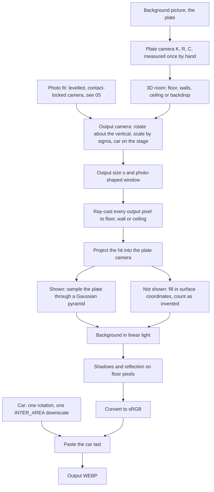

# 3D room rendering (room mode)

## In short

- Each background picture (the "plate") is a photo from a pinhole camera, measured once by hand from lines in the picture. From it we model the room it shows: floor, walls, and a ceiling or a far backdrop.
- For every input photo, the photo's own fitted camera is stood in that room so the car's footprint lands on the stage, and the room is ray-cast through it. Floor and car then share one viewpoint.
- Shadows, and a reflection on glossy floors, are drawn on the floor in linear light. The car is pasted last: at most one levelling rotation and one downscale.
- No neural network or generative model is used anywhere in rendering, shading or compositing.

This file covers the background side of room mode. How the photo's camera is measured (roll, pitch, focal, distance, height, levelling, tyre lock) is in [05-camera-angle.md](05-camera-angle.md). The car's 3D proxy and `cars.json` are in [04-car-dimensions-and-orientation.md](04-car-dimensions-and-orientation.md). The overview is in [README.md](README.md).

## How it works

1. **Pick the room.** background_1/2/3 have their own builders. Any other background gets a rough generic room if it has a `horizon_y`, else no room ([rooms.py:158-166](../../background_changer/car_fit_to_bg/rooms.py#L158-L166)).
2. **Build it from the calibration.** Plate camera (K, R, C) with the world origin on the stage, then the floor plan, wall top, ceiling, a clean floor patch and (background_3) a de-vignette ([rooms.py:37-97](../../background_changer/car_fit_to_bg/rooms.py#L37-L97)).
3. **Stage point and scale.** S = the floor point under the stage pixel. sigma = room units per car metre, set by flat mode's stage rule ([place.py:110-111](../../background_changer/car_fit_to_bg/place.py#L110-L111)).
4. **Place the photo's camera.** Rotate it about the vertical onto the plate camera's side, scale by sigma, move it onto S. Pull it back inside if it falls outside the room ([place.py:112-115](../../background_changer/car_fit_to_bg/place.py#L112-L115)).
5. **Output size and window.** Never enlarge the car; with `keep_background_sharp`, never magnify the floor at the stage ([place.py:116-126](../../background_changer/car_fit_to_bg/place.py#L116-L126)).
6. **Ray-cast.** Every output pixel finds its nearest floor, wall or ceiling hit ([render.py:116-143](../../background_changer/room3d/render.py#L116-L143)).
7. **Project and fill.** Each hit is projected into the plate camera. What the plate never showed is filled in that surface's own coordinates and counted as invented ([render.py:144-179](../../background_changer/room3d/render.py#L144-L179)).
8. **Sample.** The plate is sampled in linear light through a Gaussian pyramid ([render.py:180-189](../../background_changer/room3d/render.py#L180-L189)).
9. **Shade the floor.** Footprint shadow, tyre patches and outline layers multiply the floor ([place.py:138-159](../../background_changer/car_fit_to_bg/place.py#L138-L159)).
10. **Reflection.** Glossy floors only: a Fresnel-scaled mirror image of the car is added ([place.py:160-170](../../background_changer/car_fit_to_bg/place.py#L160-L170)).
11. **Composite.** Linear to sRGB, then paste the car ([place.py:171-172](../../background_changer/car_fit_to_bg/place.py#L171-L172)).
12. **Report.** `invented_pct`, `invented_near_pct`, `floor_texels`, contact residual and flags go to `results.csv` ([place.py:173-196](../../background_changer/car_fit_to_bg/place.py#L173-L196), [change_background.py:463-485](../../background_changer/change_background.py#L463-L485)).

The steps run in stage 3 of a room-mode run, once per photo and background, after the photo is fitted once ([change_background.py:582-601](../../background_changer/change_background.py#L582-L601)). Output goes to `<output_folder>/<images folder name>/<background>/<photo>.webp` ([change_background.py:598](../../background_changer/change_background.py#L598), [change_background.py:784-785](../../background_changer/change_background.py#L784-L785)).

### The plate is a photo from a known camera

**World frame of a room.** Origin = the stage point on the floor. x right, y forward (away from the plate camera), z up. The floor is z = 0 ([room.py:3-6](../../background_changer/room3d/room.py#L3-L6), [rooms.py:3-4](../../background_changer/car_fit_to_bg/rooms.py#L3-L4)).

**Camera (K, R, C).**
- K = `[[f, 0, cx], [0, f, cy], [0, 0, 1]]`, with pixel centres at integer coordinates. A W-pixel frame's centre column is (W-1)/2 ([room.py:50-51](../../background_changer/room3d/room.py#L50-L51)).
- R maps world to camera. Its rows are the camera's right, down and forward axes ([room.py:4-5](../../background_changer/room3d/room.py#L4-L5)). `look_at` builds one with no roll ([room.py:41-47](../../background_changer/room3d/room.py#L41-L47)).
- C is the camera centre in room units.
- A point P lands at `K R (P - C)`, divided by its third coordinate, which is the depth along the optical axis ([room.py:60-68](../../background_changer/room3d/room.py#L60-L68)). Depth at or below `FRONT_EPS` = 0.05 room units counts as not shown ([room.py:25](../../background_changer/room3d/room.py#L25), [room.py:119-121](../../background_changer/room3d/room.py#L119-L121)).
- The plane z = z0 maps to pixels by `H = K R [[1, 0, -Cx], [0, 1, -Cy], [0, 0, z0 - Cz]]` ([room.py:54-57](../../background_changer/room3d/room.py#L54-L57)). `floor_point` inverts it ([room.py:123-126](../../background_changer/room3d/room.py#L123-L126)). `px_per_unit_at` gives the plate's sideways px per room unit at a floor point, by central difference with e = 1e-4 ([room.py:128-133](../../background_changer/room3d/room.py#L128-L133)).

**Room units.** Each room keeps its plate's own units: background_1 uses 6.0 m-disc units, background_2 metres given an assumed 1.0 m camera height, background_3 metres from the barriers, the generic room camera heights. Car metres are scaled into room units by sigma, so the room's absolute scale never changes the picture. It only matters for the few constants given in room units: the 0.3-unit camera margin and the fill bands (0.45 and 1.7 units).

**The photo's camera.** The fit hands over R_lock (car to camera) and C_lock (camera centre in car metres). Car frame: x forward, y left, z up, origin = the middle of the wheelbase on the floor ([carmodel.py:16-18](../../background_changer/bg_changer/carmodel.py#L16-L18)). The photo's principal point is its frame centre ((W-1)/2, (H-1)/2) ([\_\_init\_\_.py:115](../../background_changer/car_fit_to_bg/__init__.py#L115)). How R_lock and C_lock are found is in [05-camera-angle.md](05-camera-angle.md).

### How each plate was calibrated

Once, by hand, from the picture alone. No camera data was needed ([findings.md:71-80](../../background_changer/docs/findings.md#calibrating-the-backgrounds-from-the-pictures-alone)). The numbers are constants in the scene modules. Values marked "computed" are not printed in the code; they follow from the code's own formulas.

| | background_1 (white turntable studio) | background_2 (grey studio, curved walls) | background_3 (race track) |
|---|---|---|---|
| Measured from | Rim ellipse (0.15 px rms), vanishing point of the side-wall floor LED strips, the 8 radial disc seams | Square floor-tile repeat, plinth lines, panel seams | Nine 0.80 m jersey barriers, cross-checked with a tipper truck at 3.1 m |
| Focal f | 1702.5 px | 1213 px | about 1400 px, hard-coded in `rooms.py` |
| Principal point | (959.6, 502.5) | (959.9, 512.5) | (960, 540) |
| Horizon row | 502.5 | 546.8 | 397 (±4) |
| Pitch / roll / yaw | 0 / 0 / 0 (level) | 1.62° up / 0 / 1.71° (looks slightly left; atan2 gives -1.709°) | 5.83° down / 0 / 0 |
| Camera height | k / f = 1707.6 / 1702.5 = 1.003 units | 1.0 m, assumed | 1.240 m (computed from the ground homography) |
| Stage centre (anchor px) | (958.8, 764.0), where the 8 seams meet | (960, 780) | (960, 685) |
| Stage distance, horizontal (computed) | 6.530 units | 5.235 m | 5.964 m (6.09 m slant) |
| Plate px per unit at the stage (computed) | 260.7 | 233.0 | 231.0 |
| `side_px` | 1348 | 1243 | 1232 |
| Stored as | `FOCAL`, `PRINCIPAL_POINT`, `LevelFloor(502.5, 1707.6, 6.532)` | `K`, `R`, `CAM_H`, `FLOOR_H`, `JUNCTION` | `GROUND_H` (K in `rooms.py`) |
| Code | [background_1.py:4-9](../../background_changer/bg_changer/scenes/background_1.py#L4-L9), [:23-24](../../background_changer/bg_changer/scenes/background_1.py#L23-L24), [:35-38](../../background_changer/bg_changer/scenes/background_1.py#L35-L38) | [background_2.py:4-8](../../background_changer/bg_changer/scenes/background_2.py#L4-L8), [:20-24](../../background_changer/bg_changer/scenes/background_2.py#L20-L24), [:47-53](../../background_changer/bg_changer/scenes/background_2.py#L47-L53) | [background_3.py:4-10](../../background_changer/bg_changer/scenes/background_3.py#L4-L10), [:23-24](../../background_changer/bg_changer/scenes/background_3.py#L23-L24), [rooms.py:79](../../background_changer/car_fit_to_bg/rooms.py#L79) |

**background_1.** A level camera sees a floor point at depth z on row `cy + f h / z`. So the floor is stored as `LevelFloor(horizon 502.5, k = f h = 1707.6, z0 6.532)` and the camera height is `h = k / f` ([background_1.py:38](../../background_changer/bg_changer/scenes/background_1.py#L38), [rooms.py:40-41](../../background_changer/car_fit_to_bg/rooms.py#L40-L41)). The stage is the true disc centre (958.8, 764.0), where the 8 seams meet. The rim ellipse's centre (958.7, 833.7) is 1.4 m nearer the camera ([background_1.py:6-8](../../background_changer/bg_changer/scenes/background_1.py#L6-L8)). With a 6.0 m disc the camera is 1.00 m high and 6.53 m from the centre ([background_1.py:9](../../background_changer/bg_changer/scenes/background_1.py#L9)). The room recomputes the stage depth from the anchor row: `za = k / (764.0 - 502.5) = 6.530` ([rooms.py:43](../../background_changer/car_fit_to_bg/rooms.py#L43)).

**background_2.** f comes from the square floor-tile repeat. The horizon was checked by three independent measures ([background_2.py:4-5](../../background_changer/bg_changer/scenes/background_2.py#L4-L5)). The rotation `_R` is in calibration axes (X right, Y up, Z forward). Its forward row gives `asin(0.028288) = 1.62°` up and `atan2(-0.029806, 0.999155) = -1.71°` of yaw. Check: `512.5 + 1213 tan(1.62°) = 546.8` ([background_2.py:20-21](../../background_changer/bg_changer/scenes/background_2.py#L20-L21)). The 1.0 m height is assumed, because absolute scale is not visible in the picture ([background_2.py:6-7](../../background_changer/bg_changer/scenes/background_2.py#L6-L7)). The floor homography is `FLOOR_H = K [r1, r3, -h r2]` ([background_2.py:23-24](../../background_changer/bg_changer/scenes/background_2.py#L23-L24)). The wall/floor junction (plinth bottom) was measured at 22 image points ([background_2.py:26-34](../../background_changer/bg_changer/scenes/background_2.py#L26-L34)).

**background_3.** A 0.80 m barrier whose base is on row y_b and top on row y_t gives the camera height `h_cam = 0.80 (y_b - y_h) / (y_b - y_t)`, with y_h the horizon row ([findings.md:77](../../background_changer/docs/findings.md#calibrating-the-backgrounds-from-the-pictures-alone)). Nine barriers give 1.24 m (sd 0.07) ([background_3.py:4-5](../../background_changer/bg_changer/scenes/background_3.py#L4-L5)). The result is stored as the ground homography `GROUND_H`, mapping (X right, D forward, 1) to the image ([background_3.py:23](../../background_changer/bg_changer/scenes/background_3.py#L23)). `rooms.py` decomposes it with a hard-coded K (f 1400, principal point (960, 540)) ([rooms.py:78-85](../../background_changer/car_fit_to_bg/rooms.py#L78-L85)): `cols = K^-1 G / |first column|`, `[r1 r2 t] = cols`, `r_up = r1 x r2`, `R = [r1 r2 r_up]`, `h = -t . r_up`. This gives r2 = (0, -0.1016, 0.9948), so the camera looks 5.83° down from 1.240 m. Check: `540 - 1400 tan(5.83°) = 397.0` (computed). The focal lives in `rooms.py`, not in `background_3.py`, whose docstring says "f ~ 1400 px".

### The 3D rooms

A `Room` is the floor z = 0, walls that are a closed floor-plan polygon extruded from 0 to `wall_top`, and an optional horizontal ceiling ([room.py:89-113](../../background_changer/room3d/room.py#L89-L113)). Walls are addressed by arc length s along the polygon ([room.py:180-184](../../background_changer/room3d/room.py#L180-L184)). Built-in rooms are built once and cached ([rooms.py:144-155](../../background_changer/car_fit_to_bg/rooms.py#L144-L155)). They are always built from the module's own numbers; a `[scene]` anchor override only moves S.

| | background_1 | background_2 | background_3 | generic |
|---|---|---|---|---|
| What it is | White box from the LED strips; the turntable is floor texture | Curved walls along the wall/floor junction, and a ceiling | Asphalt plus a backdrop standing at the barrier bases; trees, hills and sky are painted on it | Level camera, floor to the horizon, far backdrop |
| Floor plan (computed values) | Rectangle: side walls x = -4.710 and +4.753, back wall y = +6.641, closing wall y = C_y - 30 = -36.53 | 22-point junction (x -4.08 to +3.84, back wall at y ≈ +3.90), two side segments straight back to y = C_y - 30 = -35.23, closing front wall there | 10-point backdrop line (x -18.0 to +20.5, y +17.5 to +24.0), extended 400 units sideways at each end, closed 400 units behind the camera | Rectangle x ±10^4, back at y = f/10 - za, front at C_y - 50 |
| `wall_top` | 4.627 (= ceiling) | 3.474 (= ceiling) | 10^4 | 10^4 |
| Ceiling | 4.627 | 3.474 | none | none |
| Clean floor patch `texture_box` (x0, y0, w, h) | (-1.6, -3.5, 3.2, 0.4): terrazzo between the disc's near rim and the bottom row | (-1.5, -2.6, 3.0, 1.4): open concrete in front of the stage | (0.3, -1.0, 2.0, 1.5): plain asphalt right of the stage | (-0.2 za, -0.3 za, 0.4 za, 0.15 za): floor between stage and camera |
| De-vignette | none | none | a = 0.18, r = 960 | none |
| Code | [rooms.py:37-57](../../background_changer/car_fit_to_bg/rooms.py#L37-L57) | [rooms.py:60-74](../../background_changer/car_fit_to_bg/rooms.py#L60-L74) | [rooms.py:77-97](../../background_changer/car_fit_to_bg/rooms.py#L77-L97) | [rooms.py:117-141](../../background_changer/car_fit_to_bg/rooms.py#L117-L141) |

**background_1 box.** The LED strips were measured as half-maximum centre lines: back/floor row 632.15, back/ceiling row 34.09, corner columns 350.43 and 1573.60 ([rooms.py:27](../../background_changer/car_fit_to_bg/rooms.py#L27)). The back/floor strip gives the back wall's depth `zb = k / (632.15 - cy) = 13.17` units from the camera. At that depth the corner columns give the side walls, `x = (col - cx) zb / f - xa`, and the back/ceiling strip gives the ceiling, `ceil = h + (cy - 34.09) zb / f` ([rooms.py:47-51](../../background_changer/car_fit_to_bg/rooms.py#L47-L51)). A closing wall stands 30 units behind the plate camera, where the plate never looks ([rooms.py:52](../../background_changer/car_fit_to_bg/rooms.py#L52)). The box is 9.46 units wide and 13.17 deep from the camera (computed).

**background_2 walls.** The 22 junction points are back-projected onto the floor through `FLOOR_H` and shifted to the stage origin ([rooms.py:62-67](../../background_changer/car_fit_to_bg/rooms.py#L62-L67)). World axes are the calibration's (X, Z, Y): `R = Rt[:, [0, 2, 1]]` ([rooms.py:69](../../background_changer/car_fit_to_bg/rooms.py#L69)). The polygon starts and ends with a point straight behind each junction end at `y = C_y - 30`, and closes back to the first point. That makes three closing segments: two side walls and a front wall ([rooms.py:70-71](../../background_changer/car_fit_to_bg/rooms.py#L70-L71)). The junction has no samples between columns 601 and 1324, so the back wall is one straight segment there. Width 7.9 m and camera-to-back-wall 9.1 m (computed) match the docstring's "Room 7.9 x 9.1 m" ([background_2.py:7](../../background_changer/bg_changer/scenes/background_2.py#L7)).

> Note: the `rooms.py` docstring ([rooms.py:9-10](../../background_changer/car_fit_to_bg/rooms.py#L9-L10)) and the constant `BG2_WALL_TOP = 3.232` ([rooms.py:28](../../background_changer/car_fit_to_bg/rooms.py#L28)) describe a wall top at the top shadow line. The code passes `BG2_CEILING = 3.474` as `wall_top` ([rooms.py:72](../../background_changer/car_fit_to_bg/rooms.py#L72)) and never uses `BG2_WALL_TOP`. So the walls run up to the ceiling.

**background_3 backdrop.** `BG3_BACKDROP` is 10 image points on rows 455.3-471.3: the near envelope of the barrier bases (running maximum of the per-column rows over ±300 px, Gaussian sigma 40 px, Douglas-Peucker 0.5 px). It has no depth jumps, so the sky and trees painted on it stay continuous when the camera rises ([rooms.py:29-33](../../background_changer/car_fit_to_bg/rooms.py#L29-L33)). The points are back-projected through `GROUND_H`, extended 400 units sideways and closed 400 units behind the camera ([rooms.py:89-94](../../background_changer/car_fit_to_bg/rooms.py#L89-L94)). The walls are effectively infinite (`wall_top` = 1.0e4) and there is no ceiling ([rooms.py:95](../../background_changer/car_fit_to_bg/rooms.py#L95)).

**Generic room.** A background without its own module gets one only if `[scene.<name>] horizon_y` is set and the anchor row is more than `GENERIC_BACKDROP_ROWS` = 10 px below it ([rooms.py:114](../../background_changer/car_fit_to_bg/rooms.py#L114), [rooms.py:122-128](../../background_changer/car_fit_to_bg/rooms.py#L122-L128)). It assumes a level camera with f = 0.866 w (about 60° across, [base.py:30](../../background_changer/bg_changer/scenes/base.py#L30)), principal point ((w-1)/2, horizon_y), and a camera height of 1.0 unit. The floor runs to 10 rows below the horizon; the rest of the picture is a backdrop standing there ([rooms.py:129-141](../../background_changer/car_fit_to_bg/rooms.py#L129-L141)). It is flagged `generic-room` ([place.py:109](../../background_changer/car_fit_to_bg/place.py#L109)).

**No room.** Without a module and a usable `horizon_y`, the background is placed with flat mode (and `background_scaler`), using the fitted yaw, flagged `no-room` ([change_background.py:583-586](../../background_changer/change_background.py#L583-L586), [change_background.py:612-616](../../background_changer/change_background.py#L612-L616)). The room path itself always renders from the full-size picture: `render` raises `ValueError` if the plate's size differs from the size the room was measured on ([render.py:70-72](../../background_changer/room3d/render.py#L70-L72)).

### Choosing the output camera

The photo's camera is known relative to the car: its height, distance, pitch and roll to the car's floor. We keep all of that. We only decide two things. Which way round the car stands in the room: the camera is turned about the vertical so it sits on the plate camera's side of the stage, and so looks at the part of the room the plate shows. And the scale: the car gets flat mode's stage-relative size.

1. **Stage point.** `S = room.floor_point(spec.anchor)` ([place.py:110](../../background_changer/car_fit_to_bg/place.py#L110)). It is (0, 0) for the measured anchor and moves with a `[scene]` anchor override ([rooms.py:169-172](../../background_changer/car_fit_to_bg/rooms.py#L169-L172)). The spec carries the config's `[scene]` overrides but not flat mode's auto-fit shrink ([change_background.py:422-429](../../background_changer/change_background.py#L422-L429)).
2. **Scale.** `sigma = (side_px * size / side_length) / px_per_unit_at(S)`, in room units per car metre ([place.py:54-56](../../background_changer/car_fit_to_bg/place.py#L54-L56)). A side view of any car then spans `side_px * size` at the stage, as in flat mode. The room's own metric scale is not used: every car fills the stage the same way ([findings.md:95](../../background_changer/docs/findings.md#per-frame)). For the EQB this is about 0.89 room units per metre on background_1 and 0.92 on background_2 and background_3 (computed: stage scales 233.0, 214.8 and 212.9 px/m, see [04](04-car-dimensions-and-orientation.md), over the plate px per unit above). `[scene] size` scales sigma directly ([test_car_fit.py:204-210](../../background_changer/tests/test_car_fit.py#L204-L210)).
3. **Turn and move.** ([place.py:59-68](../../background_changer/car_fit_to_bg/place.py#L59-L68))
   - `psi = atan2(plate camera's horizontal direction from S) - atan2(C_lock_y, C_lock_x)`, `A = Rz(psi)`.
   - `R_room = R_lock A^T`, `C_room = (S, 0) + sigma A C_lock`.
   - The car frame's origin (the footprint centre) lands on S. A turn about the vertical leaves pitch and roll to the floor unchanged.
   - With weak background lines the car's pixels are not rotated, and R_lock keeps the silhouette's roll, so the room is rendered tilted to match the car instead ([\_\_init\_\_.py:161-169](../../background_changer/car_fit_to_bg/__init__.py#L161-L169)).
4. **Keep it inside the room.** `contains` needs the camera at least `CAMERA_MARGIN` = 0.3 room units above the floor, below the ceiling (or wall top), inside the floor plan and from every wall ([place.py:32](../../background_changer/car_fit_to_bg/place.py#L32), [room.py:135-139](../../background_changer/room3d/room.py#L135-L139)). If not, `clamp_inside` clamps the height to [0.3, top - 0.3], then pulls the position toward S by `xy = S + 0.95 (xy - S)`, at most 60 times (0.95^60 ≈ 0.05) ([room.py:141-152](../../background_changer/room3d/room.py#L141-L152)). The rotation is not changed. The output is flagged `camera-outside-room` ([place.py:113-115](../../background_changer/car_fit_to_bg/place.py#L113-L115)). With `[fit] on_fail = "skip"` that output is dropped: the room is too small for that photo's camera ([change_background.py:594-597](../../background_changer/change_background.py#L594-L597), [config.toml:130-133](../../background_changer/config.toml#L130-L133)).

### Output size and framing

**Texels at the stage.** `t1` is the number of plate texels per photo pixel on the floor where the stage appears, seen through the full-resolution camera (photo focal, frame-centre principal point) ([place.py:116-120](../../background_changer/car_fit_to_bg/place.py#L116-L120)). `texels_per_px` composes the two floor homographies, `G = H_plate H_out^-1`, takes central differences with e = 0.5 px, and returns the square root of the area ratio ([render.py:192-209](../../background_changer/room3d/render.py#L192-L209)).

**The size rule.** `s = min(1, max_output_size / max(W, H), t1 / min_floor_texels)` ([place.py:121-122](../../background_changer/car_fit_to_bg/place.py#L121-L122)).
- s ≤ 1, so the car is never enlarged.
- `max_output_size` caps the long side (default 1920; 0 = no cap; otherwise at least 64) ([config.toml:42](../../background_changer/config.toml#L42), [change_background.py:727-730](../../background_changer/change_background.py#L727-L730)).
- `keep_background_sharp = true` passes `min_floor_texels` = 1.0, so the background is never magnified at the stage. `false` passes 0.0, which makes that term 1 ([config.toml:48](../../background_changer/config.toml#L48), [change_background.py:731](../../background_changer/change_background.py#L731), [change_background.py:809-811](../../background_changer/change_background.py#L809-L811)).
- `floor_texels = t1 / s` is reported. `soft-floor` is flagged when it is below the constant `MIN_FLOOR_TEXELS` = 1.0. With `keep_background_sharp = true`, s ≤ t1, so the flag can only fire with `false` ([place.py:31](../../background_changer/car_fit_to_bg/place.py#L31), [place.py:123-124](../../background_changer/car_fit_to_bg/place.py#L123-L124), [place.py:187](../../background_changer/car_fit_to_bg/place.py#L187)).

**Measured.** At their own 3840×2160 the EQB photos' backgrounds would sit at 0.24-0.38 plate pixels per output pixel at the car (visibly soft). Kept at ≥ 1, the outputs come out 907-1442 px wide, with the car about as large as in flat mode. `keep_background_sharp = false` gives 1920 px wide outputs at 0.47-0.75. The rule also shrinks close-ups from small photos: `sample_vid` 0006 comes out 346-365 px wide (by background) instead of 464, and 0020 at 428-452 ([findings.md:175](../../background_changer/docs/findings.md#room-mode-fitting-each-photo-and-re-rendering-the-background), [README.md:113-118](../../background_changer/README.md#how-the-car-is-placed-room-mode)).

**Window.** The output is the photo's own frame on the levelled grid, scaled by s: `Wo = round(W s)`, `Ho = round(H s)` ([place.py:71-97](../../background_changer/car_fit_to_bg/place.py#L71-L97)).
- A cut side's border sits on the innermost point of the slanted cut edge, and the window slides toward the uncut side.
- An uncut side of the car is never cropped: the window grows instead (so an output can be a few pixels larger than the photo).
- Only left, right and top cuts get here. Bottom cuts and cuts on two or more sides are skipped before fitting ([batch.py:124-131](../../background_changer/car_fit_to_bg/batch.py#L124-L131), [change_background.py:540-548](../../background_changer/change_background.py#L540-L548)).

**Output intrinsics.** The photo's focal times s, and the principal point moved into the window with the pixel-centre convention ([place.py:126](../../background_changer/car_fit_to_bg/place.py#L126)): `Ko = [[f s, 0, (cx + 0.5) s - 0.5 - x0], [0, f s, (cy + 0.5) s - 0.5 - y0], [0, 0, 1]]`.

### Ray-casting and sampling

**Ray-cast** ([render.py:79-143](../../background_changer/room3d/render.py#L79-L143)).
- Each output pixel (u, v) gets the ray `d = R^T K^-1 (u, v, 1)` ([render.py:80](../../background_changer/room3d/render.py#L80)).
- Floor: `t = -Cz / dz` for dz < 0. Ceiling: `t = (ceiling - Cz) / dz` for dz > 0. Wall: `t = r(phi) / sqrt(dx^2 + dy^2)`, kept only when the hit height `Cz + t dz` is between 0 and `wall_top` ([render.py:121-131](../../background_changer/room3d/render.py#L121-L131)).
- Hits at t ≤ 1e-9 (behind the camera) never count. The nearest hit sets the pixel's kind: FLOOR 0, WALL 1, CEIL 2, or NONE when nothing was hit ([render.py:129-136](../../background_changer/room3d/render.py#L129-L136), [room.py:23](../../background_changer/room3d/room.py#L23)).
- A wall hit depends only on the ray's azimuth. So exact nearest polygon hits (distance r and arc length s) are computed once on a 65,536-entry azimuth table, which covers the azimuths seen in the frame (sampled every 8 px, padded by 0.2%). If the nadir or zenith is in view, the table covers the full ±π. Pixels interpolate linearly between table entries ([render.py:91-108](../../background_changer/room3d/render.py#L91-L108), [room.py:186-199](../../background_changer/room3d/room.py#L186-L199)).
- The work runs in chunks of 2^20 pixels ([render.py:65](../../background_changer/room3d/render.py#L65), [render.py:115](../../background_changer/room3d/render.py#L115)).
- Each hit is projected into the plate camera. Outside the plate (margin -0.5 px), at depth ≤ 0.05, or no hit: the pixel is a hole, and gets a fill ([render.py:144-145](../../background_changer/room3d/render.py#L144-L145)).

**Sampling** ([render.py:40-61](../../background_changer/room3d/render.py#L40-L61), [room.py:155-177](../../background_changer/room3d/room.py#L155-L177)).
- The plate goes to linear light with the exact sRGB curve, as a 256-entry table ([room.py:27-32](../../background_changer/room3d/room.py#L27-L32)).
- A Gaussian pyramid is built with 6 `cv2.pyrDown` halvings, so 7 images ([room.py:171-173](../../background_changer/room3d/room.py#L171-L173)).
- Per output pixel, `np.gradient` of the plate coordinates gives the Jacobian. The footprint fp is the length of its longer axis. The level is `clip(log2 fp, 0, 5.999)`, then 3×3-eroded (a minimum filter), so pixels next to a floor/wall edge keep the sharper level ([render.py:43-49](../../background_changer/room3d/render.py#L43-L49)).
- The two neighbouring levels are each sampled bicubically (`cv2.remap`, `INTER_CUBIC`, at plate coordinates / 2^k, `BORDER_REPLICATE`) and blended linearly by the fractional level. Negative bicubic overshoot is clipped ([render.py:50-61](../../background_changer/room3d/render.py#L50-L61)).
- Plate layers are cached per plate content (a blake2b hash of every 7th pixel), at most 3 entries ([room.py:157-161](../../background_changer/room3d/room.py#L157-L161)).

**Why a pyramid.** The output camera usually looks at the floor from higher and closer than the plate camera did. Near the car one plate pixel then covers several output pixels (fp < 1): level 0, plain bicubic, no blur added. Farther away, or at a grazing angle, many plate pixels fall into one output pixel (fp > 1). Sampling level 0 there would alias and shimmer on LED streaks, terrazzo and seams; the pyramid level averages them first. So a floor seen from above is neither aliased nor blurred ([render.py:4-6](../../background_changer/room3d/render.py#L4-L6)).

### What the plate never showed

A portrait frame looking 30-47° down sees beyond the landscape plates: ceiling or sky at the top, the floor under the phone at the bottom ([findings.md:177](../../background_changer/docs/findings.md#room-mode-fitting-each-photo-and-re-rendering-the-background)). Those points are filled in the surface's own coordinates, so seams, LED strips and plinths run on straight instead of smearing ([room.py:8-11](../../background_changer/room3d/room.py#L8-L11)). The defaults are `FILL_DEFAULT = floor "hybrid", wall "band", ceil "smooth"` ([render.py:27](../../background_changer/room3d/render.py#L27)).

| Surface | What is done | Constants | Code |
|---|---|---|---|
| Floor ("hybrid") | **Lighting:** a low-passed plate at the nearest shown floor point (same x, y clamped to the shown range). **Texture:** the high-pass (plate minus low-pass), sampled at the point mirror-tiled into `texture_box`. Result: `clip(low + high, 0, 1)` | low-pass sigma `hp_sigma` = 10 px; low `INTER_LINEAR`, high `INTER_CUBIC`, both at full plate resolution, `BORDER_REFLECT_101` (no pyramid) | [render.py:162-168](../../background_changer/room3d/render.py#L162-L168), [render.py:182-185](../../background_changer/room3d/render.py#L182-L185), [room.py:281-308](../../background_changer/room3d/room.py#L281-L308) |
| Floor without a `texture_box` | Band fold (below) | band 0.45 units (`bands[0]`) | [render.py:74-77](../../background_changer/room3d/render.py#L74-L77) |
| Walls ("band") | Off the plate's left or right side, or behind its image plane: height clamped to the visibility table's range, arc length folded back by a triangle wave that only re-uses the strip next to the visible end. Still above or below the plate: clamped to the nearest shown height on that wall column, marked "vert" | band 1.7 units (`bands[1]`); visibility inset `FILL_MARGIN` = 2 px | [render.py:153-157](../../background_changer/room3d/render.py#L153-L157), [room.py:234-279](../../background_changer/room3d/room.py#L234-L279) |
| Ceiling ("smooth") | Nearest shown ceiling point (same x), sampled from a heavily low-passed plate: no repeated light bars | `sky_sigma` = 25 px | [render.py:158-161](../../background_changer/room3d/render.py#L158-L161), [render.py:186-188](../../background_changer/room3d/render.py#L186-L188) |
| Sky and walls moved in height ("vert") | The same heavy low-pass: no streaks or beams | `sky_sigma` = 25 px | [render.py:154-157](../../background_changer/room3d/render.py#L154-L157), [render.py:186-188](../../background_changer/room3d/render.py#L186-L188) |
| Anything still outside | Clamped in plate pixels to [2, w-3] × [2, h-3] (for example a ray that hit nothing) | | [render.py:170-174](../../background_changer/room3d/render.py#L170-L174) |

**Shown ranges.** For the floor and ceiling, the shown y range at each x comes from the plate's frustum, inset by 2 px, plus the depth plane ([room.py:291-308](../../background_changer/room3d/room.py#L291-L308)). For walls, a table gives the shown arc-length interval per height. Heights run from 0 to the ceiling or wall top, capped at 200 units (1201 steps up to 30 units, 120 above) ([room.py:208-231](../../background_changer/room3d/room.py#L208-L231)).

**The band fold.** `w = max(min(band, hi - lo), 1e-9)`, `d` = distance outside [lo, hi], `t = d mod 2w`, `t = 2w - t if t > w`, then `s = lo + t` or `hi - t` ([room.py:234-246](../../background_changer/room3d/room.py#L234-L246)). Features deeper than one band inside the shown wall are never copied.

**The tiling.** Mirror-periodic in x and y, `a0 + tri(a - a0, L)`, so the copied patch is continuous and never leaves the box ([room.py:281-289](../../background_changer/room3d/room.py#L281-L289)).

**Rejected earlier.** A column-clamp fill gave repeated light bars and sky "beams" ([findings.md:173](../../background_changer/docs/findings.md#room-mode-fitting-each-photo-and-re-rendering-the-background)).

> Note: [README.md:110](../../background_changer/README.md#how-the-car-is-placed-room-mode) says these parts are "filled smoothly", and [README.md:393](../../background_changer/README.md#known-limits) calls them "smooth fills". In code only the ceiling, the sky and wall points moved in height are smooth; the floor is hybrid and the walls are band-folded. [findings.md:173](../../background_changer/docs/findings.md#room-mode-fitting-each-photo-and-re-rendering-the-background) matches the code.

> Note: the `render.py` docstring says off-side wall fills keep the "same height" ([render.py:10](../../background_changer/room3d/render.py#L10)). In code the height is first clamped to the visibility table's range, which tops out at the ceiling, the wall top or 200 units ([room.py:211-212](../../background_changer/room3d/room.py#L211-L212), [room.py:259-265](../../background_changer/room3d/room.py#L259-L265)).

**Invented share** ([place.py:174-186](../../background_changer/car_fit_to_bg/place.py#L174-L186)).
- Car pixels are those with output alpha ≥ 0.5. A hole under the car does not count.
- `invented_pct` = the share of non-car output pixels that are holes.
- `invented_near_pct` = the hole share of the car's bounding box grown by 25% of its width and height on every side (clipped to the output).
- Flag `invented` when invented > 0.35 or near > 0.01. Both values go to `results.csv` ([change_background.py:482-483](../../background_changer/change_background.py#L482-L483)). The debug overlay tints invented areas blue ([place.py:207-208](../../background_changer/car_fit_to_bg/place.py#L207-L208)).
- **Measured** ([findings.md:177](../../background_changer/docs/findings.md#room-mode-fitting-each-photo-and-re-rendering-the-background)): in `sample_vid` up to about half of a full frame is fill, mostly at the top and bottom; on four close-ups (0006, 0020, 0022, 0024) 5-15% of the area around the car. In the EQB frames 0-6%, at most 1.7% around the car.

**background_3 de-vignetting.** The race-track plate is darker toward its edges. Re-projected from a new camera, those dark edges would move into the middle of the view. So the falloff `1 - a (d / r)^2`, with a = 0.18, r = 960 px and d the distance from the principal point (960, 540), is divided out of the normalised sRGB values before linearisation: `x = clip((plate / 255) / max(1 - 0.18 d^2 / 960^2, 0.2), 0, 1)` ([rooms.py:34](../../background_changer/car_fit_to_bg/rooms.py#L34), [rooms.py:97](../../background_changer/car_fit_to_bg/rooms.py#L97), [room.py:162-170](../../background_changer/room3d/room.py#L162-L170)). The factor is 0.82 at d = 960 and 0.76 at the corners (computed). Because of it, background_3 is not in the exact self-re-render test.

> Note: the comment at [rooms.py:34](../../background_changer/car_fit_to_bg/rooms.py#L34) says the asphalt is "0.81 of the centre at the edges", and [background_3.py:12-13](../../background_changer/bg_changer/scenes/background_3.py#L12-L13) says "~17% darker in the outer columns" (0.83). The code value is a = 0.18, r = 960, which gives 0.82 at d = 960.

### Grounding on the floor

Drawn on the rendered background in linear light, before the car is pasted, on floor pixels only ([ground.py:14-19](../../background_changer/car_fit_to_bg/ground.py#L14-L19)).

**Floor points back to car metres.** Each floor pixel knows its room floor point. It maps back to the car's floor by `rel = (floor_xy - S) / sigma`, `car_xy = A^T rel` ([place.py:139-142](../../background_changer/car_fit_to_bg/place.py#L139-L142)). The footprint layers are looked up there, so they follow the room's perspective exactly.

**The layers** ([ground.py:235-260](../../background_changer/car_fit_to_bg/ground.py#L235-L260)):
- **Footprint core.** The car's footprint shrunk by `core_inset_m`, blurred by `core_sigma_m`: the dark shadow under the body ([grounding.py:304-317](../../background_changer/bg_changer/grounding.py#L304-L317)).
- **Footprint skirt.** The footprint grown by `skirt_grow_m`, blurred by `skirt_sigma_m`: the soft ambient shadow around it.
- Both are drawn on a top-down raster at 0.02 m per pixel with a 1.2 m margin ([grounding.py:301](../../background_changer/bg_changer/grounding.py#L301)). They can be shifted toward the camera by `shift_m` ([ground.py:242](../../background_changer/car_fit_to_bg/ground.py#L242)). Then they are moved per output column onto the found tyre bottoms. The shift is interpolated between tyres and fades beyond them over 0.8 m ([place.py:144-151](../../background_changer/car_fit_to_bg/place.py#L144-L151), [ground.py:252-256](../../background_changer/car_fit_to_bg/ground.py#L252-L256), [grounding.py:285-296](../../background_changer/bg_changer/grounding.py#L285-L296)).
- **Tyre contact patches.** Ellipses at the floor points under the found tyre bottoms: half-length 0.07 m along the car, half-width half the tyre width. They are blurred by `tyre_sigma_m` and normalised to a peak of 1 ([ground.py:42-43](../../background_changer/car_fit_to_bg/ground.py#L42-L43), [ground.py:204-218](../../background_changer/car_fit_to_bg/ground.py#L204-L218), [\_\_init\_\_.py:181](../../background_changer/car_fit_to_bg/__init__.py#L181)).
- **Outline layers**, from the pasted car's own bottom outline ([grounding.py:228-243](../../background_changer/bg_changer/grounding.py#L228-L243), [grounding.py:343-379](../../background_changer/bg_changer/grounding.py#L343-L379)). The floor line is the lower envelope of the outline; columns more than 1.3 m above the lowest point (mirrors) are left out ([grounding.py:181](../../background_changer/bg_changer/grounding.py#L181)). With `thick = max(2 px, 0.06 m × ppm)`:
  - **contact**: a dark line right under the outline where it touches the floor line;
  - **gap** (underbody shade): the floor seen between the underside and the floor line, only under parts at most 0.45 m above it ([grounding.py:182](../../background_changer/bg_changer/grounding.py#L182));
  - **band**: a soft band under the whole outline, fading for parts high above the floor.
- The px-per-metre used for these sizes is `ppm = f s / D`, the car's scale on the output grid ([place.py:150](../../background_changer/car_fit_to_bg/place.py#L150)).
- If the 3D fit failed, only the outline layers are drawn (`with_3d = not fit.pose.failed`) ([place.py:154-155](../../background_changer/car_fit_to_bg/place.py#L154-L155)).

**How they darken the floor** ([ground.py:263-273](../../background_changer/car_fit_to_bg/ground.py#L263-L273)): `m = product over layers of (1 - clip(gain * opacity * layer, 0, 1))`, `dark = (1 - m) * floor`, `lin = lin * clip(1 - dark, 1e-4, 1) ^ tint_gamma_bgr`. `floor` is the floor mask blurred with sigma 1 px, so walls and the backdrop never get a shadow ([place.py:156](../../background_changer/car_fit_to_bg/place.py#L156)). `gain` = config `shadow` (0-1.5, default 1.0) × `[scene.<name>] shadow`; nothing is drawn at gain 0 ([place.py:157-159](../../background_changer/car_fit_to_bg/place.py#L157-L159), [config.toml:81](../../background_changer/config.toml#L81), [change_background.py:736-737](../../background_changer/change_background.py#L736-L737)).

**Room shadow styles.** Retuned on the photo-framed composites, because flat mode's styles were "invisible at a glance" under a car seen from above ([rooms.py:100-110](../../background_changer/car_fit_to_bg/rooms.py#L100-L110)). A generic room uses the base values ([rooms.py:113](../../background_changer/car_fit_to_bg/rooms.py#L113)).

| Layer | Base (background_1, generic) | background_2 | background_3 |
|---|---|---|---|
| tyre opacity / sigma | 0.90 / 0.025 m | same | 0.85 / 0.03 m |
| core opacity / inset / sigma | 0.70 / 0.05 m / 0.15 m | same | 0.62 / 0.05 m / 0.15 m |
| skirt opacity / grow / sigma | 0.30 / 0.30 m / 0.30 m | 0.30 / 0.30 m / 0.33 m | 0.26 / 0.35 m / 0.35 m |
| contact / gap / band | 0.80 / 0.65 / 0.35 | same | 0.75 / 0.55 / 0.30 |
| shift toward camera | 0 | 0.05 m | 0 |
| tint gamma (B, G, R) | (1, 1, 1) | same | (1.114, 1.0, 0.889), warm-neutral |

> Note: the `background_2.py` docstring says the shadow is "nudged 0.10 m toward the camera" ([background_2.py:9-10](../../background_changer/bg_changer/scenes/background_2.py#L9-L10)). Both its flat style and its room style use `shift_m = 0.05` ([background_2.py:56-58](../../background_changer/bg_changer/scenes/background_2.py#L56-L58), [rooms.py:106](../../background_changer/car_fit_to_bg/rooms.py#L106)).

**Glossy-floor reflection** ([place.py:160-170](../../background_changer/car_fit_to_bg/place.py#L160-L170), [ground.py:306-363](../../background_changer/car_fit_to_bg/ground.py#L306-L363)).
- Only where the scene has a reflection style: background_1 among the built-ins ([background_1.py:41-42](../../background_changer/bg_changer/scenes/background_1.py#L41-L42)), or a generic scene with `floor = "glossy"` at opacity 0.18 × 0.8 = 0.144 ([generic.py:20](../../background_changer/bg_changer/scenes/generic.py#L20)). `[scene] reflection = false` removes it ([base.py:182-183](../../background_changer/bg_changer/scenes/base.py#L182-L183)).
- background_1: full strength on the glossy disc, radius `DISC_RADIUS` = 3.0 room units from the room origin (blurred with sigma 2 px); 0.6 (`outside_factor`) on the floor around it ([place.py:33](../../background_changer/car_fit_to_bg/place.py#L33), [place.py:161-167](../../background_changer/car_fit_to_bg/place.py#L161-L167)). A generic glossy floor is glossy everywhere.
- The car's region (its box plus 30% each side, 5% above, 120% below) is warped into an upright view of the same camera, `K U K^-1`, with no pitch and no roll to the car's floor ([ground.py:293-303](../../background_changer/car_fit_to_bg/ground.py#L293-L303), [ground.py:322-330](../../background_changer/car_fit_to_bg/ground.py#L322-L330)). There it is mirrored per column about the outline's floor line, with flat mode's `add_reflection` ([grounding.py:443-485](../../background_changer/bg_changer/grounding.py#L443-L485)), warped back and added in linear light.
- Strength follows Fresnel (Schlick, n = 1.5) relative to flat mode's 16° view: `opacity = 0.18 * min(1, R(delta) / R(16°))`, with `R(d) = r0 + (1 - r0)(1 - sin d)^5`, `r0 = 0.04`, delta = the angle down to the car, at least 0.5°. `fade_m` is multiplied by `max(0.3, cos delta)` ([ground.py:283-290](../../background_changer/car_fit_to_bg/ground.py#L283-L290), [ground.py:326-327](../../background_changer/car_fit_to_bg/ground.py#L326-L327)). So at 30° down the opacity is about 0.054, at 45° about 0.033 (computed).
- Skipped, flagged `reflection-skipped`, when the car has fewer than 20 solid pixels, the upright warp is impossible, or the warped outline has no floor line ([ground.py:317-318](../../background_changer/car_fit_to_bg/ground.py#L317-L318), [ground.py:333-339](../../background_changer/car_fit_to_bg/ground.py#L333-L339), [ground.py:354-356](../../background_changer/car_fit_to_bg/ground.py#L354-L356)).

**Contact check.** The lock's remaining miss, `max |row residual| × s`, is reported as `contact_residual_px`. Above 1% of the output height it is flagged `contact-mismatch`; the shadows are pinned to the found tyre bottoms anyway ([place.py:34](../../background_changer/car_fit_to_bg/place.py#L34), [place.py:188-196](../../background_changer/car_fit_to_bg/place.py#L188-L196)).

### Final composite

1. The shaded linear render goes to sRGB with the exact curve, rounded ([room.py:35-38](../../background_changer/room3d/room.py#L35-L38), [place.py:171](../../background_changer/car_fit_to_bg/place.py#L171)).
2. The car is pasted on top ([place.py:172](../../background_changer/car_fit_to_bg/place.py#L172), [compose.py:28-43](../../background_changer/bg_changer/compose.py#L28-L43)). Where its alpha is 1 the car pixel is copied byte for byte. Only the soft edge is blended: `rint(background (1 - a) + car a)`.

**What the car's pixels go through.** Two operations, nothing else:
- **one levelling rotation** about the frame centre, skipped below 0.5° (premultiplied Lanczos-4, clamped to the 3×3 source range; bilinear alpha), done once in the fit, see [05-camera-angle.md](05-camera-angle.md) ([level.py:53-94](../../background_changer/car_fit_to_bg/level.py#L53-L94));
- **one `INTER_AREA` downscale** by s, never up. Opaque pixels are plain `INTER_AREA`; soft-edge pixels are `INTER_AREA(colour × alpha) / INTER_AREA(alpha)` ([level.py:97-118](../../background_changer/car_fit_to_bg/level.py#L97-L118), [place.py:130](../../background_changer/car_fit_to_bg/place.py#L130)).

No colour change, relighting, sharpening or generated pixels. Shadows and the reflection are drawn before the paste, so they never touch the car. **Cut-off cars** keep their cut edge on the output's border: the window puts the border on the cut, and the room fills the rest of the frame.

### No neural network in rendering

Rendering, fills, shadows, the reflection and the composite are closed-form geometry and image filtering: numpy and OpenCV only ([render.py:1](../../background_changer/room3d/render.py#L1), [room.py:18-21](../../background_changer/room3d/room.py#L18-L21), [place.py:20-29](../../background_changer/car_fit_to_bg/place.py#L20-L29)). There is no neural network, generative model or inpainting model anywhere in this part. The only network that `background_changer` loads is the BiRefNet cut-out model, which runs earlier and is deleted before fitting and rendering start ([change_background.py:897-899](../../background_changer/change_background.py#L897-L899); see [02-car-cutout-model.md](02-car-cutout-model.md)). Upstream, the pose fit can read the `frame_view_type` classifier's results as a yaw hint; that changes which camera is fitted, not how the room is drawn (see [05-camera-angle.md](05-camera-angle.md) and [01-models-and-options.md](01-models-and-options.md)).

## The maths and constants

### Cameras and rooms

| Name | Value | Meaning | Code |
|---|---|---|---|
| Projection | `[u, v, 1] ~ K R (P - C)`; depth = third row | World point to pixel; pixel centres at integers | [room.py:60-68](../../background_changer/room3d/room.py#L60-L68) |
| Floor homography | `H = K R [[1,0,-Cx],[0,1,-Cy],[0,0,z0-Cz]]` | Plane z = z0 to pixels | [room.py:54-57](../../background_changer/room3d/room.py#L54-L57) |
| `FRONT_EPS` | 0.05 room units | Depth at or below this = not shown | [room.py:25](../../background_changer/room3d/room.py#L25) |
| background_1 camera | `h = k/f`, `za = k/(ay - cy)`, `xa = (ax - cx) za/f`, `C = (-xa, -za, h)` | With f 1702.5, (cx, cy) (959.6, 502.5), k 1707.6, anchor (958.8, 764.0): C = (0.003, -6.530, 1.003) (computed) | [rooms.py:40-46](../../background_changer/car_fit_to_bg/rooms.py#L40-L46) |
| background_1 box | `zb = k/(632.15 - cy)`, `y_back = zb - za`, `x = (col - cx) zb/f - xa`, `ceil = h + (cy - 34.09) zb/f` | 13.17, +6.641, -4.710 / +4.753, 4.627 (computed) | [rooms.py:47-51](../../background_changer/car_fit_to_bg/rooms.py#L47-L51) |
| Closing walls | `C_y - 30` (bg1, bg2), `C_y - 400` (bg3), `C_y - 50` (generic) | Behind the plate camera, never shown | [rooms.py:52](../../background_changer/car_fit_to_bg/rooms.py#L52), [:70](../../background_changer/car_fit_to_bg/rooms.py#L70), [:92](../../background_changer/car_fit_to_bg/rooms.py#L92), [:138](../../background_changer/car_fit_to_bg/rooms.py#L138) |
| background_2 axes | `R = Rt[:, [0, 2, 1]]` | World (x, y, z) = calibration (X, Z, Y) | [rooms.py:69](../../background_changer/car_fit_to_bg/rooms.py#L69) |
| `BG2_CEILING` | 3.474 | Ceiling and wall top of background_2 | [rooms.py:28](../../background_changer/car_fit_to_bg/rooms.py#L28), [:72](../../background_changer/car_fit_to_bg/rooms.py#L72) |
| background_3 decomposition | `[r1 r2 t] = K^-1 G / norm(col0)`, `R = [r1 r2 r1xr2]`, `h = -t . r_up` | h 1.240 m, pitch 5.83° down (computed) | [rooms.py:78-88](../../background_changer/car_fit_to_bg/rooms.py#L78-L88) |
| `BG3_DEVIGNETTE` | (0.18, 960.0) | Plate brightness `1 - 0.18 (d/960)^2` | [rooms.py:34](../../background_changer/car_fit_to_bg/rooms.py#L34) |
| Generic focal | `f = 0.866 w` | About 60° across | [base.py:30](../../background_changer/bg_changer/scenes/base.py#L30), [rooms.py:129](../../background_changer/car_fit_to_bg/rooms.py#L129) |
| `GENERIC_BACKDROP_ROWS` | 10 px | Generic floor ends this far below the horizon; anchor must be lower | [rooms.py:114](../../background_changer/car_fit_to_bg/rooms.py#L114) |

### Output camera and size

| Name | Value | Meaning | Code |
|---|---|---|---|
| Stage scale | `sigma = (side_px * size / side_length) / px_per_unit_at(S)` | Room units per car metre; flat mode's stage-relative size | [place.py:54-56](../../background_changer/car_fit_to_bg/place.py#L54-L56) |
| Turn | `psi = atan2(C_plate - S) - atan2(C_lock_xy)`, `A = Rz(psi)` | Camera onto the plate camera's side | [place.py:62-65](../../background_changer/car_fit_to_bg/place.py#L62-L65) |
| Pose | `R_room = R_lock A^T`, `C_room = (S, 0) + sigma A C_lock` | Photo camera in the room | [place.py:66-67](../../background_changer/car_fit_to_bg/place.py#L66-L67) |
| `CAMERA_MARGIN` | 0.3 room units | Camera distance from floor, walls, ceiling | [place.py:32](../../background_changer/car_fit_to_bg/place.py#L32) |
| Clamp | height to [0.3, top - 0.3]; `xy = S + 0.95 (xy - S)`, up to 60 times | Pull an outside camera back in | [room.py:141-152](../../background_changer/room3d/room.py#L141-L152) |
| Output scale | `s = min(1, max_output_size / max(W, H), t1 / min_floor_texels)` | Never enlarge; cap; keep ≥ 1 texel at the stage | [place.py:121-122](../../background_changer/car_fit_to_bg/place.py#L121-L122) |
| `MIN_FLOOR_TEXELS` | 1.0 | `soft-floor` below this | [place.py:31](../../background_changer/car_fit_to_bg/place.py#L31) |
| Texel step | e = 0.5 px | Central difference in `texels_per_px` | [render.py:206](../../background_changer/room3d/render.py#L206) |
| Output intrinsics | `Ko = [[f s, 0, (cx+0.5)s - 0.5 - x0], [0, f s, (cy+0.5)s - 0.5 - y0], [0, 0, 1]]` | Photo focal scaled, principal point in the window | [place.py:126](../../background_changer/car_fit_to_bg/place.py#L126) |

### Ray-casting, sampling and fills

| Name | Value | Meaning | Code |
|---|---|---|---|
| Ray | `d = R^T K^-1 (u, v, 1)` | Output pixel to world direction | [render.py:80](../../background_changer/room3d/render.py#L80) |
| Hits | `t_floor = -Cz/dz`, `t_ceil = (ceil - Cz)/dz`, `t_wall = r(phi)/sqrt(dx^2 + dy^2)` | Nearest valid hit; t ≤ 1e-9 ignored | [render.py:121-134](../../background_changer/room3d/render.py#L121-L134) |
| Azimuth table | 2^16 entries; grid every 8 px; pad 0.2% | Wall hits by azimuth | [render.py:92-102](../../background_changer/room3d/render.py#L92-L102) |
| `chunk_px` | 2^20 | Pixels per work chunk | [render.py:65](../../background_changer/room3d/render.py#L65) |
| Pyramid | `levels` = 6 (7 images) | Gaussian pyramid of the linear plate | [room.py:155](../../background_changer/room3d/room.py#L155), [:171-173](../../background_changer/room3d/room.py#L171-L173) |
| Mip level | `fp = max(norm(d(mx,my)/dcol), norm(d(mx,my)/drow))`, `lev = erode3x3(clip(log2 fp, 0, n - 1.001))` | Trilinear by footprint | [render.py:43-49](../../background_changer/room3d/render.py#L43-L49) |
| Blend | `(1 - fr) bicubic(level l0) + fr bicubic(level l0+1)` | Between two levels | [render.py:50-61](../../background_changer/room3d/render.py#L50-L61) |
| `bands` | (0.45, 1.7) room units | Fold band: floor/ceiling, walls | [render.py:64](../../background_changer/room3d/render.py#L64) |
| `hp_sigma` | 10 px | Floor lighting low-pass | [render.py:65](../../background_changer/room3d/render.py#L65), [room.py:174](../../background_changer/room3d/room.py#L174) |
| `sky_sigma` | 25 px | Ceiling, sky and "vert" low-pass | [render.py:65](../../background_changer/room3d/render.py#L65), [room.py:176](../../background_changer/room3d/room.py#L176) |
| Hybrid floor | `lin = clip(low(nearest shown) + high(tiled), 0, 1)`, `high = lin - low` | Real lighting, clean texture | [render.py:182-185](../../background_changer/room3d/render.py#L182-L185) |
| `FILL_MARGIN` | 2 px | Fill targets stay this far inside the plate | [room.py:24](../../background_changer/room3d/room.py#L24) |
| Last resort | [2, w-3] × [2, h-3] plate px | Clamp in image space | [render.py:170-174](../../background_changer/room3d/render.py#L170-L174) |
| De-vignette | `x = clip((plate/255) / max(1 - 0.18 d^2/960^2, 0.2), 0, 1)` | background_3 only, before linearising | [room.py:162-170](../../background_changer/room3d/room.py#L162-L170) |
| Invented | `invented > 0.35` or `near > 0.01` | Flag `invented`; near box = car box + 25% each side | [place.py:174-186](../../background_changer/car_fit_to_bg/place.py#L174-L186) |

### Grounding and reflection

| Name | Value | Meaning | Code |
|---|---|---|---|
| Shadow multiplier | `m = prod(1 - clip(gain * opacity_k * layer_k, 0, 1))`; `lin *= clip(1 - (1 - m) floor, 1e-4, 1) ^ gamma_bgr` | Multiplicative, linear light, floor only | [ground.py:263-273](../../background_changer/car_fit_to_bg/ground.py#L263-L273) |
| Floor mask blur | sigma 1.0 px | Soft floor/wall boundary for shading | [place.py:156](../../background_changer/car_fit_to_bg/place.py#L156) |
| `RASTER_M` | 0.02 m/px | Footprint raster | [grounding.py:301](../../background_changer/bg_changer/grounding.py#L301) |
| `PATCH_HALF_LEN_M` | 0.07 m | Tyre patch half-length | [ground.py:42](../../background_changer/car_fit_to_bg/ground.py#L42) |
| `OFFSET_TAPER_M` | 0.8 m | Tyre pin shift fades beyond the tyres | [grounding.py:183](../../background_changer/bg_changer/grounding.py#L183) |
| `BODY_DROP_M`, `GAP_MAX_M` | 1.3 m, 0.45 m | Outline columns kept; max underbody height shaded | [grounding.py:181-182](../../background_changer/bg_changer/grounding.py#L181-L182) |
| `ppm` | `f s / D` | Output px per metre at the car | [place.py:150](../../background_changer/car_fit_to_bg/place.py#L150) |
| Fresnel ratio | `R(d) = r0 + (1 - r0)(1 - sin d)^5`, `r0 = ((n-1)/(n+1))^2`, n = 1.5; ratio `R(max(0.5°, delta)) / R(16°)` | Reflection strength vs view angle | [ground.py:283-290](../../background_changer/car_fit_to_bg/ground.py#L283-L290) |
| Reflection style (bg1) | opacity 0.18, `fade_m` 0.6, `compress` 0.90, `blur_px` (3, 10, 25), `env_linear` 0.60, `outside_factor` 0.6 | Mirror image look | [background_1.py:41-42](../../background_changer/bg_changer/scenes/background_1.py#L41-L42), [grounding.py:59-67](../../background_changer/bg_changer/grounding.py#L59-L67) |
| `DISC_RADIUS` | 3.0 room units | background_1's glossy turntable (6.0 m disc) | [place.py:33](../../background_changer/car_fit_to_bg/place.py#L33) |
| `CONTACT_MISMATCH` | 0.01 of output height | `contact-mismatch` flag | [place.py:34](../../background_changer/car_fit_to_bg/place.py#L34) |

### Flags and metrics from this step

| Flag or column | When | Code |
|---|---|---|
| `no-room` | No room for this background: flat placement | [place.py:107-108](../../background_changer/car_fit_to_bg/place.py#L107-L108), [change_background.py:619](../../background_changer/change_background.py#L619) |
| `generic-room` | Room built from `horizon_y` | [place.py:109](../../background_changer/car_fit_to_bg/place.py#L109) |
| `camera-outside-room` | Camera clamped back inside | [place.py:113-115](../../background_changer/car_fit_to_bg/place.py#L113-L115) |
| `soft-floor` | `floor_texels` < 1 | [place.py:123-124](../../background_changer/car_fit_to_bg/place.py#L123-L124) |
| `reflection-skipped` | Under 20 solid car pixels, or the upright warp or its floor line is not possible | [place.py:168-170](../../background_changer/car_fit_to_bg/place.py#L168-L170) |
| `invented` | invented > 0.35 or near > 0.01 | [place.py:185-186](../../background_changer/car_fit_to_bg/place.py#L185-L186) |
| `contact-mismatch` | Lock residual > 1% of output height | [place.py:195-196](../../background_changer/car_fit_to_bg/place.py#L195-L196) |
| `out_w`, `out_h`, `out_scale`, `invented_pct`, `invented_near_pct`, `floor_texels`, `contact_residual_px`, `render_s` | Written to `results.csv` | [change_background.py:471-484](../../background_changer/change_background.py#L471-L484) |
| `room_units_per_m`, `cam_room`, `reflection_scale` | In `Placement.metrics` only (Python API) | [place.py:190-194](../../background_changer/car_fit_to_bg/place.py#L190-L194) |

## Options we had

| Option | Licence | Verdict | Why |
|---|---|---|---|
| Flat placement: scale and move the car onto the picture through one fixed capture camera | In-house (numpy, OpenCV) | Kept as `background_view = "flat"` | A car seen from 20-47° above, pasted on a floor seen from about 9°, floats whatever the scale ([findings.md:165](../../background_changer/docs/findings.md#room-mode-fitting-each-photo-and-re-rendering-the-background)) |
| Re-render the background as a 3D room from each photo's camera | In-house (numpy, OpenCV) | **Chosen** (default, `background_view = "room"`) | Changes the floor's viewpoint, not the car's; the car's pixels may only be levelled once and downscaled ([findings.md:165](../../background_changer/docs/findings.md#room-mode-fitting-each-photo-and-re-rendering-the-background)) |
| Full 3D rebuild of the car (Gaussian splatting or NeRF), rendered on a virtual turntable | Not checked | Rejected | Needs a GPU (about 1.5-2 days per car on this CPU); renders at about 28.7 dB PSNR can soften or change dents ([spyne notes 6.3](../../background_changer/docs/spyne-360-spin-findings.md#63-track-b-a-full-3d-rebuild-like-spyne)) |
| Fill unseen parts with a column clamp | In-house | Rejected | Repeated light bars and sky "beams" ([findings.md:173](../../background_changer/docs/findings.md#room-mode-fitting-each-photo-and-re-rendering-the-background)) |
| Fill per surface in its own coordinates: hybrid floor, band-folded walls, smooth ceiling and sky | In-house | **Chosen** | Seams and strips run on straight; no streaks or beams; the floor keeps its real lighting and grain |
| Other fold modes (`clamp`, `mirror`) for walls | In-house | Available, not default | `band` never copies features deeper than one band inside the shown wall ([room.py:234-246](../../background_changer/room3d/room.py#L234-L246)) |
| Plain bicubic sampling at full resolution | In-house | Used only where the plate is magnified | A minified floor would alias and shimmer ([render.py:4-6](../../background_changer/room3d/render.py#L4-L6)) |
| Gaussian pyramid, trilinear by footprint, bicubic within a level | In-house | **Chosen** | Neither aliased nor blurred |
| `keep_background_sharp = false` | In-house | Option | Bigger outputs (1920 px from 4K), floor at 0.47-0.75 texels per pixel, flagged `soft-floor` ([findings.md:175](../../background_changer/docs/findings.md#room-mode-fitting-each-photo-and-re-rendering-the-background)) |

## How it is checked

- **Self re-render.** background_1 and background_2, re-rendered from their own plate cameras at the plate's size, have no holes. background_1 matches its picture exactly (max error 0); background_2 within 1 grey level, because its calibrated R is not quite orthonormal. background_3 is de-vignetted, so it is not compared ([test_room3d.py:16-23](../../background_changer/tests/test_room3d.py#L16-L23)).
- **New viewpoint.** A textured box re-rendered from a closer, higher, rolled camera matches an analytic ray-cast where the plate saw it: median error ≤ 2 and 95th percentile ≤ 8 grey levels on eroded seen pixels, with more than 40% of the frame seen. The renderer's hole mask agrees with the analytic unseen set on more than 98% of pixels ([test_room3d.py:78-106](../../background_changer/tests/test_room3d.py#L78-L106)).
- **Room bounds.** Every built-in room contains its own plate camera with the 0.3 margin and rejects a plate of the wrong size; a camera above background_2's ceiling is caught and clamped back in ([test_room3d.py:26-39](../../background_changer/tests/test_room3d.py#L26-L39)).
- **Car pixels.** With shadow 1.5 and the reflection on, every opaque output pixel on every room is exactly `INTER_AREA(level(source))`; a car cut at the right edge keeps its cut on the output's border ([test_car_fit.py:56-72](../../background_changer/tests/test_car_fit.py#L56-L72), [test_car_fit.py:160-189](../../background_changer/tests/test_car_fit.py#L160-L189)).
- **Speed** (Intel i5-1240P laptop, CPU only): rendering one background with shadows and saving it takes about 0.2-1 s. The first background_3 render in a run takes about 10 s more to prepare its picture ([README.md:386](../../background_changer/README.md#speed)).

## Limits

- **The plates are flat photos.** Seen from far from where they were taken, their baked-in light streaks (background_1's LED reflections on the floor) and far scenery (background_3's trees, power line, lamp post) stretch or repeat. background_3 can show a sky seam on steep left-looking frames ([findings.md:188](../../background_changer/docs/findings.md#known-limits), [README.md:398](../../background_changer/README.md#known-limits)).
- **Invented areas are not real.** Up to about half of some portrait `sample_vid` frames, and 5-15% around the car on four close-ups, is fill ([findings.md:177](../../background_changer/docs/findings.md#room-mode-fitting-each-photo-and-re-rendering-the-background)). Check rows flagged `invented`.
- **A clamped camera keeps its rotation.** Only its position moves, so the floor's perspective then differs a little from the car's ([README.md:307](../../background_changer/README.md#output)).
- **The rooms are simple.** A box, extruded polylines, one ceiling plane, a far backdrop. Nothing inside a room has its own depth: background_3's barriers, trees and sky are painted on one backdrop.
- **Shadows and the reflection fall on floor pixels only.** A wall or the backdrop never receives a shadow.
- **background_2's camera height is assumed** (1.0 m). The picture does not depend on it, because sigma follows the stage rule; only the constants in room units (camera margin, fill bands) do.
- **The car's size follows the stage rule, not the room's metres.** Every car's side view spans `side_px` at the stage, so a small car stands relatively larger in the room than a big one.
- **The generic room is rough.** Level camera, an assumed 60° field of view, everything above the horizon on one backdrop ([rooms.py:117-121](../../background_changer/car_fit_to_bg/rooms.py#L117-L121)).
- **Mip levels are isotropic.** The level follows the footprint's longer axis, so a grazing floor is blurred along both axes. There is no anisotropic filtering ([render.py:45-48](../../background_changer/room3d/render.py#L45-L48)).
- **Reflection only on glossy scenes** (background_1 among the built-ins), and it is skipped when the upright warp fails.

## Further reading

- [background_changer/README.md](../../background_changer/README.md): how to run, room mode in steps, output columns and flags, speed.
- [background_changer/docs/findings.md](../../background_changer/docs/findings.md): the calibration table, room mode's history, output sizes and invented shares measured on `sample_vid` and the EQB frames.
- [background_changer/docs/spyne-360-spin-findings.md](../../background_changer/docs/spyne-360-spin-findings.md): the Spyne study, Track A (keep the photos' pixels) and Track B (full 3D rebuild).
- Sibling notes: [README.md](README.md) (overview), [01-models-and-options.md](01-models-and-options.md), [02-car-cutout-model.md](02-car-cutout-model.md), [03-cutout-refinement.md](03-cutout-refinement.md), [04-car-dimensions-and-orientation.md](04-car-dimensions-and-orientation.md), [05-camera-angle.md](05-camera-angle.md).
- All projects: [docs/README.md](../README.md).
