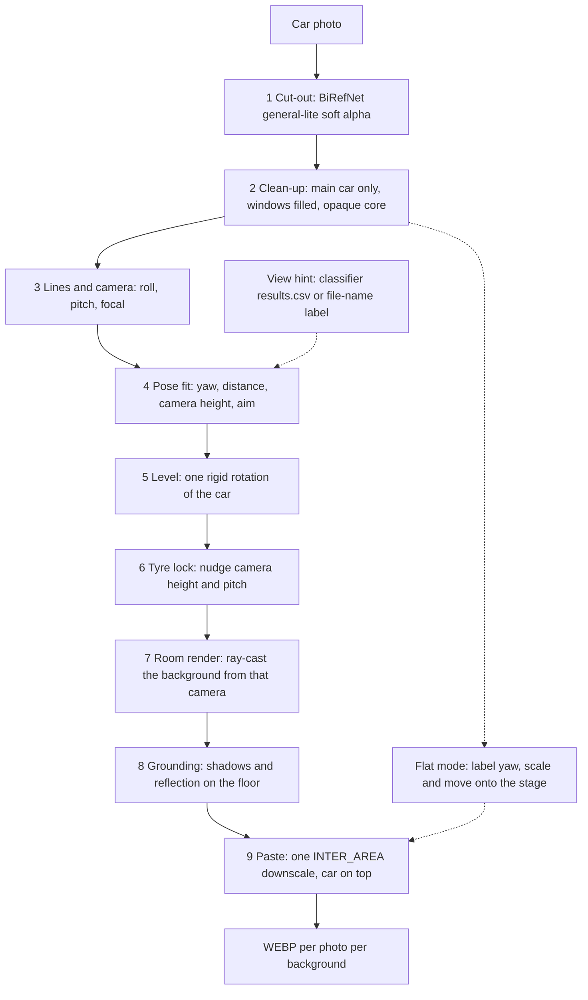

# background_changer

`background_changer` takes a folder of car photos and puts each car on a studio background. It cuts the car out, works out how each photo was taken, and writes **one WEBP per photo per background**. It runs on the CPU only, with no GPU and no torch ([requirements.txt](../../background_changer/requirements.txt)). The entry point is [change_background.py](../../background_changer/change_background.py); everything is set in [config.toml](../../background_changer/config.toml).

This folder explains how it works, for engineers on the team. Start here, then open the topic files listed at the end.

## The hard rule: the car's pixels are not changed

The photos are used to judge damage, so dents, scratches and dirt must survive. The car's pixels get at most two operations:

- **One rigid rotation** that levels a photo taken with a rolled phone (room mode only). It uses premultiplied Lanczos-4 colour clamped to the 3×3 source range, and bilinear alpha. It is skipped below 0.5° ([level.py:25](../../background_changer/car_fit_to_bg/level.py#L25), [level.py:53-94](../../background_changer/car_fit_to_bg/level.py#L53-L94)).
- **One `INTER_AREA` downscale**, never up: [level.py:97-118](../../background_changer/car_fit_to_bg/level.py#L97-L118) in room mode, [compose.py:46-57](../../background_changer/bg_changer/compose.py#L46-L57) in flat mode.

Inside the car's outline, except a thin edge band, alpha is forced to 1 ([segment.py:131-133](../../background_changer/bg_changer/segment.py#L131-L133)). The paste copies every alpha = 1 pixel as is and blends only the soft edge ([compose.py:28-43](../../background_changer/bg_changer/compose.py#L28-L43)). A car cut off by the photo edge can also lose a sliver along that edge after levelling, at most 2% of its visible width ([level.py:26](../../background_changer/car_fit_to_bg/level.py#L26)).

Nothing else touches the car: no relighting, colour matching, sharpening, denoising, upscaling or generated pixels. Windows keep their original glass. Shadows, the reflection and the room are drawn on the background, before the car goes on top. Tests check this bit for bit: [test_car_fit.py:57](../../background_changer/tests/test_car_fit.py#L57), [test_room_mode.py:143](../../background_changer/tests/test_room_mode.py#L143), [test_compose.py:61](../../background_changer/tests/test_compose.py#L61).

## Two modes

| Mode | Setting | The background | The car |
|---|---|---|---|
| **room** (default) | `background_view = "room"` | Re-rendered as a 3D room from each photo's own camera | Levelled once, downscaled once; keeps the photo's own framing (portrait stays portrait) |
| **flat** | `background_view = "flat"` | Used as is (shrunk by `background_scaler` for small photos) | Scaled and moved onto the background's measured stage; keeps its tilt |

The default is set at [config.toml:35](../../background_changer/config.toml#L35) and [change_background.py:721](../../background_changer/change_background.py#L721).

**Flat mode** takes the view angle from the label in the file name (8 bins, 45° apart, [yaw.py:16-17](../../background_changer/bg_changer/yaw.py#L16-L17)). It looks at a 3D proxy of the car through one fixed capture camera, 4.70 m away and 16.08° down ([carmodel.py:31-32](../../background_changer/bg_changer/carmodel.py#L31-L32)). It then scales the photo by `s = min(1, px_per_m * h_rel / H_photo)` ([placement.py:3](../../background_changer/bg_changer/placement.py#L3)). See [04-car-dimensions-and-orientation.md](04-car-dimensions-and-orientation.md).

**Room mode** exists because flat mode floats on photos not shot like the walkaround. A car seen from 20-47° above, on a floor seen from about 9°, floats whatever the scale ([findings.md:165](../../background_changer/docs/findings.md#L165)). Room mode moves the floor's viewpoint to the car's, never the other way round.

## Room mode runs in three stages

1. **Cut out and measure lines** (per photo). The model is loaded once ([change_background.py:837-843](../../background_changer/change_background.py#L837-L843)). Each photo is cut out ([:865](../../background_changer/change_background.py#L865)), its cut-out saved ([:873-874](../../background_changer/change_background.py#L873-L874)), and its background lines measured at a free focal ([:876](../../background_changer/change_background.py#L876), [batch.py:42-45](../../background_changer/car_fit_to_bg/batch.py#L42-L45)). Then the model is deleted to free memory ([:897-899](../../background_changer/change_background.py#L897-L899)).
2. **Settle the lens** (per folder, [change_background.py:522](../../background_changer/change_background.py#L522)). Each photo takes the first of: `[fit] focal` from the config; the folder pool (at least 3 confident photos of the same size, within ±8%; a photo whose own confident focal is over 20% off keeps it, `lens-change`); its own confident lines; EXIF; weak lines (`focal-weak`); a 70° field of view (`focal-prior`) ([lines.py:311-329](../../background_changer/car_fit_to_bg/lines.py#L311-L329)).
   > Note: the docstrings at [batch.py:5-7](../../background_changer/car_fit_to_bg/batch.py#L5-L7) and [lines.py:12-14](../../background_changer/car_fit_to_bg/lines.py#L12-L14), and background_changer/README.md:93, leave out the weak-lines step. The code has it at [lines.py:327-328](../../background_changer/car_fit_to_bg/lines.py#L327-L328).
3. **Fit once, render on every background** ([change_background.py:515-609](../../background_changer/change_background.py#L515-L609)). Photos with strong lines go first, so their camera heights can help the weak-line ones ([:526-527](../../background_changer/change_background.py#L526-L527)). Each photo is fitted once ([:560](../../background_changer/change_background.py#L560)), then placed on every chosen background ([:582-601](../../background_changer/change_background.py#L582-L601)). A background without a 3D room gets the flat placement with the fitted yaw ([:607-616](../../background_changer/change_background.py#L607-L616)).

**Photos that are not placed:** a car cut off at the bottom or on two or more sides ([batch.py:124-131](../../background_changer/car_fit_to_bg/batch.py#L124-L131)); any cut-off car with `cut_frames = "skip"` ([change_background.py:542-543](../../background_changer/change_background.py#L542-L543)); fewer than 400 car pixels, or a car filling over 90% of the frame ([__init__.py:110-114](../../background_changer/car_fit_to_bg/__init__.py#L110-L114)). With `[fit] on_fail = "skip"`, also a failed fit ([change_background.py:574-578](../../background_changer/change_background.py#L574-L578)), and, on that background only, a camera outside its room ([:594-597](../../background_changer/change_background.py#L594-L597)).

## One photo, step by step (room mode)

| Step | What happens | Code | Doc |
|---|---|---|---|
| 1 Cut-out | One `rembg.remove(..., only_mask=True)` call gives a soft 0..1 alpha | [segment.py:173-182](../../background_changer/bg_changer/segment.py#L173-L182) | [02](02-car-cutout-model.md) |
| 2 Clean-up | Classical: threshold 0.5, keep the main central blob, fill windows, drop thin posts, opaque core, `edge_shrink` | [segment.py:115-147](../../background_changer/bg_changer/segment.py#L115-L147) | [03](03-cutout-refinement.md) |
| 3 Lines and camera | LSD segments with the car masked out; measured in stage 1, re-solved at the chosen focal in stage 3 | [lines.py:253-268](../../background_changer/car_fit_to_bg/lines.py#L253-L268), [batch.py:77-88](../../background_changer/car_fit_to_bg/batch.py#L77-L88) | [05](05-camera-angle.md) |
| 4 Pose fit | A 3D proxy built from `cars.json` is fitted to the outline. Fail below IoU 0.75, weak below 0.90 | [pose.py:42](../../background_changer/car_fit_to_bg/pose.py#L42), [pose.py:474-613](../../background_changer/car_fit_to_bg/pose.py#L474-L613) | [04](04-car-dimensions-and-orientation.md), [05](05-camera-angle.md) |
| 5 Level | Rotate by the fitted roll, only with strong lines; weak lines give 0° and `roll-from-silhouette` | [__init__.py:132-170](../../background_changer/car_fit_to_bg/__init__.py#L132-L170) | [05](05-camera-angle.md) |
| 6 Tyre lock | Camera height ±15% and pitch ±3° moved so the contacts land on found tyre bottoms; only when IoU ≥ 0.90 | [__init__.py:175-180](../../background_changer/car_fit_to_bg/__init__.py#L175-L180), [ground.py:158-190](../../background_changer/car_fit_to_bg/ground.py#L158-L190) | [05](05-camera-angle.md) |
| 7 Room render | Camera placed at the stage, output size chosen, every output pixel ray-cast into the room | [place.py:110-127](../../background_changer/car_fit_to_bg/place.py#L110-L127), [render.py:64](../../background_changer/room3d/render.py#L64) | [06](06-3d-room-rendering.md) |
| 8 Grounding | Shadow layers and, on glossy floors, a reflection, on floor pixels in linear light | [place.py:153-170](../../background_changer/car_fit_to_bg/place.py#L153-L170) | [06](06-3d-room-rendering.md) |
| 9 Paste | Linear to sRGB, then the downscaled car on top | [place.py:130](../../background_changer/car_fit_to_bg/place.py#L130), [place.py:171-172](../../background_changer/car_fit_to_bg/place.py#L171-L172) | [06](06-3d-room-rendering.md) |

Steps 1-6 run once per photo; steps 7-9 run once per photo per background ([__init__.py:3-10](../../background_changer/car_fit_to_bg/__init__.py#L3-L10)). The output scale is `s = min(1, max_output_size / long side, floor texels at the stage)` ([place.py:121-122](../../background_changer/car_fit_to_bg/place.py#L121-L122)).

## Models at a glance

| Job | What runs | Kind | Licence | Code |
|---|---|---|---|---|
| Cut the car out | **BiRefNet general-lite** (`birefnet-general-lite`), rembg 2.0.86 on ONNX Runtime 1.31.1, CPU, 4 threads. The only network background_changer runs. | Neural network | MIT (BiRefNet, rembg) | [segment.py:22](../../background_changer/bg_changer/segment.py#L22), [segment.py:159-171](../../background_changer/bg_changer/segment.py#L159-L171) |
| Clean the mask | Threshold, blob choice, hole fill, horizontal opening, erosion | Classical, OpenCV/NumPy | n/a | [segment.py:115-147](../../background_changer/bg_changer/segment.py#L115-L147) |
| Which way round the car is | frame_view_type's ConvNeXt-Small view classifier. **Not run here:** its `results.csv` probabilities, or the file-name label, are read as a soft yaw prior | Neural network, upstream | MIT (code) | [batch.py:56-69](../../background_changer/car_fit_to_bg/batch.py#L56-L69), [pose.py:176-206](../../background_changer/car_fit_to_bg/pose.py#L176-L206) |
| Camera roll, pitch, focal | LSD segments, MSAC vanishing point, scipy `least_squares` (soft_l1) | Classical | n/a | [lines.py:41-45](../../background_changer/car_fit_to_bg/lines.py#L41-L45), [lines.py:197](../../background_changer/car_fit_to_bg/lines.py#L197) |
| Car pose | IoU fit of the 3D proxy with scipy Nelder-Mead; red tail lamps by a hand-coded colour rule | Classical | n/a | [pose.py:394](../../background_changer/car_fit_to_bg/pose.py#L394), [pose.py:216-241](../../background_changer/car_fit_to_bg/pose.py#L216-L241) |
| Tyre lock | scipy `least_squares` with bounds | Classical | n/a | [ground.py:179-185](../../background_changer/car_fit_to_bg/ground.py#L179-L185) |
| Room, shadows, reflection, paste | Ray-casting, Gaussian-pyramid sampling, shading in linear light | Classical, numpy/OpenCV | n/a | [render.py:1-13](../../background_changer/room3d/render.py#L1-L13), [place.py:100](../../background_changer/car_fit_to_bg/place.py#L100) |
| Plate masking | YOLOv9 plate detector (open-image-models, ONNX) in number_plate_detection. **Not run here:** the default `images_folder` is its output | Neural network, upstream | MIT (open-image-models) | [config.toml:11-13](../../background_changer/config.toml#L11-L13), [detector.py:14](../../number_plate_detection/plate_masker/detector.py#L14) |

Every model and the options we rejected are in [01-models-and-options.md](01-models-and-options.md).

## Inputs and outputs

**Inputs.**
- **Photos:** `images_folder`, a folder of `.jpg .jpeg .png .bmp .webp` files or one image ([change_background.py:78](../../background_changer/change_background.py#L78)). Names like `0012.0s_right_95pct.jpg` from frame_view_type carry the view label and the video time ([probe.py:16-17](../../background_changer/bg_changer/probe.py#L16-L17)).
- **[cars.json](../../background_changer/cars.json):** one object per car, in centimetres: `carModel`, `length`, `width`, `height`, `WheelBase`, optional `body` (`suv`, `hatch`, `sedan`) ([cars.py:42-71](../../background_changer/bg_changer/cars.py#L42-L71)). The four dimension keys accept any capitalisation; `carModel` and `body` must be spelled exactly.
- **View hints (room mode, optional):** `frame_view_type/output/<images folder name>/results.csv` ([batch.py:56-60](../../background_changer/car_fit_to_bg/batch.py#L56-L60)).

**config.toml keys that matter** (shipped values):

| Key | Value | Meaning | Code |
|---|---|---|---|
| `images_folder`, `car`, `background` | `"../number_plate_detection/output/sample_vid"`, `"Maruti Suzuki Baleno 2022"`, `"background_1"` | Photos, which car, which background(s): a name, a list or `"all"` | [config.toml:13-25](../../background_changer/config.toml#L13-L25) |
| `background_view` | `"room"` | `"room"` or `"flat"` | [config.toml:35](../../background_changer/config.toml#L35) |
| `max_output_size` | `1920` | Room: cap on the output's long side; 0 = none, else at least 64 | [change_background.py:727-730](../../background_changer/change_background.py#L727-L730) |
| `keep_background_sharp` | `true` | Room: never magnify the background at the stage (min texels 1.0, else 0.0) | [change_background.py:810](../../background_changer/change_background.py#L810) |
| `cut_frames` | `"frame"` | Room: `frame` or `skip`. Flat: `anchor` (= `frame`), `centre`, `skip` | [change_background.py:722-726](../../background_changer/change_background.py#L722-L726) |
| `model`, `threads`, `edge_shrink` | `"birefnet-general-lite"`, `4`, `2` | Cut-out model, ONNX threads (0 = auto), soft-edge erosion in px | [change_background.py:715-718](../../background_changer/change_background.py#L715-L718) |
| `shadow` | `1.0` | Gain on each background's calibrated shadow, 0-1.5 | [change_background.py:736-737](../../background_changer/change_background.py#L736-L737) |
| `[fit] focal`, `[fit] on_fail` | `"auto"`, `"place"` | Room: lens from the lines or a fixed px value; place or skip failed fits | [config.toml:125-133](../../background_changer/config.toml#L125-L133) |

Flat mode also reads `background_scale` and `background_min_width` ([config.toml:68-71](../../background_changer/config.toml#L68-L71)). `save_cutouts` and `quality` set the cut-out and WEBP output.

**Flags.** Command-line options override config.toml for one run: the images folder or image, `--background` (repeat it, or `all`), `--car`, `--background-view`, `--max-output-size`, `--cut-frames`, `--background-scale`, `--backgrounds-folder`, `--out`, `--debug`, `--model`, `--threads`, `--shadow`, `--quality`, `--config` ([change_background.py:684-705](../../background_changer/change_background.py#L684-L705)). `edge_shrink`, `keep_background_sharp`, `save_cutouts`, `cars_file`, `background_min_width` and `[fit]` have no flag.

**Outputs**, in `<output_folder>\<images folder name>\` ([change_background.py:784-785](../../background_changer/change_background.py#L784-L785)):
- `<background>\<photo>.webp`: the result ([:598](../../background_changer/change_background.py#L598)).
- `cutouts\<photo>.webp`: the car alone, full resolution, lossless ([:873-874](../../background_changer/change_background.py#L873-L874)).
- `debug\` and `<background>\debug\`: overlays, with `debug_overlay = true`.
- `results.csv`: one row per photo per background, plus a `note` row for each photo not placed. It is written in a `finally` block, so a run stopped part-way still lists what it did ([:905-916](../../background_changer/change_background.py#L905-L916)). Room mode adds fit, camera and render columns ([:103-108](../../background_changer/change_background.py#L103-L108)).

The run refuses to write into the images folder ([:792-793](../../background_changer/change_background.py#L792-L793)). Column and flag meanings are in [background_changer/README.md](../../background_changer/README.md#output).

## Measured speed

Measured on an Intel i5-1240P laptop, CPU only ([background_changer/README.md](../../background_changer/README.md#speed)):

| Step | Time |
|---|---|
| Load the model | ~8-13 s, once per run |
| Cut the car out | ~12-17 s per photo, typically |
| Room mode: measure the lines | under 1 s per photo |
| Room mode: 3D fit | ~10-20 s per photo, once whatever the number of backgrounds |
| Room mode: render one background with shadows, and save | ~0.2-1 s (the first background_3 render in a run takes ~10 s more) |
| Flat mode: place on one background and save | about 1 s |

> Note: background_changer/README.md:383 says a cut-out can take up to ~45 s (first photos, hot or busy laptop). [spyne-360-spin-findings.md:495](../../background_changer/docs/spyne-360-spin-findings.md#L495) measured 13-17 s per frame, up to ~31 s.

## Files in this folder

- [01-models-and-options.md](01-models-and-options.md): every model and approach used and considered, with licences and why.
- [02-car-cutout-model.md](02-car-cutout-model.md): the BiRefNet cut-out model: loading, the call, threads, speed.
- [03-cutout-refinement.md](03-cutout-refinement.md): the classical clean-up of the mask; no second model.
- [04-car-dimensions-and-orientation.md](04-car-dimensions-and-orientation.md): `cars.json`, the 3D proxy, yaw, flat-mode placement.
- [05-camera-angle.md](05-camera-angle.md): roll, pitch, focal, distance, height, levelling, tyre lock.
- [06-3d-room-rendering.md](06-3d-room-rendering.md): rooms, output camera, ray-casting, fills, grounding, composite.

## Further reading

- [background_changer/README.md](../../background_changer/README.md): how to run, every setting, `results.csv` columns and flags.
- [background_changer/docs/findings.md](../../background_changer/docs/findings.md): research notes and measurements.
- [background_changer/docs/spyne-360-spin-findings.md](../../background_changer/docs/spyne-360-spin-findings.md): the Spyne 360° spin study and ideas not built.
- [docs/README.md](../README.md): index of all project docs. [video_pipeline](../video_pipeline/README.md) chains this project with [frame_view_type](../frame_view_type/README.md) and [number_plate_detection](../number_plate_detection/README.md).
