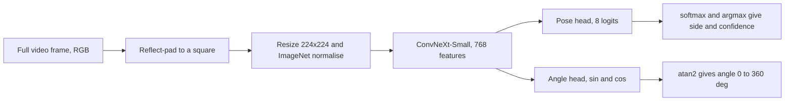

# frame_view_type: the model and the options we had

## In short

- We use **[`veerupandey/view_classifier`](https://github.com/veerupandey/view_classifier)**, checkpoint `joint_v2_best.pt` (about 198 MB, Git LFS), pinned to commit `6514ec2b2bee695c45c2152d95f44ea1bf4ca7e0`.
- It is a ConvNeXt-Small network with two heads: an 8-way view (front ... front-left) and an azimuth predicted as sin/cos, turned into degrees (0° = front, clockwise, 90° = the car's own right).
- Its author reports **94.1% / 3.77°** on the CFV test set and **82.9% / 17.0°** on UnsupCar. No proper accuracy check on our own footage has been done yet; informal checks found labels up to ~24° off on the Mercedes video and up to 177° off on `sample_vid`.
- It runs on the CPU: about **0.8 s per 4K frame** on an Intel i5-1240P laptop. The code is MIT; the training data have their own terms.
- It beat the other options (other Hugging Face models, Orient Anything, CLIP/SigLIP, prompted VLMs, training our own) because it is the only one with exactly our 8 classes, our left/right convention, an angle, and good published accuracy on walk-around video like ours.

How the script samples frames, names files and writes `results.csv`, and how `background_changer` uses the result, is in [02-how-it-works.md](02-how-it-works.md). The overview and index are in [README.md](README.md).

## How it works

The steps below are one call of `classify()` in [classify_video.py:125-136](../../frame_view_type/classify_video.py#L125-L136), plus model loading. Steps marked *(docs)* come from the upstream repo's notes, not from code on disk (see [What this checkout can verify](#what-this-checkout-can-and-cannot-verify)).

1. **Find the vendor code.** The script puts `frame_view_type/vendor/view_classifier` on `sys.path` ([classify_video.py:29-30](../../frame_view_type/classify_video.py#L29-L30)) and imports only three modules: `labels`, `model` and `transforms_cfv` ([classify_video.py:32-34](../../frame_view_type/classify_video.py#L32-L34)). Training code, the Gradio app and the folder CLI are not used.
2. **Load the weights.** A missing file, or one under 1,000,000 bytes (an un-pulled Git LFS pointer), stops the run with a hint to run `git lfs pull` ([classify_video.py:88-93](../../frame_view_type/classify_video.py#L88-L93)). Then `ConvNeXtViewClassifier(pretrained=False)` is built, `torch.load(..., map_location="cpu", weights_only=False)` reads the file, `ckpt["model_state"]` is loaded, and the model is put in eval mode ([classify_video.py:94-97](../../frame_view_type/classify_video.py#L94-L97)). `pretrained=False` means every weight comes from our checkpoint.
3. **Pad to a square.** The whole RGB frame goes through `square_reflect_crop(image, bbox=None)` ([classify_video.py:127](../../frame_view_type/classify_video.py#L127)). With no box there is no crop: the frame is only padded to a square by mirroring its edges. The model was trained on tight crops (car box + 10%), so this works best when the car fills most of the frame *(docs)*.
4. **Resize and normalise.** `eval_tensorize()` ([classify_video.py:170](../../frame_view_type/classify_video.py#L170)) turns the image into a tensor, and `.unsqueeze(0)` adds a batch of one ([classify_video.py:127](../../frame_view_type/classify_video.py#L127)). The upstream notes say this resizes to 224×224 and normalises with ImageNet statistics *(docs)*.
5. **Backbone.** ConvNeXt-Small, ImageNet-pretrained before training, about 50M parameters, gives one 768-number feature per image *(docs)*.
6. **Two heads.** The model returns `(logits, sincos)` ([classify_video.py:128](../../frame_view_type/classify_video.py#L128)).
   - **Pose head**, 8 outputs: softmax, then arg-max gives the view; that bin's probability is the confidence ([classify_video.py:129-134](../../frame_view_type/classify_video.py#L129-L134)).
   - **Angle head**, 2 outputs (sin θ, cos θ): `sincos_to_deg` turns them into degrees ([classify_video.py:133](../../frame_view_type/classify_video.py#L133)). Predicting sin/cos lets the angle wrap cleanly at 360°.
7. **Rename and keep everything.** The model's label names are mapped to ours ([classify_video.py:44-53](../../frame_view_type/classify_video.py#L44-L53)), and all 8 probabilities are kept, not just the winner ([classify_video.py:135](../../frame_view_type/classify_video.py#L135)). Everything runs under `torch.inference_mode()` ([classify_video.py:125](../../frame_view_type/classify_video.py#L125)).

**The view and the angle come from different heads.** They are trained together, so they usually agree, but nothing forces the angle to fall inside the chosen bin. `background_changer` uses the side, the confidence and the 8 probabilities, not the angle (see [02-how-it-works.md](02-how-it-works.md)).

## Training (as described upstream)

From the upstream repo, as summarised in [05-view-classifier-deep-dive.md](../../frame_view_type/docs/05-view-classifier-deep-dive.md) ("How it works"):

- **Joint loss.** Both heads are trained together: `loss = view classification error + 2 × angle error`. The angle term makes mistakes "smooth": a wrong answer is usually the neighbouring view.
- **No horizontal flip, on purpose.** A flipped photo turns a left view into a right view, so plain flip augmentation would teach wrong labels.
- **Data.**
  - CFV (Car Full View): walk-around phone videos of 66 cars in a parking garage. This is the same kind of footage as ours.
  - UnsupCar (Freiburg "Static Cars"): 47 cars, angles re-aligned to the same convention.
  - Car crops come from bounding boxes published on Zenodo.
- The repo has its own `train.py`, so it could be fine-tuned on our frames later (needs a GPU).

## The checkpoint and the pin

| Item | Value | Where |
|---|---|---|
| Upstream repo | `https://github.com/veerupandey/view_classifier` | [frame_view_type/README.md](../../frame_view_type/README.md) (Setup) |
| Pinned commit | `6514ec2b2bee695c45c2152d95f44ea1bf4ca7e0` | README setup step `git checkout`; also the gitlink stored in our first commit `f0aab1e` |
| Local clone | `frame_view_type/vendor/view_classifier/` (gitignored) | [.gitignore:23-24](../../.gitignore#L23-L24) |
| Weights file | `vendor/view_classifier/models/joint_v2_best.pt` | [classify_video.py:37](../../frame_view_type/classify_video.py#L37), [config.toml:16](../../frame_view_type/config.toml#L16) |
| Weights size | about 198 MB; an un-pulled LFS pointer is about 134 bytes | [classify_video.py:88](../../frame_view_type/classify_video.py#L88) (comment) |
| `*.pt` files | gitignored (over GitHub's 100 MB limit) | [.gitignore:15-16](../../.gitignore#L15-L16) |
| Checkpoint key | `"model_state"` (a state dict) | [classify_video.py:96](../../frame_view_type/classify_video.py#L96) |
| PyTorch pins | `torch==2.9.1`, `torchvision==0.24.1` (match the vendor's pins) | [requirements.txt:3-4](../../frame_view_type/requirements.txt#L3-L4) |
| Python | 3.11+ (the script uses `tomllib`) | [classify_video.py:20](../../frame_view_type/classify_video.py#L20) |

**Why pin a commit.** The upstream repo is a one-person research project with no releases (created 2026-09-01, last change 2026-09-12, 1 star when reviewed). A commit hash is the only stable reference. The clone used to sit in the repo as an embedded git repo (gitlink at this commit); commit `6f88ab2` removed it and added the ignore rule.

**Setup** is three commands from `frame_view_type/`: `git clone`, `git checkout <pin>`, `git lfs pull` (see [frame_view_type/README.md](../../frame_view_type/README.md), "Setup"). Without Git LFS the `.pt` file is the 134-byte placeholder and the script refuses to start.

> Note: the upstream repo asks for Python 3.12 or newer. We use 3.11; inference was checked on 3.11 with `torch 2.9.1+cpu` on 2026-11-04. It is not officially supported upstream.

## What this checkout can and cannot verify

The vendor folder is **not on disk** in this checkout (`frame_view_type/vendor` does not exist). It is gitignored, so a fresh clone of our repo never has it. `classify_video.py` imports from it at module level ([classify_video.py:32-34](../../frame_view_type/classify_video.py#L32-L34)), so the script fails on import until the three setup commands are run.

| Fact | Checked here? | How |
|---|---|---|
| Pinned commit `6514ec2b...` | Yes | README setup line, and `git ls-tree f0aab1e frame_view_type/vendor/` shows a gitlink to that commit |
| Names we import: `POSE_CLASSES`, `sincos_to_deg`, `ConvNeXtViewClassifier`, `eval_tensorize`, `square_reflect_crop` | Yes, as names | [classify_video.py:32-34](../../frame_view_type/classify_video.py#L32-L34) |
| The 8 raw label names (`front`, `front_right`, `right`, `rear_right`, `rear`, `rear_left`, `left`, `front_left`) | Indirectly | Building the `probs` dict looks up every `POSE_CLASSES` name in `SIDE_NAMES` on every frame and would raise `KeyError` on any other name ([classify_video.py:44-53](../../frame_view_type/classify_video.py#L44-L53), [classify_video.py:135](../../frame_view_type/classify_video.py#L135)); the script has run (timings recorded), so the names match |
| Model returns `(logits, sincos)`; checkpoint holds `model_state` | Yes | [classify_video.py:96](../../frame_view_type/classify_video.py#L96), [classify_video.py:128](../../frame_view_type/classify_video.py#L128) |
| CPU only, eval mode, built with `pretrained=False`, every weight loaded from the checkpoint | Yes | [classify_video.py:94-97](../../frame_view_type/classify_video.py#L94-L97) (`load_state_dict` is strict by default) |
| ConvNeXt-Small backbone, ~50M parameters, 768-d feature | No, docs only | The class name only says "ConvNeXt" |
| 224×224 input and ImageNet normalisation | No, docs only | Lives in `transforms_cfv.eval_tensorize` |
| Order of `POSE_CLASSES` (sets the order of the `prob_*` columns) | No, docs only | The notes list it as front, front_right, right, rear_right, rear, rear_left, left, front_left |
| `sincos_to_deg(sin, cos)` argument order, 0–360 range, 0° = front clockwise | No, docs only | We pass `sincos[0, 0]` first, then `sincos[0, 1]` |
| Training recipe, loss weight 2, flip off | No, docs only | Upstream `train.py` and docs |
| Accuracy numbers | No, docs only | Upstream `docs/results/joint_v2_metrics.json`, read on GitHub |
| Weights size 198 MB | No, docs only | README and code comment |

> Note: the upstream review in [05-view-classifier-deep-dive.md](../../frame_view_type/docs/05-view-classifier-deep-dive.md) was done on GitHub on 2026-11-04 and does not say which commit it read.

## The maths and constants

### Angle convention and the 8 bins

The azimuth is the camera's angle around the car seen from above: **0° = camera straight in front of the car, increasing clockwise, 90° = the car's right side.** "Left" and "right" are the car's own sides (left = driver side on a left-hand-drive car). Each class is a 45° slice centred on a multiple of 45° (front = 337.5°–22.5°, front-right = 22.5°–67.5°, ...). The full table of model names, our names, centres and ranges is in [02-how-it-works.md](02-how-it-works.md#the-8-labels).

- Renames: [classify_video.py:44-53](../../frame_view_type/classify_video.py#L44-L53). Ranges: [01-problem-definition.md](../../frame_view_type/docs/01-problem-definition.md).
- The same centres are `BIN_DEG` in `background_changer` ([yaw.py:16-17](../../background_changer/bg_changer/yaw.py#L16-L17)), and its 3D car proxy uses the same yaw convention ([carmodel.py:16](../../background_changer/bg_changer/carmodel.py#L16)).
- No code in our repo turns the angle into a bin; the side always comes from the pose head. If you need it: `bin = floor(((angle + 22.5) mod 360) / 45)`, with bin 0 = front, 1 = front-right, ... 7 = front-left.

### Formulas

| Name | Formula | Code |
|---|---|---|
| Probabilities | `probs = softmax(logits)` over the 8 pose outputs | [classify_video.py:129](../../frame_view_type/classify_video.py#L129) |
| View | `i = argmax(probs)`; `side = SIDE_NAMES[POSE_CLASSES[i]]` | [classify_video.py:130-132](../../frame_view_type/classify_video.py#L130-L132) |
| Confidence | `conf = probs[i]`, 0–1 (the file name shows `round(conf * 100)`) | [classify_video.py:134](../../frame_view_type/classify_video.py#L134), [classify_video.py:177](../../frame_view_type/classify_video.py#L177) |
| Angle | `angle_deg = sincos_to_deg(sincos[0,0], sincos[0,1])`, i.e. `atan2(sin, cos)` in degrees, 0–360 (docs) | [classify_video.py:133](../../frame_view_type/classify_video.py#L133) |
| Training loss (upstream) | `loss = classification error + 2 × angle error` | upstream, see [05-view-classifier-deep-dive.md](../../frame_view_type/docs/05-view-classifier-deep-dive.md) |
| Flip with label swap (option E only) | a flipped image at azimuth θ shows azimuth `(360 − θ) mod 360`: left ↔ right, front-left ↔ front-right, back-left ↔ back-right; front and back unchanged | not in code |

### Constants

| Name | Value | Meaning | Code |
|---|---|---|---|
| `DEFAULT_CKPT` | `vendor/view_classifier/models/joint_v2_best.pt` | Weights used when `config.toml` / `--ckpt` give none | [classify_video.py:37](../../frame_view_type/classify_video.py#L37) |
| LFS pointer threshold | 1,000,000 bytes | A smaller checkpoint is treated as an un-pulled pointer; the script exits | [classify_video.py:89](../../frame_view_type/classify_video.py#L89) |
| `pretrained` | `False` | No ImageNet start weights at build time; `load_state_dict` then fills every weight from the checkpoint | [classify_video.py:94-96](../../frame_view_type/classify_video.py#L94-L96) |
| `map_location` | `"cpu"` | Always CPU; there is no CUDA/MPS choice in our script | [classify_video.py:95](../../frame_view_type/classify_video.py#L95) |
| `weights_only` | `False` | Lets `torch.load` run pickle code; load only this exact file | [classify_video.py:95](../../frame_view_type/classify_video.py#L95) |
| `bbox` | `None` | No car crop; whole frame reflect-padded to a square | [classify_video.py:127](../../frame_view_type/classify_video.py#L127) |
| Input size | 224×224 (docs) | Size the padded frame is resized to | vendor `transforms_cfv` (not on disk) |
| Pose head size | 8 | One output per view | [classify_video.py:44-53](../../frame_view_type/classify_video.py#L44-L53) (names) |
| Angle head size | 2 | `(sin θ, cos θ)` | [classify_video.py:133](../../frame_view_type/classify_video.py#L133) |
| Angle-loss weight | 2 (docs) | Weight of the angle error in training | upstream |
| Torch threads | PyTorch default | Printed at start-up, not set by us | [classify_video.py:171](../../frame_view_type/classify_video.py#L171) |

> Note: [05-view-classifier-deep-dive.md](../../frame_view_type/docs/05-view-classifier-deep-dive.md) ("At a glance") says the model picks CPU, CUDA or Apple MPS automatically. That describes the upstream code; our `classify_video.py` always loads on the CPU and never moves the model to a GPU.

## Reported accuracy

All numbers are the author's own, from the upstream `docs/results/joint_v2_metrics.json`, as copied into [05-view-classifier-deep-dive.md](../../frame_view_type/docs/05-view-classifier-deep-dive.md) ("How good is it"). None of the numbers in the table was measured by us.

| Test set | Frames (cars) | 8-view accuracy | Mean angle error | Correct or next-door view |
|---|---|---|---|---|
| CFV test (same kind of footage it trained on) | 2,527 (7 cars) | **94.1%** | 3.77° | 99.9% |
| CFV val | 4,693 (13 cars) | 93.6% | 3.8° | not reported |
| UnsupCar test (other photos, other place) | 619 | **82.9%** | 17.0° | 89.7% |
| 12 Wikimedia car-damage photos | 12 | no labels | no labels | 8 of 12 at ≥ 60% confidence |

- **CFV:** almost every mistake is a neighbouring view (e.g. front ↔ front-right). Zero left ↔ right mix-ups.
- **UnsupCar:** some mistakes are about 180° off. 26 of 95 front-left frames and 14 of 89 left frames were called back-right. These carry the 17.0° mean error.
- **Small test set:** CFV test is 7 cars, so the 94% has a wide margin. The worst validation cars still scored 90–92%.
- **For our footage** the notes expect something between the two, roughly 83–94%, and closer to 94% when the car fills the frame as in CFV. This is an expectation, not a measurement.
- **What we have seen on our footage (informal, no hand labels).** background_changer's notes compared the labels with a perspective fit: off by up to ~24° from the bin centre on the 20 Mercedes frames, i.e. at worst one bin off near a border (e.g. `0014 back-right` is really about 111°) ([findings.md:92](../../background_changer/docs/findings.md#L92)), but off by up to 177° on the 14 `sample_vid` frames, a near-opposite view ([findings.md:165](../../background_changer/docs/findings.md#L165)). `sample_vid` is a close, steep, often cut-off phone video, far from CFV.

> Note: [02-options-compared.md](../../frame_view_type/docs/02-options-compared.md) gives the CFV test angle error as 3.77°; [05-view-classifier-deep-dive.md](../../frame_view_type/docs/05-view-classifier-deep-dive.md) rounds it to 3.8°.

## Speed on CPU

Measured on an Intel i5-1240P laptop, CPU only, with `Final_zoomed_car.mp4` (38 s, 4K, 30 fps) ([frame_view_type/README.md:81-92](../../frame_view_type/README.md#L81-L92)): about **0.8 s per sampled 4K frame** (reflect-pad, run the model), plus about **19 s** to read through every frame of the video, whatever the interval. Every 2 s took 47 s in all (20 frames); every 5 s took 35 s (8 frames). The full table and what the numbers mean are in [02-how-it-works.md](02-how-it-works.md#speed-on-cpu).

- Model loading time and thread count are printed at start-up but were not recorded in the notes.
- [number_plate_detection/docs/findings.md:11](../../number_plate_detection/docs/findings.md#L11) quotes the same 0.8 s per frame when comparing costs.
- Lower-resolution videos should be much faster; no number is recorded.

## Licence

| Part | Terms |
|---|---|
| Upstream code | MIT |
| CFV (training data) | Apache-2.0 |
| UnsupCar / Freiburg Static Cars and the Zenodo box labels (training data) | Not spelled out in the upstream repo |
| The weights `joint_v2_best.pt` | Trained on all of the above; check the data terms before any commercial use |

## Options we had

The research in [02-options-compared.md](../../frame_view_type/docs/02-options-compared.md) found five kinds of option (A to E), from "download and run" to "train our own", plus the CFV authors' own model from [03-datasets.md](../../frame_view_type/docs/03-datasets.md). Everything except the hosted VLM APIs is free to run locally.

| Option | Fit to our 8 classes | Reported accuracy | Licence | Hardware | Verdict | Why |
|---|---|---|---|---|---|---|
| **A1** [`veerupandey/view_classifier`](https://github.com/veerupandey/view_classifier) | Exact 8 + angle | 94.1% CFV test, 82.9% UnsupCar test | MIT code; data has its own terms | CPU (0.8 s per 4K frame measured); upstream also CUDA/MPS | **Chosen** | Our classes and left/right convention, an angle head, the best published numbers, trained on walk-around video, ready weights |
| **A2** [`mitbersh/car-view-classification`](https://huggingface.co/mitbersh/car-view-classification) | Exact 8 + "other" (two 3-way heads, left/centre/right × front/centre/back, combined) | Not published | Not stated | CPU (ResNet-18, small) | Not tried (rank 3 baseline) | No accuracy, licence or inference code on the card (code is in the AutoInspect repo); gated, partly-Carvana training set |
| **A3** [`tiesenx14/vit-base-patch16-224-car-angle`](https://huggingface.co/tiesenx14/vit-base-patch16-224-car-angle) | Exact 8 + "undetermined" (Vietnamese labels) | Not published | Not stated | CPU OK (ViT-base, 86M) | Not tried (rank 3 baseline) | One-line HF `pipeline`, but unknown data, no metrics, 7 downloads a month; unclear if left/right is the car's or the viewer's |
| **A4** [`Nekshay/SWIN_Angle_Detection_Car`](https://huggingface.co/Nekshay/SWIN_Angle_Detection_Car) | 16 poses `Angle1`...`Angle16` (likely Carvana, 22.5° apart), collapse to 8 | Not published | Not stated | CPU OK, GPU faster (Swin-base) | Not tried | Front index and direction unknown; no card, metrics or licence; about 240 downloads a month |
| **A5** [`ArrayDice/car_orientation_classification`](https://huggingface.co/ArrayDice/car_orientation_classification) | Labels not listed | 69% (own eval set) | Apache-2.0 | CPU OK (ViT-base) | Rejected | Low accuracy, unknown labels; "listed for completeness only" |
| **CFV model** [`fort-cyber/car-orientation`](https://github.com/fort-cyber/car-orientation) | Trained on CFV angle labels; output format not checked | Not recorded in our notes | Apache-2.0 | Not documented | Not tried (rank 4) | Trained on the data closest to our footage; weights via a Google Drive link |
| **B** [Orient Anything](https://github.com/SpatialVision/Orient-Anything) V1 / V2 | Azimuth, bin into 8 | Zero-shot, general objects, no car-only number; V2 Pascal3D+ median error 15.0° (V1 22.9°) | CC-BY-4.0 | Small 23M on CPU; Base 88M; Large 305M wants a GPU | Second choice, not tried | General model; a 15–20° median error is a big share of a 45° slice; one object per image; azimuth direction unverified |
| **C** CLIP / SigLIP text prompts | Any classes via text | Near chance on left vs right in research | Open (varies) | CPU OK | Rejected as the main approach | Contrastive models cannot tell the car's left from its right; frozen features still useful for E |
| **D** Prompted VLM: Qwen-VL locally, or Gemini / GPT / Claude APIs | Any classes via text | No published number for this task | Open (Qwen-VL) or paid API | GPU for Qwen-VL; none for APIs (small fee per image) | Not tried (rank 5 "no setup" baseline) | Unmeasured; may share CLIP's left/right weakness; few-shot examples may help |
| **E** Fine-tune our own | Whatever we choose | Depends on the data | Ours (training-data terms still apply) | GPU for training (minutes to hours), CPU for inference | Fallback | Only needed if A and B fall short on our footage |

**Also seen, not a fit:** [SyedaAimanAli/CNN-Classifier](https://github.com/SyedaAimanAli/CNN-Classifier) (front / back / side only) and [VoNet](https://dl.acm.org/doi/pdf/10.1145/3018009.3018045) (5 classes; merges left and right).

> Note: for A4, [02-options-compared.md](../../frame_view_type/docs/02-options-compared.md) says "merge pairs of neighbouring poses", while [03-datasets.md](../../frame_view_type/docs/03-datasets.md) points out that every second Carvana pose sits exactly on a class border. Merging pairs would shift every class centre by 11.25°; dropping or flagging the border poses keeps our centres.

### B. Orient Anything, in more detail

- Estimates the 3D orientation of **any** object from one image: azimuth, polar angle, in-plane rotation and a confidence. Trained on about 2M rendered images of 3D models.
- **V2** (NeurIPS 2025 Spotlight) is much better than V1 and also models symmetric objects. On Pascal3D+ the median error fell from 22.9° to 15.0°.
- Sizes: Small (23M parameters), Base (88M), Large (305M). Small should run on a CPU.
- Works best with a single object per image, so a busy car park would need a car crop first.
- Why second: it needs no car-specific training, so it may cope better with odd cars or camera heights. But there is no car-only accuracy, and its 15–20° median error is a large share of a 45° bin.

### C. CLIP / SigLIP prompts, in more detail

- The idea: compare each frame with text such as "a photo of the front-left of a car" and take the best match.
- ["What's left can't be right"](https://arxiv.org/abs/2311.11477v1) (2023) finds CLIP around chance on left/right relations.
- The [Visual Spatial Reasoning benchmark](https://arxiv.org/pdf/2205.00363) (2022) finds left/right especially hard when it depends on the object's own orientation. That is exactly our case.
- Likely fine for front vs back vs side; unreliable for the left/right and diagonal splits.

### D. Prompted vision-language models, in more detail

- Ask a chat model "Which side of this car is shown? Answer one of: front, front-right, ...".
- Open: the Qwen-VL family, run locally (needs a GPU for decent speed). Hosted: Gemini, GPT or Claude APIs, no setup, a small fee per image.
- No published accuracy for this task. The nearest benchmark (picking the right camera in multi-camera driving scenes) is a different task.

### E. Fine-tune our own, in more detail

- **Model:** a small CNN (ResNet, EfficientNet, MobileNet), or a linear head on frozen DINOv2 or CLIP features. Or fine-tune `view_classifier` itself with its own `train.py`.
- **Data:** CFV and/or Carvana, plus hand-labelled frames of ours.
- **Flip with label swap.** A horizontal flip turns a left view into a right view. So flipping is allowed only if the label is swapped too: left ↔ right, front-left ↔ front-right, back-left ↔ back-right; front and back stay. For an angle label this is `θ → (360 − θ) mod 360`. This doubles the data. `view_classifier` instead turned flips off. A flipped car is a mirror image (steering wheel and fuel cap on the other side), so the small left/right cues are swapped too.
- **Predict an angle as well.** Predicting sin/cos alongside the class gives smoother errors and makes smoothing over video frames easy (a circular mean of the angle).

## Datasets considered

From [03-datasets.md](../../frame_view_type/docs/03-datasets.md). None is used by our code; they matter for testing other models or for option E.

| Dataset | Labels | Size | Licence | Fit |
|---|---|---|---|---|
| [CFV (Car Full View)](https://huggingface.co/datasets/fort-cyber/CFV-Dataset) | Angle 0–360° per frame, car box, car ID; plates blurred | 23,826 frames at 512×512 (18.8k train, 5.05k test), about 66 cars, 1.66 GB | Apache-2.0 | **Best.** Walk-around video like ours; `view_classifier` was trained on it |
| [Carvana](https://www.kaggle.com/c/carvana-image-masking-challenge) (Kaggle 2017) | 16 studio turntable poses, 22.5° apart, index in the file name (`<car_id>_01.jpg` ... `_16.jpg`) | Thousands of cars; the labelled train split alone is 318 cars × 16 | Kaggle competition terms (likely restrict other and commercial use) | Good for training, poor for testing (studio, plain background) |
| [`mitbersh/car-view-classification`](https://huggingface.co/datasets/mitbersh/car-view-classification) | Our 8 classes + "other", image-folder format | 1k–10k images, 147 MB | Not stated; gated; partly Carvana, so redistribution may be restricted | Ready-made classes, but terms unclear |

- **CFV notes.** Recorded clockwise from the front; a few frames hand-labelled, the rest interpolated. The dataset card calls the angle "pitch", but it is the azimuth. Front and direction still need checking on a few frames. Paper: Catruna et al., *Electronics* 12(24), 2023.
- **Carvana notes.** Every second pose sits on one of our class centres; the poses in between sit on class borders. Which index is the front, and the turning direction, are unverified.
- **Not a fit:** CompCars (coarse views with left and right merged; non-commercial research only) and Stanford Cars (make/model labels only, no views).

## Recommendation order and why A1 won

The try-order from [04-recommendation-and-next-steps.md](../../frame_view_type/docs/04-recommendation-and-next-steps.md):

| Order | Try | Effort | Status |
|---|---|---|---|
| 1 | `veerupandey/view_classifier` | Clone, `git lfs pull`, run | **Built** as `classify_video.py` |
| 2 | Orient Anything V2 | Hugging Face Space first, then locally | Not tried |
| 3 | `mitbersh` and `tiesenx14` HF models | A few lines of `transformers` | Not tried |
| 4 | CFV's own model, `fort-cyber/car-orientation` | Download weights from the repo's link | Not tried |
| 5 | A prompted VLM | Paste frames into a chat, or a short API script | Not tried |
| skip | CLIP / SigLIP prompts as the main approach | | Poor at left vs right |
| fallback | E, fine-tune our own | | Only if all of the above fall short |

**Why A1 won:**

- **Exactly our 8 classes**, with the car's own left and right, and 0° = front, clockwise. No mapping or merging.
- **An angle as well as a class.** It shows how close a frame is to a bin border, and it makes smoothing over neighbouring frames a simple circular mean.
- **The only option with good published accuracy**: 94.1% on CFV test, 82.9% on unfamiliar UnsupCar photos, with almost all CFV errors one bin off and no left/right swaps.
- **Trained on walk-around phone video**, the same kind of footage as ours.
- **Ready to use**: trained weights that downloaded fine (checked 2026-11-04), small enough for a laptop CPU, and only PyTorch, torchvision and Pillow needed.
- **Permissive code licence** (MIT) and free.

> Note: the short ranking in [frame_view_type/docs/README.md](../../frame_view_type/docs/README.md) puts the prompted VLM 4th and leaves out the CFV model; the fuller list in 04 is the one above. The same README still says "research only (2026-11-03). Nothing has been built"; since then `classify_video.py` was built and timed.

## Limits

- **No accuracy on our own footage.** The planned check (50–100 hand-labelled frames, confusion matrix, off-by-one rate, then again with smoothing) has not been done. Informal checks saw a label about 180° off on `sample_vid` (see "Reported accuracy"). See [04-recommendation-and-next-steps.md](../../frame_view_type/docs/04-recommendation-and-next-steps.md).
- **Whole frame, not a car crop.** The model was trained on box + 10% crops. A small car in a wide frame is far from what it saw in training.
- **No reject class.** Close-ups, interiors, wheels and VIN plates still get one of the 8 views. A low confidence is the only warning.
- **180° flips on unfamiliar footage**, as seen on UnsupCar. Each frame is judged alone; smoothing across frames is planned, not built (see [02-how-it-works.md](02-how-it-works.md)).
- **Small published test set** (7 CFV test cars).
- **Weights licence unclear** for commercial use (UnsupCar / Freiburg / Zenodo terms).
- **Pickle load.** `weights_only=False` runs code from the `.pt` file. Load only the file from the pinned upstream commit.
- **One-person upstream project**, no releases. Hence the commit pin.
- **CPU only in our script**, about 0.8 s per 4K frame plus about 19 s to read a 38 s 4K video.
- **Unofficial Python version.** Upstream asks for 3.12+; we run 3.11.
- **Not checkable here.** Backbone, input size, normalisation, class order and the `sincos_to_deg` convention are taken from the upstream notes, because the vendor code is gitignored and not on disk.

## Further reading

- [README.md](README.md): overview and index of these docs.
- [02-how-it-works.md](02-how-it-works.md): frame sampling, file names, `results.csv`, and how `background_changer` uses the view.
- [../background_changer/04-car-dimensions-and-orientation.md](../background_changer/04-car-dimensions-and-orientation.md): how the view label becomes the car's yaw.
- [frame_view_type/README.md](../../frame_view_type/README.md): setup, settings, output and measured speed.
- [frame_view_type/docs/README.md](../../frame_view_type/docs/README.md): the original research notes, with:
  - [01-problem-definition.md](../../frame_view_type/docs/01-problem-definition.md): the 8 classes as angles and the left/right convention.
  - [02-options-compared.md](../../frame_view_type/docs/02-options-compared.md): every model found, with sources.
  - [03-datasets.md](../../frame_view_type/docs/03-datasets.md): datasets, with sources.
  - [04-recommendation-and-next-steps.md](../../frame_view_type/docs/04-recommendation-and-next-steps.md): try-order and evaluation plan.
  - [05-view-classifier-deep-dive.md](../../frame_view_type/docs/05-view-classifier-deep-dive.md): the chosen model's repo, results and risks.
