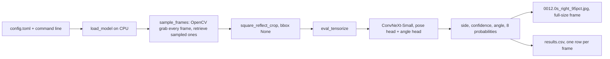

# How classify_video.py works

## In short

[`classify_video.py`](../../frame_view_type/classify_video.py) reads a car video with OpenCV and keeps one frame every `every_seconds` (2 by default). It pads each kept frame to a square by mirroring its edges and runs the vendored `view_classifier` model on the CPU, one frame at a time.
The 8-way head gives the side, and that side's softmax probability is the confidence. A separate sin/cos head gives an angle in degrees.
Each kept frame is saved at full size as `<time>s_<side>_<conf>pct.jpg`, and `results.csv` gets one row per frame with the angle and all 8 probabilities.
There is no car crop, no smoothing over time and no "not a car" class. Why this model was picked is in [01-model-and-options.md](01-model-and-options.md); the overview is in [README.md](README.md).

**Before you run it:** the model package `frame_view_type/vendor/view_classifier` is gitignored ([.gitignore:24](../../.gitignore#L24)) and is not in this checkout. The script imports from it at start-up ([classify_video.py:32-34](../../frame_view_type/classify_video.py#L32-L34)), so it cannot run until the repo is cloned at the pinned commit and its weights are pulled ([frame_view_type/README.md:9-21](../../frame_view_type/README.md#L9-L21)).

## How it works

1. **Read the settings.** `load_config` reads `config.toml` with `tomllib` ([classify_video.py:56-84](../../frame_view_type/classify_video.py#L56-L84)). It rejects unknown keys, non-string paths and a non-numeric `every_seconds`, and resolves relative paths against the config file's folder ([classify_video.py:80](../../frame_view_type/classify_video.py#L80)). Command-line options then override the config ([classify_video.py:151-155](../../frame_view_type/classify_video.py#L151-L155)). The full precedence table is below.
2. **Make the output folder.** Results go to `<output>/<video stem>/`, created if missing ([classify_video.py:164-165](../../frame_view_type/classify_video.py#L164-L165)). The script prints the input, output and interval ([classify_video.py:166](../../frame_view_type/classify_video.py#L166)).
3. **Load the model.** A missing checkpoint, or one under 1,000,000 bytes, is treated as an un-pulled Git LFS pointer and the script exits with a `git lfs pull` hint ([classify_video.py:88-93](../../frame_view_type/classify_video.py#L88-L93)). Otherwise it builds `ConvNeXtViewClassifier(pretrained=False)` (no ImageNet download; all weights come from the checkpoint), loads the file with `torch.load(map_location="cpu", weights_only=False)`, copies in `ckpt["model_state"]` and switches to eval mode ([classify_video.py:94-97](../../frame_view_type/classify_video.py#L94-L97)). It then gets the vendor's eval transform with `eval_tensorize()` and prints the load time and torch's CPU thread count ([classify_video.py:168-171](../../frame_view_type/classify_video.py#L168-L171)).
4. **Pick frames.** `sample_frames` opens the video with `cv2.VideoCapture` and reads the frame rate from `cv2.CAP_PROP_FPS` ([classify_video.py:103-108](../../frame_view_type/classify_video.py#L103-L108)). It calls `grab()` on every frame in order and `retrieve()` only on the frames it keeps ([classify_video.py:110-120](../../frame_view_type/classify_video.py#L110-L120)). The code comment says this is more reliable than seeking. Each kept frame is converted BGR to RGB with `cv2.cvtColor(bgr, cv2.COLOR_BGR2RGB)` and wrapped as a PIL image, with time `idx / fps` ([classify_video.py:117](../../frame_view_type/classify_video.py#L117)). The exact rule is in the maths section.
5. **Prepare the image.** The whole frame goes through the vendor's `square_reflect_crop(image, bbox=None)`: no crop to the car, just padding to a square by mirroring the edges. The vendor transform then turns it into a tensor, and `.unsqueeze(0)` adds a batch dimension of 1 ([classify_video.py:127](../../frame_view_type/classify_video.py#L127)). The docs say the transform resizes to 224×224 and normalises with ImageNet statistics ([docs/05:49-51](../../frame_view_type/docs/05-view-classifier-deep-dive.md#L49-L51)). This cannot be checked here: see "Preprocessing: what can be checked" below.
6. **Classify.** `classify` runs under `@torch.inference_mode()` ([classify_video.py:125](../../frame_view_type/classify_video.py#L125)). The model returns 8 logits and a (sin, cos) pair ([classify_video.py:128](../../frame_view_type/classify_video.py#L128)). Softmax over the logits gives the 8 probabilities. The arg-max is the side, renamed through `SIDE_NAMES`, and its probability is the confidence. The angle comes from `sincos_to_deg` on the second head ([classify_video.py:129-136](../../frame_view_type/classify_video.py#L129-L136)).
7. **Save the frame.** The original full-size RGB frame (not the padded square) is saved as JPEG, quality 95, named `f"{t:06.1f}s_{side}_{round(conf * 100)}pct.jpg"` ([classify_video.py:177-178](../../frame_view_type/classify_video.py#L177-L178)). One line per frame is printed: time, side, angle, confidence and file name ([classify_video.py:179-182](../../frame_view_type/classify_video.py#L179-L182)).
8. **Write `results.csv` and the summary.** After the last frame, the rows are written in one go ([classify_video.py:195-200](../../frame_view_type/classify_video.py#L195-L200)). If no frame was read, the script exits and writes no CSV. Then it prints the frame count, the loop time, seconds per frame (including reading the video) and the count per side ([classify_video.py:202-205](../../frame_view_type/classify_video.py#L202-L205)).

## The maths and constants

### Settings and precedence

Command line beats `config.toml`, which beats the code's fallback.

| Setting | Command line | `config.toml` | Fallback in code | Code |
|---|---|---|---|---|
| Video | positional `<video>` | `input = "sample_vid.mp4"` ([config.toml:7](../../frame_view_type/config.toml#L7)) | none: the script stops with "no input video" | [classify_video.py:144](../../frame_view_type/classify_video.py#L144), [:152](../../frame_view_type/classify_video.py#L152), [:157-158](../../frame_view_type/classify_video.py#L157-L158) |
| Output base folder | `--out` | `output = "output"` ([config.toml:10](../../frame_view_type/config.toml#L10)) | `DEFAULT_OUTPUT = ROOT / "output"` | [classify_video.py:38](../../frame_view_type/classify_video.py#L38), [:146](../../frame_view_type/classify_video.py#L146), [:154](../../frame_view_type/classify_video.py#L154) |
| Interval | `--every` (float) | `every_seconds = 2` ([config.toml:13](../../frame_view_type/config.toml#L13)) | `DEFAULT_EVERY = 2.0` | [classify_video.py:39](../../frame_view_type/classify_video.py#L39), [:145](../../frame_view_type/classify_video.py#L145), [:153](../../frame_view_type/classify_video.py#L153) |
| Checkpoint | `--ckpt` | `checkpoint = "vendor/view_classifier/models/joint_v2_best.pt"` ([config.toml:16](../../frame_view_type/config.toml#L16)) | `DEFAULT_CKPT = VENDOR / "models" / "joint_v2_best.pt"` | [classify_video.py:37](../../frame_view_type/classify_video.py#L37), [:147](../../frame_view_type/classify_video.py#L147), [:155](../../frame_view_type/classify_video.py#L155) |
| Config file | `--config` | n/a | `config.toml` next to the script | [classify_video.py:36](../../frame_view_type/classify_video.py#L36), [:148](../../frame_view_type/classify_video.py#L148), [:151](../../frame_view_type/classify_video.py#L151) |

- **Where relative paths start.** Paths in a config file are relative to that file's folder ([classify_video.py:80](../../frame_view_type/classify_video.py#L80)); an absolute path stays absolute. Paths typed on the command line are relative to the current folder. The code fallbacks are absolute, built from the script's folder `ROOT` ([classify_video.py:28-29](../../frame_view_type/classify_video.py#L28-L29)).
- **Missing config.** A missing default `config.toml` is ignored (fallbacks apply). A missing file named with `--config` is an error ([classify_video.py:58-61](../../frame_view_type/classify_video.py#L58-L61)).
- `--every` is checked with `is not None`, so `--every 0` is not silently replaced by the config value; it is rejected by the `> 0` check instead ([classify_video.py:153](../../frame_view_type/classify_video.py#L153), [:161-162](../../frame_view_type/classify_video.py#L161-L162)).

> Note: [frame_view_type/README.md:36](../../frame_view_type/README.md#L36) gives the default `input` as `"Final_zoomed_car.mp4"`. The code reads `config.toml`, which now says `"sample_vid.mp4"`.

> Note: [frame_view_type/README.md:41](../../frame_view_type/README.md#L41) says relative paths are relative to the `frame_view_type` folder. That holds for the default `config.toml` only; command-line paths are relative to the current folder.

### Checks that stop the script

| Check | Value | Message / effect | Code |
|---|---|---|---|
| Allowed config keys | `input`, `output`, `checkpoint`, `every_seconds` | Any other key: exit, listing the allowed ones | [classify_video.py:40-41](../../frame_view_type/classify_video.py#L40-L41), [:70-75](../../frame_view_type/classify_video.py#L70-L75) |
| TOML syntax | n/a | Exit, with a hint to put Windows paths in single quotes | [classify_video.py:65-69](../../frame_view_type/classify_video.py#L65-L69) |
| Path settings are text | `str` | Exit if a path is not a quoted string | [classify_video.py:76-79](../../frame_view_type/classify_video.py#L76-L79) |
| `every_seconds` type | `int` or `float`, not `bool` | Exit otherwise | [classify_video.py:81-83](../../frame_view_type/classify_video.py#L81-L83) |
| Video exists | n/a | Exit "input video not found" | [classify_video.py:159-160](../../frame_view_type/classify_video.py#L159-L160) |
| Interval | `every > 0` | Exit otherwise | [classify_video.py:161-162](../../frame_view_type/classify_video.py#L161-L162) |
| Checkpoint size | `>= 1_000_000` bytes | Smaller or missing: treated as a Git LFS pointer (~134 bytes; the real file is ~198 MB), exit with `git -C vendor/view_classifier lfs pull` | [classify_video.py:88-93](../../frame_view_type/classify_video.py#L88-L93) |
| Video opens | `cap.isOpened()` | Exit "cannot open video" | [classify_video.py:104-105](../../frame_view_type/classify_video.py#L104-L105) |
| Frame rate | `fps > 0` | Exit "video reports invalid fps" | [classify_video.py:106-108](../../frame_view_type/classify_video.py#L106-L108) |
| At least one frame | `rows` not empty | Exit "no frames were read"; no `results.csv` | [classify_video.py:195-196](../../frame_view_type/classify_video.py#L195-L196) |

### Frame sampling

| Name | Value | Meaning | Code |
|---|---|---|---|
| Target frame | `target(k) = round(k * every_seconds * fps)`, k = 0, 1, 2, … | Frame index of the k-th sample | [classify_video.py:114](../../frame_view_type/classify_video.py#L114) |
| Keep rule | keep frame `idx` when `idx >= target(k)` | Frames are counted by `grab()`; `retrieve()` runs only on kept ones | [classify_video.py:113-117](../../frame_view_type/classify_video.py#L113-L117) |
| Advance | after a kept frame, raise k while `target(k) <= idx` | Each frame is kept at most once, even if several targets land on it | [classify_video.py:118-119](../../frame_view_type/classify_video.py#L118-L119) |
| Time stamp | `t = idx / fps` | The real frame time, not `k * every_seconds` | [classify_video.py:117](../../frame_view_type/classify_video.py#L117) |
| `fps` | `cap.get(cv2.CAP_PROP_FPS)` | The frame rate the container reports | [classify_video.py:106](../../frame_view_type/classify_video.py#L106) |
| Frames kept | about `floor(duration / every_seconds) + 1` | 38 s video: 20 at 2 s, 8 at 5 s ([frame_view_type/README.md:87-88](../../frame_view_type/README.md#L87-L88)) | derived |

Worked examples:
- 30 fps, every 2 s: targets 0, 60, 120, … so `t` = 0.0, 2.0, 4.0 s.
- 29.97 fps, every 2 s: target 1 is `round(59.94) = 60`, so `t = 60 / 29.97 = 2.002` s, saved as `0002.0s_…`.
- 25 fps, every 0.5 s: `k * 12.5` rounds with Python's `round()` (halves go to the even number), giving 0, 12, 25, 38, 50, 62, 75, 88, 100. The gaps are 12, 13, 13, 12, then repeat, so the average is 12.5.
- If `every_seconds * fps < 1`, every frame is kept.
- If `retrieve()` fails on a kept frame, that sample is dropped and k still moves on ([classify_video.py:115-119](../../frame_view_type/classify_video.py#L115-L119)).

> Note: [docs/05:136-142](../../frame_view_type/docs/05-view-classifier-deep-dive.md#L136-L142) sketches frame extraction with `ffmpeg`. The code uses OpenCV `grab()`/`retrieve()` instead.

### Preprocessing: what can be checked

| Step | Where | Checked against code? |
|---|---|---|
| Convert BGR to RGB, wrap as PIL image | `cv2.cvtColor(bgr, cv2.COLOR_BGR2RGB)`, `Image.fromarray` ([classify_video.py:117](../../frame_view_type/classify_video.py#L117)) | Yes |
| No crop to the car | `bbox=None` ([classify_video.py:127](../../frame_view_type/classify_video.py#L127)) | Yes |
| Pad the whole frame to a square by mirroring its edges | vendor `square_reflect_crop` ([classify_video.py:34](../../frame_view_type/classify_video.py#L34), [:127](../../frame_view_type/classify_video.py#L127)) | The call, yes. How it pads (which library call, which reflect mode, centred or not): no, the vendor file is not on disk |
| Resize to 224×224 | vendor `eval_tensorize()` ([classify_video.py:170](../../frame_view_type/classify_video.py#L170)) | No. Docs only ([docs/05:51](../../frame_view_type/docs/05-view-classifier-deep-dive.md#L51)) |
| Normalise with ImageNet mean and std | vendor `eval_tensorize()` | No. Docs only ([docs/05:51](../../frame_view_type/docs/05-view-classifier-deep-dive.md#L51)) |
| Add batch dimension | `.unsqueeze(0)` ([classify_video.py:127](../../frame_view_type/classify_video.py#L127)) | Yes |

Our code makes no padding call of its own: the only OpenCV calls are `VideoCapture`, `isOpened`, `get(CAP_PROP_FPS)`, `grab`, `retrieve`, `cvtColor` and `release` ([classify_video.py:103-122](../../frame_view_type/classify_video.py#L103-L122)). The deep-dive was written by reading the vendor code on GitHub, not by running it ([docs/05:3](../../frame_view_type/docs/05-view-classifier-deep-dive.md#L3)). To confirm the 224×224 size, the normalisation and the padding call, clone the repo at commit `6514ec2b2bee695c45c2152d95f44ea1bf4ca7e0` and read `view_classifier/transforms_cfv.py`.

### Classification

| Name | Formula | Meaning | Code |
|---|---|---|---|
| Model output | `logits, sincos = model(x)` | 8 class scores and 2 angle numbers (sizes per [docs/05:53-55](../../frame_view_type/docs/05-view-classifier-deep-dive.md#L53-L55)) | [classify_video.py:128](../../frame_view_type/classify_video.py#L128) |
| Probabilities | `probs = softmax(logits, dim=1)[0]` | 8 values that sum to 1 | [classify_video.py:129](../../frame_view_type/classify_video.py#L129) |
| Side | `i = argmax(probs)`; `side = SIDE_NAMES[POSE_CLASSES[i]]` | Most likely of the 8 views | [classify_video.py:130-132](../../frame_view_type/classify_video.py#L130-L132) |
| Confidence | `conf = probs[i]` | Top probability, 0 to 1 | [classify_video.py:134](../../frame_view_type/classify_video.py#L134) |
| Angle | `angle = sincos_to_deg(sincos[0, 0], sincos[0, 1])` | Per the docs: `atan2(sin, cos)` in degrees, 0–360, 0 = front, clockwise, 90 = the car's right | [classify_video.py:133](../../frame_view_type/classify_video.py#L133), [docs/05:55](../../frame_view_type/docs/05-view-classifier-deep-dive.md#L55), [docs/01:5](../../frame_view_type/docs/01-problem-definition.md#L5) |
| All 8 probabilities | `{SIDE_NAMES[name]: probs[j] for j, name in enumerate(POSE_CLASSES)}` | Kept for `results.csv` | [classify_video.py:135](../../frame_view_type/classify_video.py#L135) |
| Gradients | `@torch.inference_mode()` | No autograd bookkeeping | [classify_video.py:125](../../frame_view_type/classify_video.py#L125) |
| Device | `map_location="cpu"`, no `.to(device)` | Always CPU, torch's default thread count | [classify_video.py:95](../../frame_view_type/classify_video.py#L95), [:171](../../frame_view_type/classify_video.py#L171) |

The side comes from the pose head and the angle from the separate angle head. The script never bins the angle, so the two can disagree (for example side `front` with angle 30°).

> Note: [docs/05:15](../../frame_view_type/docs/05-view-classifier-deep-dive.md#L15) says the vendor picks CPU, CUDA or MPS automatically. That describes the vendor's own tools; `classify_video.py` always runs on the CPU.

### The 8 labels

"Left" and "right" are the **car's own** sides: left is the driver side on a left-hand-drive car, and a frame of the car's left side shows its nose pointing to the left of the picture ([frame_view_type/README.md:5](../../frame_view_type/README.md#L5), [docs/01:26](../../frame_view_type/docs/01-problem-definition.md#L26)).

| Model label | Our label (file name, CSV) | Angle bin centre | Angle range |
|---|---|---|---|
| `front` | `front` | 0° | 337.5°–22.5° |
| `front_right` | `front-right` | 45° | 22.5°–67.5° |
| `right` | `right` | 90° | 67.5°–112.5° |
| `rear_right` | `back-right` | 135° | 112.5°–157.5° |
| `rear` | `back` | 180° | 157.5°–202.5° |
| `rear_left` | `back-left` | 225° | 202.5°–247.5° |
| `left` | `left` | 270° | 247.5°–292.5° |
| `front_left` | `front-left` | 315° | 292.5°–337.5° |

Renaming: `SIDE_NAMES` at [classify_video.py:44-53](../../frame_view_type/classify_video.py#L44-L53). Bin centres and ranges: [docs/01:9-18](../../frame_view_type/docs/01-problem-definition.md#L9-L18). The order of `POSE_CLASSES` (and so of the `prob_` columns) is set by the vendor's `labels.py`, which is not on disk.

### Output file name

| Part | Format | Example | Code |
|---|---|---|---|
| Time | `{t:06.1f}`: seconds, 6 characters, zero-padded, 1 decimal | `0012.0` | [classify_video.py:177](../../frame_view_type/classify_video.py#L177) |
| Side | our label from the table above | `right` | [classify_video.py:177](../../frame_view_type/classify_video.py#L177) |
| Confidence | `round(conf * 100)`, whole percent | `95` | [classify_video.py:177](../../frame_view_type/classify_video.py#L177) |
| Image | original full-size RGB frame, JPEG quality 95 | `0012.0s_right_95pct.jpg` | [classify_video.py:178](../../frame_view_type/classify_video.py#L178) |
| Folder | `<output>/<video stem>/` | `output/sample_vid/` | [classify_video.py:164](../../frame_view_type/classify_video.py#L164) |

The zero-padded time makes files sort in video order up to 9999.9 s.

### `results.csv`

UTF-8, one header row, one row per kept frame, in video order ([classify_video.py:183-200](../../frame_view_type/classify_video.py#L183-L200)). 13 columns:

| Column | Value | Rounding |
|---|---|---|
| `file` | the JPEG name above | n/a |
| `time_s` | `idx / fps` | 2 decimals |
| `side` | our label | n/a |
| `angle_deg` | angle head, degrees | 1 decimal |
| `confidence` | top probability, 0–1 | 3 decimals |
| `prob_<label>` × 8 | probability of each side, e.g. `prob_front-right` | 3 decimals |

## Speed on CPU

Measured on an Intel i5-1240P laptop, CPU only, with `Final_zoomed_car.mp4` (38 s, 4K, 30 fps) ([frame_view_type/README.md:81-92](../../frame_view_type/README.md#L81-L92)):

| Interval | Frames saved | Total time |
|---|---|---|
| every 2 s | 20 | 47 s |
| every 5 s | 8 | 35 s |

- **Reading the video:** about 19 s, whatever the interval, because every frame is grabbed.
- **Per sampled frame:** about 0.8 s to pad the 4K frame and run the model ([docs/05:152](../../frame_view_type/docs/05-view-classifier-deep-dive.md#L152)), plus the JPEG save.
- **Derived from the table:** 12 extra frames cost 12 s, so each sampled frame costs about 1 s all-in. The remaining ~27 s does not depend on the interval: the ~19 s of reading plus start-up and model loading (not measured separately).
- The default video in `config.toml` is now `sample_vid.mp4`, a 464×832 phone video ([number_plate_detection/docs/findings.md:180](../../number_plate_detection/docs/findings.md#L180)). No timing is recorded for it; lower resolution should read much faster.
- For comparison, the plate tool takes about 85 ms per 4K frame on a laptop CPU with 4 threads ([number_plate_detection/docs/findings.md:11](../../number_plate_detection/docs/findings.md#L11)).

## Options we had

The model choice (view_classifier against Orient Anything, CLIP, VLMs and others) is in [01-model-and-options.md](01-model-and-options.md). The choices inside the script:

| Option | Licence | Verdict | Why |
|---|---|---|---|
| OpenCV: `grab()` every frame, `retrieve()` the kept ones | Apache-2.0 (the pip wheel bundles LGPL FFmpeg) | **Used** | One pip package. The code comment calls it more reliable than seeking ([classify_video.py:110](../../frame_view_type/classify_video.py#L110)). Cost: the whole video is read (~19 s for 38 s of 4K). |
| OpenCV: seek to each kept frame | Apache-2.0 | Not used | Judged less reliable than grabbing ([classify_video.py:110](../../frame_view_type/classify_video.py#L110)). |
| `ffmpeg` to extract frames first | LGPL or GPL, by build | Not used | Sketched in [docs/05:137](../../frame_view_type/docs/05-view-classifier-deep-dive.md#L137). Needs a second tool and a folder of temporary images. |
| Whole frame, mirror-padded to a square (`bbox=None`) | MIT (vendor code) | **Used** | No detector needed. Fine when the car fills most of the frame ([docs/05:119](../../frame_view_type/docs/05-view-classifier-deep-dive.md#L119)). |
| Crop to the car with a detector first | depends on the detector | Not built | Closer to the training input (tight box + 10%), so better on small cars ([docs/05:119](../../frame_view_type/docs/05-view-classifier-deep-dive.md#L119)). See "Not built yet". |

## Who reads the output

- **number_plate_detection** masks the plates in this folder and keeps the same file names, so the labels survive ([number_plate_detection/README.md:91](../../number_plate_detection/README.md#L91)). See [number_plate_detection/README.md](../number_plate_detection/README.md).
- **background_changer** parses the name with `NAME_RE` ([probe.py:17](../../background_changer/bg_changer/probe.py#L17)). In room mode it also reads `frame_view_type/output/<same folder name>/results.csv` when that file exists ([batch.py:56-60](../../background_changer/car_fit_to_bg/batch.py#L56-L60)) and uses the 8 `prob_` columns; it never uses `angle_deg` or `time_s`. The full list of what it does with the label, the confidence and the probabilities is in [README.md](README.md#how-background_changer-uses-it); how the label sets the car's yaw is in [04-car-dimensions-and-orientation.md](../background_changer/04-car-dimensions-and-orientation.md).
- **video_pipeline** does not run this script; it only reuses `sample_vid.mp4` as its input video ([video_pipeline/config.toml:6](../../video_pipeline/config.toml#L6)). It extracts its own frames as `00001.jpg`, … ([make_video.py:53](../../video_pipeline/make_video.py#L53)), so they carry no view label. See [video_pipeline/README.md](../video_pipeline/README.md).

## Limits

- **The vendor package is missing in this checkout.** The script cannot import its model until `vendor/view_classifier` is cloned and LFS-pulled. The preprocessing details above come from the docs only.
- **No car crop.** The whole frame is padded to a square. The model was trained on tight car crops, so accuracy drops when the car is small in the frame ([frame_view_type/README.md:96](../../frame_view_type/README.md#L96), [docs/05:119](../../frame_view_type/docs/05-view-classifier-deep-dive.md#L119)).
- **No smoothing over time.** Each frame is judged alone, so an occasional frame can be badly wrong, for example front-left called back-right ([frame_view_type/README.md:97](../../frame_view_type/README.md#L97)). On `sample_vid`, background_changer's notes saw labels off by up to 177° ([findings.md:165](../../background_changer/docs/findings.md#L165)).
- **Every frame gets a label.** There is no "other" class: close-ups, wheels, interiors and VIN plates are still put in one of the 8 sides. A low confidence is the only warning ([frame_view_type/README.md:98](../../frame_view_type/README.md#L98), [docs/05:161](../../frame_view_type/docs/05-view-classifier-deep-dive.md#L161)).
- **Side and angle can disagree.** They come from two heads, and nothing reconciles them.
- **CPU only, one frame at a time.** No device choice, no batching, and no thread setting (torch's default is used) ([classify_video.py:95](../../frame_view_type/classify_video.py#L95), [:175-176](../../frame_view_type/classify_video.py#L175-L176)).
- **Reading cost is fixed.** Every frame is grabbed, so a long 4K video costs its full read time even at a large interval.
- **Time comes from the nominal frame rate.** `t = idx / fps` uses the container's reported fps, not each frame's own time stamp. On a variable-frame-rate phone video the times can drift slightly.
- **Re-runs leave old files.** Files with the same name are overwritten, but files from an earlier run with a different interval or different results stay in the folder, and they are not in the new `results.csv`. Downstream tools read every image in the folder.
- **`results.csv` is written only at the end.** If a run is stopped part-way, the JPEGs saved so far have no CSV (or sit next to an older one).
- **Output folder is named by the video's stem.** Two videos called `car.mp4` in different folders write into the same `<output>/car/`.
- **The checkpoint is unpickled** (`weights_only=False`). Only load the pinned repo's own `.pt` file ([docs/05:158](../../frame_view_type/docs/05-view-classifier-deep-dive.md#L158)).
- **Name resolution is 0.1 s.** At intervals under 0.1 s, two frames with the same side and confidence can get the same name; the later one overwrites the earlier.

> Note: [frame_view_type/docs/README.md:13](../../frame_view_type/docs/README.md#L13) still says "research only … nothing has been built". `classify_video.py` exists and its CPU timings are recorded, but no accuracy on our own frames has been measured yet.

## Not built yet

These were recommended in the research notes and are not in the code:

1. **Temporal smoothing.** A majority vote over 5–9 neighbouring frames ([docs/04:26](../../frame_view_type/docs/04-recommendation-and-next-steps.md#L26)), or a circular average of the angle over nearby frames, then convert back to a view ([docs/05:140](../../frame_view_type/docs/05-view-classifier-deep-dive.md#L140), [docs/05:144](../../frame_view_type/docs/05-view-classifier-deep-dive.md#L144)). The walk-around order makes isolated wrong frames easy to spot ([docs/01:41](../../frame_view_type/docs/01-problem-definition.md#L41)).
2. **Car-detector crop.** Any off-the-shelf YOLO-style detector in front, passing a box instead of `bbox=None` ([docs/05:119](../../frame_view_type/docs/05-view-classifier-deep-dive.md#L119), [docs/05:138](../../frame_view_type/docs/05-view-classifier-deep-dive.md#L138)).
3. **Non-car filter.** An "other" class or a filter for close-ups, interiors and blurred frames ([docs/04:32](../../frame_view_type/docs/04-recommendation-and-next-steps.md#L32)), and dropping low-confidence frames ([docs/05:141](../../frame_view_type/docs/05-view-classifier-deep-dive.md#L141)).
4. **Hand-labelled check on our own footage** ([docs/04:15-26](../../frame_view_type/docs/04-recommendation-and-next-steps.md#L15-L26)):
   - Pick 50–100 frames spread over the video, with several examples of each of the 8 sides.
   - Label them by hand with the car's own left and right; mark unusable frames as "other".
   - Run the model on 3–4 obvious frames first to confirm its left/right and angle direction match ours.
   - Score 8-way accuracy, a confusion matrix (watch for left↔right swaps) and the off-by-one-neighbour rate.
   - Add temporal smoothing and score again.

The docs expect roughly 83–94% on our footage, between the vendor's UnsupCar and CFV results ([docs/05:107](../../frame_view_type/docs/05-view-classifier-deep-dive.md#L107)); this has not been measured.

## Further reading

- [frame_view_type/README.md](../../frame_view_type/README.md): setup, settings, output and speed.
- [frame_view_type/docs/README.md](../../frame_view_type/docs/README.md): the research notes' index.
- [01-problem-definition.md](../../frame_view_type/docs/01-problem-definition.md): the 8 classes as angles and the left/right convention.
- [04-recommendation-and-next-steps.md](../../frame_view_type/docs/04-recommendation-and-next-steps.md): try-order and the evaluation plan.
- [05-view-classifier-deep-dive.md](../../frame_view_type/docs/05-view-classifier-deep-dive.md): the model, its accuracy and its risks.
- In this folder: [README.md](README.md) (overview) and [01-model-and-options.md](01-model-and-options.md) (the model and the alternatives).
