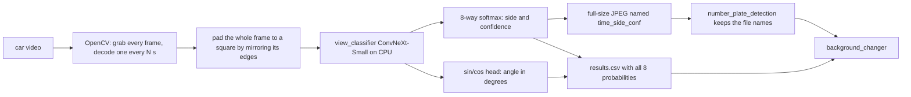

# frame_view_type: which side of the car a video frame shows

`frame_view_type` takes a video of a car and keeps one frame every N seconds (2 by default). A ready-trained model, [`veerupandey/view_classifier`](https://github.com/veerupandey/view_classifier) (ConvNeXt-Small), says which of 8 sides of the car each kept frame shows. It runs on the CPU. Each frame is saved at full size with its time, side and confidence in the file name, and `results.csv` lists every frame with the probabilities of all 8 sides. The whole tool is one script, [classify_video.py](../../frame_view_type/classify_video.py).

**The 8 sides** are the car's own: `front`, `front-right`, `right`, `back-right`, `back`, `back-left`, `left`, `front-left` (left = driver side on a left-hand-drive car). As an angle: 0° = camera straight in front of the car, increasing clockwise, 90° = the car's right side. Each side is a 45° slice centred on 0, 45, ..., 315 (front = 337.5°-22.5°). See [01-problem-definition.md](../../frame_view_type/docs/01-problem-definition.md).

## Flow

## Models at a glance

| Model | Role | Licence | Runtime | Size and speed | Code |
|---|---|---|---|---|---|
| `veerupandey/view_classifier`, checkpoint `joint_v2_best.pt` | 8-way view with confidence, plus a sin/cos azimuth | MIT code; weights trained on CFV (Apache-2.0) plus UnsupCar and Zenodo boxes, whose terms are not stated | PyTorch 2.9.1, torchvision 0.24.1, CPU only (`map_location="cpu"`, no device choice) | 198 MB, about 50M parameters; about 0.8 s per sampled 4K frame | [classify_video.py:87-98](../../frame_view_type/classify_video.py#L87-L98) |

- No car detector is used, so the whole frame goes in ([classify_video.py:127](../../frame_view_type/classify_video.py#L127)).
- Accuracy reported by the model's author, not measured on our footage: 94.1% 8-way on the CFV test set (7 cars), 82.9% on UnsupCar ([05-view-classifier-deep-dive.md:92-99](../../frame_view_type/docs/05-view-classifier-deep-dive.md#L92-L99)). No proper accuracy check on our own frames has been done yet. background_changer's notes saw labels off by up to ~24° on the Mercedes video ([findings.md:92](../../background_changer/docs/findings.md#L92)) and by up to 177° (a near-opposite view) on `sample_vid` ([findings.md:165](../../background_changer/docs/findings.md#L165)).
- The model, its accuracy and the options we compared (other Hugging Face classifiers, Orient Anything, CLIP/SigLIP, prompted VLMs, our own fine-tune) are in [01-model-and-options.md](01-model-and-options.md).

## Output

Everything goes to `<output>/<video stem>/`, e.g. `frame_view_type/output/sample_vid/` ([classify_video.py:164](../../frame_view_type/classify_video.py#L164)). A re-run overwrites files with the same name; older files with other names stay in the folder but are not in the new `results.csv`.

| File | Content | Code |
|---|---|---|
| `<time>s_<side>_<conf>pct.jpg` | The original full-size frame, JPEG quality 95. Name = `f"{t:06.1f}s_{side}_{round(conf*100)}pct.jpg"`, e.g. `0012.0s_right_95pct.jpg`. Files sort in video order. | [classify_video.py:177-178](../../frame_view_type/classify_video.py#L177-L178) |
| `results.csv` | One row per frame: `file`, `time_s` (2 dp), `side`, `angle_deg` (1 dp), `confidence` (0-1, 3 dp), then `prob_front` ... `prob_front-left` (3 dp, in the model's class order). UTF-8, with a header. Not written if no frame was read. | [classify_video.py:183-200](../../frame_view_type/classify_video.py#L183-L200) |

`side` and `confidence` come from the 8-way head; `angle_deg` comes from the separate sin/cos head, so the two can disagree. How each is computed is in [02-how-it-works.md](02-how-it-works.md).

## How background_changer uses it

The default chain keeps the names: `number_plate_detection` reads `../frame_view_type/output/sample_vid` and writes the same file names ([number_plate_detection/config.toml:7](../../number_plate_detection/config.toml#L7), [number_plate_detection/README.md:91](../../number_plate_detection/README.md#L91)). background_changer then reads `../number_plate_detection/output/sample_vid` ([background_changer/config.toml:13](../../background_changer/config.toml#L13)).

- **Every photo: the file name.** `NAME_RE` reads `<time>s_<label>_<conf>pct` into time, label and confidence in percent ([probe.py:16-33](../../background_changer/bg_changer/probe.py#L16-L33), called at [change_background.py:331](../../background_changer/change_background.py#L331)).
- **Flat mode: the label is the yaw.** The yaw is the label's bin centre (front 0, front-right 45, ..., front-left 315) with sigma 15°. Under 60% confidence sigma is 25° and the photo is flagged `low-conf-label`. With no label the yaw is guessed from the cut-out's aspect ratio (sigma 30°, flag `no-view-label`; 90° if the car is cut off) ([yaw.py:16-54](../../background_changer/bg_changer/yaw.py#L16-L54)). `results.csv` is not read in flat mode.
- **Room mode: results.csv is a soft yaw prior.** `find_view_results` looks for `<repo>/frame_view_type/output/<images folder name>/results.csv` ([batch.py:56-60](../../background_changer/car_fit_to_bg/batch.py#L56-L60)); rows are matched by file stem ([pose.py:186-197](../../background_changer/car_fit_to_bg/pose.py#L186-L197)). A photo with a row uses its 8 probabilities. Otherwise its file-name label becomes `p = min(0.95, max(0.3, conf/100))` (a 0% confidence counts as 60%, from `conf_pct or 60`) for the label and `(1 - p)/7` for each other side ([pose.py:200-206](../../background_changer/car_fit_to_bg/pose.py#L200-L206)). With neither, the outline decides alone and the photo is flagged `no-view-label` ([batch.py:63-69](../../background_changer/car_fit_to_bg/batch.py#L63-L69), [batch.py:92-93](../../background_changer/car_fit_to_bg/batch.py#L92-L93)).
- **The prior is a von Mises mixture.** `logprior(yaw) = log(0.05 + sum over sides of p_side * exp(k * (cos(yaw - centre_side) - 1)))`, `k = 1 / radians(25)^2` ([pose.py:176-183](../../background_changer/car_fit_to_bg/pose.py#L176-L183)). It enters the pose score as `score = e / 0.02 - logprior(yaw) + red_penalty`, where `e` is minus the outline IoU plus the camera priors ([pose.py:497-499](../../background_changer/car_fit_to_bg/pose.py#L497-L499)).
- **The file-name label still decides close calls.** A fit whose score beats the best flipped pose (yaw + 180° ± 45°) by under 2 nats is flagged `yaw-unsure`, and the label's yaw is used if it fits within 0.02 IoU ([pose.py:561-567](../../background_changer/car_fit_to_bg/pose.py#L561-L567)). A failed fit is placed at the label's yaw ([pose.py:596-603](../../background_changer/car_fit_to_bg/pose.py#L596-L603)). A fitted yaw more than 24° from the label's bin centre is flagged `yaw-vs-label` ([change_background.py:89](../../background_changer/change_background.py#L89), [change_background.py:455-458](../../background_changer/change_background.py#L455-L458)).
- **The time prefix is a video clock (room mode).** `VIDEO_NAME` reads the `<time>s_` prefix. Frames with weak background lines borrow roll and pitch from confident frames within ±8 s, weighted `conf * exp(-(dt / 4 s)^2)` ([lines.py:35-36](../../background_changer/car_fit_to_bg/lines.py#L35-L36), [lines.py:337-350](../../background_changer/car_fit_to_bg/lines.py#L337-L350)).
- `angle_deg` and `time_s` from `results.csv` are read but never used; only the `prob_*` columns are ([pose.py:193-194](../../background_changer/car_fit_to_bg/pose.py#L193-L194), [batch.py:67-68](../../background_changer/car_fit_to_bg/batch.py#L67-L68)). The console says which source was used: `view hints: frame_view_type results (...)` or `the file names' view labels` ([change_background.py:830](../../background_changer/change_background.py#L830)).

The pose fit itself is in [04-car-dimensions-and-orientation.md](../background_changer/04-car-dimensions-and-orientation.md).

> Note: video_pipeline does not run frame_view_type; it only reuses `frame_view_type/sample_vid.mp4` as its input ([video_pipeline/config.toml:6](../../video_pipeline/config.toml#L6)). It writes its own frames as `00001.jpg` ... ([make_video.py:52-67](../../video_pipeline/make_video.py#L52-L67)) into a folder named `frames` ([make_video.py:105](../../video_pipeline/make_video.py#L105)), so background_changer finds no label and no `results.csv`, and every frame is fitted from its outline alone (`no-view-label`). See [video_pipeline](../video_pipeline/README.md).

## Setup (once)

From [frame_view_type/README.md:9-21](../../frame_view_type/README.md#L9-L21): Python 3.11+, Git and Git LFS.

1. Clone `https://github.com/veerupandey/view_classifier` into `frame_view_type/vendor/view_classifier` and check out the pinned commit `6514ec2b2bee695c45c2152d95f44ea1bf4ca7e0` (a one-person research project with no releases).
2. `git -C vendor/view_classifier lfs pull` for the checkpoint `models/joint_v2_best.pt` (about 198 MB). A file under 1,000,000 bytes is taken as an un-pulled LFS pointer (about 134 bytes) and the script exits ([classify_video.py:88-93](../../frame_view_type/classify_video.py#L88-L93)).
3. Make a venv and install [requirements.txt](../../frame_view_type/requirements.txt#L3-L7): `torch==2.9.1`, `torchvision==0.24.1` (the vendor's pins), `pillow`, `numpy`, `opencv-python-headless`.
4. Run `.venv\Scripts\python classify_video.py`, or `... classify_video.py <video> --every 3`. Settings are in [02-how-it-works.md](02-how-it-works.md).

The clone and all `*.pt` files are gitignored ([.gitignore:16](../../.gitignore#L16), [.gitignore:24](../../.gitignore#L24)). Until the clone exists, the script cannot import the model ([classify_video.py:28-34](../../frame_view_type/classify_video.py#L28-L34)).

> Note: the vendor repo asks for Python 3.12+; 3.11 was confirmed for inference ([05-view-classifier-deep-dive.md:149](../../frame_view_type/docs/05-view-classifier-deep-dive.md#L149)).

**Speed** (Intel i5-1240P laptop, CPU, `Final_zoomed_car.mp4`, 38 s, 4K, 30 fps): every 2 s gave 20 frames in 47 s; every 5 s gave 8 frames in 35 s. About 19 s of that is reading every frame ([frame_view_type/README.md:81-92](../../frame_view_type/README.md#L81-L92)).

## Files

This folder:

- [README.md](README.md): this overview and index.
- [01-model-and-options.md](01-model-and-options.md): the view_classifier model, its reported accuracy, and every option we compared.
- [02-how-it-works.md](02-how-it-works.md): step by step through `classify_video.py`, with every setting and constant.

The project folder `frame_view_type/`:

- [classify_video.py](../../frame_view_type/classify_video.py): the whole tool (settings, model load, sampling, classify, save).
- [config.toml](../../frame_view_type/config.toml): `input`, `output`, `every_seconds`, `checkpoint`.
- [requirements.txt](../../frame_view_type/requirements.txt): inference dependencies.
- `vendor/view_classifier/`: the model clone with its weights (not in git, not in this checkout).

> Note: [frame_view_type/README.md:36](../../frame_view_type/README.md#L36) gives the default `input` as `Final_zoomed_car.mp4`; [config.toml:7](../../frame_view_type/config.toml#L7) sets `sample_vid.mp4`. And [frame_view_type/docs/README.md:13](../../frame_view_type/docs/README.md#L13) still says "research only"; the script has since been built and timed.

## Further reading

- [frame_view_type/README.md](../../frame_view_type/README.md): setup, run, settings, output, speed and limits.
- [frame_view_type/docs/README.md](../../frame_view_type/docs/README.md): the research notes (problem, options, datasets, recommendation, [view_classifier deep dive](../../frame_view_type/docs/05-view-classifier-deep-dive.md)).
- [docs/README.md](../README.md), [background_changer](../background_changer/README.md), [number_plate_detection](../number_plate_detection/README.md), [video_pipeline](../video_pipeline/README.md).
