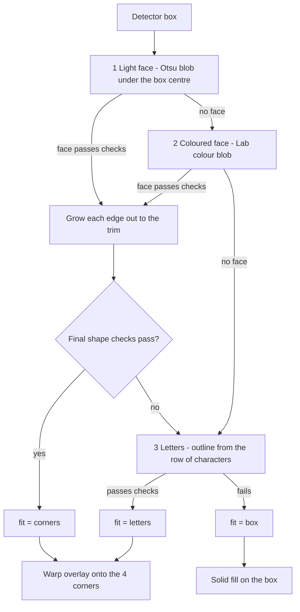

# Fitting the cover exactly to the plate

## In short

- The detector gives a straight box. On angled views the plate fills only about a third of it, so covering the box would paint over the car.
- `fit_plate` replaces the box with the plate's own 4 corners. It uses plain OpenCV and no second model. It traces the light plate face, pushes each edge out to the plate's outer trim, then checks the shape.
- The methods run in a fixed order and never go back: light face, coloured face, row of letters, box. The result is labelled `corners`, `letters` or `box`.
- The overlay image is perspective-warped onto the 4 corners, inside a small region only, and blended through an anti-aliased polygon mask. Plates left with the box get a solid fill.
- Measured on an Intel i5-1240P laptop (CPU): corners found on 12 of 12 real plates, about 4–8 ms per light plate.

## Why the box is not enough

The detector ([01](01-model-and-options.md)) returns an axis-aligned box `x1, y1, x2, y2` (x2 and y2 exclusive) and a confidence. `corners` starts as `None` ([detector.py:34-41](../../number_plate_detection/plate_masker/detector.py#L34-L41), [detector.py:105-115](../../number_plate_detection/plate_masker/detector.py#L105-L115)).

On an angled view the plate is a tilted four-sided shape inside that box. On the 4K test frames the plate's area was **32 %** of the box on `0034` and **33 %** on `0006`, against **66 %** on the straight `0000` ([findings.md:103](../../number_plate_detection/docs/findings.md#L103)). So the box is 2–3× the plate. The first version painted the box plus 10 % padding, which was clearly bigger than the plate ([findings.md:62](../../number_plate_detection/docs/findings.md#L62)).

When nothing better is found, `Plate.quad` gives the box corners at pixel centres: `[x1, y1], [x2-1, y1], [x2-1, y2-1], [x1, y2-1]` ([detector.py:58-64](../../number_plate_detection/plate_masker/detector.py#L58-L64)).

## The order of methods

| Order | Method | Label | Typical plates | Details |
|---|---|---|---|---|
| 1 | Light face (Otsu) | `corners` | White, yellow, silver | This page |
| 2 | Coloured face (Lab colour) | `corners` | Blue, green, red, black with light letters | [03](03-multi-colour-plates.md) |
| 3 | Row of letters | `letters` | Edge not traceable: dark plate on a dark car, very small plate | [03](03-multi-colour-plates.md) |
| 4 | Detector box | `box` | False hits, badly blurred plates | Solid fill |

- **Strict order, no going back.** `find_plate_outline` tries the plate's edge first, then the letters ([corners.py:490-496](../../number_plate_detection/plate_masker/corners.py#L490-L496)). Inside the edge method, the coloured search runs only when no light face passed the face checks ([corners.py:539](../../number_plate_detection/plate_masker/corners.py#L539)).
- **The first face that passes wins.** If a light face passes the face checks but its grown outline fails the final check, the edge method returns `None` and the letters path runs next. No other blur pass and no coloured search is tried ([corners.py:593-595](../../number_plate_detection/plate_masker/corners.py#L593-L595)). The same holds inside the coloured search: the first hypothesis whose face passes is kept ([corners.py:565-573](../../number_plate_detection/plate_masker/corners.py#L565-L573)).
- **Labels.** Both edge methods (light and coloured) give `corners`. The letters method gives `letters`. With no outline the plate is returned unchanged, so `corners` stays `None` and `Plate.fit` is `box` ([corners.py:599-606](../../number_plate_detection/plate_masker/corners.py#L599-L606), [detector.py:51-56](../../number_plate_detection/plate_masker/detector.py#L51-L56)).

## How it works: the light face

`w` and `h` below are the detector box's width and height.

1. **Size gate.** A box under 12 px wide or 6 px tall skips both edge methods ([corners.py:502-503](../../number_plate_detection/plate_masker/corners.py#L502-L503)).
2. **Two crops.** A big grayscale crop, the box plus `m = int(0.5 * max(w, h))` on every side, is used later to measure the trim and to check the background ([corners.py:506-509](../../number_plate_detection/plate_masker/corners.py#L506-L509)). A small crop inside it, the box plus `THRESH_MARGIN = 0.15` of `w` and `h` on each side, is the part that gets thresholded ([corners.py:510-512](../../number_plate_detection/plate_masker/corners.py#L510-L512)). The box centre is converted into small-crop pixels ([corners.py:513](../../number_plate_detection/plate_masker/corners.py#L513)).
3. **Blur and opening passes, scaled to the plate.** `k = max(3, int(0.04 * min(w, h))) | 1` (the `| 1` makes it odd). A box 50 px tall or more tries `(blur 5, opening k)`, `(5, 2k+1)`, `(3, none)`. A smaller box tries `(3, none)`, `(3, 3)`, `(5, none)` ([corners.py:517-518](../../number_plate_detection/plate_masker/corners.py#L517-L518)). The first pass whose face passes every face check wins ([corners.py:520-529](../../number_plate_detection/plate_masker/corners.py#L520-L529)). Why: an opening cuts thin bridges between the plate and a white bumper, but on a small plate it also erases the 1–2 px white margin round the characters. So small plates try no opening first ([corners.py:515-516](../../number_plate_detection/plate_masker/corners.py#L515-L516), [findings.md:107](../../number_plate_detection/docs/findings.md#L107)).

   | Box height (shorter side) | k | Passes tried, in order (blur, opening) |
   |---|---|---|
   | Under 50 px | – | (3, 0), (3, 3), (5, 0) |
   | 60 px | 3 | (5, 3), (5, 7), (3, 0) |
   | 100 px | 5 | (5, 5), (5, 11), (3, 0) |
   | 220 px | 9 | (5, 9), (5, 19), (3, 0) |

4. **Threshold and pick the blob.** A Gaussian blur of `blur × blur` (sigma 0, so OpenCV derives it from the kernel: 0.8 px for 3, 1.1 px for 5), then one global Otsu threshold over the small crop ([corners.py:259-260](../../number_plate_detection/plate_masker/corners.py#L259-L260)). If the pass has an opening, a `MORPH_OPEN` with an elliptical `opening × opening` kernel follows ([corners.py:239-240](../../number_plate_detection/plate_masker/corners.py#L239-L240)). Outer contours are found. A contour is kept when its area is **0.3–1.25 × the box area** and it contains the box centre (`pointPolygonTest >= 0`, so a centre on the outline counts). The largest kept contour is the face ([corners.py:241-248](../../number_plate_detection/plate_masker/corners.py#L241-L248)).
5. **Blob to 4 corners.** Take the blob's convex hull and its perimeter. Try `approxPolyDP(hull, eps * perimeter)` for `eps` = 0.010, 0.015, … 0.080 (`np.linspace(0.01, 0.08, 15)`), smallest first. Keep the first result with exactly 4 vertices. If none has 4, use the hull's minimum-area rectangle (`boxPoints(minAreaRect(hull))`) ([corners.py:248-254](../../number_plate_detection/plate_masker/corners.py#L248-L254)).
6. **Order the corners.** Sort the 4 points by their `atan2` angle round their mean. That is clockwise on screen, because image y points down. Then roll the list so the point with the smallest `x + y` comes first. Result: TL, TR, BR, BL ([corners.py:59-64](../../number_plate_detection/plate_masker/corners.py#L59-L64)).
7. **Check the face.** In image pixels, the face must pass the shape checks with `max_area = 1.1`, lie inside the box grown by `FACE_BOX_MARGIN = 0.10`, and `background_side` must return `light` ([corners.py:525-528](../../number_plate_detection/plate_masker/corners.py#L525-L528)). Otherwise the next pass is tried. If all three passes fail, the coloured search runs ([below](#coloured-plates-and-letters)).
8. **Grow each edge to the outer trim** ([next section](#growing-each-edge-to-the-outer-trim)).
9. **Final check.** The grown outline, in image pixels, must be finite and pass the shape checks with `max_area = 1.6` ([corners.py:593-595](../../number_plate_detection/plate_masker/corners.py#L593-L595)). There is no box-margin check at this stage. If it fails, the letters path runs.
10. **Store.** `fit_plate` stores the corners rounded to 0.1 px, with `outline_from = "corners"` ([corners.py:599-606](../../number_plate_detection/plate_masker/corners.py#L599-L606)). `detections.csv` writes them rounded to whole pixels ([mask_plates.py:275](../../number_plate_detection/mask_plates.py#L275)).

### Growing each edge to the outer trim

The light face is only the white part of the plate. Going outward, the plates here have: white face, a thin dark border line, a light rim (the plate's raised edge), then the bumper or holder ([findings.md:109](../../number_plate_detection/docs/findings.md#L109)). The cover must reach the end of the rim. Each of the 4 edges is measured and moved on its own.

1. **Face height.** `face_h` is the mean length of the face's left and right edges ([corners.py:67-72](../../number_plate_detection/plate_masker/corners.py#L67-L72), [corners.py:577](../../number_plate_detection/plate_masker/corners.py#L577)). In this section `h` means `face_h`, not the box height.
2. **Seven profiles per edge.** They start at 20 %, 30 %, … 80 % along the edge ([corners.py:120](../../number_plate_detection/plate_masker/corners.py#L120)). Each samples brightness 1 px apart along the edge's outward normal, from `n_in = max(2, int(0.05 h))` px inside the face to `n_out = max(6, int(0.35 h))` px outside ([corners.py:118-122](../../number_plate_detection/plate_masker/corners.py#L118-L122)). Samples are nearest-pixel reads of the unblurred grayscale big crop, so offsets are whole pixels ([corners.py:104-113](../../number_plate_detection/plate_masker/corners.py#L104-L113)). Normals point away from the face's centre ([corners.py:75-84](../../number_plate_detection/plate_masker/corners.py#L75-L84)).
3. **Per profile** ([corners.py:125-148](../../number_plate_detection/plate_masker/corners.py#L125-L148)):
   - Skip the profile if any sample falls outside the big crop.
   - `white` = upper median of the inside samples (`sorted(inside)[n // 2]`). Skip if `white < 100`.
   - `t` = first outside distance where the brightness drops below `0.6 * white`: the face ends here. Skip if there is none, or if `t > 0.15 h`.
   - `j` = the darkest point in the `window = max(3, int(0.12 h))` samples from `t`: the border line.
   - `k` = the brightest point in the `window` samples from `j`: the rim, if there is one.
   - **Rim found** when `out[k] - out[j] >= 40` grey levels and `out[k] >= 0.5 * white`. Walk on from `k` while the brightness stays above the midpoint `(out[k] + out[j]) / 2`, for at most `0.1 h`. The offset is one pixel past where the walk stops.
   - **No rim** otherwise. The offset is `t`: the plate ends where its white face ends.
4. **Per edge.** The trim is the median (`statistics.median`) of the valid profiles' offsets. Fewer than 7 may be valid. With none valid, the trim is `TRIM_TYPICAL = 0.14 h`. Either way it is clipped to `[0, TRIM_MAX = 0.22 h]` ([corners.py:149](../../number_plate_detection/plate_masker/corners.py#L149), [corners.py:582-584](../../number_plate_detection/plate_masker/corners.py#L582-L584)).
5. **Re-intersect.** `grow_quad` moves each edge line out along its unit normal by its own trim. Each new corner is where the two neighbouring shifted lines cross. For nearly parallel neighbours (`|det| < 1e-9`) it adds both normal offsets to the old corner instead ([corners.py:87-101](../../number_plate_detection/plate_masker/corners.py#L87-L101)).

**Worked example**, `face_h = 100` px: 5 samples inside, 35 outside, window 12 px. The face must end within 15 px of the edge. The rim walk stops at most 10 px past the rim's brightest point. An edge that can't be measured gets 14 px; no edge gets more than 22 px.

Measured on the real frames, the rim ended 0.13–0.15 × face height outside the face on most edges, 0.09–0.23 overall ([corners.py:32-35](../../number_plate_detection/plate_masker/corners.py#L32-L35), [findings.md:109](../../number_plate_detection/docs/findings.md#L109)).

> Note: findings.md:109 says each edge takes "the median" of its 7 profiles. In the code it is the median of the valid profiles only, and the face brightness inside each profile is the upper median of the inside samples.

### The shape checks

`_plausible` ([corners.py:214-234](../../number_plate_detection/plate_masker/corners.py#L214-L234)) rejects a candidate unless every rule holds. Every bound is measured against the **detector box**, never against the face.

| Check | Rule | Code |
|---|---|---|
| Minimum edge | Every edge ≥ 0.15 × min(box w, box h) | [corners.py:215-217](../../number_plate_detection/plate_masker/corners.py#L215-L217) |
| Convex | `cv2.isContourConvex` is true | [corners.py:218-219](../../number_plate_detection/plate_masker/corners.py#L218-L219) |
| Tilt | Top and bottom edges ≤ 40° from horizontal; sides ≤ 40° from vertical | [corners.py:220-225](../../number_plate_detection/plate_masker/corners.py#L220-L225) |
| Aspect | 1.0 ≤ width / height ≤ 8.0 (means of opposite edges) | [corners.py:226-228](../../number_plate_detection/plate_masker/corners.py#L226-L228) |
| Area | 0.2 ≤ area / (box w × box h) ≤ `max_area` | [corners.py:229-231](../../number_plate_detection/plate_masker/corners.py#L229-L231) |
| Span | x-extent ≥ 0.6 × box w, and y-extent ≥ 0.6 × box h | [corners.py:232-234](../../number_plate_detection/plate_masker/corners.py#L232-L234) |

`max_area` is **1.1** for the face ([corners.py:526](../../number_plate_detection/plate_masker/corners.py#L526)), **1.6** for the grown outline ([corners.py:594](../../number_plate_detection/plate_masker/corners.py#L594)) and **1.6** for the letters outline ([corners.py:479](../../number_plate_detection/plate_masker/corners.py#L479)).

The tilt limit is generous: the most tilted real plate leans about 25°. The check was added after a chrome-trim false hit produced a sideways shape that passed every other check ([corners.py:36-38](../../number_plate_detection/plate_masker/corners.py#L36-L38), [findings.md:110](../../number_plate_detection/docs/findings.md#L110)).

Two more checks apply to the **face only**:

- **Inside the box.** All face corners must lie inside the box grown by 10 % of its width and height on each side ([corners.py:152-158](../../number_plate_detection/plate_masker/corners.py#L152-L158)). A blob reaching further has merged with something round the plate, such as a white bumper through a faint border line. Real plates' outer edges reach at most 2 % / 6 % past the box ([corners.py:42-45](../../number_plate_detection/plate_masker/corners.py#L42-L45), [findings.md:172](../../number_plate_detection/docs/findings.md#L172)).
- **Background side.** `background_side` shrinks the face by 2 px and splits its grayscale pixels into light and dark with Otsu. For each side it takes the share of that side's pixels in its biggest 8-connected piece. The side with the bigger share is the background if that share is ≥ 0.6 and the other side's is < 0.6. Fewer than 50 pixels, or no clear side, gives `None`, which rejects the face ([corners.py:264-289](../../number_plate_detection/plate_masker/corners.py#L264-L289)). The light pass needs `light`. On the 12 real plates the background's biggest piece held 0.91–0.98 of its pixels, the characters' only 0.15–0.18 ([findings.md:157](../../number_plate_detection/docs/findings.md#L157)).

> Note: findings.md:110 lists "area 0.2–1.6 × the box" as a single check. In the code the upper bound is 1.1 for the face and 1.6 only for the grown and letters outlines. That list also leaves out the blob window (0.3–1.25), the 10 % box margin and the background-side check. It, and the corners.py docstring ([corners.py:12](../../number_plate_detection/plate_masker/corners.py#L12)), say a failed plate keeps its box; today the letters path is tried first.

## Coloured plates and letters

**Coloured face.** It runs only when no light face passed. A two-colour k-means in OpenCV's 8-bit Lab, on the middle of the box (less 25 % of its height top and bottom and 15 % of its width each side), gives the background and character colours ([corners.py:540-543](../../number_plate_detection/plate_masker/corners.py#L540-L543), [corners.py:300-310](../../number_plate_detection/plate_masker/corners.py#L300-L310)). A mask of pixels close to one colour goes through the same blob, hull, corner and face-check steps as above. It tries, in turn: the darker colour as a dark background, the lighter colour as a light background, and the lighter colour as a border ring round a dark background ([corners.py:551-573](../../number_plate_detection/plate_masker/corners.py#L551-L573)). The edges then grow by a colour-based trim that defaults to 0 (not 0.14 h), with the same 0.22 h cap ([corners.py:585-592](../../number_plate_detection/plate_masker/corners.py#L585-L592)). The result is labelled `corners`. Details: [03](03-multi-colour-plates.md).

**Letters.** It runs when the edge methods return nothing, and needs a box of at least 16 × 8 px ([corners.py:412-413](../../number_plate_detection/plate_masker/corners.py#L412-L413)). It finds a row of at least 3 characters of similar height, light or dark, at most 40° from horizontal and spanning at least 35 % of the box width ([corners.py:313-370](../../number_plate_detection/plate_masker/corners.py#L313-L370)). It fits lines along their tops and bottoms, takes the plate's sides along the letters' upright strokes, and adds margins: 0.35 × letter height above and below, 4.5 % of the row's length at each end, scaled by the letter height at that end ([corners.py:429-463](../../number_plate_detection/plate_masker/corners.py#L429-L463)). When the row's direction has an x part above 0.3, an end more than 5 % of the box width past the box is pulled back along the row, but by no more than its own margin ([corners.py:466-478](../../number_plate_detection/plate_masker/corners.py#L466-L478)). The outline must pass the shape checks with `max_area = 1.6` and stay inside the box grown by 25 % ([corners.py:479](../../number_plate_detection/plate_masker/corners.py#L479)). The result is labelled `letters`. Details: [03](03-multi-colour-plates.md).

**Box.** If the letters fail too, the plate keeps its box ([corners.py:601-603](../../number_plate_detection/plate_masker/corners.py#L601-L603)).

## Putting the cover on

1. **Which style each plate gets** ([__init__.py:100-114](../../number_plate_detection/plate_masker/__init__.py#L100-L114), [masking.py:159-180](../../number_plate_detection/plate_masker/masking.py#L159-L180)):
   - `tight_fit = true` (the default, [config.toml:39](../../number_plate_detection/config.toml#L39)): every plate goes through `fit_plate`. Plates with an outline (`corners` or `letters`) get the chosen style, normally the overlay (`image`). Plates left with the box get `solid` ([__init__.py:111-112](../../number_plate_detection/plate_masker/__init__.py#L111-L112), [masking.py:177](../../number_plate_detection/plate_masker/masking.py#L177)). Reason: an image stretched over a straight box on a tilted plate, a grille or a badge looks wrong ([masking.py:16-18](../../number_plate_detection/plate_masker/masking.py#L16-L18)).
   - `tight_fit = false`: `fit_plate` is skipped and `box_style` is `None`, so every plate gets the chosen style on its straight box, overlay included ([__init__.py:103-112](../../number_plate_detection/plate_masker/__init__.py#L103-L112)). Only useful for straight-on views ([findings.md:138](../../number_plate_detection/docs/findings.md#L138)).
   - Plates are painted one after another, in detector-confidence order, into one copy of the image ([masking.py:175-179](../../number_plate_detection/plate_masker/masking.py#L175-L179)).
2. **Padding.** `pad_quad` grows the quad by `pad × its own height` on every side, through `grow_quad`. The default is `0.0`, because the fitted outline already includes the border and rim ([masking.py:151-156](../../number_plate_detection/plate_masker/masking.py#L151-L156), [masking.py:38](../../number_plate_detection/plate_masker/masking.py#L38), [config.toml:41-43](../../number_plate_detection/config.toml#L41-L43), [findings.md:136](../../number_plate_detection/docs/findings.md#L136)). Padding also grows box quads. `mask_plates.py` refuses a negative value ([mask_plates.py:202-203](../../number_plate_detection/mask_plates.py#L202-L203)).
3. **Small region only.** The work area is the quad's bounding box: `floor` of the minimum to `ceil` of the maximum plus 1, clamped to the image ([masking.py:105-112](../../number_plate_detection/plate_masker/masking.py#L105-L112)). Nothing outside it is warped or changed.
4. **Pre-shrink.** The target size is `tw = max(2, round(longer of top and bottom edge))` and `th = max(2, round(longer of left and right edge))`. If the overlay is more than 1.5× that in either direction, it is first resized to `(tw, th)` with `INTER_AREA`, because `warpPerspective` has no area filter ([masking.py:113-118](../../number_plate_detection/plate_masker/masking.py#L113-L118)).
5. **Pixel-edge mapping.** The overlay's outer pixel edges, `(-0.5, -0.5)`, `(ow-0.5, -0.5)`, `(ow-0.5, oh-0.5)`, `(-0.5, oh-0.5)`, are mapped onto TL, TR, BR, BL with `cv2.getPerspectiveTransform` ([masking.py:120-122](../../number_plate_detection/plate_masker/masking.py#L120-L122)). So the overlay's outermost pixels end exactly on the plate's corners, not half a pixel inside them.
6. **Warp.** `cv2.warpPerspective` with `INTER_LINEAR` and `BORDER_REPLICATE`, into the work area only ([masking.py:123-124](../../number_plate_detection/plate_masker/masking.py#L123-L124)). Because the border is replicated, pixels just outside the quad carry the overlay's edge colour, not black.
7. **Anti-aliased mask.** A zero `uint8` mask the size of the work area gets the quad drawn with `cv2.fillConvexPoly(mask, corners, 255, lineType=cv2.LINE_AA, shift=4)`, then is scaled to 0–1 ([masking.py:126-128](../../number_plate_detection/plate_masker/masking.py#L126-L128)). `shift = 4` means the corners go in as fixed-point integers in 1/16 px, `round(quad * 16)` ([masking.py:45-46](../../number_plate_detection/plate_masker/masking.py#L45-L46)). OpenCV fills the inside with whole pixels and draws each edge as an anti-aliased line, so pixels an edge crosses get partial alpha. That is the only softening: no supersampling, no blur, no feather.
8. **PNG transparency.** If the warped overlay has 4 channels, the mask is multiplied by its alpha / 255 and only the BGR channels are kept ([masking.py:129-131](../../number_plate_detection/plate_masker/masking.py#L129-L131)). `load_overlay` reads the file with `IMREAD_UNCHANGED`, so a PNG's alpha survives ([mask_plates.py:136-147](../../number_plate_detection/mask_plates.py#L136-L147)).
9. **Brightness.** Before blending, the warped overlay is multiplied by a per-pixel gain so its white matches the plate's light ([masking.py:133-143](../../number_plate_detection/plate_masker/masking.py#L133-L143)). With auto brightness the light is measured on the original image and the unpadded quad, before any plate is painted ([__init__.py:105-110](../../number_plate_detection/plate_masker/__init__.py#L105-L110)). With the fixed `lighting` method it is measured here, on the padded quad, just before this plate is painted ([masking.py:139](../../number_plate_detection/plate_masker/masking.py#L139)). See [04](04-auto-brightness.md).
10. **Blend.** `roi = clip(roi * (1 - a) + warped * a + 0.5, 0, 255)` as `uint8`, written back into the work area ([masking.py:144-145](../../number_plate_detection/plate_masker/masking.py#L144-L145)).

**Solid style.** `cv2.fillConvexPoly` of the quad straight into the image, with the same `LINE_AA` and `shift = 4`. The colour is converted from RGB to BGR; the default is black ([masking.py:49-52](../../number_plate_detection/plate_masker/masking.py#L49-L52), [masking.py:39](../../number_plate_detection/plate_masker/masking.py#L39), [config.toml:36](../../number_plate_detection/config.toml#L36)).

## The maths and constants

**Formulas**

- Quad size: `width = (|TR - TL| + |BR - BL|) / 2`, `height = (|BL - TL| + |BR - TR|) / 2` ([corners.py:67-72](../../number_plate_detection/plate_masker/corners.py#L67-L72)).
- Opening size: `k = max(3, int(0.04 * min(w, h))) | 1` ([corners.py:517](../../number_plate_detection/plate_masker/corners.py#L517)).
- Corner simplification: `epsilon = eps * arcLength(hull, closed=True)`, `eps in linspace(0.01, 0.08, 15)`, first 4-vertex result wins ([corners.py:249-253](../../number_plate_detection/plate_masker/corners.py#L249-L253)).
- Trim per edge: `trim_i = clip(median(valid offsets_i) if any else 0.14 * face_h, 0, 0.22 * face_h)` ([corners.py:584](../../number_plate_detection/plate_masker/corners.py#L584)).
- Shifted edge `i`: point `q_i + n_i * trim_i`, direction `q_(i+1) - q_i`. New corner `j` = `p1 + d1 * s`, where `[d1, -d2] s = p2 - p1` for edges `j-1` and `j` ([corners.py:91-100](../../number_plate_detection/plate_masker/corners.py#L91-L100)).
- Tilt: `a = |atan2(dy, dx)|` in degrees; top/bottom lean = `min(a, 180 - a)`, side lean = `|90 - a|` ([corners.py:221-223](../../number_plate_detection/plate_masker/corners.py#L221-L223)).
- Warp: `M = getPerspectiveTransform(src, quad - (x0, y0))`, `src` = the overlay's pixel edges ([masking.py:112](../../number_plate_detection/plate_masker/masking.py#L112), [masking.py:121-122](../../number_plate_detection/plate_masker/masking.py#L121-L122)).
- Blend: `alpha = coverage(quad) * png_alpha / 255`; `out = clip(roi * (1 - alpha) + gain * warped * alpha + 0.5, 0, 255)` ([masking.py:126-145](../../number_plate_detection/plate_masker/masking.py#L126-L145)).

**Finding the face** ([corners.py](../../number_plate_detection/plate_masker/corners.py))

| Name | Value | Meaning | Code |
|---|---|---|---|
| Minimum box, edge methods | w ≥ 12, h ≥ 6 px | Smaller boxes go straight to the letters | [corners.py:502-503](../../number_plate_detection/plate_masker/corners.py#L502-L503) |
| Big-crop margin | `int(0.5 * max(w, h))` | Crop for the trim and background checks | [corners.py:506](../../number_plate_detection/plate_masker/corners.py#L506) |
| `THRESH_MARGIN` | 0.15 | Otsu crop = box + 15 % of w and h each side | [corners.py:31](../../number_plate_detection/plate_masker/corners.py#L31) |
| `k` | `max(3, int(0.04 * min(w, h))) \| 1` | Opening size | [corners.py:517](../../number_plate_detection/plate_masker/corners.py#L517) |
| Passes, h ≥ 50 | (5, k), (5, 2k+1), (3, 0) | (blur, opening), first plausible wins | [corners.py:518](../../number_plate_detection/plate_masker/corners.py#L518) |
| Passes, h < 50 | (3, 0), (3, 3), (5, 0) | Small plates try no opening first | [corners.py:518](../../number_plate_detection/plate_masker/corners.py#L518) |
| Blob area window | 0.3–1.25 × box area | Contour accepted as the face | [corners.py:244](../../number_plate_detection/plate_masker/corners.py#L244) |
| `eps` sweep | `linspace(0.01, 0.08, 15)` | Share of the hull perimeter | [corners.py:250](../../number_plate_detection/plate_masker/corners.py#L250) |
| `FACE_BOX_MARGIN` | 0.10 | Face corners within the box ± 10 % | [corners.py:45](../../number_plate_detection/plate_masker/corners.py#L45) |
| `BACKGROUND_SHARE` | 0.6 | Share in the biggest piece for a side to be the background | [corners.py:41](../../number_plate_detection/plate_masker/corners.py#L41) |
| Background check shrink / minimum | 2 px / 50 pixels | Face shrunk before the split; fewer pixels = reject | [corners.py:271](../../number_plate_detection/plate_masker/corners.py#L271), [corners.py:280](../../number_plate_detection/plate_masker/corners.py#L280) |

**Growing to the trim** (`h` = face height)

| Name | Value | Meaning | Code |
|---|---|---|---|
| Profiles per edge | 7, at 0.2–0.8 along the edge | Brightness profiles across each edge | [corners.py:120](../../number_plate_detection/plate_masker/corners.py#L120) |
| `n_in`, `n_out` | `max(2, int(0.05 h))`, `max(6, int(0.35 h))` | Samples inside / outside the face edge | [corners.py:118](../../number_plate_detection/plate_masker/corners.py#L118) |
| `window` | `max(3, int(0.12 h))` | Search length for the line and the rim | [corners.py:123](../../number_plate_detection/plate_masker/corners.py#L123) |
| Face floor | `white >= 100` | Darker profiles are skipped | [corners.py:131](../../number_plate_detection/plate_masker/corners.py#L131) |
| Face end | `< 0.6 * white`, within `0.15 h` | Where the white face stops | [corners.py:134-135](../../number_plate_detection/plate_masker/corners.py#L134-L135) |
| Rim test | contrast ≥ 40 grey levels, rim ≥ `0.5 * white` | Otherwise "no rim", offset = face end | [corners.py:141](../../number_plate_detection/plate_masker/corners.py#L141) |
| Rim walk | < `0.1 h` past the brightest point | How far the rim end is followed | [corners.py:144](../../number_plate_detection/plate_masker/corners.py#L144) |
| `TRIM_TYPICAL` | 0.14 | Trim for an edge with no valid profile (× h) | [corners.py:34](../../number_plate_detection/plate_masker/corners.py#L34) |
| `TRIM_MAX` | 0.22 | Cap on any edge's trim (× h) | [corners.py:35](../../number_plate_detection/plate_masker/corners.py#L35) |
| Parallel limit | `\|det\| < 1e-9` | Fallback corner when neighbouring edges are parallel | [corners.py:96](../../number_plate_detection/plate_masker/corners.py#L96) |

**Shape checks** (against the detector box)

| Name | Value | Meaning | Code |
|---|---|---|---|
| Minimum edge | 0.15 × min(box w, box h) | No tiny edges | [corners.py:216](../../number_plate_detection/plate_masker/corners.py#L216) |
| `MAX_TILT` | 40.0° | Edge lean limit (also the letter-row slope limit) | [corners.py:38](../../number_plate_detection/plate_masker/corners.py#L38) |
| Aspect | 1.0–8.0 | Width / height | [corners.py:227](../../number_plate_detection/plate_masker/corners.py#L227) |
| Area | 0.2 – `max_area` × box | Lower and upper area bound | [corners.py:230](../../number_plate_detection/plate_masker/corners.py#L230) |
| `max_area` | 1.1 face / 1.6 grown / 1.6 letters | Upper area bound per stage | [corners.py:526](../../number_plate_detection/plate_masker/corners.py#L526), [corners.py:594](../../number_plate_detection/plate_masker/corners.py#L594), [corners.py:479](../../number_plate_detection/plate_masker/corners.py#L479) |
| Span | ≥ 0.6 of box w and h | Must cover most of the box | [corners.py:234](../../number_plate_detection/plate_masker/corners.py#L234) |
| Letters box margin | ± 25 % | Letters outline must stay this close to the box | [corners.py:479](../../number_plate_detection/plate_masker/corners.py#L479) |
| Stored precision | 0.1 px | Corners are rounded to this | [corners.py:605](../../number_plate_detection/plate_masker/corners.py#L605) |

**The overlay** ([masking.py](../../number_plate_detection/plate_masker/masking.py))

| Name | Value | Meaning | Code |
|---|---|---|---|
| `DEFAULT_PAD` | 0.0 | No margin beyond the fitted outline | [masking.py:38](../../number_plate_detection/plate_masker/masking.py#L38) |
| `DEFAULT_COLOR_RGB` | (0, 0, 0) | Solid fill colour | [masking.py:39](../../number_plate_detection/plate_masker/masking.py#L39) |
| `_SHIFT` | 4 | Polygon corners in 1/16 px | [masking.py:40](../../number_plate_detection/plate_masker/masking.py#L40) |
| Pre-shrink trigger | > 1.5 × target size | Then `INTER_AREA` to the target size | [masking.py:117](../../number_plate_detection/plate_masker/masking.py#L117) |
| Minimum target size | 2 px | Floor on `tw`, `th` | [masking.py:115-116](../../number_plate_detection/plate_masker/masking.py#L115-L116) |
| Source corners | pixel edges, ± 0.5 | Overlay edges land on the plate corners | [masking.py:121](../../number_plate_detection/plate_masker/masking.py#L121) |
| Warp | `INTER_LINEAR`, `BORDER_REPLICATE` | Bilinear, edge colour carried outward | [masking.py:124](../../number_plate_detection/plate_masker/masking.py#L124) |
| `LIGHT_GAIN_MIN`, `DEFAULT_LIGHTING` | 0.15, 100.0 | Brightness gain floor and manual default, see [04](04-auto-brightness.md) | [masking.py:41-42](../../number_plate_detection/plate_masker/masking.py#L41-L42) |

**Settings that change the fit** ([config.toml](../../number_plate_detection/config.toml))

| Setting | Default | Effect | Code |
|---|---|---|---|
| `tight_fit` | `true` | Fit the outline; failures get a solid box. `false`: no fitting, chosen style on the straight box | [config.toml:39](../../number_plate_detection/config.toml#L39), [__init__.py:103-112](../../number_plate_detection/plate_masker/__init__.py#L103-L112) |
| `padding` | `0.0` | Grows the quad by `padding × its height` on every side | [config.toml:43](../../number_plate_detection/config.toml#L43) |
| `overlay` | `true` | `image` style (warped overlay) instead of `solid` | [config.toml:14](../../number_plate_detection/config.toml#L14), [__init__.py:87](../../number_plate_detection/plate_masker/__init__.py#L87) |
| `overlay_image` | `assets/RC.png` | The image warped onto the plate; a PNG's alpha is kept | [config.toml:15](../../number_plate_detection/config.toml#L15) |
| `color` | `[0, 0, 0]` | Solid fill colour, also for box-only plates | [config.toml:36](../../number_plate_detection/config.toml#L36) |

> Note: if a key is missing from config.toml, `mask_plates.py` falls back to `overlay = false` and `assets/sample_plate.png` ([mask_plates.py:40](../../number_plate_detection/mask_plates.py#L40), [mask_plates.py:194-195](../../number_plate_detection/mask_plates.py#L194-L195)).

## Options we had

| Option | Licence | Verdict | Why |
|---|---|---|---|
| Detector box + 10 % padding (first version) | MIT (detector) | Replaced | The box is 2–3× the plate's area on angled views ([findings.md:62](../../number_plate_detection/docs/findings.md#L62), [findings.md:103](../../number_plate_detection/docs/findings.md#L103)) |
| Light face + per-edge trim, plain OpenCV | Apache-2.0 (OpenCV) | **Chosen** | No extra model, a few ms per plate, corners on 12/12 real plates |
| One strong opening for every plate size | Apache-2.0 (OpenCV) | Replaced by size-scaled passes | It erases the 1–2 px white margin round the letters on small plates ([findings.md:107](../../number_plate_detection/docs/findings.md#L107)) |
| Fixed trim of 0.14 × height on every edge | Apache-2.0 (OpenCV) | Kept only for an unmeasurable light edge | The rim varies 0.09–0.23 × height ([findings.md:109](../../number_plate_detection/docs/findings.md#L109)); on coloured plates it overgrew the outline to 68–74 % overlap ([findings.md:171](../../number_plate_detection/docs/findings.md#L171)) |
| Bright blob on dark or coloured plates | Apache-2.0 (OpenCV) | Rejected | There the bright blob is the lettering: 82–84 % overlap ([findings.md:153](../../number_plate_detection/docs/findings.md#L153), [corners.py:534-536](../../number_plate_detection/plate_masker/corners.py#L534-L536)) |
| Overlay stretched over the box when no outline is found | – | Rejected; solid box instead | Sits wrong on a tilted plate, a grille or a badge ([findings.md:137](../../number_plate_detection/docs/findings.md#L137), [masking.py:16-18](../../number_plate_detection/plate_masker/masking.py#L16-L18)) |

## Measured results

From the older notes, measured on an Intel i5-1240P laptop, CPU only, on 4K (3840×2160) frames unless stated ([findings.md:69](../../number_plate_detection/docs/findings.md#L69)). Not re-run for this page.

**Accuracy**

- **Real plates:** corners found on all 12 visible main-car plates: straight, tilted, angled front and rear. Checked at 3× zoom, no white face, border line or rim of the original plate shows outside the overlay or fill ([findings.md:114](../../number_plate_detection/docs/findings.md#L114), [README.md:176](../../number_plate_detection/README.md#L176)).
- **Non-plates:** the chrome-trim false hit (`0008`) and a dark dealer holder (`0022`) both fell back to the box ([findings.md:115](../../number_plate_detection/docs/findings.md#L115)).
- **Stability:** after the coloured-plate changes, the 12 real outlines moved by less than 0.5 px and the output on the 20 frames was pixel-identical ([findings.md:158](../../number_plate_detection/docs/findings.md#L158), [findings.md:176](../../number_plate_detection/docs/findings.md#L176)).
- **Colour test set:** 11 cases × 3 views all pass, with outline overlap (IoU) of **91–98 %** against a pass bar of 90 % ([README.md:149-163](../../number_plate_detection/README.md#L149-L163), [findings.md:201](../../number_plate_detection/docs/findings.md#L201), [run_colour_tests.py:42-56](../../number_plate_detection/tests/run_colour_tests.py#L42-L56)). The "true" outline is `fit_plate`'s own outline of the real white plate in 3 frames ([make_test_photos.py:223-227](../../number_plate_detection/tests/make_test_photos.py#L223-L227)). So this measures how consistent the fit is across plate colours, not accuracy against hand-marked corners. Per-colour figures: [03](03-multi-colour-plates.md).
- **Small real plates:** in `sample_vid` (464×832 phone video, black plates with yellow letters about 80×25 px), all 8 plates got the overlay through the letters path ([findings.md:180](../../number_plate_detection/docs/findings.md#L180), [findings.md:200](../../number_plate_detection/docs/findings.md#L200)).
- **Resolution:** with the frames shrunk to 640–1920 px wide, the straight front and the angled rear fit at every size. The strongly angled front (`0034`) fits only from 1280 px wide; below that its plate is about 40 px tall and it falls back to the box ([findings.md:116](../../number_plate_detection/docs/findings.md#L116)).

**Time per plate**

| Step | Time | Source |
|---|---|---|
| Outline fit, light plate | 4–8 ms (about 8 ms in the per-frame breakdown) | [findings.md:163](../../number_plate_detection/docs/findings.md#L163), [findings.md:78](../../number_plate_detection/docs/findings.md#L78), [README.md:53](../../number_plate_detection/README.md#L53) |
| Outline fit, coloured plate | About 20 ms | [findings.md:163](../../number_plate_detection/docs/findings.md#L163) |
| Outline fit, green with black letters | Up to about 70 ms (both colours are tried) | [findings.md:163](../../number_plate_detection/docs/findings.md#L163) |
| Overlay warp and blend | About 18 ms | [findings.md:78](../../number_plate_detection/docs/findings.md#L78), [findings.md:130](../../number_plate_detection/docs/findings.md#L130) |
| Solid fill | About 10 ms | [findings.md:78](../../number_plate_detection/docs/findings.md#L78) |
| Whole frame (detect, fit, cover) | About 85 ms, of which the detector about 50 ms | [findings.md:11](../../number_plate_detection/docs/findings.md#L11), [findings.md:78](../../number_plate_detection/docs/findings.md#L78) |

> Note: the corners.py docstring says "about 1-3 ms per plate" ([corners.py:5](../../number_plate_detection/plate_masker/corners.py#L5)). The measured notes say 4–8 ms for a light plate.

## Limits

- **Small plates at steep angles.** Below about 40 px plate height at a steep angle the fit fails and the plate gets a solid box ([findings.md:116](../../number_plate_detection/docs/findings.md#L116)).
- **Rounded corners.** Real plates have slightly rounded corners; the fit has sharp ones. At the very corners the overlay can reach 1–2 px onto the holder ([findings.md:117](../../number_plate_detection/docs/findings.md#L117), [README.md:189](../../number_plate_detection/README.md#L189)).
- **No going back.** A light face whose grown outline fails the final check goes straight to the letters path. The coloured search and the other blur passes are not retried, so a plate can end up as `letters` or `box` when a later pass would have worked.
- **Trim cap.** The cap is 0.22 × face height, while measured rims reach 0.23 overall. The widest rim seen would lose about 0.01 × height ([corners.py:32-35](../../number_plate_detection/plate_masker/corners.py#L32-L35)).
- **Grown outline is not held to the box.** Only the face has the 10 % box-margin check. The grown outline is bounded only by the shape checks (area up to 1.6 × the box, span, tilt).
- **About 1 px of soft edge.** The mask edge comes only from OpenCV's `LINE_AA` coverage. There is no feather and no supersampling, so the transition is about 1 px wide at any plate size ([masking.py:126-128](../../number_plate_detection/plate_masker/masking.py#L126-L128)).
- **Box covers sit about half a pixel inside the box** (inference). The box quad uses pixel centres (`x1` to `x2-1`, [detector.py:63-64](../../number_plate_detection/plate_masker/detector.py#L63-L64)), while the overlay and the polygon fill work to the quad's exact outline.
- **Mild aliasing is possible** (inference). An overlay between 1.0× and 1.5× the target size is not pre-shrunk, and `INTER_LINEAR` has no area filter ([masking.py:117-124](../../number_plate_detection/plate_masker/masking.py#L117-L124)).
- **Colour fringes are possible on transparent PNG edges** (inference). A BGRA overlay is resized and warped with straight (not premultiplied) alpha ([masking.py:118](../../number_plate_detection/plate_masker/masking.py#L118), [masking.py:124](../../number_plate_detection/plate_masker/masking.py#L124), [masking.py:129-131](../../number_plate_detection/plate_masker/masking.py#L129-L131)).
- **No tracking over time.** Each frame is fitted on its own. In video, a plate that flips between `corners` and `box` will flicker ([findings.md:126](../../number_plate_detection/docs/findings.md#L126)).
- **Validation is narrow.** Light face: 12 real white plates from one 4K video. Letters: 8 real black/yellow plates from one phone video. Coloured face: pasted test plates only. The test-set truth is the fit's own outline, not hand-marked corners.

> Note: findings.md:117 and findings.md:125 say dark plates "always fall back to the box" and that corner fitting "relies on a light plate face". Both predate the coloured and letters paths ([corners.py:539-573](../../number_plate_detection/plate_masker/corners.py#L539-L573), [corners.py:490-496](../../number_plate_detection/plate_masker/corners.py#L490-L496)). README.md:185 ("The real test video has white plates only") and findings.md:123 ("Tested on one video only") predate `sample_vid`.

## Further reading

- [Overview of number plate masking](README.md) and its sibling pages: [01 detector and options](01-model-and-options.md), [03 multi-colour plates](03-multi-colour-plates.md), [04 auto brightness](04-auto-brightness.md).
- [All docs](../README.md).
- Older notes, [findings.md: Fitting the plate's own outline](../../number_plate_detection/docs/findings.md#fitting-the-plates-own-outline), [Replacing the plate with an image](../../number_plate_detection/docs/findings.md#replacing-the-plate-with-an-image), [Any plate colour](../../number_plate_detection/docs/findings.md#any-plate-colour-added-2026-11-06), [The colour test set](../../number_plate_detection/docs/findings.md#the-colour-test-set-added-2026-11-06), [A second real video](../../number_plate_detection/docs/findings.md#a-second-real-video-sample_vid-added-2026-11-07).
- Project README: [How a plate is covered](../../number_plate_detection/README.md#how-a-plate-is-covered), [Testing plate colours](../../number_plate_detection/README.md#testing-plate-colours), [Known limits](../../number_plate_detection/README.md#known-limits).
- Test plates: [assets/test_plates/README.md](../../number_plate_detection/assets/test_plates/README.md).
- Code: [corners.py](../../number_plate_detection/plate_masker/corners.py), [masking.py](../../number_plate_detection/plate_masker/masking.py), [detector.py](../../number_plate_detection/plate_masker/detector.py), [plate_masker/\_\_init\_\_.py](../../number_plate_detection/plate_masker/__init__.py).
