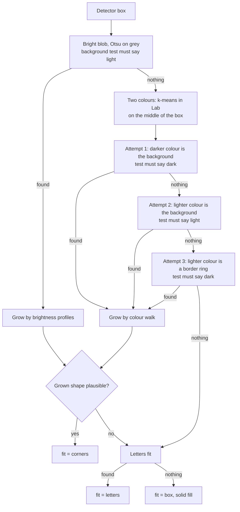

# Multi-colour plates

## In short

- **There is no colour-specific model.** Every plate goes through the same detector box ([01](01-model-and-options.md)) and one plain-OpenCV outline routine in [corners.py](../../number_plate_detection/plate_masker/corners.py). That routine handles white, yellow, green, blue, red and black plates, with light or dark letters.
- **The background is the side that is connected.** The plate is split into light and dark pixels. The background is the side that forms one connected area, and the letters are separate islands. Area is not used, because bold letters cover about half the plate.
- **There are three ways to find the plate, tried in order.** First the bright blob, for light plates. Then the background colour (two-colour k-means in Lab), tried three ways, for dark or coloured plates. Last, the row of letters when the plate's edge can't be seen, as on the small black Indian plates with yellow letters in `sample_vid`. If all three fail, the detector box gets a solid fill.
- **Tested on 11 cases in 3 views each.** The set has 10 drawn plates plus a night case, pasted onto 3 real views. The notes record all 11 cases passing on all 3 views, with 91–98 % outline overlap.

## How it works

1. **Detect.** The YOLOv9 detector returns a straight box. It has one class ("License Plate") and knows nothing about colour ([detector.py:95-101](../../number_plate_detection/plate_masker/detector.py#L95-L101), see [01](01-model-and-options.md)).
2. **Bright blob (light background).** The area round the box is thresholded with Otsu, and the code takes the bright blob under the box centre. The blob is kept only if the background test says the light side is the background. See [Light background](#light-background-white-yellow-silver).
3. **Background colour (dark or coloured background).** This runs only if step 2 found nothing. Two-colour k-means in Lab runs on the middle of the box, followed by a colour-distance mask. The mask is tried three ways: darker colour as background, then lighter colour as background, then lighter colour as a border ring. See [Dark or coloured background](#dark-or-coloured-background).
4. **Grow to the outer trim.** Light plates use brightness profiles ([02](02-exact-plate-fit.md)). Coloured plates use a colour walk outward. The grown shape must pass the plausibility check, or the edge method returns nothing ([corners.py:593-595](../../number_plate_detection/plate_masker/corners.py#L593-L595)).
5. **Letters fit.** This runs only if steps 2–4 gave nothing ([corners.py:490-496](../../number_plate_detection/plate_masker/corners.py#L490-L496)). The outline is built from the row of characters, and `fit` becomes `letters`. See [Letters fit](#letters-fit-when-no-edge-can-be-seen).
6. **Box.** If nothing worked, `corners` stays `None` and `fit` is `box` ([detector.py:51-56](../../number_plate_detection/plate_masker/detector.py#L51-L56)). With `tight_fit` on, such a plate gets a solid fill in `color` (default black), even with `overlay = true` ([__init__.py:112](../../number_plate_detection/plate_masker/__init__.py#L112), [masking.py:177](../../number_plate_detection/plate_masker/masking.py#L177)).
7. **Brightness.** Afterwards, `plate_brightness_detector` names the plate's two colours and picks the overlay's brightness ([How a colour is named](#how-a-colour-is-named), [04](04-auto-brightness.md)).



### Background or letters: connectivity, not area

A plate has two paints, the background and the letters. The background wraps round everything, so it is one connected area. The letters are separate islands. The code tests that directly, using `background_side()` ([corners.py:264-289](../../number_plate_detection/plate_masker/corners.py#L264-L289)):

1. Shrink the found face by 2 px on every edge, so the blurred edge stays out ([corners.py:271](../../number_plate_detection/plate_masker/corners.py#L271)).
2. Take the grey values inside it. If the area is empty or has fewer than 50 pixels, the answer is `None` (unclear) ([corners.py:275-281](../../number_plate_detection/plate_masker/corners.py#L275-L281)).
3. Split them with one Otsu threshold. Light is above the threshold, and dark is at or below it ([corners.py:282-284](../../number_plate_detection/plate_masker/corners.py#L282-L284)).
4. For each side, label its 8-connected pieces inside the face. `share = biggest piece / all pixels of that side` ([corners.py:285-287](../../number_plate_detection/plate_masker/corners.py#L285-L287)).
5. The side with the bigger share is the background, but only if its share is at least 0.6 **and** the other side's share is below 0.6. Otherwise the answer is `None` ([corners.py:288-289](../../number_plate_detection/plate_masker/corners.py#L288-L289)).

**Evidence.** On all 12 real white plates of the 4K video, the background's biggest piece held 91–98 % of its pixels. The letters' biggest piece held only 15–18 %. Area alone was unreliable: the bold font covers about half the plate, and the dark side was the majority on 5 of the 12 ([findings.md:157](../../number_plate_detection/docs/findings.md#any-plate-colour-added-2026-11-06), [corners.py:268-269](../../number_plate_detection/plate_masker/corners.py#L268-L269)).

**Where it gates.** The test is not a first step. It checks each candidate face. Inside `first_plausible`, a candidate is accepted only if it passes all of these ([corners.py:520-529](../../number_plate_detection/plate_masker/corners.py#L520-L529)):

- it is plausible, with an area of at most 1.1 × the box;
- it lies inside the box ± 10 % ([below](#the-10--box-rule));
- `background_side()` gives the side that this attempt expects.

The test always runs on the **unblurred greyscale** big crop ([corners.py:509](../../number_plate_detection/plate_masker/corners.py#L509), [corners.py:527](../../number_plate_detection/plate_masker/corners.py#L527)). That includes the colour attempts. So it is a brightness split, and colour plays no part in it.

The letters fit does not use this test. The brightness module has its own copy, `_background_side` ([detector.py:217-224](../../number_plate_detection/plate_brightness_detector/detector.py#L217-L224), same 0.6). That copy only labels which colour is the background and which is the characters. The reading itself always comes from the light side ([04](04-auto-brightness.md)).

> Note: [README.md:53](../../number_plate_detection/README.md#how-a-plate-is-covered) says the code "first" works out which colour is the background. In the code the candidate blob comes first, and the background test then checks it.

### Light background (white, yellow, silver)

The code makes a small crop of the box ± 15 % (`THRESH_MARGIN`), blurs it, and applies an Otsu threshold. It keeps the outer contour that contains the box centre and covers 0.3–1.25 × the box area. That contour becomes 4 corners through a convex hull and `approxPolyDP` ([corners.py:237-261](../../number_plate_detection/plate_masker/corners.py#L237-L261)). The blob counts only if the background test says `light` ([corners.py:531-533](../../number_plate_detection/plate_masker/corners.py#L531-L533)). The outline is then grown by brightness profiles: white face, then dark border line, then light rim. The trim is measured per edge, 0.14 × face height when an edge can't be measured, and at most 0.22. All of this is in [02](02-exact-plate-fit.md). Yellow plates take this path because yellow paint is much lighter than black letters: the test colours have a grey level of about 194 against 20. Silver plates take it too, because the test only looks at grey level.

### Dark or coloured background

**Why not the bright blob.** On light letters on a dark background, the bright blob is the lettering (or a light border line). Using it gave a crooked outline, with only 82–84 % overlap ([findings.md:153](../../number_plate_detection/docs/findings.md#any-plate-colour-added-2026-11-06)). So once this path starts, the code never falls back to the bright blob ([corners.py:534-536](../../number_plate_detection/plate_masker/corners.py#L534-L536)).

**Step A: find the two colours** ([corners.py:539-545](../../number_plate_detection/plate_masker/corners.py#L539-L545), [corners.py:300-310](../../number_plate_detection/plate_masker/corners.py#L300-L310)).

- Sample from the middle of the box: rows `y1 + 0.25h` to `y2 - 0.25h`, columns `x1 + 0.15w` to `x2 - 0.15w`. This keeps out the border line and rim, so mostly letters and background are left.
- Convert the **unblurred** BGR pixels to OpenCV 8-bit Lab, then to float32.
- If there are fewer than 20 pixels, there are no colours and this whole path is skipped.
- Use at most 3000 pixels, evenly spaced.
- Run `cv2.kmeans` with k = 2: criteria `EPS + MAX_ITER` (20 iterations, eps 0.5), 3 attempts, `KMEANS_PP_CENTERS`.
- Sort the two centres by L, giving (darker, lighter).

**Step B: build the colour mask** ([corners.py:292-297](../../number_plate_detection/plate_masker/corners.py#L292-L297), [corners.py:551-557](../../number_plate_detection/plate_masker/corners.py#L551-L557)).

- The small crop (box ± 15 %) is Gaussian-blurred with the current pass's blur size and converted to Lab float32. Each blurred crop and each mask is cached per blur size and colour, so attempts 2 and 3 share the "lighter" masks.
- Distance to the background colour: `d = sqrt((0.5*dL)^2 + da^2 + db^2)`. Brightness counts half, because shade changes it while the colour stays.
- Threshold: `limit = max(10, 0.5 * d(letters colour, background colour))`, which is half-way between the two colours. A pixel belongs to the mask when `d < limit`.
- **Units:** OpenCV 8-bit Lab (`COLOR_BGR2LAB` on uint8). L is stored as `L* x 255/100`, and a and b as `a* + 128` and `b* + 128`. So the floor of 10 is 10 a/b units, or 20 units of stored L (about 8 L*).
- The mask then goes through the same blob step as the light path, `_mask_quad`: a blob under the centre, 0.3–1.25 × the box, convex hull, 4 corners. The pass's opening is applied first.

**Step C: three attempts, in order** ([corners.py:559-573](../../number_plate_detection/plate_masker/corners.py#L559-L573)).

| # | Blob colour | Background test must say | The blob is | Made for |
|---|---|---|---|---|
| 1 | darker | `dark` | the background | white or yellow letters on blue, green, red or black |
| 2 | lighter | `light` | the background | green with black letters: lighter than its letters but darker than the car round it, so the bright-blob step misses it |
| 3 | lighter | `dark` | a border ring round a dark background | a black plate in a black holder: the background merges with the holder, but the light border line does not |

- **Passes.** Each attempt runs the (blur, opening) passes in order and stops at the first that passes every check ([corners.py:517-529](../../number_plate_detection/plate_masker/corners.py#L517-L529)). The first attempt that returns a face wins.
- **Colours and `from_ring`.** The plate colours are then kept as (background, characters) in Lab. For attempt 3 they are swapped, so the darker colour is the background and the lighter is the characters, and `from_ring = True`.
- **Why the ring works.** In attempt 3, the ring's outer contour encloses the box centre, so the blob step takes the outside of the ring as the face.
- **What the blob can be.** In attempts 1 and 2 the blob can be the whole plate already (its outer rim, as on a straight view), or only the background inside a border line. The trim walk handles both ([corners.py:586-587](../../number_plate_detection/plate_masker/corners.py#L586-L587)).

#### The 10 % box rule

Every candidate face, light or coloured, must lie inside the detector box grown by 10 % of the box's width and height on every side (`FACE_BOX_MARGIN`, [corners.py:42-45](../../number_plate_detection/plate_masker/corners.py#L42-L45), [corners.py:152-158](../../number_plate_detection/plate_masker/corners.py#L152-L158)). Real plates' outer edges reach at most 2 % / 6 % past the box. The rule was added because a thin, blurred red border line no longer separated a white plate from a white bumper. The blob merged with the bumper, giving 51 % overlap. Now such a blob is rejected, and the next pass or attempt is used ([findings.md:172](../../number_plate_detection/docs/findings.md#the-colour-test-set-added-2026-11-06)). The rule applies to the face before the trim. The grown outline is not checked against the box again ([corners.py:593-595](../../number_plate_detection/plate_masker/corners.py#L593-L595)).

#### Measured colour trim

The found face may stop at the background's edge, inside a border line and rim. So each edge is walked outward, and every pixel is labelled "near the background colour" or "different". Seen from the background, a plate ends in one of two ways ([corners.py:161-175](../../number_plate_detection/plate_masker/corners.py#L161-L175)):

```
background | different (car)                                                -> the edge is the plate's edge
background | different (border line) | background again (rim) | different (car) -> the plate ends after the rim
```

1. The big crop is blurred 3×3 and converted to Lab ([corners.py:588-589](../../number_plate_detection/plate_masker/corners.py#L588-L589)). `h` here is the face height: the mean of the face's left and right edges ([corners.py:577](../../number_plate_detection/plate_masker/corners.py#L577)).
2. Each edge gets 7 profiles at 0.2–0.8 along it. Each profile is `max(6, int(0.3h))` px long, and a profile that leaves the big crop is skipped ([corners.py:178-190](../../number_plate_detection/plate_masker/corners.py#L178-L190)).
3. "Near" means `d < limit`, with the same weights and limit as the mask ([corners.py:176-177](../../number_plate_detection/plate_masker/corners.py#L176-L177), [corners.py:191](../../number_plate_detection/plate_masker/corners.py#L191)).
4. **Normal case (attempts 1 and 2)** ([corners.py:196-210](../../number_plate_detection/plate_masker/corners.py#L196-L210)):
   - Skip near pixels for up to 0.05h, because the found edge may sit a pixel or two inside.
   - Count the run of different pixels. If it is longer than `LINE_MAX` (0.12h) or runs to the end of the profile, it is the car, so the offset is where the run started.
   - Otherwise the run was a border line, so walk the near-background rim after it. If the rim is still going at `RIM_MAX` (0.12h), its end can't be seen, and the offset is rim start + `round(RIM_TYPICAL x h)` = rim start + 0.06h. Otherwise the offset is the rim's end.
5. **Ring case (attempt 3).** The face is already the outside of the line. Skip at most 2 different pixels (the line's blurred edge), then walk the rim as above ([corners.py:193-195](../../number_plate_detection/plate_masker/corners.py#L193-L195)). In a black holder the rim never ends, so 0.06h is added.
6. **Combine.** An edge's trim is the median of its profile offsets. If no profile gives an offset, the trim is 0. The trim is clipped to `[0, TRIM_MAX x h]` = 0.22h ([corners.py:211](../../number_plate_detection/plate_masker/corners.py#L211), [corners.py:590-592](../../number_plate_detection/plate_masker/corners.py#L590-L592)). Each of the 4 edges gets its own trim, and `grow_quad` moves the edges out and re-joins the corners ([corners.py:87-101](../../number_plate_detection/plate_masker/corners.py#L87-L101)).

**Why the trim is measured.** The first version added a fixed 0.14h, as on light plates. On straight views the colour blob was already the whole plate, so that made it too big: 68–74 % overlap ([findings.md:171](../../number_plate_detection/docs/findings.md#the-colour-test-set-added-2026-11-06)).

#### Black plate in a black holder

The black background merges with a black holder and a dark bumper. Attempt 1 then either fails the plausibility check or reaches more than 10 % outside the box. Attempt 3 takes the light border line as the plate's outline and adds only the rim. The rim's end can't be seen against the holder, so it is taken as 0.06 × face height ([findings.md:173](../../number_plate_detection/docs/findings.md#the-colour-test-set-added-2026-11-06)). If the plate has no light border line, the letters fit is the only way left.

> Note: [findings.md:158](../../number_plate_detection/docs/findings.md#any-plate-colour-added-2026-11-06) says a black plate on a black holder (angled rear) "falls back to the box". That was written before attempt 3 was added. The black/white test case now passes on the angled rear too ([README.md:161](../../number_plate_detection/README.md#testing-plate-colours)). [findings.md:117](../../number_plate_detection/docs/findings.md#fitting-the-plates-own-outline) ("dark plates always fall back to the box") and [findings.md:125](../../number_plate_detection/docs/findings.md#limits-and-risks) ("relies on a light plate face") are older still.

**Cost.** Measured on an Intel i5-1240P laptop (CPU): about 4–8 ms per plate for light plates, about 20 ms for coloured plates, and up to about 70 ms for green with black letters, where every attempt runs ([findings.md:163](../../number_plate_detection/docs/findings.md#any-plate-colour-added-2026-11-06)).

> Note: the [corners.py:5](../../number_plate_detection/plate_masker/corners.py#L5) docstring still says "about 1-3 ms per plate".

### Letters fit: when no edge can be seen

**The case it was built for.** `sample_vid` is a 464×832 phone video of a dark grey hatchback with black Indian rental plates with yellow letters (`KA 03 ...`). The plates are about 80×25 px, and the letters are about 11 px tall and 2–3 px thick. The detector found all 8 visible plates, but every one fell back to the box. All three edge methods failed for these reasons ([findings.md:180-186](../../number_plate_detection/docs/findings.md#a-second-real-video-sample_vid-added-2026-11-07)):

- the black background is almost the same shade as the car;
- there is no light border line;
- the only bright parts are the letters.

So the outline is worked out from the row of characters, in `_letters_quad` ([corners.py:402-481](../../number_plate_detection/plate_masker/corners.py#L402-L481)):

1. **Crop.** The box must be at least 16 × 8 px. The crop is the box ± 8 % ([corners.py:412-417](../../number_plate_detection/plate_masker/corners.py#L412-L417)).
2. **Light or dark characters.** An Otsu threshold is computed from the pixels inside the box only, then applied to the whole crop. The code tries light characters first, then dark characters, and keeps the better `(count, span)` score. A tie keeps the light result ([corners.py:418-424](../../number_plate_detection/plate_masker/corners.py#L418-L424)).
3. **Row of characters** (`_character_row`, [corners.py:313-370](../../number_plate_detection/plate_masker/corners.py#L313-L370)):
   - **Candidates.** 8-connected shapes whose centre lies inside the box. Height from `max(4, 0.2h)` to `0.95h`, width at most `0.4w`, area at least 8 px, and fill (area / bounding box) 0.12–0.9. At least 3 are needed.
   - **Rows.** Every pair with heights within 1.6× of each other, and a slope of at most tan 40° (`MAX_TILT`), seeds a line. The members are candidates within `0.3 x href` of that line, with height `0.6–1.6 x href`, where `href` is the pair's mean height. A row needs at least 3 members. The best row is the one with the most members, then the longest span.
   - **Ink filter.** Keep only members with at least 30 % of the median member's area, and at least 3 must remain ([corners.py:356-361](../../number_plate_detection/plate_masker/corners.py#L356-L361)). A thin highlight at the plate's end was being counted as a letter, and this removes it. Even a "1" has about 80 % of a typical letter's ink.
   - **Span.** The row must cover at least 0.35 × the box width ([corners.py:362-365](../../number_plate_detection/plate_masker/corners.py#L362-L365)).
4. **Text direction `t`.** `cv2.fitLine` (L2) is fitted through the character centres and turned to point right ([corners.py:429-434](../../number_plate_detection/plate_masker/corners.py#L429-L434)).
5. **Sides along the strokes** (`_letters_down`, [corners.py:373-399](../../number_plate_detection/plate_masker/corners.py#L373-L399)). At an angle, a plate's sides stay near upright in the photo instead of square to the slanted row. So the "down" direction is the mean long axis of the characters that are clearly tall:
   - each character needs at least 6 px and an eigenvalue ratio of at least 1.69, which is an axis ratio of 1.3;
   - each axis must be within 35° of square to `t`;
   - at least 2 such characters are needed, and the mean must also be within 35°.
   
   Otherwise the code uses the line square to `t`.
6. **Top and bottom lines.** For each character, the top is the 2nd percentile along the down direction and the bottom is the 98th. The ends are the 1st and 99th percentiles along `t`. Straight lines are fitted through the tops and through the bottoms. Their different slopes carry the plate's perspective ([corners.py:441-450](../../number_plate_detection/plate_masker/corners.py#L441-L450)).
7. **Letter height at each end.** `c_left` and `c_right` are bottom minus top at each end. If either is below 3 px, the fit fails ([corners.py:451-455](../../number_plate_detection/plate_masker/corners.py#L451-L455)).
8. **Margins** ([corners.py:456-463](../../number_plate_detection/plate_masker/corners.py#L456-L463)):
   - Above and below: 0.35 × the letter height at that end (`LETTER_MARGIN_V`).
   - At each end: 4.5 % of the row's length (`LETTER_MARGIN_H`), scaled by `c_end / c_mean`, so the end nearer the camera gets the bigger margin. The end margin is a share of the row's length and not of the letter height, because an angled view squeezes the row but not the letters ([corners.py:50-56](../../number_plate_detection/plate_masker/corners.py#L50-L56)).
   - These were measured from the real plates: 0.27–0.4 vertically, and about 3–5 % at the ends ([findings.md:190](../../number_plate_detection/docs/findings.md#a-second-real-video-sample_vid-added-2026-11-07)).
9. **Pull-back** ([corners.py:466-478](../../number_plate_detection/plate_masker/corners.py#L466-L478)). An end that sticks out past the box ± 5 % of its width (`LETTER_BOX_MARGIN_X`) is pulled back along `t`. This happens only when `vx > 0.3`, and never by more than that end's own margin, so the outline never cuts into the text.
10. **Check.** The result must be plausible, with an area of at most 1.6 × the box, and lie inside the box ± 25 % ([corners.py:479](../../number_plate_detection/plate_masker/corners.py#L479)).

**Results.** All 8 `sample_vid` plates get the logo, following tilt and perspective ([findings.md:199-201](../../number_plate_detection/docs/findings.md#a-second-real-video-sample_vid-added-2026-11-07)). The black/yellow test plate overlaps the truth by 92–93 %. These plates are too small to read the paint, so their brightness comes from the photo, a steady 67–78 % ([04](04-auto-brightness.md)).

> Note: the [corners.py:408-409](../../number_plate_detection/plate_masker/corners.py#L408-L409) docstring and [findings.md:190](../../number_plate_detection/docs/findings.md#a-second-real-video-sample_vid-added-2026-11-07) say the result is "kept within the detector's box left to right". In the code, an end is pulled back only when `vx > 0.3`, and by at most that end's margin. The only hard limit is the box ± 25 %.

### How a colour is named

The outline code never names colours: it only works with the two Lab centres. The names come from the brightness module, in `name_colour` ([colours.py:30-48](../../number_plate_detection/plate_brightness_detector/colours.py#L30-L48)). It works on the median BGR of each side's core: the side shaved by 1 px, or the whole side if fewer than 20 pixels would be left ([detector.py:142-144](../../number_plate_detection/plate_brightness_detector/detector.py#L142-L144), [detector.py:201-204](../../number_plate_detection/plate_brightness_detector/detector.py#L201-L204)).

The colour goes to OpenCV HSV (hue 0–179, saturation 0–255). A saturation below 60 is neutral. A neutral light side is called `white`, whatever its level, so grey and silver count too. A neutral dark side is `black` if max(B, G, R) < 110, otherwise `grey` ([detector.py:207-214](../../number_plate_detection/plate_brightness_detector/detector.py#L207-L214)). Any other colour is named by its hue band (table below). The names fill `plate_colours` (background/characters) in `detections.csv` ([mask_plates.py:281](../../number_plate_detection/mask_plates.py#L281)).

The names also pick a paint factor from `PAINT_FACTORS`: how bright that paint looks next to white in the same light ([colours.py:8-23](../../number_plate_detection/plate_brightness_detector/colours.py#L8-L23)). Only factors of 0.5 or more are used (white, yellow, orange). The darker ones are listed for reference only, because dividing by a small, uncertain factor magnifies errors. `teal` and `purple` have no entry at all. The factors are marked as first estimates. How the factor turns into the overlay's brightness is in [04](04-auto-brightness.md).

The test colours, computed from their RGB values, get these names:

- yellow (255, 200, 0): hue 23.5, `yellow`;
- green (0, 120, 70): hue 77.5, `green`;
- blue (20, 60, 170): hue 112, `blue`;
- both reds: hue 178, `red`;
- white and black: saturation 0, neutral.

### Which method fits which plate

This table shows the path the code is built for, following its own comments ([corners.py:531-566](../../number_plate_detection/plate_masker/corners.py#L531-L566)). The per-photo `fit` label is printed by the test runner and written to `detections.csv`.

| Plate | Example | Outline method | `fit` | Light read from ([04](04-auto-brightness.md)) |
|---|---|---|---|---|
| White, dark or red letters | most of Europe, India private cars, Belgium | Bright blob. If a faint line lets it merge with a white bumper, the 10 % rule rejects it and a later pass or attempt is used. | `corners` | white background |
| Yellow, black letters | taxis, UK rear, Netherlands | Bright blob | `corners` | yellow background ÷ 0.75 |
| Silver or grey, dark letters | — | Bright blob | `corners` | named `white` (neutral), factor 1.0 |
| Blue, green, red or black, white letters | China, India EV, temporary, rental | Colour attempt 1 (darker colour is the background) | `corners` | white letters |
| Green, yellow letters | India EV taxi | Colour attempt 1 | `corners` | yellow letters ÷ 0.75 |
| Green, black letters | — | Colour attempt 2 (lighter colour is the background) | `corners` | photo (no white or light paint) |
| Black with a light border line, in a black holder | — | Colour attempt 3 (ring), plus 0.06h rim | `corners` | white letters, if white |
| Black, yellow letters, no border line, on a dark car | India self-drive rental (`sample_vid`) | Letters fit | `letters` | yellow ÷ 0.75 if readable. On `sample_vid` the letters are too thin, so photo. |
| No visible edge and fewer than 3 readable letters, or badly blurred | — | none | `box` | solid fill; the reading is unused |

## The maths and constants

All code links are in `number_plate_detection/`. `w`, `h` = detector box width and height, unless the row says face height.

**Background test**

| Name | Value | Meaning | Code |
|---|---|---|---|
| `BACKGROUND_SHARE` | 0.6 | Share of a side's pixels that must sit in its biggest 8-connected piece for it to be the background. The other side must stay below it. | [corners.py:41](../../number_plate_detection/plate_masker/corners.py#L41), [corners.py:288-289](../../number_plate_detection/plate_masker/corners.py#L288-L289) |
| Face shrink | 2 px | Face shrunk on every edge before the test | [corners.py:271](../../number_plate_detection/plate_masker/corners.py#L271) |
| Minimum pixels | 50 | Fewer gives `None` | [corners.py:280-281](../../number_plate_detection/plate_masker/corners.py#L280-L281) |
| Input | unblurred grey of the big crop | Same for the colour attempts | [corners.py:509](../../number_plate_detection/plate_masker/corners.py#L509), [corners.py:527](../../number_plate_detection/plate_masker/corners.py#L527) |
| `BACKGROUND_SHARE` (brightness) | 0.6 | Separate copy; sets the background/characters labels only | [detector.py:37](../../number_plate_detection/plate_brightness_detector/detector.py#L37) |

Formula: `share(side) = biggest 8-connected piece / all pixels of that side`; `background = side with the larger share if share_max >= 0.6 and share_min < 0.6, else None`.

**Edge path: candidates and checks.** The crops, the (blur, opening) passes, the blob window (0.3–1.25 × box), the corner simplification, the 10 % box margin and the shape checks (face area ≤ 1.1 × box, grown and letters outlines ≤ 1.6 × box, `MAX_TILT` 40°) are shared with the light path. Their constants are listed once, in [02: The maths and constants](02-exact-plate-fit.md#the-maths-and-constants).

**Two colours and the colour mask**

| Name | Value | Meaning | Code |
|---|---|---|---|
| Sample region | rows `y1 + 0.25h`..`y2 - 0.25h`, columns `x1 + 0.15w`..`x2 - 0.15w` | Middle of the box: letters and background only | [corners.py:541-543](../../number_plate_detection/plate_masker/corners.py#L541-L543) |
| Minimum pixels | 20 | Fewer: no colours, colour path skipped | [corners.py:303-304](../../number_plate_detection/plate_masker/corners.py#L303-L304) |
| Colour space | OpenCV 8-bit Lab, as float32 | `COLOR_BGR2LAB` on uint8 BGR | [corners.py:305](../../number_plate_detection/plate_masker/corners.py#L305) |
| Samples | ≤ 3000, evenly spaced | | [corners.py:306](../../number_plate_detection/plate_masker/corners.py#L306) |
| k | 2 | Background and letters | [corners.py:308](../../number_plate_detection/plate_masker/corners.py#L308) |
| Criteria | `EPS + MAX_ITER`, 20 iterations, eps 0.5 | | [corners.py:307](../../number_plate_detection/plate_masker/corners.py#L307) |
| Attempts, start | 3, `KMEANS_PP_CENTERS` | | [corners.py:308](../../number_plate_detection/plate_masker/corners.py#L308) |
| Order | sorted by L into (darker, lighter) | Darker is tried first | [corners.py:309](../../number_plate_detection/plate_masker/corners.py#L309) |
| Lab weights | [0.5, 1.0, 1.0] | L counts half | [corners.py:294](../../number_plate_detection/plate_masker/corners.py#L294) |
| Limit | `max(10, 0.5 * d(ink, face))` | Half-way between the two colours, at least 10 | [corners.py:296-297](../../number_plate_detection/plate_masker/corners.py#L296-L297) |
| Attempt order | (darker, `dark`, background), (lighter, `light`, background), (lighter, `dark`, ring) | | [corners.py:565-566](../../number_plate_detection/plate_masker/corners.py#L565-L566) |

Formula: `d(p, face) = sqrt((0.5*(L_p - L_face))^2 + (a_p - a_face)^2 + (b_p - b_face)^2)`; a pixel is background-coloured when `d < max(10, 0.5 * d(ink, face))`.

**Colour trim walk** (`h` = face height, [corners.py:577](../../number_plate_detection/plate_masker/corners.py#L577))

| Name | Value | Meaning | Code |
|---|---|---|---|
| Walk input | big crop, 3×3 Gaussian blur, Lab float32 | | [corners.py:588-589](../../number_plate_detection/plate_masker/corners.py#L588-L589) |
| Profiles | 7, at 0.2–0.8 along the edge | | [corners.py:179](../../number_plate_detection/plate_masker/corners.py#L179) |
| Profile length | `max(6, int(0.3h))` px | | [corners.py:178](../../number_plate_detection/plate_masker/corners.py#L178) |
| Start skip | up to 0.05h of near pixels | Found edge may sit inside | [corners.py:186](../../number_plate_detection/plate_masker/corners.py#L186), [corners.py:197-198](../../number_plate_detection/plate_masker/corners.py#L197-L198) |
| `LINE_MAX` | 0.12 | A longer different run is the car | [corners.py:49](../../number_plate_detection/plate_masker/corners.py#L49), [corners.py:202](../../number_plate_detection/plate_masker/corners.py#L202) |
| `RIM_MAX` | 0.12 | Rim walk limit | [corners.py:49](../../number_plate_detection/plate_masker/corners.py#L49), [corners.py:206-208](../../number_plate_detection/plate_masker/corners.py#L206-L208) |
| `RIM_TYPICAL` | 0.06 | Rim used when the walk hits `RIM_MAX` | [corners.py:49](../../number_plate_detection/plate_masker/corners.py#L49), [corners.py:209](../../number_plate_detection/plate_masker/corners.py#L209) |
| Ring skip | ≤ 2 different pixels | Blurred edge of the line (attempt 3) | [corners.py:193-195](../../number_plate_detection/plate_masker/corners.py#L193-L195) |
| No result | 0 px | Coloured plates (light plates use 0.14h) | [corners.py:592](../../number_plate_detection/plate_masker/corners.py#L592) |
| `TRIM_MAX` | 0.22 | Most added per edge | [corners.py:35](../../number_plate_detection/plate_masker/corners.py#L35), [corners.py:592](../../number_plate_detection/plate_masker/corners.py#L592) |

Formula: `trim = clip(median(offsets) or 0, 0, 0.22h)`. The offset is `line_start` if the different run is longer than 0.12h or reaches the profile end. Otherwise it is the rim's end, or `rim_start + round(0.06h)` if the rim reaches 0.12h.

**Letters fit**

| Name | Value | Meaning | Code |
|---|---|---|---|
| Box minimum | w ≥ 16, h ≥ 8 px | | [corners.py:412](../../number_plate_detection/plate_masker/corners.py#L412) |
| Crop | box ± 8 % | | [corners.py:415-416](../../number_plate_detection/plate_masker/corners.py#L415-L416) |
| Threshold | Otsu on the pixels inside the box | Applied to the whole crop | [corners.py:418-419](../../number_plate_detection/plate_masker/corners.py#L418-L419) |
| Candidate | centre in box; height `max(4, 0.2h)`..`0.95h`; width ≤ `0.4w`; area ≥ 8 px; fill 0.12–0.9 | One character | [corners.py:325-331](../../number_plate_detection/plate_masker/corners.py#L325-L331) |
| Pair | heights within 1.6×; `abs(dx) >= 1` px; slope ≤ tan 40° | Seeds a line | [corners.py:340](../../number_plate_detection/plate_masker/corners.py#L340) |
| Member | ≤ `0.3 * href` from the line; height `0.6–1.6 * href` | | [corners.py:344-346](../../number_plate_detection/plate_masker/corners.py#L344-L346) |
| Row | ≥ 3 members; score (count, span) | | [corners.py:347-352](../../number_plate_detection/plate_masker/corners.py#L347-L352) |
| Ink filter | area ≥ 0.3 × median member area; ≥ 3 left | Drops highlights and plate edges | [corners.py:358-361](../../number_plate_detection/plate_masker/corners.py#L358-L361) |
| Span | ≥ 0.35 × box width | | [corners.py:364](../../number_plate_detection/plate_masker/corners.py#L364) |
| Down axis | ≥ 6 px per character; eigenvalue ratio ≥ 1.69; within 35°; ≥ 2 characters | Else square to the row | [corners.py:382-398](../../number_plate_detection/plate_masker/corners.py#L382-L398) |
| Top / bottom / ends | 2nd / 98th percentile along down; 1st / 99th along the row; straight lines (`polyfit`, degree 1) | | [corners.py:445-450](../../number_plate_detection/plate_masker/corners.py#L445-L450) |
| End letter height | ≥ 3 px | | [corners.py:454](../../number_plate_detection/plate_masker/corners.py#L454) |
| `LETTER_MARGIN_V` | 0.35 | × letter height at that end, above and below | [corners.py:55](../../number_plate_detection/plate_masker/corners.py#L55), [corners.py:461-462](../../number_plate_detection/plate_masker/corners.py#L461-L462) |
| `LETTER_MARGIN_H` | 0.045 | × row length at each end, scaled per end | [corners.py:55](../../number_plate_detection/plate_masker/corners.py#L55), [corners.py:457-459](../../number_plate_detection/plate_masker/corners.py#L457-L459) |
| `LETTER_BOX_MARGIN_X` | 0.05 | Pull-back target: box ± 5 % of width | [corners.py:56](../../number_plate_detection/plate_masker/corners.py#L56), [corners.py:467](../../number_plate_detection/plate_masker/corners.py#L467) |
| Pull-back | only if `vx > 0.3`; `shift = min(over / vx, m_end)` | Never into the text | [corners.py:469-478](../../number_plate_detection/plate_masker/corners.py#L469-L478) |
| Final box limit | box ± 25 % | | [corners.py:479](../../number_plate_detection/plate_masker/corners.py#L479) |

Formula: `m_end = 0.045 * (a_right - a_left) * c_end / ((c_left + c_right) / 2)`; `top(end) = topline(end) - 0.35 * c_end`; `bottom(end) = bottomline(end) + 0.35 * c_end`.

**Colour names and paint factors**

| Name | Value | Meaning | Code |
|---|---|---|---|
| `NEUTRAL_SATURATION` | 60 (HSV S, 0–255) | Below this: neutral. Real white plates measured 4–12, plate yellows 200+. | [colours.py:25-27](../../number_plate_detection/plate_brightness_detector/colours.py#L25-L27) |
| Hue bands (OpenCV H, 0–179) | red `h < 8` or `h >= 165`; orange 8–19; yellow 20–34; green 35–84; teal 85–99; blue 100–129; purple 130–164 | Colour names | [colours.py:35-48](../../number_plate_detection/plate_brightness_detector/colours.py#L35-L48) |
| Neutral light side | `white` | Any level | [detector.py:212-213](../../number_plate_detection/plate_brightness_detector/detector.py#L212-L213) |
| Neutral dark side | `black` if max(B, G, R) < 110, else `grey` | | [detector.py:214](../../number_plate_detection/plate_brightness_detector/detector.py#L214) |

`PAINT_FACTORS` and `MIN_FACTOR` per colour name are in [04: Paint names and factors](04-auto-brightness.md#paint-names-and-factors).

## The colour test set

The 4K test video only has white plates, so the test set pastes drawn plates of every colour onto real views of the car. The right outline and brightness are then known for every photo. [make_test_photos.py](../../number_plate_detection/tests/make_test_photos.py) builds it, and [run_colour_tests.py](../../number_plate_detection/tests/run_colour_tests.py) scores it.

**How the photos are made**

1. **Draw the plates.** 1040 × 224 px with the text `TEST 123`, at most 0.84 of the width and 0.58 of the height. Each has a border line in the letter colour (12 px, 5.4 % of the height) and a rim of background colour outside it (10 px, 4.5 %) ([make_test_photos.py:44-45](../../number_plate_detection/tests/make_test_photos.py#L44-L45), [make_test_photos.py:85-101](../../number_plate_detection/tests/make_test_photos.py#L85-L101)). `black_yellow` copies the `sample_vid` plates: no border line, condensed text `AB 12 CD 3456` at 0.62 of the height, squeezed to at most 0.92 of the width ([make_test_photos.py:63-65](../../number_plate_detection/tests/make_test_photos.py#L63-L65), [make_test_photos.py:104-118](../../number_plate_detection/tests/make_test_photos.py#L104-L118)). Existing plate images are kept unless `--redraw` is passed.
2. **Pick 3 views** from `frame_view_type`'s 4K frames (3840×2160, `Final_zoomed_car`): `front` (frame `0000.0s_`), `front_angled` (`0034.0s_`) and `rear_angled` (`0024.0s_`) ([make_test_photos.py:38-42](../../number_plate_detection/tests/make_test_photos.py#L38-L42); frames from [frame_view_type](../frame_view_type/README.md)).
3. **Get the "true" outline.** The real white plate in each view is detected and fitted with `fit_plate`. The largest plate with corners is the main plate, and its outline is the truth ([make_test_photos.py:223-229](../../number_plate_detection/tests/make_test_photos.py#L223-L229)). So the truth is the algorithm's own white-plate fit, which was checked by eye at 3× zoom ([findings.md:114](../../number_plate_detection/docs/findings.md#fitting-the-plates-own-outline)), not a hand-drawn outline. The true plates are about 134, 134 and 109 px tall (from [expected.csv](../../number_plate_detection/assets/test_photos/expected.csv)).
4. **Get the true light.** It is the 80th percentile of the Otsu-light pixels more than 0.16 × height inside that outline ([make_test_photos.py:176-184](../../number_plate_detection/tests/make_test_photos.py#L176-L184)): 192, 194 and 193 of 255 (75.3, 76.1 and 75.7 %).
5. **Paste.** Each plate is pasted with `image_overlay` at that level, then blurred inside the outline grown by 2 px, with sigma `max(0.6, 0.008 * height)`, to look like the camera's plate. The photo is saved as JPEG at quality 92 ([make_test_photos.py:187-200](../../number_plate_detection/tests/make_test_photos.py#L187-L200), [make_test_photos.py:147](../../number_plate_detection/tests/make_test_photos.py#L147)).
6. **Night case.** `night_flash` darkens the scene to 25 % (`NIGHT_DARKEN`) and pastes the white/black plate at full brightness, as if it were glowing in a flash ([make_test_photos.py:260-264](../../number_plate_detection/tests/make_test_photos.py#L260-L264)).
7. **Expected reading.** For each case it comes from the lighter of the two colours (by luma `0.299R + 0.587G + 0.114B`):
   - neutral gives `white`;
   - a paint factor of 0.5 or more gives `light paint`;
   - anything else gives `photo`.

   `night_flash` is always `photo` ([make_test_photos.py:121-128](../../number_plate_detection/tests/make_test_photos.py#L121-L128), [make_test_photos.py:263-264](../../number_plate_detection/tests/make_test_photos.py#L263-L264)). That makes 11 cases × 3 views = 33 photos and 33 rows in `expected.csv`.

**Pass rule** ([run_colour_tests.py:104-119](../../number_plate_detection/tests/run_colour_tests.py#L104-L119)). The plate scored is the detection with the best IoU against the true outline ([run_colour_tests.py:173-178](../../number_plate_detection/tests/run_colour_tests.py#L173-L178)). A photo passes when:

- the plate is detected;
- `fit` is not `box` (a `letters` fit counts as found);
- the IoU with the true outline is at least `PASS_OVERLAP` 0.90;
- with auto brightness on, the overlay's white is within ±`PASS_POINTS` 5 points of the true brightness. The overlay's white is the 75th percentile of grey inside the true outline shrunk to 0.7 about its centre ([run_colour_tests.py:59-64](../../number_plate_detection/tests/run_colour_tests.py#L59-L64)).

Cases that expect `photo` (green/black, night_flash) only need a source starting with `photo`; their value is not checked. Auto brightness off is reported but not judged. The runner forces `padding = 0` and `tight_fit = true` and turns smoothing off ([run_colour_tests.py:144-151](../../number_plate_detection/tests/run_colour_tests.py#L144-L151)).

**Results.** These are recorded in [README.md:149-163](../../number_plate_detection/README.md#testing-plate-colours), with all 11 cases passing on all 3 views. They were not re-run for this page, and no `output/colour_tests/summary.csv` is on disk. The true brightness is 75–76 % for every case except night.

| Case | Background / letters (RGB) | Stands for | Expected reading | Outline overlap | Auto ON |
|---|---|---|---|---|---|
| `white_black` | 255,255,255 / 20,20,20 | most of Europe, India private cars | white | 93–97 % | 75–76 % |
| `white_red` | 255,255,255 / 200,30,40 | Belgium | white | 96–97 % | 75–76 % |
| `yellow_black` | 255,200,0 / 20,20,20 | taxis and commercial, UK rear, Netherlands | light paint | 94–95 % | 76–77 % |
| `green_white` | 0,120,70 / 255,255,255 | electric cars (e.g. India) | white | 94–96 % | 75–76 % |
| `green_yellow` | 0,120,70 / 255,200,0 | electric taxis or commercial (e.g. India) | light paint | 94–95 % | 76–77 % |
| `green_black` | 0,120,70 / 20,20,20 | the photo fallback: no white or light paint | photo | 96–97 % | 78–85 % (value not checked) |
| `blue_white` | 20,60,170 / 255,255,255 | e.g. China | white | 93–96 % | 75–76 % |
| `red_white` | 190,25,35 / 255,255,255 | temporary or diplomatic plates | white | 94–97 % | 75–76 % |
| `black_white` | 20,20,20 / 255,255,255 | rental or vintage cars | white | 91–97 % | 75–76 % |
| `black_yellow` | 20,20,20 / 255,200,0, no border | Indian self-drive rental (outline from the letters) | light paint | 92–93 % | 76 % |
| `night_flash` | `white_black` plate at 255, scene × 0.25 | reflective plate in a flash | photo | 93–98 % | 19–22 % (photo) |

Plate RGB values are from [make_test_photos.py:48-60](../../number_plate_detection/tests/make_test_photos.py#L48-L60). The brightness side of these results, including auto off, is in [04](04-auto-brightness.md).

**History.** The first run failed 7 of 10 cases, every time on the outline. Brightness was right wherever the outline was. There were four fixes ([findings.md:169-176](../../number_plate_detection/docs/findings.md#the-colour-test-set-added-2026-11-06)):

- the measured colour trim, replacing a fixed 0.14h;
- the 10 % box rule;
- the border-ring attempt for black plates;
- redrawing the sample plates' border line at about 5 % of the height (it was 3.6 %, and perspective plus blur erased it on the angled view).

The 12 real plates' outlines stayed the same (within 0.5 px). `black_yellow` and the letters fit were added the next day ([findings.md:201](../../number_plate_detection/docs/findings.md#a-second-real-video-sample_vid-added-2026-11-07)).

> Note: [findings.md:167](../../number_plate_detection/docs/findings.md#the-colour-test-set-added-2026-11-06) says "9 flat sample plates" plus night (10 cases). That predates `black_yellow`. The code has 10 plates plus `night_flash`, making 11 cases. [findings.md:176](../../number_plate_detection/docs/findings.md#the-colour-test-set-added-2026-11-06) says brightness ended "within ±1 point", but the README table shows yellow plates at 76–77 % against a true 75–76 %.

## Options we had

| Option | Licence | Verdict | Why |
|---|---|---|---|
| Background = the side with more pixels | own code, OpenCV | Rejected | The dark side was the majority on 5 of 12 real white plates, because bold letters cover about half the plate ([findings.md:157](../../number_plate_detection/docs/findings.md#any-plate-colour-added-2026-11-06)) |
| Background = the light side (bright blob on every plate) | own code, OpenCV | Kept for light plates only | On dark plates the bright blob is the lettering: crooked outline, 82–84 % overlap ([findings.md:153](../../number_plate_detection/docs/findings.md#any-plate-colour-added-2026-11-06)) |
| **Background = the side that is one connected piece** | own code, OpenCV | **Chosen** | 91–98 % vs 15–18 % on the real plates; no training, no model |
| Fixed 0.14h trim on coloured plates | own code | Replaced | The colour blob is often already the whole plate: 68–74 % overlap ([findings.md:171](../../number_plate_detection/docs/findings.md#the-colour-test-set-added-2026-11-06)) |
| **Measured colour walk** (background, line, rim, car) | own code | **Chosen** | Handles both "blob = whole plate" and "blob = inside the line" |
| Accept any background blob under the box centre | own code | Replaced by the 10 % box rule | A faint red line let a white plate merge with a white bumper: 51 % overlap ([findings.md:172](../../number_plate_detection/docs/findings.md#the-colour-test-set-added-2026-11-06)) |
| Black plate in a black holder: box fallback | — | Replaced by the ring attempt | The light border line still gives the plate's outline ([findings.md:173](../../number_plate_detection/docs/findings.md#the-colour-test-set-added-2026-11-06)) |
| **Outline from the row of letters** | own code, OpenCV | **Chosen as the last method before the box** | The only way to fit the `sample_vid` plates: dark plate on a dark car, no border line ([findings.md:182-190](../../number_plate_detection/docs/findings.md#a-second-real-video-sample_vid-added-2026-11-07)) |
| A colour-specific model (plate segmentation or colour classifier) | — | Not tried | The classical path covers every case in the test set. The project keeps plate fitting as plain OpenCV with no extra model on the CPU ([corners.py:4-5](../../number_plate_detection/plate_masker/corners.py#L4-L5)) |

## Limits

- **Letters-fit outlines assume the letters fill most of the plate.** Plates with small letters on a big plate (e.g. US plates) get an overlay smaller than the plate. The letters themselves are always covered ([README.md:186](../../number_plate_detection/README.md#known-limits), [findings.md:204](../../number_plate_detection/docs/findings.md#a-second-real-video-sample_vid-added-2026-11-07)).
- **A black plate in a black holder needs a light border line or readable letters.** With neither, it falls back to the box with a solid fill. The box also remains for any badly blurred plate, or one with fewer than 3 readable letters and no visible edge ([README.md:188](../../number_plate_detection/README.md#known-limits)).
- **The background test only sees brightness.** It runs on greyscale for every attempt. Two paints with about the same grey level can't be told apart, even if their colours differ. For example, the test set's red (190, 25, 35) and green (0, 120, 70) have grey levels of about 76 and 78, so a red-on-green plate would likely fail the test, and the letters fit (also on grey) as well. No such plate is in the test set.
- **Automated colour tests use drawn, pasted plates only.** They are flat, about 109–134 px tall, and on one white car. The only real coloured plates are the 8 black/yellow `sample_vid` plates, which were checked by eye. Reflective sheeting, other fonts, dirt and stickers are untested.
  > Note: [README.md:185](../../number_plate_detection/README.md#known-limits) says coloured plates are tested "on generated photos only" and that the real video has white plates only. It does not mention `sample_vid`.
- **The test's "true" outline is `fit_plate`'s own fit of the real white plate.** IoU ≥ 0.90 measures agreement with that fit, not with a hand-drawn outline.
- **Not every case's value is checked.** The `green_black` and `night_flash` brightness values are not checked, only that the photo reading was used. The `black_yellow` test is documented as fitted from the letters ([README.md:162](../../number_plate_detection/README.md#testing-plate-colours)), but that was not re-run for this page.
- **The grown outline is not re-checked against the box.** Only the face is held to box ± 10 %. A colour walk that ran on (up to 0.22h per edge) is caught only by the plausibility check (area ≤ 1.6 × box).
- **A colour-walk edge case.** If the found edge sits more than 0.05h inside the background, the rest of the background is walked as if it were the rim. The walk then stops at the border line, so the line and the real rim beyond it are not added. If that stretch of background is longer than 0.12h, only 0.11h in all (0.05h + 0.06h) is added ([corners.py:197-209](../../number_plate_detection/plate_masker/corners.py#L197-L209)).
- **Colour names and paint factors are first estimates** from standard plate colours and simulations ([colours.py:12-13](../../number_plate_detection/plate_brightness_detector/colours.py#L12-L13)). `teal` and `purple` have no factor, so they use the photo reading.
- **Cost grows with the number of attempts.** Green with black letters runs every attempt, at up to about 70 ms per plate on the i5-1240P laptop.

## Further reading

- [README](README.md): overview and index of the number-plate docs.
- [01: model and options](01-model-and-options.md): the detector.
- [02: exact plate fit](02-exact-plate-fit.md): box to 4 corners, light-plate trim, the warp.
- [04: auto brightness](04-auto-brightness.md): how the light is read for each plate colour.
- Older notes: [findings.md, Any plate colour](../../number_plate_detection/docs/findings.md#any-plate-colour-added-2026-11-06), [The colour test set](../../number_plate_detection/docs/findings.md#the-colour-test-set-added-2026-11-06), [A second real video: sample_vid](../../number_plate_detection/docs/findings.md#a-second-real-video-sample_vid-added-2026-11-07).
- [number_plate_detection/README.md, Testing plate colours](../../number_plate_detection/README.md#testing-plate-colours) and [Known limits](../../number_plate_detection/README.md#known-limits).
- [assets/test_plates/README.md](../../number_plate_detection/assets/test_plates/README.md): the sample plates and how to add your own.
- [plate_brightness_detector/README.md](../../number_plate_detection/plate_brightness_detector/README.md): brightness results per plate colour.
