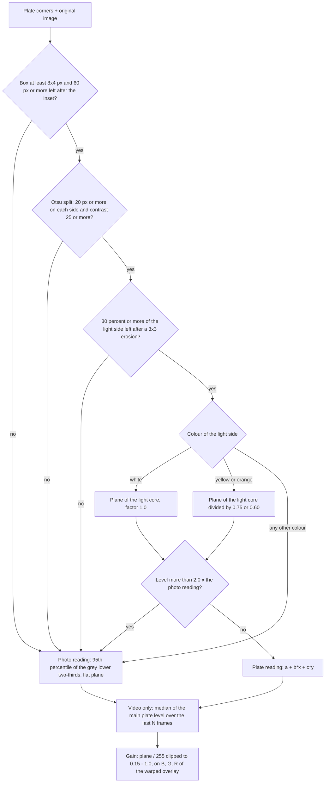

# Auto brightness: matching the overlay to the plate's light

## In short

- **Why:** a camera never records a plate's white as 255. Real plates measured 170–187 of 255, so a full-white overlay looks pasted on. The overlay is darkened to the light that fell on the real plate.
- **Two methods, one switch.** `auto_brightness = false` is the fixed method: the plate's light pixels are taken as white, and the overlay is scaled towards them by `lighting` %. `auto_brightness = true` (set in `config.toml`) is the automatic method: it reads the light from white paint, else from yellow or orange paint corrected by a factor, else from the photo.
- **Same last step for both:** one grey gain per pixel, between 0.15 and 1.0, multiplied into B, G and R of the warped overlay. It never brightens, never tints and never touches alpha.
- **Video:** the main plate's level is a median over the last N frames. `video_pipeline` uses N = 5.
- **Cost:** about 2–8 ms per plate plus about 2 ms per image on a 4K frame, CPU only. No model: both methods are plain OpenCV and numpy.

## Why the overlay needs darkening

At full brightness the overlay looked pasted on, most of all on shaded rear plates. The plate's white face measured **170–187 of 255**: front plates in sun 182–187, rear plates in shade 170–181, varying by about ±10 across one plate. The overlay's 255 white was brighter than anything else on the car. A full match scales the overlay to about 70 % of its own brightness on these frames.

Only brightness is matched, not colour. A yellow plate must not tint the logo.

## How it works

### 1. Which method runs

| Settings | What happens | Code |
|---|---|---|
| `overlay = false` | Solid fill in `color`. No brightness logic runs: no `BrightnessDetector` is created, and `solid_fill` ignores the light options. | [mask_plates.py:212](../../number_plate_detection/mask_plates.py#L212), [masking.py:49-52](../../number_plate_detection/plate_masker/masking.py#L49-L52) |
| `overlay = true`, `auto_brightness = false`, `lighting > 0` | Fixed method, inside `image_overlay` (section 2). | [masking.py:138-143](../../number_plate_detection/plate_masker/masking.py#L138-L143) |
| `overlay = true`, `auto_brightness = false`, `lighting = 0` | Overlay at its own full brightness. The plate is not measured. | [masking.py:133-138](../../number_plate_detection/plate_masker/masking.py#L133-L138) |
| `overlay = true`, `auto_brightness = true` | Automatic method (section 3). Every reading carries a plane, photo fallbacks included, so `lighting` is never used. It is still checked to be 0–100. | [masking.py:134-137](../../number_plate_detection/plate_masker/masking.py#L134-L137), [mask_plates.py:206-207](../../number_plate_detection/mask_plates.py#L206-L207) |

**Box plates.** A plate whose corners were not found gets a solid box when `tight_fit = true`. Its brightness reading is still computed, but not used ([plate_masker/\_\_init\_\_.py:112](../../number_plate_detection/plate_masker/__init__.py#L112), [masking.py:177](../../number_plate_detection/plate_masker/masking.py#L177)). With `tight_fit = false` every plate gets the overlay on its detector box, and the automatic method uses the wider box inset (0.22). When and why the corner fit fails is in [02-exact-plate-fit.md](02-exact-plate-fit.md).

### 2. The fixed method (`_plate_light`)

1. **When.** Inside `image_overlay`, per plate, just before that plate is painted. It reads the plate's area of the output copy, which still holds the original plate there ([masking.py:139](../../number_plate_detection/plate_masker/masking.py#L139)).
2. **Inner area.** The quad (already padded) is shrunk by **0.2 × plate height on every edge** with `grow_quad`. Height is the mean of the left and right edge lengths ([masking.py:62-65](../../number_plate_detection/plate_masker/masking.py#L62-L65), [corners.py:67-72](../../number_plate_detection/plate_masker/corners.py#L67-L72), [corners.py:87-101](../../number_plate_detection/plate_masker/corners.py#L87-L101)).
3. **Grey.** `cv2.COLOR_BGR2GRAY`. Fewer than **50** inner pixels: no measurement ([masking.py:66-69](../../number_plate_detection/plate_masker/masking.py#L66-L69)).
4. **Light pixels only.** Otsu threshold over the inner grey values; light = grey > threshold. This keeps the white face and drops the letters. If light pixels are fewer than **20 %** of the inner pixels: no measurement ([masking.py:70-73](../../number_plate_detection/plate_masker/masking.py#L70-L73)).
5. **Plane.** At most **4000** light pixels, evenly spaced. Least squares on `[1, x, y]` in ROI pixels. One refit keeps pixels with `|r| <= 2.5 * max(std(r), 1)`, if at least 20 remain. The refit drops glare ([masking.py:74-83](../../number_plate_detection/plate_masker/masking.py#L74-L83)).
6. **Per-pixel light.** The plane is evaluated at every ROI pixel, so a plate half in shade keeps its gradient ([masking.py:84-85](../../number_plate_detection/plate_masker/masking.py#L84-L85)).
7. **Gain.** `gain = 1 - s * (1 - clip(light / 255, 0.15, 1.0))` with `s = lighting / 100` ([masking.py:133](../../number_plate_detection/plate_masker/masking.py#L133), [masking.py:140-143](../../number_plate_detection/plate_masker/masking.py#L140-L143)). `lighting = 0` leaves the overlay as it is; `lighting = 100` makes its white equal to the plate's white.
8. **No measurement, no change.** If step 3 or 4 fails, the overlay is pasted at full brightness. Nothing is logged ([masking.py:140](../../number_plate_detection/plate_masker/masking.py#L140)).

**Measured on 4 real white plates** (`Final_zoomed_car` 4K frames, [findings: Matching the plate's lighting](../../number_plate_detection/docs/findings.md#matching-the-plates-lighting)), the overlay's white came out as:

| `lighting` | Overlay white (of 255) |
|---|---|
| 0 % | 255 |
| 50 % | 214–221 |
| 100 % | 173–188 |
| Original plates | 186–190 |

By eye, 100 % looked like part of the photo on both sunlit and shaded plates, so it is the default ([masking.py:41](../../number_plate_detection/plate_masker/masking.py#L41), [config.toml:32](../../number_plate_detection/config.toml#L32)).

> Note: `docs/findings.md` writes the formula as `factor = 1 − lighting/100 × (1 − plate white/255)`. The code also clips `plate white/255` to [0.15, 1.0] and skips the step when the measurement fails.

**Why it was not enough.** It assumes the light pixels are white. That holds for white plates and for white letters: white letters on blue, green, red or black read 182–183 against the correct 186. Yellow fails: a yellow plate or yellow letters read 140, so the board came out about 25 % too dark (53–57 % against a true 75–76 %, about 20 points). Green with black letters has no white at all and came out at 23 %.

### 3. The automatic method (`plate_brightness_detector`)

The camera only sees light × paint colour. To learn the light, the module needs something on the plate whose true colour it knows ([detector.py:1-16](../../number_plate_detection/plate_brightness_detector/detector.py#L1-L16)).

1. **Measured first, on the original image.** `PlateMasker.process` detects the plates and fits their corners, then calls `measure_all(image, quads, fitted)` on the untouched image, before anything is painted. `fitted` is `corners is not None`, so outlines worked out from the letters count as fitted ([plate_masker/\_\_init\_\_.py:102-110](../../number_plate_detection/plate_masker/__init__.py#L102-L110)).
2. **Photo reading, once per image.** Take the lower two-thirds, `image[H//3:]` (the car, not the sky). Keep every `step`-th pixel, `step = max(1, max(h, w) // 480)`, where h and w are the size of that lower part. Convert to grey and take the **95th percentile**, floored at 1.0 ([detector.py:88-93](../../number_plate_detection/plate_brightness_detector/detector.py#L88-L93), [detector.py:185](../../number_plate_detection/plate_brightness_detector/detector.py#L185)). Integer division leaves the subsampled longest side at 480–959 px; a lower part under 480 px is used whole. A 4K frame gives step 8 (480 × 180 samples). `sample_vid` (464 × 832 portrait) gives a 464 × 555 lower part and step 1. A photo reading is a flat plane `(photo, 0, 0)` ([detector.py:95-97](../../number_plate_detection/plate_brightness_detector/detector.py#L95-L97)).
3. **Crop and shrink.** Crop the quad's bounding box. Smaller than **8 × 4 px**: photo. Plate height = mean of the left and right edges. Taller than **64 px** (`WORK_HEIGHT`): shrink with `INTER_AREA` to 64 px tall ([detector.py:107-121](../../number_plate_detection/plate_brightness_detector/detector.py#L107-L121)).
4. **Inset.** Fill the quad and keep pixels more than **0.16 × height** inside the outline for a fitted outline, **0.22 × height** for a plain detector box (a box also holds some bumper). The distance is `cv2.distanceTransform` with `DIST_L2` and a 3 × 3 mask. Fewer than **60** pixels left: photo ([detector.py:124-132](../../number_plate_detection/plate_brightness_detector/detector.py#L124-L132)).
5. **Light/dark split.** Otsu over the inset's grey values. Fewer than **20** pixels on either side: photo. `median(light) - median(dark) < 25`: photo ([detector.py:135-141](../../number_plate_detection/plate_brightness_detector/detector.py#L135-L141)).
6. **Name the paints.** Each side is shaved by a 3 × 3 erosion to drop the blended pixels where letters meet background; if fewer than 20 survive, the unshaved side is kept. The per-channel median BGR of each core is named in OpenCV HSV ([detector.py:142-144](../../number_plate_detection/plate_brightness_detector/detector.py#L142-L144), [detector.py:201-214](../../number_plate_detection/plate_brightness_detector/detector.py#L201-L214), [colours.py:30-48](../../number_plate_detection/plate_brightness_detector/colours.py#L30-L48)):
   - saturation < **60**: neutral. A neutral light side is always **white**, however bright (white in shade is still white paint). A neutral dark side is **black** if max(B, G, R) < 110, else **grey**.
   - otherwise by hue band (table in "The maths and constants").
7. **Which side is the background.** By connectivity: for each side, share = largest 8-connected piece / all its pixels. The side with the higher share is the background if its share is at least **0.6** and the other side's is below 0.6; otherwise it is unknown ([detector.py:145-151](../../number_plate_detection/plate_brightness_detector/detector.py#L145-L151), [detector.py:217-224](../../number_plate_detection/plate_brightness_detector/detector.py#L217-L224)). This only sets the labels (`background`, `characters`, and the word in `source`). The light side is always the reference, whichever part it is. The same test drives the outline fit for coloured plates: see [03-multi-colour-plates.md](03-multi-colour-plates.md).
8. **Paint too thin to read.** Erode the full light mask by 3 × 3 (1 work pixel). If fewer than **30 %** of its pixels survive, every light pixel is blended with the dark part and neither its brightness nor its colour can be read: photo. Readable plates keep 45–83 %; the 25 px-tall `sample_vid` plates keep 8–16 % ([detector.py:39-43](../../number_plate_detection/plate_brightness_detector/detector.py#L39-L43), [detector.py:152-155](../../number_plate_detection/plate_brightness_detector/detector.py#L152-L155)). This runs before the ladder, so it applies to thin white letters too.
9. **The ladder** ([detector.py:157-165](../../number_plate_detection/plate_brightness_detector/detector.py#L157-L165), [colours.py:14-23](../../number_plate_detection/plate_brightness_detector/colours.py#L14-L23)):
   - light side **white**: factor 1.0.
   - else a light paint with `PAINT_FACTORS[name] >= 0.5`: **yellow 0.75** or **orange 0.60**.
   - else: photo. Red, green, blue, teal and purple light sides all end here.
10. **Plane.** `_fit_plane` on the light core: at most 4000 samples, work pixels mapped back to image pixels with `x = x0 + (xs + 0.5) / scale - 0.5`, least squares on `[1, x, y]`, one 2.5-sigma refit (the same rule as the fixed method). All three coefficients are then divided by the factor. Level = the plane at the mean of the 4 corners, clipped to [1, 255] ([detector.py:167-172](../../number_plate_detection/plate_brightness_detector/detector.py#L167-L172), [detector.py:227-246](../../number_plate_detection/plate_brightness_detector/detector.py#L227-L246)).
11. **Glare or flash check.** If `level > 2.0 * photo`, the plate is not trusted: photo. The level compared is after the paint division and after the 255 clip ([detector.py:173-175](../../number_plate_detection/plate_brightness_detector/detector.py#L173-L175)).

> Note: because the level is clipped to 255 before the check, `level > 2.0 * photo` can only be true when the photo reading is below 127.5 (50 %). In a normally lit photo the glare rule never fires, and glare on the plate is handled only by the 2.5-sigma refit. The module's README describes the rule as "more than 2×" without this condition.

> Note: the fallback `photo (plate unreadable)` after `_fit_plane` returns None ([detector.py:168-169](../../number_plate_detection/plate_brightness_detector/detector.py#L168-L169)) cannot be reached. Step 5 guarantees at least 20 light pixels, and `_core` never returns fewer than 20.

**What `source` says** (shown in the console and in `detections.csv`):

| `source` | When | Code |
|---|---|---|
| `white background`, `white characters`, `white paint` | White light side; `paint` when the background side is unknown | [detector.py:146-159](../../number_plate_detection/plate_brightness_detector/detector.py#L146-L159) |
| `yellow background (/0.75)`, `orange characters (/0.6)` | Light paint divided by its factor (`{factor:g}`, so orange prints `/0.6`) | [detector.py:160-162](../../number_plate_detection/plate_brightness_detector/detector.py#L160-L162) |
| `photo (plate too small)` | Box under 8 × 4 px, or under 60 px after the inset | [detector.py:111-112](../../number_plate_detection/plate_brightness_detector/detector.py#L111-L112), [detector.py:131-132](../../number_plate_detection/plate_brightness_detector/detector.py#L131-L132) |
| `photo (plate unreadable: one colour only)` | Under 20 px on the light or dark side | [detector.py:138-139](../../number_plate_detection/plate_brightness_detector/detector.py#L138-L139) |
| `photo (plate unreadable: too little contrast)` | Median contrast under 25 | [detector.py:140-141](../../number_plate_detection/plate_brightness_detector/detector.py#L140-L141) |
| `photo (plate too small to read its paint: <colour> <part>)` | Under 30 % of the light side survives a 1 px shave | [detector.py:152-155](../../number_plate_detection/plate_brightness_detector/detector.py#L152-L155) |
| `photo (no white or light paint on the plate: <light>/<dark>)` | Light side is not white, yellow or orange | [detector.py:163-165](../../number_plate_detection/plate_brightness_detector/detector.py#L163-L165) |
| `photo (plate much brighter than the photo, glare or flash? (<source>))` | Level over 2.0 × the photo reading | [detector.py:173-175](../../number_plate_detection/plate_brightness_detector/detector.py#L173-L175) |
| `..., smoothed over k frames` | Suffix added by video smoothing | [detector.py:196](../../number_plate_detection/plate_brightness_detector/detector.py#L196) |

### 4. Smoothing for video

1. **Off by default.** `brightness_smoothing = 0`; N > 0 turns it on ([config.toml:24-26](../../number_plate_detection/config.toml#L24-L26)). It only exists in the automatic method.
2. **Where the state lives.** `mask_plates.py` creates one `BrightnessDetector(smoothing=N)` before the image loop and hands it to `PlateMasker`, which keeps it for the whole run. The detector holds a `deque(maxlen=N)` of levels ([mask_plates.py:212](../../number_plate_detection/mask_plates.py#L212), [mask_plates.py:225-228](../../number_plate_detection/mask_plates.py#L225-L228), [plate_masker/\_\_init\_\_.py:95](../../number_plate_detection/plate_masker/__init__.py#L95), [detector.py:81](../../number_plate_detection/plate_brightness_detector/detector.py#L81)).
3. **Frame order.** Images are processed in sorted file-name order ([mask_plates.py:126](../../number_plate_detection/mask_plates.py#L126)). `video_pipeline` names frames `00001.jpg`, `00002.jpg`, ..., so sorted order is time order ([make_video.py:67](../../video_pipeline/make_video.py#L67)).
4. **What goes in.** After all plates in a frame are measured, the **main plate** is the quad with the largest area (`cv2.contourArea`). Its level, as read (after the paint factor, the glare check and any photo fallback), is appended to the history ([detector.py:187-190](../../number_plate_detection/plate_brightness_detector/detector.py#L187-L190)).
5. **What comes out.** `m = median(history)` (the mean of the two middle values for an even count). If `|m - level| > 0.5`, the main plate's level becomes `m` and all three plane coefficients are multiplied by `m / level`, so a gradient keeps its shape ([detector.py:191-197](../../number_plate_detection/plate_brightness_detector/detector.py#L191-L197)).
6. **What is not smoothed.** Other plates in the same frame. Frames with no plate add nothing to the history, because `measure_all` is only called when there are plates ([plate_masker/\_\_init\_\_.py:105](../../number_plate_detection/plate_masker/__init__.py#L105)).
7. **Never reset.** `reset()` exists ([detector.py:83-85](../../number_plate_detection/plate_brightness_detector/detector.py#L83-L85)) but nothing calls it. One run of `mask_plates.py` is one history. `video_pipeline` runs it once per video. For a folder of unrelated photos, keep N = 0.

### 5. How the gain is applied

1. **After the warp.** The overlay is first warped onto the plate's 4 corners (the warp itself is described in [02-exact-plate-fit.md](02-exact-plate-fit.md)). The gain is applied to the warped colour, per destination pixel, so a gradient follows the photo's geometry, not the overlay's ([masking.py:113-124](../../number_plate_detection/plate_masker/masking.py#L113-L124)).
2. **Alpha is kept apart.** Alpha = anti-aliased polygon coverage × the PNG's own alpha. The gain then acts on B, G and R only ([masking.py:126-132](../../number_plate_detection/plate_masker/masking.py#L126-L132)).
3. **Automatic:** `gain(x, y) = clip((a + b*x + c*y) / 255, 0.15, 1.0)`, with x and y in image pixels over the plate's bounding box ([masking.py:134-137](../../number_plate_detection/plate_masker/masking.py#L134-L137)).
4. **Fixed:** `gain = 1 - s * (1 - clip(light / 255, 0.15, 1.0))` ([masking.py:138-143](../../number_plate_detection/plate_masker/masking.py#L138-L143)).
5. **One grey factor for B, G and R.** The gain is a 2-D map broadcast over the 3 channels, so it changes brightness, not hue. The values are 8-bit gamma-encoded and multiplied directly as float32; nothing is converted to linear light. The light is also measured in encoded grey (`BGR2GRAY`), so measurement and application use the same scale ([masking.py:132](../../number_plate_detection/plate_masker/masking.py#L132), [detector.py:129](../../number_plate_detection/plate_brightness_detector/detector.py#L129)).
6. **Never brightens.** The upper clip of 1.0 means no overlay pixel gets brighter than its own value. A plane above 255 (for example bright yellow ÷ 0.75) just gives gain 1.0. The lower clip `LIGHT_GAIN_MIN = 0.15` keeps the overlay at 15 % of its own brightness or more ([masking.py:42](../../number_plate_detection/plate_masker/masking.py#L42)). In the fixed method with `lighting < 100` the floor is `1 - 0.85 * s`.
7. **Blend.** `out = clip(roi * (1 - alpha) + warped * alpha + 0.5, 0, 255)` as uint8, a straight (not premultiplied) blend ([masking.py:144-145](../../number_plate_detection/plate_masker/masking.py#L144-L145)).
8. **Overlay only.** The solid fill takes `light_plane` and `lighting` as keyword options and ignores them ([masking.py:49-52](../../number_plate_detection/plate_masker/masking.py#L49-L52)).

### 6. What is reported

- `percent = min(100, 100 * level / 255)` ([detector.py:57-60](../../number_plate_detection/plate_brightness_detector/detector.py#L57-L60)).
- **Console:** `light N% (source)` is printed only for plates with corners ([mask_plates.py:262-266](../../number_plate_detection/mask_plates.py#L262-L266)). With `tight_fit = false` no plate has corners, so nothing is printed, although the overlay still uses the reading.
- **`detections.csv`:** `brightness_pct` (1 decimal), `brightness_source` and `plate_colours` (`background/characters`), for every plate that has a reading, box plates included. All three are empty in fixed mode ([mask_plates.py:276-281](../../number_plate_detection/mask_plates.py#L276-L281)).
- **`brightness_pct` is not the gain actually applied.** It is the level at the mean of the unpadded quad's corners, clipped to [1, 255]. The overlay gets a per-pixel gain over the padded quad, clipped to [0.15, 1.0]. The two differ across a gradient, for a plane above 255 (gain 1.0) and for a level below 38 (gain held at 0.15).

> Note: the main README describes `brightness_pct` as "how bright the overlay's white was made". That holds at the plate's centre only, and only between 15 % and 100 %.

## Settings and command line

| Setting | `config.toml` | If the key is missing | CLI | Effect |
|---|---|---|---|---|
| `overlay` | `true` ([config.toml:14](../../number_plate_detection/config.toml#L14)) | `false` ([mask_plates.py:194](../../number_plate_detection/mask_plates.py#L194)) | `--overlay` / `--no-overlay` | Brightness matching only runs with the overlay. |
| `auto_brightness` | `true` ([config.toml:22](../../number_plate_detection/config.toml#L22)) | `false` ([mask_plates.py:197](../../number_plate_detection/mask_plates.py#L197)) | `--auto-brightness` / `--no-auto-brightness` | `true` = automatic method, `false` = fixed method. Ignored without the overlay. |
| `lighting` | `100` ([config.toml:32](../../number_plate_detection/config.toml#L32)) | `100.0` (`DEFAULT_LIGHTING`, [mask_plates.py:196](../../number_plate_detection/mask_plates.py#L196)) | `--lighting N` | Fixed method only. 0–100; checked even when unused ([mask_plates.py:206-207](../../number_plate_detection/mask_plates.py#L206-L207), [plate_masker/\_\_init\_\_.py:92-93](../../number_plate_detection/plate_masker/__init__.py#L92-L93)). |
| `brightness_smoothing` | `0` ([config.toml:26](../../number_plate_detection/config.toml#L26)) | `0` ([mask_plates.py:198](../../number_plate_detection/mask_plates.py#L198)) | `--brightness-smoothing N` | Automatic method only. A whole number, 0 or more; 0 = off ([mask_plates.py:90-92](../../number_plate_detection/mask_plates.py#L90-L92), [mask_plates.py:208-209](../../number_plate_detection/mask_plates.py#L208-L209)). |

The CLI flags are defined at [mask_plates.py:171-179](../../number_plate_detection/mask_plates.py#L171-L179) and win over `config.toml`.

> Note: the main README lists the default of `overlay` and `auto_brightness` as `true`. That is the value set in `config.toml`; with the key removed, the code falls back to `false`.

**Python only** (not in `config.toml`):
- `BrightnessDetector(smoothing=0, glow_ratio=2.0, photo_percentile=95.0)`: the glare ratio and the photo percentile ([detector.py:75](../../number_plate_detection/plate_brightness_detector/detector.py#L75)). `smoothing < 0` raises `ValueError` ([detector.py:76-77](../../number_plate_detection/plate_brightness_detector/detector.py#L76-L77)).
- `PAINT_FACTORS` and `NEUTRAL_SATURATION`: edit in [colours.py:14-27](../../number_plate_detection/plate_brightness_detector/colours.py#L14-L27) to recalibrate.
- `PlateMasker(brightness_detector=...)` turns the automatic method on; `PlateMasker(lighting=...)` sets the fixed one ([plate_masker/\_\_init\_\_.py:72-98](../../number_plate_detection/plate_masker/__init__.py#L72-L98)).

**`video_pipeline`** calls `mask_plates.py` with `--overlay --auto-brightness --brightness-smoothing N` ([make_video.py:133-134](../../video_pipeline/make_video.py#L133-L134)). N comes from `brightness_smoothing` in [video_pipeline/config.toml:29](../../video_pipeline/config.toml#L29) (5; also 5 when missing, [make_video.py:42](../../video_pipeline/make_video.py#L42)). At the default 5 frames per second ([video_pipeline/config.toml:16](../../video_pipeline/config.toml#L16)), that is a median over about 1 s. The overlay image and the other plate settings still come from `number_plate_detection/config.toml`. See [../video_pipeline/README.md](../video_pipeline/README.md).

## The maths and constants

### Formulas

| Name | Formula | Code |
|---|---|---|
| Fixed gain | `s = clamp(lighting, 0, 100) / 100`; `gain = 1 - s * (1 - clip(P(x, y) / 255, 0.15, 1.0))` | [masking.py:133](../../number_plate_detection/plate_masker/masking.py#L133), [masking.py:142-143](../../number_plate_detection/plate_masker/masking.py#L142-L143) |
| Automatic gain | `gain = clip((a + b*x + c*y) / 255, 0.15, 1.0)`, x, y in image pixels | [masking.py:134-137](../../number_plate_detection/plate_masker/masking.py#L134-L137) |
| Plane fit with glare refit | `coef = lstsq([1, x, y], v)`; `r = v - A·coef`; keep `abs(r) <= 2.5 * max(std(r), 1)`; if 20 or more kept, refit on them | [masking.py:78-83](../../number_plate_detection/plate_masker/masking.py#L78-L83), [detector.py:240-245](../../number_plate_detection/plate_brightness_detector/detector.py#L240-L245) |
| Work to image pixels | `x = x0 + (xs + 0.5) / scale - 0.5`, `scale = 64 / height` (1 for plates 64 px tall or less) | [detector.py:119](../../number_plate_detection/plate_brightness_detector/detector.py#L119), [detector.py:240](../../number_plate_detection/plate_brightness_detector/detector.py#L240) |
| Paint correction | `plane = (a / f, b / f, c / f)`, f = 1.0 (white), 0.75 (yellow), 0.60 (orange) | [detector.py:158-162](../../number_plate_detection/plate_brightness_detector/detector.py#L158-L162), [detector.py:170](../../number_plate_detection/plate_brightness_detector/detector.py#L170) |
| Plate level | `level = clip(a + b*cx + c*cy, 1, 255)`, (cx, cy) = mean of the 4 corners | [detector.py:171-172](../../number_plate_detection/plate_brightness_detector/detector.py#L171-L172) |
| Reported percent | `percent = min(100, 100 * level / 255)` | [detector.py:57-60](../../number_plate_detection/plate_brightness_detector/detector.py#L57-L60) |
| Photo reading | `photo = max(1, P95(gray(lower[::s, ::s])))`, `lower = image[H//3:]`, `s = max(1, max(lower.h, lower.w) // 480)` | [detector.py:88-93](../../number_plate_detection/plate_brightness_detector/detector.py#L88-L93) |
| Contrast rule | `median(light) - median(dark) < 25` → photo | [detector.py:140](../../number_plate_detection/plate_brightness_detector/detector.py#L140) |
| Thin-paint rule | `count(erode3x3(light)) < 0.30 * count(light)` → photo | [detector.py:152-153](../../number_plate_detection/plate_brightness_detector/detector.py#L152-L153) |
| Background rule | `share = largest 8-connected piece / side`; background if `share >= 0.6` and the other side's share `< 0.6` | [detector.py:217-224](../../number_plate_detection/plate_brightness_detector/detector.py#L217-L224) |
| Glare rule | `level > 2.0 * photo` → photo (only possible when `photo < 127.5`) | [detector.py:173](../../number_plate_detection/plate_brightness_detector/detector.py#L173) |
| Smoothing | `m = median(last N levels)`; if `abs(m - level) > 0.5`: `level = m`, `plane *= m / level` | [detector.py:187-197](../../number_plate_detection/plate_brightness_detector/detector.py#L187-L197) |
| Composite | `out = uint8(clip(roi * (1 - alpha) + warped * gain * alpha + 0.5, 0, 255))` | [masking.py:144-145](../../number_plate_detection/plate_masker/masking.py#L144-L145) |

### Constants

| Name | Value | Meaning | Code |
|---|---|---|---|
| `LIGHT_GAIN_MIN` | 0.15 | Lowest gain, both methods | [masking.py:42](../../number_plate_detection/plate_masker/masking.py#L42) |
| (upper gain clip) | 1.0 | The overlay is never brightened | [masking.py:137](../../number_plate_detection/plate_masker/masking.py#L137), [masking.py:142](../../number_plate_detection/plate_masker/masking.py#L142) |
| `DEFAULT_LIGHTING` | 100.0 | Fixed method: full match | [masking.py:41](../../number_plate_detection/plate_masker/masking.py#L41) |
| Fixed inset | 0.2 × height | Inner area, clear of border and rim | [masking.py:63](../../number_plate_detection/plate_masker/masking.py#L63) |
| Fixed minimum area | 50 px | Fewer inner pixels: no measurement | [masking.py:68](../../number_plate_detection/plate_masker/masking.py#L68) |
| Fixed minimum light share | 20 % of inner pixels | Fewer light pixels: no measurement | [masking.py:72](../../number_plate_detection/plate_masker/masking.py#L72) |
| Plane sample cap | 4000 | Evenly spaced samples, both methods | [masking.py:74-76](../../number_plate_detection/plate_masker/masking.py#L74-L76), [detector.py:236-238](../../number_plate_detection/plate_brightness_detector/detector.py#L236-L238) |
| Refit band | 2.5 × max(std, 1) | Residuals beyond it (glare) are dropped once | [masking.py:81](../../number_plate_detection/plate_masker/masking.py#L81), [detector.py:243](../../number_plate_detection/plate_brightness_detector/detector.py#L243) |
| Refit minimum | 20 px | Fewer kept: the first fit stands | [masking.py:82](../../number_plate_detection/plate_masker/masking.py#L82), [detector.py:244](../../number_plate_detection/plate_brightness_detector/detector.py#L244) |
| `INSET_FITTED` | 0.16 × height | Automatic inset, fitted outline (corners or letters) | [detector.py:33](../../number_plate_detection/plate_brightness_detector/detector.py#L33) |
| `INSET_BOX` | 0.22 × height | Automatic inset, detector box | [detector.py:34](../../number_plate_detection/plate_brightness_detector/detector.py#L34) |
| `WORK_HEIGHT` | 64 px | Taller plates are measured on a shrunk copy | [detector.py:44](../../number_plate_detection/plate_brightness_detector/detector.py#L44) |
| Minimum box | 8 × 4 px | Smaller: photo | [detector.py:111](../../number_plate_detection/plate_brightness_detector/detector.py#L111) |
| Minimum inset area | 60 px | Fewer: photo | [detector.py:131](../../number_plate_detection/plate_brightness_detector/detector.py#L131) |
| Minimum side | 20 px | Fewer light or dark pixels: photo | [detector.py:138](../../number_plate_detection/plate_brightness_detector/detector.py#L138) |
| `MIN_CONTRAST` | 25 grey levels | Light vs dark medians | [detector.py:38](../../number_plate_detection/plate_brightness_detector/detector.py#L38) |
| `BACKGROUND_SHARE` | 0.6 | Connected share that marks the background | [detector.py:37](../../number_plate_detection/plate_brightness_detector/detector.py#L37) |
| `_core` minimum | 20 px | Fewer survive the shave: keep the unshaved side | [detector.py:204](../../number_plate_detection/plate_brightness_detector/detector.py#L204) |
| `MIN_CORE_SHARE` | 0.30 | Light paint share that must survive a 1 px shave | [detector.py:43](../../number_plate_detection/plate_brightness_detector/detector.py#L43) |
| `NEUTRAL_SATURATION` | 60 (of 255) | Below: white, grey or black | [colours.py:27](../../number_plate_detection/plate_brightness_detector/colours.py#L27) |
| Black/grey split | max(B, G, R) < 110 | Neutral dark side named black, else grey | [detector.py:214](../../number_plate_detection/plate_brightness_detector/detector.py#L214) |
| `MIN_FACTOR` | 0.5 | Only paints at or above it are divided by | [colours.py:23](../../number_plate_detection/plate_brightness_detector/colours.py#L23) |
| `glow_ratio` | 2.0 | Plate over this × photo: glare or flash | [detector.py:75](../../number_plate_detection/plate_brightness_detector/detector.py#L75) |
| `photo_percentile` | 95.0 | Percentile for the photo reading | [detector.py:75](../../number_plate_detection/plate_brightness_detector/detector.py#L75) |
| Photo rows | `H // 3` onward | Lower two-thirds only | [detector.py:90](../../number_plate_detection/plate_brightness_detector/detector.py#L90) |
| Photo subsample | `max(h, w) // 480` | Step; 480–959 px longest side after it (step 1 below 480 px) | [detector.py:91](../../number_plate_detection/plate_brightness_detector/detector.py#L91) |
| Photo floor | 1.0 | Lowest photo reading | [detector.py:93](../../number_plate_detection/plate_brightness_detector/detector.py#L93) |
| Level clip | [1, 255] | Reported level and glare check | [detector.py:172](../../number_plate_detection/plate_brightness_detector/detector.py#L172) |
| Smoothing threshold | 0.5 grey levels | Smaller changes are not applied | [detector.py:192](../../number_plate_detection/plate_brightness_detector/detector.py#L192) |

### Paint names and factors

OpenCV HSV: hue 0–179 (degrees / 2), saturation 0–255. Factors are grey-level ratios against white paint in the same light, marked in the code as first estimates ([colours.py:8-23](../../number_plate_detection/plate_brightness_detector/colours.py#L8-L23), [colours.py:33-48](../../number_plate_detection/plate_brightness_detector/colours.py#L33-L48)).

| Name | Rule | `PAINT_FACTORS` | Used to read the light |
|---|---|---|---|
| white | S < 60, light side | 1.00 | Yes |
| black / grey | S < 60, dark side | black 0.05 | Never (dark side) |
| red | H < 8 or H ≥ 165 | 0.30 | No: photo |
| orange | 8 ≤ H < 20 | 0.60 | Yes, ÷ 0.60 |
| yellow | 20 ≤ H < 35 | 0.75 | Yes, ÷ 0.75 |
| green | 35 ≤ H < 85 | 0.35 | No: photo |
| teal | 85 ≤ H < 100 | none | No: photo |
| blue | 100 ≤ H < 130 | 0.25 | No: photo |
| purple | 130 ≤ H < 165 | none | No: photo |

Real white plates measured saturation 4–12; plate yellows 200 or more ([colours.py:26](../../number_plate_detection/plate_brightness_detector/colours.py#L26)).

## Results

### Colour test set

From the [main README](../../number_plate_detection/README.md#testing-plate-colours) and the [plate_brightness_detector README](../../number_plate_detection/plate_brightness_detector/README.md#results). Ten drawn plates pasted onto 3 views of the 4K `Final_zoomed_car` frames (front, angled front, angled rear), plus a night case: 11 cases, 33 photos. Every plate is lit like the real plate, so the true brightness is 75–76 % everywhere.

- **Truth:** the 80th percentile of the Otsu-light grey pixels in a 0.16 × height inset of the real white plate ([make_test_photos.py:176-184](../../number_plate_detection/tests/make_test_photos.py#L176-L184)).
- **Score:** the 75th percentile of grey inside the quad shrunk to 70 % about its centre, ÷ 2.55 ([run_colour_tests.py:59-64](../../number_plate_detection/tests/run_colour_tests.py#L59-L64)).
- **Pass:** plate found, corners found, outline overlap at least 90 %, brightness within ±5 points ([run_colour_tests.py:42-43](../../number_plate_detection/tests/run_colour_tests.py#L42-L43)). "Auto off" repaints the same plates with the fixed method and `lighting` from `config.toml` ([run_colour_tests.py:181-183](../../number_plate_detection/tests/run_colour_tests.py#L181-L183)).

| Plate | Read from (auto) | Auto on | Auto off |
|---|---|---|---|
| White, black letters | white background | 75–76 % | 75 % |
| White, red letters | white background | 75–76 % | 75 % |
| Yellow taxi, black letters | yellow background ÷ 0.75 | 76–77 % | 57 % |
| Green, white letters | white letters | 75–76 % | 71–73 % |
| Green, yellow letters | yellow letters ÷ 0.75 | 76–77 % | 55 % |
| Blue, white letters | white letters | 75–76 % | 71–72 % |
| Red, white letters | white letters | 75–76 % | 71–73 % |
| Black, white letters | white letters | 75–76 % | 69–72 % |
| Black, yellow letters, no border | yellow letters ÷ 0.75 | 76 % | 53–56 % |
| Green, black letters | photo (no white or light paint) | 78–85 % | 23 % |
| Night, plate glowing in a flash (scene at 25 %) | photo (plate much brighter than the photo) | 19–22 % | 98–100 % |

All 11 cases pass on all 3 views.

> Note: for the two cases expected to use the photo reading (green/black, night), the test only checks that `source` starts with `photo`; their brightness is not held to ±5 points ([run_colour_tests.py:114-115](../../number_plate_detection/tests/run_colour_tests.py#L114-L115)). The main README and `docs/findings.md` say every photo is checked against ±5 points. An older line in `docs/findings.md` reports "all 10 cases"; that round was before the black/yellow plate was added.

### Real plates

| Plates | Read from | Auto on | Auto off |
|---|---|---|---|
| White plates, 12 frames of the 4K video | white background | 73–75 % | 67–73 % |
| Black plates with yellow letters, `sample_vid` (about 25 px tall) | photo (letters too thin to read) | 67–78 %, steady | not reported |

From the [plate_brightness_detector README](../../number_plate_detection/plate_brightness_detector/README.md#results) and [findings: sample_vid](../../number_plate_detection/docs/findings.md#a-second-real-video-sample_vid-added-2026-11-07). Before the thin-paint rule, the `sample_vid` readings swung from 65 % to 100 % between frames of the same car: the 2–3 px yellow letters were read sometimes as yellow (÷ 0.75), sometimes as orange (÷ 0.6).

### Earlier round

From [findings: Any plate colour](../../number_plate_detection/docs/findings.md#any-plate-colour-added-2026-11-06). Before the test set existed, the real plate in one frame was recoloured in memory (true answer 73–74 %): real white plates 73–75 %, yellow taxi 75 %, green/blue/red/black with white letters 72–73 %, green/yellow 74–75 %, green/black 85 % (photo), night glow 22 % (photo). With `auto_brightness = false`, yellow came out at 53–56 %, and the output was pixel-identical to the fixed method before the change.

### Cost

Measured on the team's Intel i5-1240P laptop (CPU, no GPU), 4K frames ([plate_brightness_detector README](../../number_plate_detection/plate_brightness_detector/README.md#results), [findings: Speed](../../number_plate_detection/docs/findings.md#speed)):
- Automatic method: about **2–8 ms per plate**, plus about **2 ms per image** for the photo reading.
- The whole overlay step (warp and blend) was measured at about 18 ms per plate. The notes do not say how much of that is the fixed method's measurement.
- What keeps it cheap: plates shrunk to 64 px tall, the photo subsampled, plane fits capped at 4000 samples.

## Options we had

| Option | Licence | Verdict | Why |
|---|---|---|---|
| Overlay at full brightness | – | Rejected | Looked pasted on, most of all on shaded rear plates. 255 is brighter than anything else on the car. |
| Fixed method: light pixels taken as white, scaled by `lighting` % | Own code (OpenCV, NumPy) | Kept as `auto_brightness = false` | Right on white plates, close on white letters (69–73 %). Yellow 53–57 %, green/black 23 %. |
| Automatic ladder: white, then light paint ÷ factor, then photo | Own code (OpenCV, NumPy) | **Chosen** (`config.toml`, `video_pipeline`) | Within 2 points of the truth on every test plate with white or yellow paint (orange is not in the test set). |
| Divide dark paints by their factor (red 0.30, green 0.35, blue 0.25) | Own code | Not used | Dividing by a small, uncertain factor magnifies errors. These plates use their white letters or the photo. |
| Photo reading for every plate | Own code | Fallback only | Flat (no gradient) and rough: 78–85 % on green/black against 75–76 %. |
| Read the paint on every plate, however small | Own code | Replaced by the thin-paint rule | Swung 65–100 % between frames on 25 px plates. |
| Pick the background by area | – | Rejected | Bold fonts cover about half the plate; the dark part was the majority on 5 of 12 real plates. Connectivity is used. |
| Match colour as well as brightness | – | Not done | A yellow plate would tint the logo. |

## Limits

- **The fixed method treats light pixels as white.** Yellow plates come out about 20 points too dark, green/black at 23 %. It also has none of the automatic method's checks (no shave of blended pixels, no contrast, colour or glare check, no photo fallback). When its measurement fails, the overlay goes on at full brightness with no warning.
- **The fixed method reads the copy being painted.** Plates are painted one after another into the same copy, so if two plates overlap, the second can read the first one's overlay. The automatic method measures on the original image.
- **Brightness only.** A colour cast in the scene (sunset, sodium light) is not carried over to the board.
- **Never brightens.** The gain is capped at 1.0. A plane above 255 (for example bright yellow ÷ 0.75) gives the overlay at its own brightness.
- **Gamma-encoded, not linear light.** Measurement and gain are both in 8-bit encoded grey. That is self-consistent, but a camera's tone curve makes it approximate.
- **The photo reading is rough.** It is flat (no gradient), and it takes everything in the lower two-thirds: the plate, headlights, a white car body. On a white car it mostly reflects the body paint.
- **The glare rule only works in dark photos** (photo reading under 127.5). In the other direction, a correctly lit white plate in a dark scene could exceed 2× and be sent to the photo reading. Neither case is tested.
- **Dirty or silver plates.** Any neutral light side is called white, so a dirty white plate looks like a white plate in shade, and the board is made a little too dark. No photo can tell the two apart.
- **Paint factors and hue bands are first estimates** from simulations. The test yellow, RGB (255, 200, 0), has a grey value of 0.759 × white, almost exactly the 0.75 factor, and the test plates are pasted with the same multiply. So the passing yellow cases do not validate 0.75 on real reflective yellow sheeting ([make_test_photos.py:51](../../number_plate_detection/tests/make_test_photos.py#L51), [make_test_photos.py:187-190](../../number_plate_detection/tests/make_test_photos.py#L187-L190)).
- **Coloured plates are tested on pasted plates only.** The real videos have only white plates and black/yellow plates.
- **Smoothing has no tracking.** The main plate is picked again in every frame by area. If the largest plate switches to another car, both cars' levels mix in one median. The history is never reset within a run.
- **`brightness_pct` is a summary,** not the per-pixel gain (section 6). For box plates it is written to the CSV even though they get a solid fill.

## Further reading

- [03-multi-colour-plates.md](03-multi-colour-plates.md): plate colours, background vs letters, and the colour test set.
- [02-exact-plate-fit.md](02-exact-plate-fit.md): from the detector box to 4 corners, and the overlay warp.
- [01-model-and-options.md](01-model-and-options.md): the plate detector and the alternatives.
- [README.md](README.md): overview of plate masking and the index of these notes.
- [../video_pipeline/README.md](../video_pipeline/README.md): how `video_pipeline` calls `mask_plates.py` with smoothing on.
- Older notes: [findings: Matching the plate's lighting](../../number_plate_detection/docs/findings.md#matching-the-plates-lighting), [findings: Any plate colour](../../number_plate_detection/docs/findings.md#any-plate-colour-added-2026-11-06), [findings: sample_vid](../../number_plate_detection/docs/findings.md#a-second-real-video-sample_vid-added-2026-11-07), [plate_brightness_detector README](../../number_plate_detection/plate_brightness_detector/README.md), [number_plate_detection README: Testing plate colours](../../number_plate_detection/README.md#testing-plate-colours).
