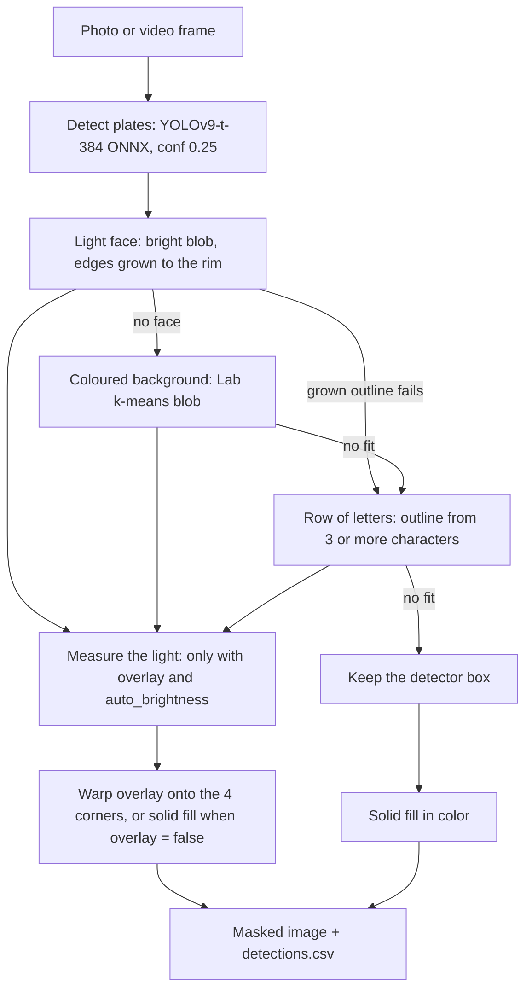

# Number plate detection

## What it does

[`number_plate_detection`](../../number_plate_detection/README.md) finds the number plates in car photos and video frames and covers each one. By default it uses a branded image, [`assets/RC.png`](../../number_plate_detection/assets/RC.png) (1000×220 px, with transparency). The image is warped onto the plate's own 4 corners and darkened to match the plate's lighting. With `overlay = false`, each plate is filled with a solid colour instead.

- **CPU only.** There is one learned model, a YOLOv9-tiny plate detector on ONNX Runtime. Everything after it is plain OpenCV and numpy. No GPU and no torch ([requirements.txt:2-4](../../number_plate_detection/requirements.txt#L2-L4)).
- **Entry point.** [`mask_plates.py`](../../number_plate_detection/mask_plates.py) reads [`config.toml`](../../number_plate_detection/config.toml). Command-line options override it ([mask_plates.py:184-199](../../number_plate_detection/mask_plates.py#L184-L199)).
- **In the video pipeline** this is stage 2. It runs on the extracted frames, before the background change, with `--overlay --auto-brightness --brightness-smoothing N` ([make_video.py:128-134](../../video_pipeline/make_video.py#L128-L134)). N is `brightness_smoothing` in `video_pipeline/config.toml`, 5 by default ([config.toml:29](../../video_pipeline/config.toml#L29), [make_video.py:42](../../video_pipeline/make_video.py#L42)). The model, confidence, threads, overlay image and the other settings still come from this project's `config.toml`. See [video_pipeline](../video_pipeline/README.md).

## How it works

1. **Detect.** The model finds a straight box around each plate and keeps boxes with confidence of at least 0.25. Boxes are clipped to the image, empty ones are dropped, and the rest are sorted by confidence, highest first ([detector.py:105-115](../../number_plate_detection/plate_masker/detector.py#L105-L115)).
2. **Fit the plate's own outline** inside each box. The first method that passes wins ([corners.py:490-496](../../number_plate_detection/plate_masker/corners.py#L490-L496)). Light face first, then coloured background ([corners.py:531-573](../../number_plate_detection/plate_masker/corners.py#L531-L573)), then the row of letters ([corners.py:402-481](../../number_plate_detection/plate_masker/corners.py#L402-L481)). Every candidate must pass the same sanity checks: it must be convex, each edge may lean at most 40°, width/height must be 1-8, its area must be 0.2 to 1.6 × the box (1.1 for the light or coloured face), and it must span at least 60 % of the box ([corners.py:214-234](../../number_plate_detection/plate_masker/corners.py#L214-L234)). The order is strict. Once a light face passes, the coloured path is never tried, even if the grown outline fails later. [02](02-exact-plate-fit.md) and [03](03-multi-colour-plates.md) cover the details.
3. **Fall back to the box.** A plate that fails all three methods keeps its box and is labelled `box`. It always gets the solid fill, even when `overlay = true` ([__init__.py:111-113](../../number_plate_detection/plate_masker/__init__.py#L111-L113), [masking.py:176-179](../../number_plate_detection/plate_masker/masking.py#L176-L179)).
4. **Measure the light.** This runs only when `overlay` and `auto_brightness` are both on ([mask_plates.py:212](../../number_plate_detection/mask_plates.py#L212)). All plates are measured at once, on the original image, before anything is painted ([__init__.py:105-110](../../number_plate_detection/plate_masker/__init__.py#L105-L110)). The result is a brightness plane `a + b*x + c*y` for each plate. See [04](04-auto-brightness.md).
5. **Cover.** First the quad is grown by `padding` ([masking.py:151-156](../../number_plate_detection/plate_masker/masking.py#L151-L156)). The overlay is then perspective-warped onto the corners and blended through an anti-aliased polygon times the PNG alpha. With auto brightness, its colour is scaled by `clip(plane / 255, 0.15, 1)` ([masking.py:88-145](../../number_plate_detection/plate_masker/masking.py#L88-L145)). A solid fill is drawn as an anti-aliased polygon with 1/16 px precision ([masking.py:49-52](../../number_plate_detection/plate_masker/masking.py#L49-L52)).

## Models at a glance

| Step | Model or method | Learned? | Licence | Cost (i5-1240P laptop, CPU, 4K frame) | Code |
|---|---|---|---|---|---|
| Detect | open-image-models `yolo-v9-t-384-license-plate-end2end` (YOLOv9-tiny, NMS inside the ONNX graph) | **Yes, the only learned model** | MIT | 7.4 MB file. Detector 50-63 ms per frame at 4 threads | [detector.py:14](../../number_plate_detection/plate_masker/detector.py#L14) |
| Fit outline | Otsu threshold, convex hull + `approxPolyDP`, two-colour k-means in Lab, connected components, `fitLine` | No | OpenCV + numpy | 4-8 ms per light plate, about 20 ms coloured, up to about 70 ms green/black | [corners.py:499](../../number_plate_detection/plate_masker/corners.py#L499) |
| Measure light | Otsu split, HSV colour names, least-squares plane | No | OpenCV + numpy | 2-8 ms per plate + about 2 ms per image | [detector.py:100](../../number_plate_detection/plate_brightness_detector/detector.py#L100) |
| Cover | `getPerspectiveTransform` + `warpPerspective`, `LINE_AA` polygon | No | OpenCV + numpy | Overlay about 18 ms, solid fill about 10 ms per plate | [masking.py:88](../../number_plate_detection/plate_masker/masking.py#L88) |

[01](01-model-and-options.md) covers the other detector sizes and the alternatives we rejected.

## Key settings

| Setting | `config.toml` | If the key is missing | What it does | Code |
|---|---|---|---|---|
| `model` | `"yolo-v9-t-384-license-plate-end2end"` | same | Detector name (`t-256/384/416/512/640` or `s-608`), or a local `.onnx` path (relative to the config's folder) | [config.toml:48](../../number_plate_detection/config.toml#L48), [mask_plates.py:81-82](../../number_plate_detection/mask_plates.py#L81-L82) |
| `confidence` | `0.25` | `0.25` | Keep boxes at least this sure. Must be strictly between 0 and 1. `0.15` caught 2 small background plates | [config.toml:51](../../number_plate_detection/config.toml#L51), [detector.py:16](../../number_plate_detection/plate_masker/detector.py#L16) |
| `threads` | `4` | `4` | ONNX Runtime intra-op threads (inter-op 1). `0` = no session options, so ONNX Runtime uses every core | [detector.py:89-93](../../number_plate_detection/plate_masker/detector.py#L89-L93) |
| `overlay` | `true` | `false` | `true` = warp `overlay_image` onto each plate. `false` = solid fill everywhere | [config.toml:14](../../number_plate_detection/config.toml#L14), [mask_plates.py:194](../../number_plate_detection/mask_plates.py#L194) |
| `overlay_image` | `"assets/RC.png"` | `assets/sample_plate.png` | Read with its alpha (BGR or BGRA). 16-bit images are scaled to 8-bit; grey images become BGR | [mask_plates.py:136-147](../../number_plate_detection/mask_plates.py#L136-L147) |
| `tight_fit` | `true` | `true` | `false` = skip fitting and put the chosen style on the straight box | [__init__.py:103-104](../../number_plate_detection/plate_masker/__init__.py#L103-L104) |
| `padding` | `0.0` | `0.0` | Grow the quad by `padding × quad height` on every side. Must be 0 or more | [masking.py:151-156](../../number_plate_detection/plate_masker/masking.py#L151-L156) |
| `color` | `[0, 0, 0]` | `(0, 0, 0)` | RGB fill, used for `overlay = false` and for every `box` plate | [config.toml:36](../../number_plate_detection/config.toml#L36) |
| `lighting` | `100` | `100` | Manual mode only (`auto_brightness = false`). 0-100 % match to the plate's measured white | [masking.py:138-143](../../number_plate_detection/plate_masker/masking.py#L138-L143) |
| `auto_brightness` | `true` | `false` | Read the light with `plate_brightness_detector`. `lighting` is then ignored | [config.toml:22](../../number_plate_detection/config.toml#L22), [mask_plates.py:197](../../number_plate_detection/mask_plates.py#L197) |
| `brightness_smoothing` | `0` | `0` | Video: median of the main (largest) plate's level over the last N frames | [detector.py:187-197](../../number_plate_detection/plate_brightness_detector/detector.py#L187-L197) |

Unknown keys are rejected ([mask_plates.py:64-70](../../number_plate_detection/mask_plates.py#L64-L70)).

> Note: [README.md:27](../../number_plate_detection/README.md) and its settings table give the default `input` as `../frame_view_type/output/Final_zoomed_car`. `config.toml:7` sets `../frame_view_type/output/sample_vid`. Its other "Default" values are the `config.toml` values. For `overlay`, `overlay_image` and `auto_brightness` the code's own fallbacks differ (`false`, `assets/sample_plate.png`, `false`), which matters with `--config` and a file that leaves those keys out.

## Output

- **Folder:** `<output>/<input name>/`. A single image gets a folder named after its stem. The script refuses to write into the input folder ([mask_plates.py:217-221](../../number_plate_detection/mask_plates.py#L217-L221)).
- **Images:** each image is saved under its own name. JPEGs are written at quality 95 ([mask_plates.py:150-156](../../number_plate_detection/mask_plates.py#L150-L156)). An image with no plate is not painted, but it is still decoded and re-encoded ([mask_plates.py:258](../../number_plate_detection/mask_plates.py#L258)). It is not a byte copy, and a JPEG loses a little more quality.

> Note: the project README says images without a plate are "copied unchanged", and the [mask_plates.py](../../number_plate_detection/mask_plates.py#L6) docstring says "saved unchanged". Both mean "not painted".
- **`detections.csv`** (utf-8-sig) has one row per plate. An image with no plate gets one row with `plates = 0`. The columns are `file, plates, plate, fit, x1, y1, x2, y2, confidence, corners, brightness_pct, brightness_source, plate_colours` ([mask_plates.py:270-291](../../number_plate_detection/mask_plates.py#L270-L291)). `fit` is `corners`, `letters` or `box`. Corners are written to whole pixels (they are stored to 0.1 px).
- With auto brightness on, `box` plates still get a brightness reading in the CSV. It is not used, because those plates get the solid fill.

## Measured results

These figures come from the notes, not the code. They were measured on an Intel i5-1240P laptop, on the CPU ([README.md speed](../../number_plate_detection/README.md#speed-on-cpu), [findings.md speed](../../number_plate_detection/docs/findings.md#speed)).

- **4K frame:** about 85 ms to find, fit and cover. Of that, the detector takes about 50 ms, corner fitting about 8 ms per plate and the overlay about 18 ms. A run of 20 frames takes about 4.3 s.
- **4K test video** (white plates): the plate was found and fitted in 12 of the 12 frames where it is visible. Two non-plates fell back to a solid box. Two small background plates were missed at 0.25 and caught at 0.15.
- **`sample_vid`** (464×832, real black plates with yellow letters, about 80×25 px): found in 8 of 8 frames, all fitted through `letters`.
- **Colour test set:** all 11 cases pass on all 3 views. Outline overlap is 91-98 %, against a pass bar of 0.90 IoU and ±5 brightness points ([run_colour_tests.py:42-43](../../number_plate_detection/tests/run_colour_tests.py#L42-L43)). The two cases expected to use the photo reading (green/black, night) only have to use it; their value is not checked ([run_colour_tests.py:114-115](../../number_plate_detection/tests/run_colour_tests.py#L114-L115)).

> Note: the [corners.py](../../number_plate_detection/plate_masker/corners.py#L5) docstring says the fit takes "about 1-3 ms per plate". The notes measured 4-8 ms for light plates and more for coloured ones.

> Note: README.md:185 and :191 say only white plates and one video were tested. That predates `sample_vid`. Only the coloured-background path is still tested on synthetic plates alone.

## Files in this folder

- [01-model-and-options.md](01-model-and-options.md): the YOLOv9 detector, its sizes, the threshold and thread choices, and the alternatives we rejected.
- [02-exact-plate-fit.md](02-exact-plate-fit.md): from the straight box to the plate's 4 corners (light face, edge growth to the rim, sanity checks, letters fallback), and the overlay warp.
- [03-multi-colour-plates.md](03-multi-colour-plates.md): dark and coloured plates (background side, Lab k-means, colour trim) and the colour test set.
- [04-auto-brightness.md](04-auto-brightness.md): how bright the overlay is made (white, then light paint, then photo), the glare check, smoothing, and the manual `lighting` mode.

## Code map

- [`mask_plates.py`](../../number_plate_detection/mask_plates.py): the command-line tool. It loads the config, loops over the images, and writes the masked copies and `detections.csv`.
- [`plate_masker/__init__.py`](../../number_plate_detection/plate_masker/__init__.py): `PlateMasker.process`, which runs detect, fit, measure and mask in one call.
- [`plate_masker/detector.py`](../../number_plate_detection/plate_masker/detector.py): the `PlateDetector` ONNX wrapper and the `Plate` record (box, corners, `fit`).
- [`plate_masker/corners.py`](../../number_plate_detection/plate_masker/corners.py): `fit_plate`, which turns the box into 4 corners.
- [`plate_masker/masking.py`](../../number_plate_detection/plate_masker/masking.py): the mask styles in `MASKERS` (`solid`, `image`) and padding.
- [`plate_brightness_detector/`](../../number_plate_detection/plate_brightness_detector/README.md): `BrightnessDetector`, plus the paint factors and colour names in `colours.py`.
- [`tests/`](../../number_plate_detection/tests/run_colour_tests.py): `make_test_photos.py` builds the colour test set and `run_colour_tests.py` scores it.

## Further reading

- [number_plate_detection/README.md](../../number_plate_detection/README.md): setup, how to run it, command-line options, and results.
- [number_plate_detection/docs/findings.md](../../number_plate_detection/docs/findings.md): research notes, options compared, speed tables and the history of each fix.
- [plate_brightness_detector/README.md](../../number_plate_detection/plate_brightness_detector/README.md): the brightness module and its results.
- [assets/test_plates/README.md](../../number_plate_detection/assets/test_plates/README.md): the sample plates in the colour test set.
- [docs/README.md](../README.md): an index of every project's docs.
