# The pipeline, step by step

This is the current flow, as `video_pipeline/e2e_steps.py` runs it: one walk-around video in, studio shots of the car
out, with a picture of every step. Every picture below comes from the run of 24 Nov 2026 on `sample_vid.mp4`, a
464×832 portrait phone video of a Maruti Suzuki Baleno 2022. Where a step works on one photo, the photo shown is
`0014.5s_front_93pct`. Terms are explained in the [glossary](glossary.md).

Each step has the same four parts:

- **What it does**
- **What it solves**: the problem that would show up without it
- **Input**
- **Output**

The notes under each step add the fallbacks and the flags that step writes to `results.csv`.

Contents:
[0 Settings](#step-0-settings-and-input-video) ·
[1 Sides](#step-1-pick-one-frame-per-side-of-the-car) ·
[2 Plates](#step-2-cover-the-number-plates) ·
[3 Cut-out](#step-3-cut-the-car-out) ·
[4 This car only](#step-4-keep-only-this-car) ·
[5 Glass](#step-5-tint-the-glass) ·
[6 Camera](#step-6-measure-the-camera) ·
[7 Focal](#step-7-agree-on-one-focal-length) ·
[8 3D fit](#step-8-fit-a-3d-car-to-the-outline) ·
[9 Level, tyres](#step-9-level-the-car-and-find-the-tyres) ·
[10 Room](#step-10-rebuild-the-studio-room-from-the-photos-camera) ·
[11 Shadows](#step-11-shadows-and-reflection) ·
[12 Paste](#step-12-paste-the-car-last) ·
[13 Report](#step-13-flags-report-cost) ·
[Variant: make_video.py](#variant-make_videopy-video-in-video-out)

---

## Step 0: Settings and input video

**What it does.** `e2e_steps.py` reads [e2e.toml](../video_pipeline/e2e.toml), which sets:

- the video;
- the sampling step (`every_seconds = 0.5`);
- the car model, which must be a `carModel` in `background_changer/cars.json`;
- the backgrounds (`["all"]`);
- whether hosted models are used (`hosted = true`).

It clears the previous work folder, but keeps the fal cache so that a rerun is free. It then starts each tool with
that tool's own Python environment.

**What it solves.** One command runs four separate tools in the right order with matching folder names. The tools
find each other's files by folder name (rule 4 in [CLAUDE.md](../CLAUDE.md)), so a hand-run chain with one name
wrong silently loses the side labels.

**Input.** A walk-around video, plus the car's real size (length, width, height and wheelbase in cm) from `cars.json`.

**Output.** The work folder `video_pipeline/output/e2e_<video>/`, holding `run.log` and `step_times.csv`.

---

## Step 1: Pick one frame per side of the car

Tool: `frame_view_type/classify_video.py --pick-sides`

**What it does.** It keeps one frame every 0.5 s: 54 frames from this 27 s video. An 8-way view classifier
(ConvNeXt-Small, run on the CPU) gives each frame a probability for each side:

- front, front-right, right, back-right
- back, back-left, left, front-left

The sides are the car's own sides. It then picks the single best frame for each side, greedily: the highest
probability first, each frame used once, and no pick below 0.3.

**What it solves.** A video has hundreds of near-identical frames. A customer wants one clean shot per side, and
every later step costs time and money per photo. The side label is also kept, as the starting guess for the car's
angle in step 8.

**Input.** The video.

**Output.** `frame_view_type/output/<video>_sides/`, which holds:

- the chosen frames, named `<time>s_<side>_<conf>pct.jpg`;
- `results.csv`, with all 8 probabilities for each frame;
- `missing_sides.txt`.

This video gave 6 sides. It has no straight left or right view: the best probability for those was 0.13.

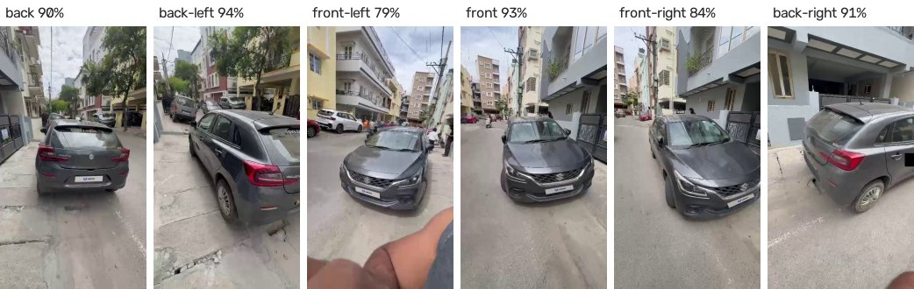

*The picture shows the frames after step 2, so the plates are already covered.*

> Note: the classifier always answers with one of the 8 sides, even for a close-up or an interior shot. A low
> confidence is the only warning.

---

## Step 2: Cover the number plates

Tool: `number_plate_detection/mask_plates.py`

**What it does.** For each frame:

1. A small YOLOv9 detector finds a box round each plate.
2. Plain image analysis finds the plate's own 4 corners inside that box. It uses the light face of the plate or the
   row of letters, so it works on white, yellow, black and coloured plates.
3. A branded overlay image is warped onto exactly those 4 corners and darkened to match the plate's lighting.

If the corners can't be found, a solid box covers the plate instead.

**What it solves.**

- **Privacy:** plates must not appear in published shots.
- **Fit:** a plain rectangle looks pasted on when the plate is seen at an angle. Warping onto the real corners makes
  the cover sit flat on the plate, and the brightness match stops it glowing in shadow.

**Input.** The frames from step 1.

**Output.** `masked/<video>_sides/`, holding the same file names with plates covered, and `detections.csv` (box,
corners, fit method and brightness for each plate).

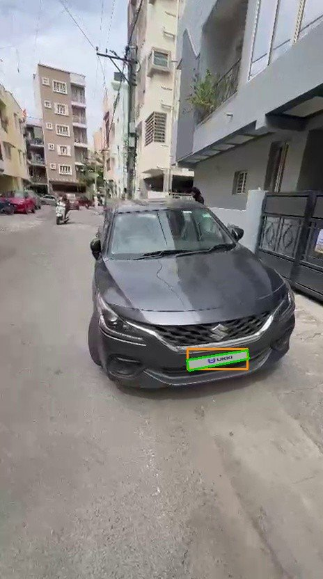

> Note: a missed plate is a privacy leak, so the confidence threshold (0.25) is set low on purpose.

---

## Step 3: Cut the car out

Tool: `background_changer/change_background.py`, stage 1 (with `[hosted] cutout = true`)

**What it does.** BiRefNet v2, run on fal.ai at up to 2048 px, gives a soft mask for every pixel:

- white = car
- black = background
- grey = unsure (the edges)

A clean-up then:

1. drops stray blobs;
2. cuts off posts and poles that touch the car;
3. fills the window holes, because the glass belongs to the car;
4. keeps a thin soft band at the edge.

**What it solves.** Every later step needs to know exactly which pixels are the car. A ragged or missing edge shows
as a halo on the studio background, and a hole in the glass would let the new background show through the car.

**Input.** The plate-masked photo.

**Output.** The car's mask (alpha), kept in memory, and `cutouts/<photo>.webp`.

| Raw mask from the model | After clean-up |
|---|---|
| 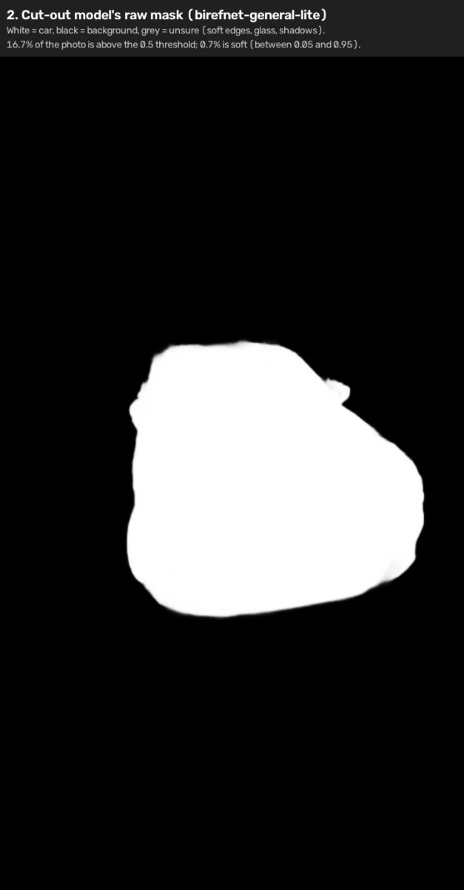 | 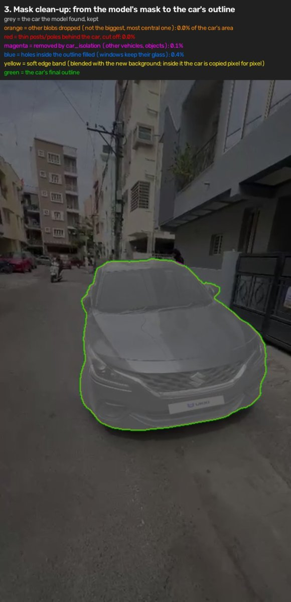 |

> Note: if fal fails, or returns an empty mask, the local BiRefNet-lite model takes over and the photo is flagged
> `hosted-cutout-failed`.

---

## Step 4: Keep only this car

**What it does.** SAM 3 on fal.ai, prompted with "car", finds every car in the photo as a separate object. The one
that overlaps the cut-out best is kept, and anything the cut-out had merged with it is removed. Merged objects
include a parked car behind, a scooter or a person.

**What it solves.** BiRefNet keeps everything that looks like a foreground object. On a street that often includes
a second car or a passer-by, who would otherwise be pasted into the studio as part of "the car".

**Input.** The photo and the cleaned mask from step 3.

**Output.** The final cut-out mask: this car only.

| SAM 3 keeps this car | Final cut-out (what gets pasted) |
|---|---|
| 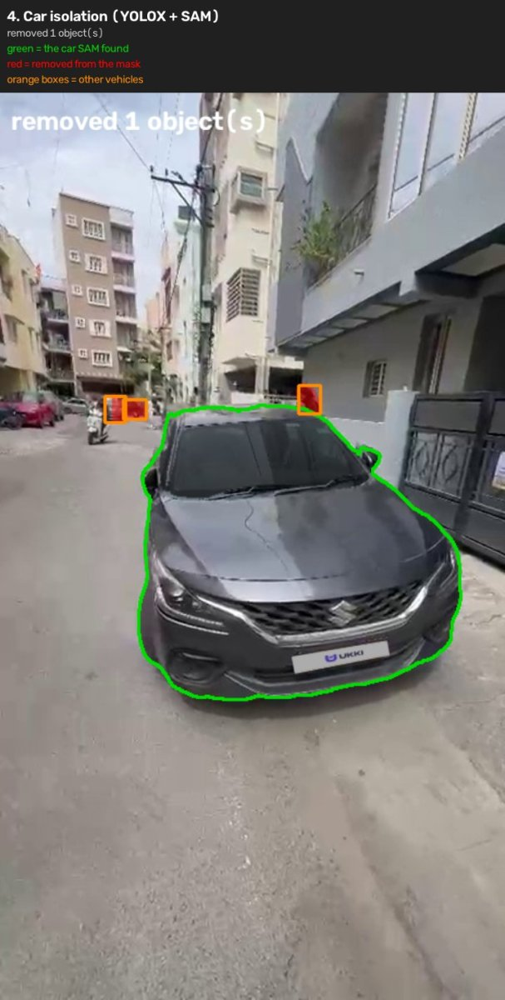 | 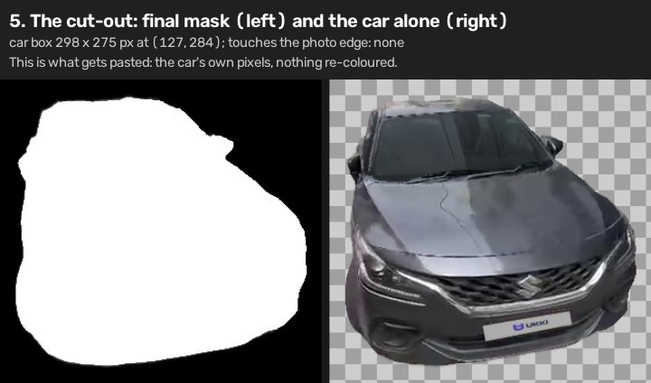 |

> Note: if SAM 3 fails, the plain clean-up from step 3 is used, flagged `sam3-failed`.

---

## Step 5: Tint the glass

**What it does.** SAM 3 is called twice more, with "car window" and "windshield", to find the glass. The glass mask
is kept only inside the car's outline, shrunk slightly so that it never touches the paint. Inside that mask the
glass gets one fixed dark blue-grey gradient: lighter at the top, near-black at the bottom. 85% of the glass is
replaced at the centre, 15% of the original shows through, and the edges are feathered.

The untouched photo is first copied to `originals/`. From here on, the tinted frame counts as "the photo".

**What it solves.** Glass shows what was behind the car: the street, buildings, other cars. Once the background is
changed, a street seen through the windscreen of a car in a white studio gives the edit away at once. A fixed tint
is the same on every photo and needs no measurement and no generated content. It is the one approved change to car
pixels, because only glass is touched and the body (dents, scratches) stays exactly as shot.

**Input.** The photo and the car mask.

**Output.**

- the tinted frame, at `_frames/<photo>.png`;
- the untouched photo, at `originals/<photo>.jpg`;
- the `glass_pct` column in `results.csv`.

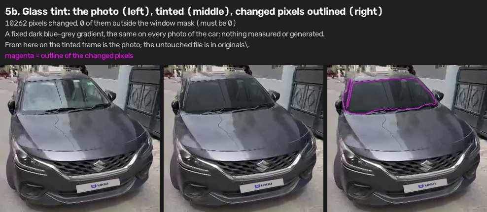

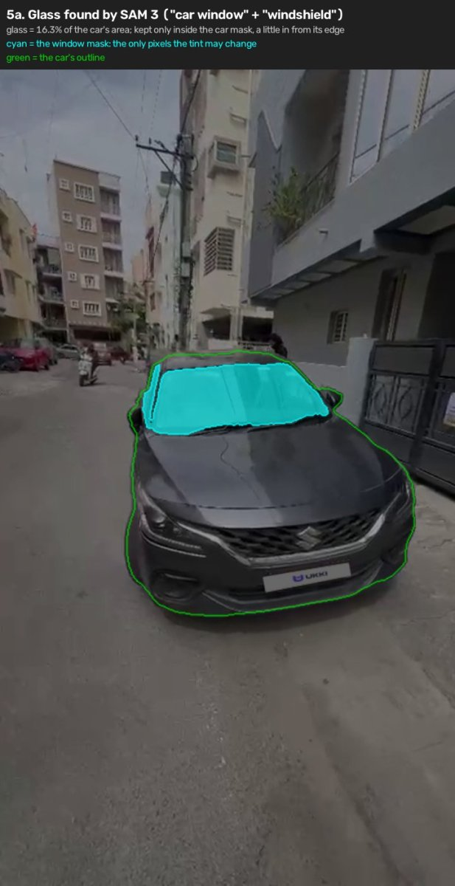

> Note: if the glass mask fails, nothing is tinted and the photo is flagged `glass-mask-failed`. Pixels outside the
> mask are bit-identical to the photo; `tests/test_hosted_glass.py` checks this.

---

## Step 6: Measure the camera

Code: `hosted/camera.py` plus `car_fit_to_bg/lines.py`

**What it does.** It works out where the phone was and how it was held, for each photo. Three sources are used:

- **MoGe-3** (fal.ai, one call per photo) turns the photo into a 3D point cloud. A flat floor is fitted to it, and
  that floor gives:
  - the camera's height above the ground;
  - its pitch (how far it looks down);
  - its roll (how far it is tilted sideways);
  - its focal length.
- **VGGT** (fal.ai, one call for all the photos of the car together) solves the shots as one set. It gives one shared
  focal length and the angle between shots. Those angles are anchored on the step 1 side labels and replace them as
  the angle prior for step 8.
- **Background lines.** The straight lines in the background (walls, kerbs, windows) are found on the laptop. Lines
  in one direction meet at a vanishing point, and these points give roll and pitch independently.

The hosted camera is used unless the photo's own strong lines disagree by more than 5° in pitch or roll. In that
case the lines win, flagged `camera-lines-fallback`.

**What it solves.** To stand the car in a new room convincingly, the room has to be seen from the same height and
angle as the car was. A car photographed from 1.7 m looking 18° down, pasted into a room seen at eye level, looks
like a cardboard cut-out. The camera numbers set everything that follows: how the room is drawn, where the floor
is, and how the car is levelled.

**Input.** The tinted photos (full frame for MoGe-3; copies at most 1036 px for VGGT) and the car mask, so that
lines on the car are ignored.

**Output.** Per photo, a camera: focal length in px, pitch, roll, height, and an angle prior. The flags
`camera-hosted`, `camera-moge`, `camera-vggt` and `focal-vggt` record which sources were used.

In this run 4 of the 6 photos used the hosted camera. For the front photo: focal 365 px, pitch 17.8°, roll 0.9°,
height 1.70 m. The two back photos kept their lines (`camera-lines-fallback`).

| Hosted camera (MoGe-3 + VGGT) and its horizon | Camera from background lines |
|---|---|
| 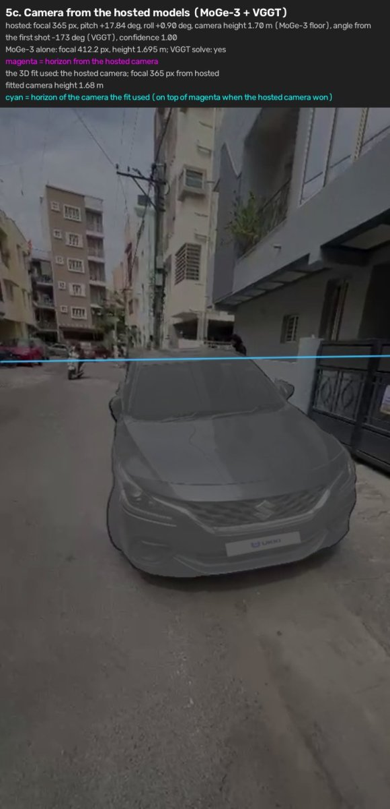 | 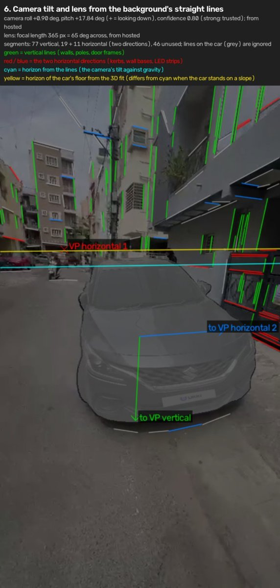 |

---

## Step 7: Agree on one focal length

Code: `car_fit_to_bg/batch.choose_focals`

**What it does.** All photos from one phone share one lens, so the focal lengths are pooled over the folder. The
order of preference is:

1. a focal set in config;
2. the hosted (VGGT) focal;
3. the median of at least 3 confident line focals that agree within 8%;
4. the photo's own lines;
5. the focal recorded in the photo file (EXIF);
6. a 70° field of view, as a last resort.

**What it solves.** The focal length from a single photo is noisy, and a wrong focal makes the car look too
stretched or too flat in 3D. Pooling turns many noisy guesses into one good one. A photo that really was shot with a
different lens keeps its own focal, flagged `lens-change`.

**Input.** The step 6 measurements for all photos.

**Output.** One focal length per photo, and its source in `focal_source`.

---

## Step 8: Fit a 3D car to the outline

Code: `car_fit_to_bg/pose.py`

**What it does.** A simple 3D model of the car is built from its real size in `cars.json`: body, windows, mirrors
and 4 tyres, with a hatch, sedan or SUV profile. It is drawn through the camera from step 6 and turned until its
outline matches the cut-out. The search:

1. tries 36 angles, every 10°;
2. refines the best few candidates and their 180° opposites;
3. scores each by outline overlap (IoU), plus the side label and VGGT priors, plus red tail-lamp cues;
4. polishes the winner.

The result is the car's angle (yaw) and the camera's distance and height relative to the car.

**What it solves.** A flat cut-out has no idea where its wheels touch the ground or which way it faces. The 3D fit
gives the car a position and direction on a real floor. That is what lets steps 9-12 put the tyres on the floor, cast
a correctly shaped shadow, and set the car at the right size in the room.

**Input.** The cut-out mask, the camera, the car's size, and the angle prior from steps 1 and 6.

**Output.**

- the pose: yaw, camera distance, height and angle down;
- `fit_iou`, how well the outlines match;
- flags such as `weak-fit` (IoU below 0.90), `fit-failed` (below 0.75), `yaw-unsure` and `yaw-vs-label`.

For the front photo the fit found yaw 11°, IoU 0.941, and the camera 3.95 m away, 1.68 m up, looking 25° down.

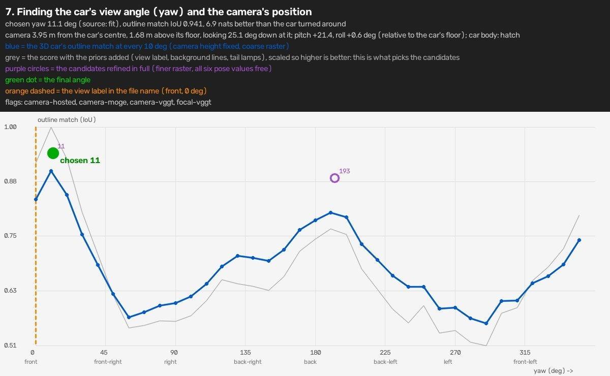

| Photo outline (red) vs the 3D car (green) | Both outlines filled, per candidate |
|---|---|
| 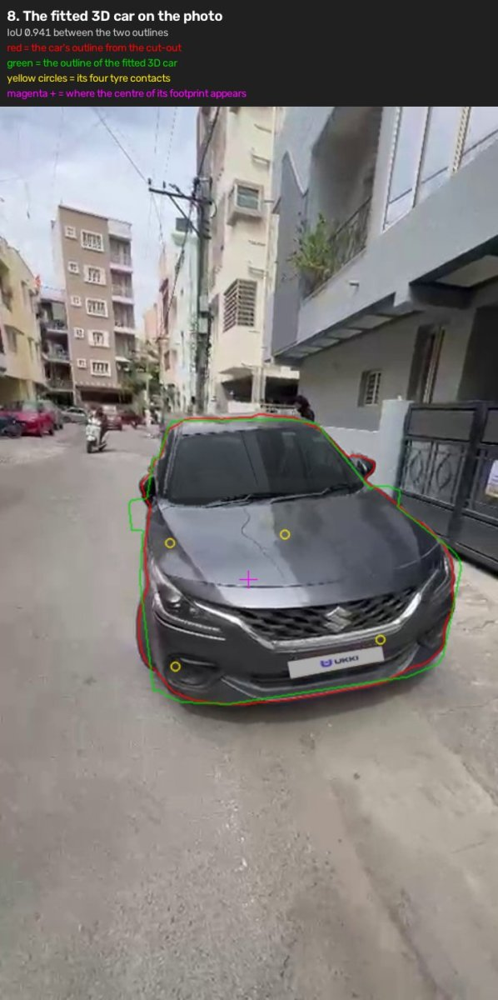 | 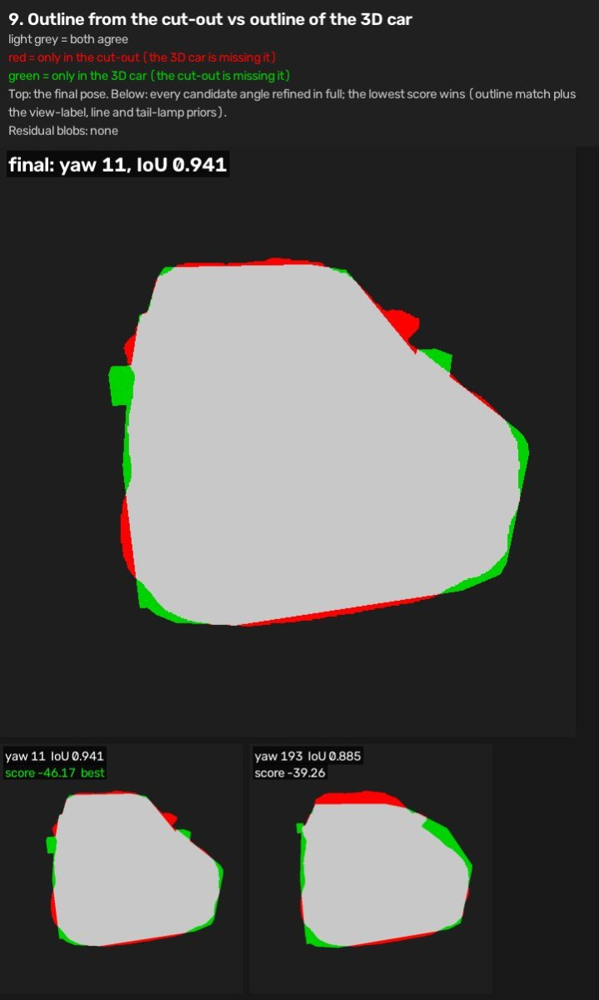 |

> Note: in this run the back-right photo fitted at IoU 0.85 (`weak-fit`, `merged-object`, `occluder`). It was
> placed anyway and flagged for a look (rule 9: flag, don't drop).

---

## Step 9: Level the car and find the tyres

Code: `car_fit_to_bg/level.py`, `ground.py`

**What it does.**

1. If the camera was tilted, the car's pixels are rotated once, rigidly, so that the car stands level. This is the
   only rotation the car ever gets. Angles under 0.5° are left alone. If the lines were too weak to trust, nothing is
   rotated and the room is tilted instead.
2. The bottoms of the tyres are found on the levelled outline.
3. When the fit is good (IoU ≥ 0.90), the 3D car is locked onto those tyre contacts.

**What it solves.**

- A phone held slightly crooked makes the car look as if it sits on a slope once it is in a level studio.
- Without exact tyre contacts, the car floats above the floor or sinks into it, and its shadow detaches. The lock
  ties the 3D model to where the real tyres are in the photo.

**Input.** The pose and camera, the photo and the mask.

**Output.**

- the levelled car (pixels and mask), held in memory;
- `level_deg`, `tyres_found` and `lock_mode`;
- flags such as `car-on-slope`, `partial-level` and `roll-from-silhouette`.

| One rotation: the car's bottom line before and after | Tyre contacts: predicted, found, locked |
|---|---|
| 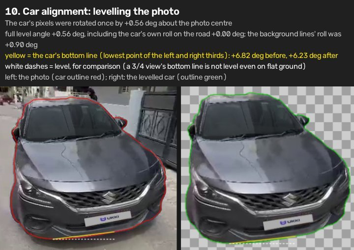 | 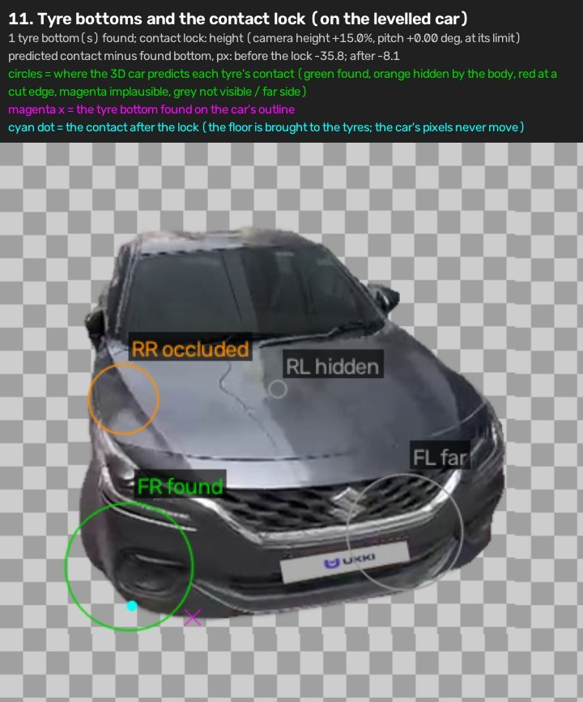 |

---

## Step 10: Rebuild the studio room from the photo's camera

Code: `room3d/`, `car_fit_to_bg/place.py`, `rooms.py`. Steps 10-12 run once per background; the fit from steps 6-9
is reused for every background.

**What it does.** Each studio background is a single picture, but it has been measured once as a 3D room: floor,
walls, ceiling, and the camera it was shot from. For each photo, the photo's own camera (step 6) is placed in that
room at the right distance from the stage. The room is then re-drawn from that viewpoint by casting a ray from each
output pixel into the room and reading the background picture where the ray lands. This runs on the CPU with NumPy
and OpenCV; no neural network is used. Areas the background picture never showed are filled from nearby texture and
recorded.

**What it solves.** Pasting a car shot from above onto a background shot at eye level is the classic sign of a
fake: the floor lines and horizon don't match the car. Re-drawing the room from the car's own camera means the floor,
the walls and the horizon all agree with how the car was photographed, for every angle of the walk-around.

**Input.** The background picture and its room model, the photo's camera, and the car's position on the stage.

**Output.** The re-rendered room, at the output size: at most 1920 px, and never larger than the floor detail
allows. Flags: `camera-outside-room`, `soft-floor`, `invented` (too much of the room had to be filled in) and
`no-room` (a background without a 3D model falls back to flat placement).

| Room re-rendered from the photo's camera | Surfaces: floor, walls, ceiling, and areas never shown |
|---|---|
| 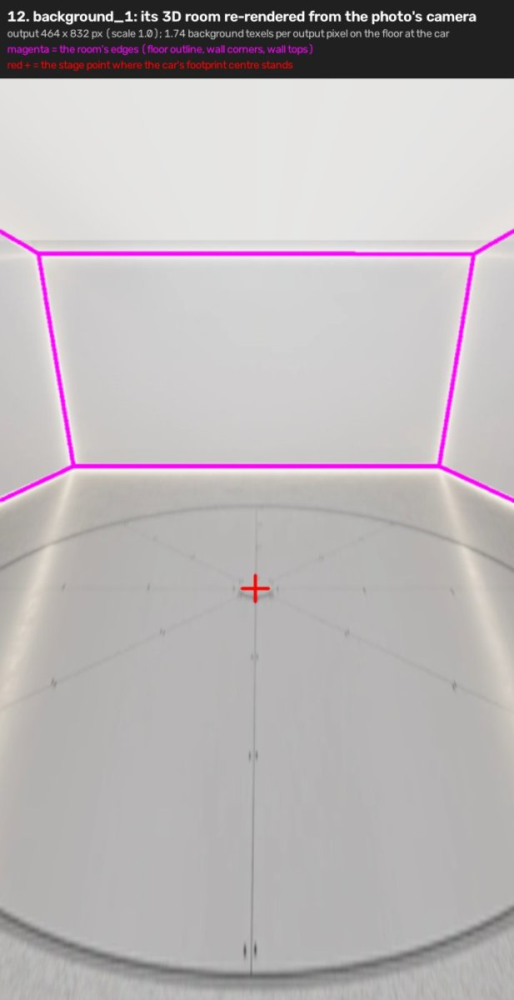 | 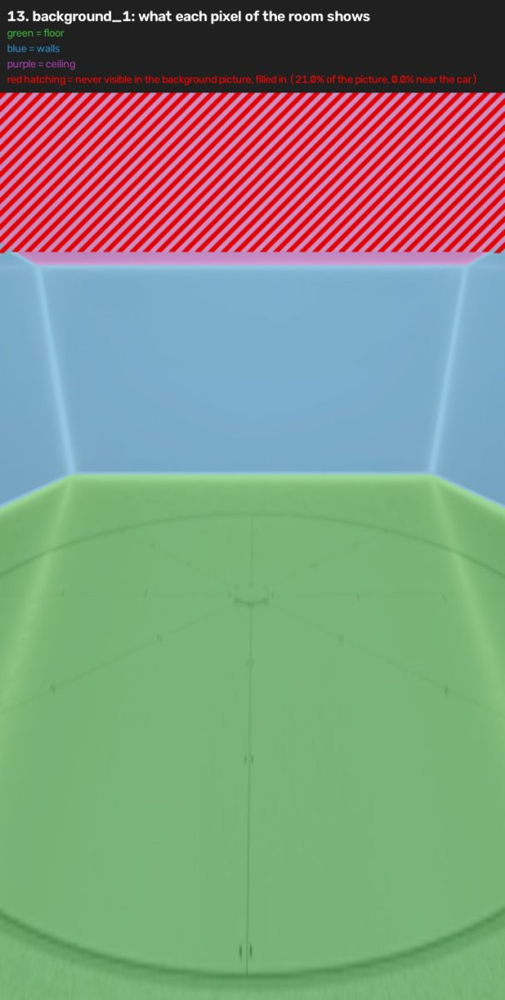 |

---

## Step 11: Shadows and reflection

Code: `car_fit_to_bg/ground.py`

**What it does.** A contact shadow and a soft ambient shadow are drawn on the room's floor, shaped by the 3D car's
footprint and tyre contacts. They are drawn in linear light and on floor pixels only. On glossy floors
(background_1's turntable disc), a faint reflection of the car is added. All of this goes onto the *background*,
before the car is pasted.

**What it solves.** A car with no shadow looks like a sticker hovering over the floor. The shadow is what makes the
car sit in the room. Drawing it only on the background keeps the rule that the car's own pixels are never relit.

**Input.** The rendered room, the car's footprint and contacts, and the `shadow` strength from config (1.0).

**Output.** The background, ready for the car.

| What the shadows and reflection changed | Background ready for the car |
|---|---|
| 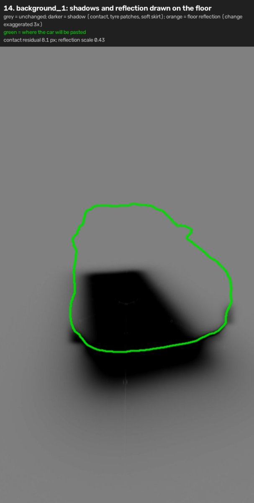 | 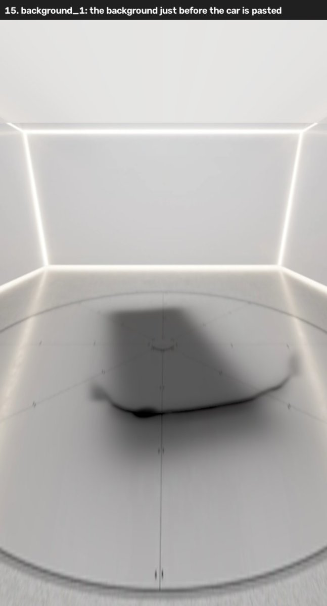 |

---

## Step 12: Paste the car last

**What it does.** The levelled car is downscaled once, with plain area averaging, to the room's scale. It is never
enlarged. It is then pasted onto the finished background at its locked floor position. Nothing is drawn after the
paste. If the car ran off the edge of the photo, the output is framed the same way, so no missing part has to be
invented.

**What it solves.** This step keeps the result honest: the car in the output is the car in the photo, pixel for
pixel apart from the one downscale, with every dent and scratch intact. Tests check this bit-exactly
(`tests/`, `tools/check_room.py`).

**Input.** The levelled car from step 9 and the background from step 11.

**Output.** `background/<video>_sides/<background>/<photo>.webp`: one image per photo per background (WEBP, quality
90).

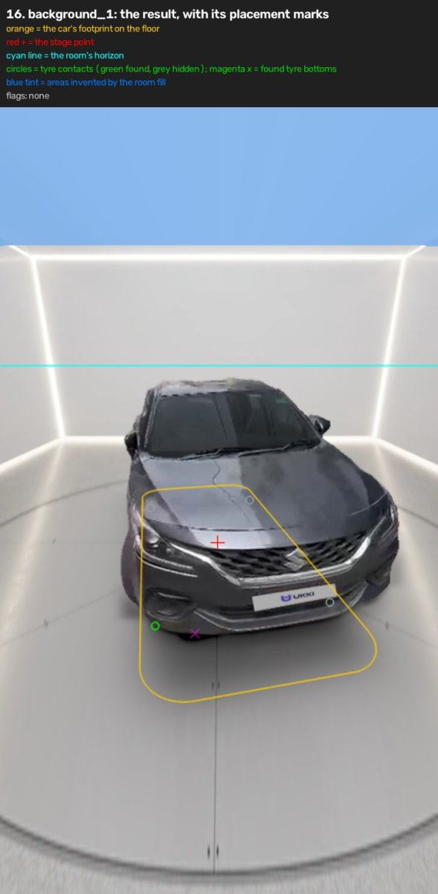

| background_1 | background_2 | background_3 |
|---|---|---|
| 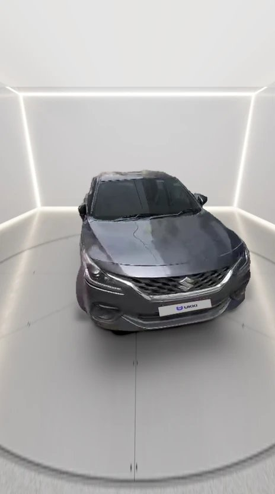 | 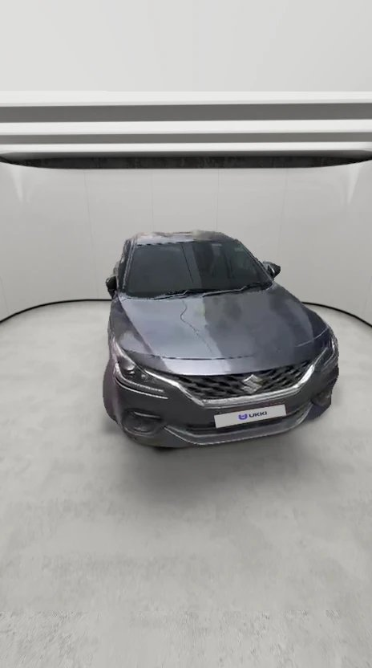 | 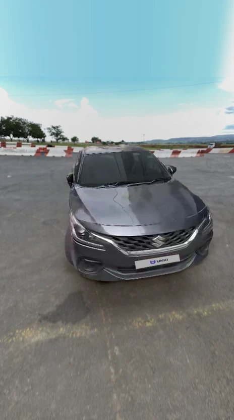 |

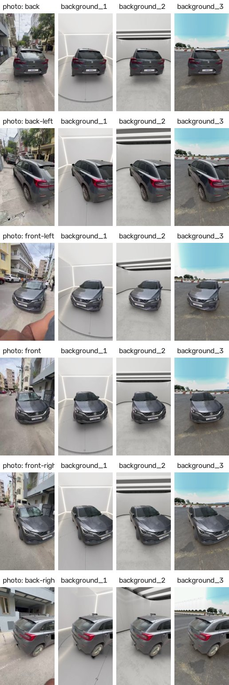

---

## Step 13: Flags, report, cost

**What it does.**

- `results.csv` gets one row per photo per background, holding the pose, camera, sources, timings, cost and a
  `flags` column.
- With `--debug`, every step above saves its own captioned picture; the pictures in this document are those.
- `e2e_steps.py` then builds `index.html`, which shows, per photo, the step 1 strip, the plate, every debug picture
  and every result, plus a summary of step times and fal spend.

**What it solves.** A run never stops on one bad photo. Unsure fits are placed and flagged, not dropped. The flags
and the report let a person check the few photos that need a look instead of all of them, and the cost line keeps
the fal spend visible.

**Input.** Everything above.

**Output.**

- `video_pipeline/output/e2e_<video>/index.html`, `step_times.csv` and `run.log`;
- `results.csv`;
- `debug/<photo>/01..11` and `debug/<photo>/<background>/12..16`.

**Cost control.** Every fal result is cached under `_hosted_cache/`, keyed by the exact request, so a rerun costs $0.
A budget (`[hosted] max_cost_per_car`, $3) stops fal calls, and the run falls back to the laptop path. This run:
37 calls, about $0.23 for 6 photos.

---

## Variant: make_video.py (video in, video out)

`video_pipeline/make_video.py` is the older driver. It:

1. takes 5 frames a second from the first 10 s;
2. covers the plates (step 2);
3. runs steps 3-12 on one background;
4. writes the results back into an mp4, repeating the previous frame where a frame could not be placed.

It does not run step 1, so its frames (`00001.jpg`, ...) carry no side label. Each fit then starts without an angle
prior and is flagged `no-view-label`. The only change it makes after background_changer is one uniform resize of
each whole finished frame to fit the video canvas. Details: [video_pipeline/CLAUDE.md](../video_pipeline/CLAUDE.md).
