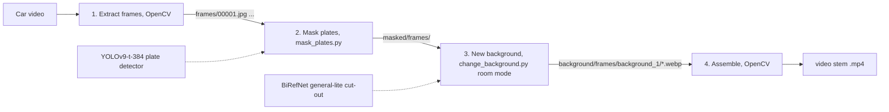

# Video pipeline

[`video_pipeline/make_video.py`](../../video_pipeline/make_video.py) turns a car video into a new video of the same car on a studio background, with its number plates covered. It has no model of its own. It chains the other projects in this repo:

- OpenCV takes frames from the video.
- [number_plate_detection](../number_plate_detection/README.md) covers the plates.
- [background_changer](../background_changer/README.md) puts the car on the new background, in room mode.
- OpenCV writes the results back into an mp4.

All settings are in [`video_pipeline/config.toml`](../../video_pipeline/config.toml). It is CPU only, like the projects it calls.

## In short

- **Four stages:** extract frames (5 per second of the first 10 s, as config.toml ships), mask plates, change the background, assemble the mp4.
- **Stages 2 and 3 are separate processes.** Each runs with its own project's `.venv` Python when that exists.
- **Resumable per stage.** Stages 1-3 are skipped when their output is already complete. Stage 4 always runs and rewrites the mp4.
- **Gaps are filled.** A frame the background changer left out repeats the previous result, so the video keeps its length.
- **Stage 3 is almost all the time:** about 25-40 s per frame on a laptop CPU, so the default run (about 50 frames) takes roughly 20-35 minutes.

## The flow



## Models at a glance

make_video.py runs no model itself. The models run inside the two sub-projects, with the settings of those projects' own `config.toml` files.

| Stage | Model | Licence | Runtime and settings | Details |
|---|---|---|---|---|
| 1. Extract | None (OpenCV decode and JPEG encode) | | CPU | [make_video.py:52-73](../../video_pipeline/make_video.py#L52-L73) |
| 2. Mask plates | `yolo-v9-t-384-license-plate-end2end` (open-image-models, YOLOv9-tiny, 384 px input, 7.4 MB ONNX) | MIT | ONNX Runtime CPU, 4 threads, confidence 0.25 ([config.toml:48-55](../../number_plate_detection/config.toml#L48-L55)) | [01-model-and-options.md](../number_plate_detection/01-model-and-options.md) |
| 2. Mask plates | No model: corner fit and brightness are plain OpenCV/numpy | | CPU | [02-exact-plate-fit.md](../number_plate_detection/02-exact-plate-fit.md), [04-auto-brightness.md](../number_plate_detection/04-auto-brightness.md) |
| 3. New background | `birefnet-general-lite` (BiRefNet through rembg) for the car cut-out | MIT | ONNX Runtime CPU, 4 threads ([config.toml:89-92](../../background_changer/config.toml#L89-L92)) | [02-car-cutout-model.md](../background_changer/02-car-cutout-model.md) |
| 3. New background | No second model: the mask clean-up is classical OpenCV/NumPy. No neural network in the line camera, the 3D silhouette pose fit (SciPy) or the 3D room render | | CPU | [03-cutout-refinement.md](../background_changer/03-cutout-refinement.md), [05-camera-angle.md](../background_changer/05-camera-angle.md), [06-3d-room-rendering.md](../background_changer/06-3d-room-rendering.md) |
| 4. Assemble | None | | CPU | [make_video.py:145-174](../../video_pipeline/make_video.py#L145-L174) |
| Not run | `veerupandey/view_classifier` ([frame_view_type](../frame_view_type/README.md)) | MIT code | | See [No view labels](#no-view-labels-in-this-pipeline) |

## How to run

1. **Set up both virtual environments once:** [background_changer setup](../../background_changer/README.md#setup-once-already-done-on-this-pc) and [number_plate_detection setup](../../number_plate_detection/README.md#setup-once). make_video.py looks for `number_plate_detection\.venv\Scripts\python.exe` and `background_changer\.venv\Scripts\python.exe` ([make_video.py:82-84](../../video_pipeline/make_video.py#L82-L84)).
2. **Put the video where `video` points.** The default is `../frame_view_type/sample_vid.mp4`. Videos are not in git (`*.mp4` in [.gitignore:10](../../.gitignore#L10)), so copy it in.
3. **Check `car` and `background`.** `car` must be a `carModel` in [`background_changer/cars.json`](../../background_changer/cars.json). `background` must be one file name, exactly as on disk and without extension, from `background_changer/backgrounds`. A list or `"all"` does not work here (see [Settings](#settings-in-configtoml)).
4. **Run it from the `video_pipeline` folder with the background_changer Python** ([config.toml:1-2](../../video_pipeline/config.toml#L1-L2)):

   ```powershell
   cd video_pipeline
   ..\background_changer\.venv\Scripts\python make_video.py
   ```

There are no command-line options; edit `config.toml`. make_video.py itself needs Python 3.11+ (`tomllib`), OpenCV and numpy, which the background_changer venv has ([requirements.txt](../../background_changer/requirements.txt)). The first run also downloads the plate model (7.4 MB) and the BiRefNet lite model (about 220 MB) once.

Each sub-project command is printed before it runs ([make_video.py:77](../../video_pipeline/make_video.py#L77)). A non-zero exit stops the pipeline with `stage failed: <script name>` ([make_video.py:78-79](../../video_pipeline/make_video.py#L78-L79)).

## How it works

`<work>` below is `<output>/<video stem>/`, by default `video_pipeline/output/sample_vid/` ([make_video.py:104-109](../../video_pipeline/make_video.py#L104-L109)).

### 1. Extract frames

1. **Open the video** with `cv2.VideoCapture`. If it cannot be opened, the run stops: `cannot open video` ([make_video.py:54-56](../../video_pipeline/make_video.py#L54-L56)). The source frame rate is OpenCV's `CAP_PROP_FPS`, or 30.0 if OpenCV reports 0 ([make_video.py:57](../../video_pipeline/make_video.py#L57)).
2. **Work out the step** between kept frames: `step = 1 if fps <= 0 or fps >= src_fps else src_fps / fps` ([make_video.py:58](../../video_pipeline/make_video.py#L58)). So `fps = 0` keeps every frame.
3. **Read every frame in order.** Frame `idx` is kept when `idx >= next_take - 1e-6`; then `next_take += step` ([make_video.py:60-71](../../video_pipeline/make_video.py#L60-L71)). The k-th kept frame (k from 0) is the first frame at or after `k * step`.
4. **Stop** at the end of the video, when `max_seconds > 0` and `idx / src_fps >= max_seconds` ([make_video.py:63](../../video_pipeline/make_video.py#L63)), or when `max_frames > 0` frames are kept ([make_video.py:69-70](../../video_pipeline/make_video.py#L69-L70)).
5. **Save** each kept frame as `00001.jpg`, `00002.jpg`, ... (5-digit counter from 1) at JPEG quality 95 ([make_video.py:67](../../video_pipeline/make_video.py#L67)).
6. **Write the marker** `frames.done` with `<count> <source fps>` ([make_video.py:121-122](../../video_pipeline/make_video.py#L121-L122)). With no frames at all, the run stops: `no frames extracted` ([make_video.py:125-126](../../video_pipeline/make_video.py#L125-L126)).

**Example.** `sample_vid` is 464×832 at 59.97 fps ([background_changer findings](../../background_changer/docs/findings.md#low-resolution-input-sample_vid-and-the-background-scaler)). With `fps = 5` and `max_seconds = 10`, the step is 11.994, so frames 0, 12, 24, ..., 588 are kept: 50 frames. Frame 600 is at 10.005 s, so extraction stops there. With `output_fps = "source"` the mp4 plays them at `min(5, 59.97)` = 5 fps: 10 s.

### 2. Mask the plates

The command ([make_video.py:128-134](../../video_pipeline/make_video.py#L128-L134)):

```
<python> number_plate_detection/mask_plates.py <work>/frames --out <work>/masked
         --overlay --auto-brightness --brightness-smoothing <brightness_smoothing>
```

- **Python:** `number_plate_detection/.venv/Scripts/python.exe` if it exists, else the Python running make_video.py ([make_video.py:82-84](../../video_pipeline/make_video.py#L82-L84)).
- **Output:** mask_plates.py writes to `<out>/<input folder name>/`, so the masked frames land in `<work>/masked/frames/` under the same names, at JPEG quality 95 ([mask_plates.py:217-218](../../number_plate_detection/mask_plates.py#L217-L218), [mask_plates.py:150-152](../../number_plate_detection/mask_plates.py#L150-L152)). Every frame it can read is written, with or without a plate ([mask_plates.py:258](../../number_plate_detection/mask_plates.py#L258)); an unreadable one is skipped ([mask_plates.py:250-253](../../number_plate_detection/mask_plates.py#L250-L253)). It also writes `detections.csv` ([mask_plates.py:288](../../number_plate_detection/mask_plates.py#L288)).
- **`--overlay`** warps the overlay image onto each plate's 4 corners. **`--auto-brightness`** lets plate_brightness_detector pick its brightness. Both are already `true` in that project's config; the flags make sure.
- **`--brightness-smoothing N`** (default 5 here; 0 in that project's own config): the main plate's brightness, the largest plate in the frame, is the median of its last N readings. It is only replaced when the median differs by more than 0.5 grey levels ([plate_brightness_detector/detector.py:187-197](../../number_plate_detection/plate_brightness_detector/detector.py#L187-L197)). One detector is built per run, so the history follows the frames in sorted order, which is video order ([mask_plates.py:212](../../number_plate_detection/mask_plates.py#L212), [mask_plates.py:249](../../number_plate_detection/mask_plates.py#L249)). See [04-auto-brightness.md](../number_plate_detection/04-auto-brightness.md).
- **Everything else** comes from [`number_plate_detection/config.toml`](../../number_plate_detection/config.toml), which mask_plates.py loads because no `--config` is passed ([mask_plates.py:184](../../number_plate_detection/mask_plates.py#L184)): model, confidence 0.25, threads 4, `tight_fit`, `overlay_image = "assets/RC.png"`, `padding`, and the fill `color` for plates left with only a box. Editing that file changes the video pipeline too.

How a plate is found and covered: [number_plate_detection docs](../number_plate_detection/README.md).

### 3. Change the background

The command ([make_video.py:136-143](../../video_pipeline/make_video.py#L136-L143)):

```
<python> background_changer/change_background.py <work>/masked/frames --out <work>/background
         --car "<car>" --background <background> --background-view room
```

- **Python:** `background_changer/.venv/Scripts/python.exe` if it exists, else the current one.
- **Output:** `<work>/background/frames/<background>/<frame>.webp`, plus transparent cut-outs in `<work>/background/frames/cutouts/` and `<work>/background/frames/results.csv` ([change_background.py:784-785](../../background_changer/change_background.py#L784-L785), [change_background.py:598](../../background_changer/change_background.py#L598), [change_background.py:874](../../background_changer/change_background.py#L874), [change_background.py:913](../../background_changer/change_background.py#L913)).
- **Room mode** runs in three passes over the folder: cut out every frame and measure its background lines, pool the lens over the folder, then fit and place each frame ([change_background.py:8-13](../../background_changer/change_background.py#L8-L13)). All frames of one video have the same size, so the focal length is pooled over the whole video, once at least 3 frames have a confident line focal ([lines.py:28-29](../../background_changer/car_fit_to_bg/lines.py#L28-L29)). A frame whose own confident focal is more than 20% off the pool keeps its own (`lens-change`). See [05-camera-angle.md](../background_changer/05-camera-angle.md).
- **Everything else** comes from [`background_changer/config.toml`](../../background_changer/config.toml) (no `--config` is passed):

| Setting | Value there | Effect here | Line |
|---|---|---|---|
| `model` | `"birefnet-general-lite"` | Cut-out model | [config.toml:89](../../background_changer/config.toml#L89) |
| `threads` | 4 | ONNX Runtime threads for the cut-out | [config.toml:92](../../background_changer/config.toml#L92) |
| `max_output_size` | 1920 | Cap on the result's long side (px) | [config.toml:42](../../background_changer/config.toml#L42) |
| `keep_background_sharp` | true | Results can come out smaller than the frame (close-ups) | [config.toml:48](../../background_changer/config.toml#L48) |
| `cut_frames` | `"frame"` | A car cut off on one side is framed like the photo | [config.toml:56](../../background_changer/config.toml#L56) |
| `quality` | 90 | WEBP quality of the results | [config.toml:99](../../background_changer/config.toml#L99) |
| `save_cutouts` | true | Writes `cutouts/` (lossless WEBP) | [config.toml:102](../../background_changer/config.toml#L102) |
| `[fit] focal` | `"auto"` | Focal from the background lines, pooled | [config.toml:128](../../background_changer/config.toml#L128) |
| `[fit] on_fail` | `"place"` | A failed 3D fit is still placed, flagged `fit-failed` | [config.toml:133](../../background_changer/config.toml#L133) |

**Frames that get no result.** These leave a gap that stage 4 fills. Each gets a `note` in `results.csv`:

- the frame cannot be read, or cannot be re-read for the fit ([change_background.py:859-862](../../background_changer/change_background.py#L859-L862), [change_background.py:549-556](../../background_changer/change_background.py#L549-L556));
- the cut-out model finds no object ([change_background.py:866-869](../../background_changer/change_background.py#L866-L869));
- the car is cut off at the bottom, or on two sides or more ([batch.py:124-131](../../background_changer/car_fit_to_bg/batch.py#L124-L131), [change_background.py:541-548](../../background_changer/change_background.py#L541-L548));
- any cut-off car, if `cut_frames = "skip"` ([change_background.py:542-543](../../background_changer/change_background.py#L542-L543));
- the 3D fit raises an error ([change_background.py:561-568](../../background_changer/change_background.py#L561-L568));
- with `[fit] on_fail = "skip"`: a failed fit, or a camera outside the room ([change_background.py:574-578](../../background_changer/change_background.py#L574-L578), [change_background.py:594-597](../../background_changer/change_background.py#L594-L597));
- the room render raises an error ([change_background.py:590-593](../../background_changer/change_background.py#L590-L593)).

If no frame can be cut out at all, change_background.py exits with an error ([change_background.py:919-920](../../background_changer/change_background.py#L919-L920)) and the pipeline stops.

#### No view labels in this pipeline

make_video.py does not run [frame_view_type](../frame_view_type/README.md). Its frames are named `00001.jpg`, not `0012.0s_right_95pct.jpg`. So background_changer has no view hint for them:

- **No label in the name.** `parse_name` only matches `<time>s_<label>_<conf>pct` ([probe.py:17](../../background_changer/bg_changer/probe.py#L17), [probe.py:29-33](../../background_changer/bg_changer/probe.py#L29-L33)), so it returns nothing.
- **No classifier results.** `find_view_results` looks for `frame_view_type/output/<images folder name>/results.csv`, here `frame_view_type/output/frames/results.csv` ([batch.py:56-60](../../background_changer/car_fit_to_bg/batch.py#L56-L60)). That normally does not exist, and its rows would be looked up by file stem, which would not match `00001` ([batch.py:67](../../background_changer/car_fit_to_bg/batch.py#L67)).
- **The outline alone decides.** The view log-prior is 0 ([pose.py:179-180](../../background_changer/car_fit_to_bg/pose.py#L179-L180)) and every frame is flagged `no-view-label` ([batch.py:92-93](../../background_changer/car_fit_to_bg/batch.py#L92-L93)). The yaw comes from the silhouette fit plus the red tail-lamp penalty.
- **No label fallbacks.** A `yaw-unsure` fit keeps its own yaw, because only a label can decide it ([pose.py:562-567](../../background_changer/car_fit_to_bg/pose.py#L562-L567)). A `fit-failed` frame is placed at the fitted yaw, not a label's ([pose.py:596-603](../../background_changer/car_fit_to_bg/pose.py#L596-L603)). `yaw-vs-label` is never set ([change_background.py:455-458](../../background_changer/change_background.py#L455-L458)) and `view_label`/`view_conf` stay empty in `results.csv` ([change_background.py:444](../../background_changer/change_background.py#L444)).
- **No roll/pitch from neighbouring frames.** Room mode lets a frame whose lines give no roll, or a confidence below 0.3, borrow roll and pitch from frames with confidence 0.3 or more within ±8 s ([batch.py:81](../../background_changer/car_fit_to_bg/batch.py#L81), [lines.py:35](../../background_changer/car_fit_to_bg/lines.py#L35)). It reads the time from a `<time>s_` name prefix ([lines.py:36](../../background_changer/car_fit_to_bg/lines.py#L36), [lines.py:332-334](../../background_changer/car_fit_to_bg/lines.py#L332-L334)). `00001` has none, so the borrowing never happens ([batch.py:81-88](../../background_changer/car_fit_to_bg/batch.py#L81-L88)), although change_background.py asks for it with `video=True` ([change_background.py:560](../../background_changer/change_background.py#L560)). Those frames get their roll from the silhouette (`roll_source = silhouette`, [change_background.py:466](../../background_changer/change_background.py#L466)).
- **The console line is misleading.** It prints `view hints: the file names' view labels` ([change_background.py:830](../../background_changer/change_background.py#L830)), although the names carry none.

> Note: the findings report 0 front/back flips on 32 placeable frames, but that was with the classifier or label prior in the score ([background_changer findings](../../background_changer/docs/findings.md#room-mode-fitting-each-photo-and-re-rendering-the-background)). Without it, flips on these frames have not been measured.

How the hints work when they are there: [frame_view_type/02-how-it-works.md](../frame_view_type/02-how-it-works.md) and [04-car-dimensions-and-orientation.md](../background_changer/04-car-dimensions-and-orientation.md).

### 4. Assemble the video

1. **Collect the results** by file stem ([make_video.py:146](../../video_pipeline/make_video.py#L146)).
2. **Fill gaps.** Walk the frames in order. A frame with a result uses it. A frame without one repeats the last result ([make_video.py:147-155](../../video_pipeline/make_video.py#L147-L155)). Gaps before the first result take the first result ([make_video.py:156-160](../../video_pipeline/make_video.py#L156-L160)). With no result at all, the run stops: `the background changer produced no frames; see its results.csv` ([make_video.py:157-158](../../video_pipeline/make_video.py#L157-L158)).
3. **Pick the canvas.** The size of the first result, with each side rounded down to an even number ([make_video.py:162-164](../../video_pipeline/make_video.py#L162-L164)).
4. **Pick the frame rate** ([make_video.py:165-168](../../video_pipeline/make_video.py#L165-L168)). `output_fps = "source"` gives `src_fps` when `fps <= 0`, else `min(fps, src_fps)`. One output frame per sampled frame then keeps the source's duration. A number is used as it is.
5. **Write the mp4** with `cv2.VideoWriter` and the `mp4v` FourCC ([make_video.py:169-172](../../video_pipeline/make_video.py#L169-L172)).
6. **Fit each frame to the canvas** with `fit_to_canvas` ([make_video.py:87-98](../../video_pipeline/make_video.py#L87-L98)). A frame of the canvas size goes in unchanged. Any other is resized by `min(w / iw, h / ih)` with `cv2.INTER_AREA` and centred on a black canvas. No colour or other change.
7. **Print a summary:** frame count, fps, size and how many gaps were filled ([make_video.py:173-174](../../video_pipeline/make_video.py#L173-L174)).

## Resuming a run

| Stage | Skipped when | Code |
|---|---|---|
| 1. Extract | `frames/` holds images and `frames.done` exists. The source fps is then read from the marker. | [make_video.py:112-116](../../video_pipeline/make_video.py#L112-L116) |
| 2. Mask plates | `masked/frames/` holds as many images as `frames/` | [make_video.py:130](../../video_pipeline/make_video.py#L130) |
| 3. New background | Every frame stem has an image in `background/frames/<background>/` | [make_video.py:138](../../video_pipeline/make_video.py#L138) |
| 4. Assemble | Never; it always rewrites the mp4 | [make_video.py:145-174](../../video_pipeline/make_video.py#L145-L174) |

> Note: the module docstring says each stage is skipped when its output is complete ([make_video.py:3](../../video_pipeline/make_video.py#L3)). That holds for stages 1-3 only.

- **The checks look at names and counts, not settings.** After changing `fps`, `max_seconds`, `max_frames`, `car`, the video's content, or either sub-project's config, delete `<work>` to start clean. A new `background` writes to a new folder, so only stages 3 and 4 run again. The mp4 keeps the name `<video stem>.mp4` whatever the background ([make_video.py:108](../../video_pipeline/make_video.py#L108)), so the new run overwrites the previous video.
- **Re-extraction does not clear later stages.** Without `frames.done`, stage 1 deletes the old frames and extracts again ([make_video.py:118-119](../../video_pipeline/make_video.py#L118-L119)), but `masked/` and `background/` stay. With the same frame count, stage 2 reuses the old masked frames and stage 3 the old results with the same names. With a smaller count, the leftover masked frames keep stage 2's count check from ever passing, and stage 3 processes them too.
- **The frame count in `frames.done` is read but never checked** ([make_video.py:114](../../video_pipeline/make_video.py#L114)).
- **Stages resume whole, not per frame.** mask_plates.py and change_background.py redo every frame of the folder. A stage 3 stopped at frame 40 of 50 starts again from frame 1.
- **A frame that is always left out makes stage 3 run every time.** For example, a car cut off at the bottom never gets a result, so the check at [make_video.py:138](../../video_pipeline/make_video.py#L138) never passes and every new run repeats all of stage 3. Likewise, a frame mask_plates.py cannot read keeps the stage 2 count short, so stage 2 also runs every time.

## Folder layout

```
<output>/<video stem>/                     default: video_pipeline/output/sample_vid/
  frames.done                              "<count> <source fps>"
  frames/00001.jpg ...                     stage 1, JPEG 95
  masked/frames/00001.jpg ...              stage 2, same names, JPEG 95
  masked/frames/detections.csv
  background/frames/results.csv            stage 3, one row per frame
  background/frames/cutouts/00001.webp ... transparent cut-outs, lossless WEBP
  background/frames/<background>/00001.webp ...   stage 3 results, WEBP 90
  <video stem>.mp4                         stage 4
```

The extra `frames` level appears because both sub-projects name their output folder after their input folder ([mask_plates.py:217-218](../../number_plate_detection/mask_plates.py#L217-L218), [change_background.py:784-785](../../background_changer/change_background.py#L784-L785)). With `debug_overlay = true` in the background_changer config, `debug/` folders are added. `output/` is git-ignored ([.gitignore:12-13](../../.gitignore#L12-L13)).

## Settings in config.toml

Relative paths are relative to the `video_pipeline` folder ([make_video.py:36-37](../../video_pipeline/make_video.py#L36-L37)).

| Key | In config.toml | If missing | Meaning | Code |
|---|---|---|---|---|
| `video` | `"../frame_view_type/sample_vid.mp4"` | Required | The input video | [config.toml:6](../../video_pipeline/config.toml#L6), [make_video.py:33-36](../../video_pipeline/make_video.py#L33-L36) |
| `car` | `"Maruti Suzuki Baleno 2022"` | Required | `carModel` in background_changer/cars.json; passed as `--car` | [config.toml:9](../../video_pipeline/config.toml#L9), [make_video.py:142](../../video_pipeline/make_video.py#L142) |
| `background` | `"background_1"` | Required | One background name; passed as `--background`. make_video.py looks for the results in `background/frames/<background>/`, so a list fails there with a Python error, and `"all"` (or a name with its extension) leaves stage 4 with no results. | [config.toml:12](../../video_pipeline/config.toml#L12), [make_video.py:137](../../video_pipeline/make_video.py#L137) |
| `fps` | 5 | 5 | Frames sampled per second of video; 0 = every frame | [config.toml:16](../../video_pipeline/config.toml#L16), [make_video.py:38](../../video_pipeline/make_video.py#L38) |
| `output_fps` | `"source"` | `"source"` | `"source"` = keep the source duration; a number = frames per second of the output | [config.toml:20](../../video_pipeline/config.toml#L20), [make_video.py:39](../../video_pipeline/make_video.py#L39) |
| `max_seconds` | 10 | 0 | Only the first N seconds; 0 = the whole video | [config.toml:23](../../video_pipeline/config.toml#L23), [make_video.py:41](../../video_pipeline/make_video.py#L41) |
| `max_frames` | 0 | 0 | Only the first N sampled frames (a test cap); 0 = all | [config.toml:26](../../video_pipeline/config.toml#L26), [make_video.py:40](../../video_pipeline/make_video.py#L40) |
| `brightness_smoothing` | 5 | 5 | Plate brightness median over this many frames; passed as `--brightness-smoothing` | [config.toml:29](../../video_pipeline/config.toml#L29), [make_video.py:42](../../video_pipeline/make_video.py#L42) |
| `output` | `"output"` | `"output"` | Work and results folder | [config.toml:32](../../video_pipeline/config.toml#L32), [make_video.py:37](../../video_pipeline/make_video.py#L37) |

There is no check of types or unknown keys, unlike the sub-projects. A missing `video`, `car` or `background` stops the run ([make_video.py:33-35](../../video_pipeline/make_video.py#L33-L35)).

## The maths and constants

| Name | Value | Meaning | Code |
|---|---|---|---|
| Sampling step | `step = 1 if fps <= 0 or fps >= src_fps else src_fps / fps` | Video frames per kept frame | [make_video.py:58](../../video_pipeline/make_video.py#L58) |
| Take rule | `keep idx if idx >= next_take - 1e-6; next_take += step` | The k-th kept frame is the first at or after `k * step`; 1e-6 absorbs float error | [make_video.py:65-68](../../video_pipeline/make_video.py#L65-L68) |
| Duration cap | `stop if max_seconds and idx / src_fps >= max_seconds` | Time is frame index over source fps | [make_video.py:63](../../video_pipeline/make_video.py#L63) |
| Frame cap | `stop if max_frames and n >= max_frames` | Checked after each kept frame | [make_video.py:69-70](../../video_pipeline/make_video.py#L69-L70) |
| Fallback source fps | 30.0 | Used when OpenCV reports 0 fps | [make_video.py:57](../../video_pipeline/make_video.py#L57) |
| Frame names | `f"{n:05d}.jpg"`, n from 1 | Sorts in video order | [make_video.py:67](../../video_pipeline/make_video.py#L67) |
| JPEG quality | 95 | Extracted frames (mask_plates.py also writes 95) | [make_video.py:67](../../video_pipeline/make_video.py#L67) |
| Marker | `frames.done` = `"<n> <src_fps>"` | Stage 1 complete; keeps the source fps for stage 4 | [make_video.py:122](../../video_pipeline/make_video.py#L122) |
| Output fps, `"source"` | `src_fps if fps <= 0 else min(fps, src_fps)` | One output frame per sampled frame keeps the duration | [make_video.py:165-166](../../video_pipeline/make_video.py#L165-L166) |
| Output fps, number | `float(output_fps)` | Duration becomes `frames / output_fps` | [make_video.py:167-168](../../video_pipeline/make_video.py#L167-L168) |
| Canvas | `w - w % 2`, `h - h % 2` of the first result | Even sides for the video encoder | [make_video.py:162-164](../../video_pipeline/make_video.py#L162-L164) |
| Letterbox scale | `s = min(w / iw, h / ih)`; `nw, nh = max(1, round(iw * s)), max(1, round(ih * s))` | Whole frame fits inside the canvas | [make_video.py:92-93](../../video_pipeline/make_video.py#L92-L93) |
| Letterbox offset | `top, left = (h - nh) // 2, (w - nw) // 2` on black | Centred, black bars | [make_video.py:95-97](../../video_pipeline/make_video.py#L95-L97) |
| Resize filter | `cv2.INTER_AREA` | Used for both shrinking and enlarging | [make_video.py:94](../../video_pipeline/make_video.py#L94) |
| Codec | FourCC `mp4v` | MPEG-4 Part 2 in an .mp4 | [make_video.py:169](../../video_pipeline/make_video.py#L169) |
| Image types read | `.jpg .jpeg .png .bmp .webp` | Results are `.webp` | [make_video.py:27](../../video_pipeline/make_video.py#L27) |

## Speed

There is no recorded end-to-end run of make_video.py. The per-step times below were measured on the team laptop (Intel i5-1240P, CPU only, no GPU) for the sub-projects on their own.

| Step | Time | Measured in |
|---|---|---|
| Stage 1: extract | Not measured | |
| Stage 2: plates, per 4K frame | About 85 ms to find, fit and cover; JPEG read about 80 ms, write about 47 ms; model load about 1 s | [number_plate_detection README](../../number_plate_detection/README.md#speed-on-cpu) |
| Stage 3: load BiRefNet | ~8-13 s, once per run | [background_changer README](../../background_changer/README.md#speed) |
| Stage 3: cut out the car | ~12-17 s per frame, up to ~45 s | same |
| Stage 3: measure the lines | Under 1 s per frame | same |
| Stage 3: fit the car in 3D | ~10-20 s per frame | same |
| Stage 3: render one background and save | ~0.2-1 s | same |
| Stage 4: assemble | Not measured | |

- **Per frame, stage 3 costs about 25-40 s** ([config.toml:14-15](../../video_pipeline/config.toml#L14-L15)); the step times above add up to about 22-39 s. The comment calls it "the room-mode fit", but it covers the cut-out as well.
- **The default run** (50 frames) is therefore roughly 20-35 minutes, nearly all in stage 3. This is an estimate, not a measurement.
- **Small frames are not much faster to cut out:** the model works at its own fixed size ([background_changer README](../../background_changer/README.md#speed)).
- **To try settings quickly,** set `max_frames` to a few frames, then delete `<work>` before the full run.

> Note: the background_changer README gives the cut-out as "up to ~45 s"; the Spyne notes measured "up to ~31 s" ([spyne-360-spin-findings.md](../../background_changer/docs/spyne-360-spin-findings.md#79-cpu-feasibility-on-this-laptop-i5-1240p-16-gb-no-gpu)).

## Limits

- **Not tested end to end.** No run, timing or output of make_video.py is recorded in the notes, and there is no sample video or output in the repo.
- **No view labels.** frame_view_type is not run, so the 3D fit has no view prior, no label fallback and no roll/pitch from neighbouring frames. Front/back flips are not measured without the prior. See [No view labels](#no-view-labels-in-this-pipeline).
- **Each frame is placed on its own.** Only three things are shared across frames: the plate brightness median, the pooled focal length, and a folder camera-height prior for frames with weak lines ([batch.py:109-114](../../background_changer/car_fit_to_bg/batch.py#L109-L114)). Nothing is smoothed over time. Car pose, roll, pitch, level and plate detection can jump from frame to frame. A plate missed in one frame shows in that frame.
- **Left-out frames freeze the video.** A frame with no result repeats the previous one, so a run of cut-off frames looks like a pause. In the 14 stills frame_view_type took from `sample_vid`, 10 showed a cut-off car, and 0008 and 0010 were cut on two sides ([background_changer findings](../../background_changer/docs/findings.md#low-resolution-input-sample_vid-and-the-background-scaler)). Only bottom and two-side cuts are left out ([batch.py:124-131](../../background_changer/car_fit_to_bg/batch.py#L124-L131)).
- **The canvas comes from the first result, not the largest.** Room-mode results can differ in size: close-ups come out smaller with `keep_background_sharp = true` (on `sample_vid`, still 0006 at 346-365 px wide instead of 464, [background_changer findings](../../background_changer/docs/findings.md#room-mode-fitting-each-photo-and-re-rendering-the-background)), and a levelled car near the edge can come out a few pixels larger ([config.toml:39-41](../../background_changer/config.toml#L39-L41)). Such frames are resized to fit, with black bars when the shape differs. A smaller result is enlarged, which softens it; background_changer itself never enlarges the car.
- **mp4v is not H.264.** Some players and most browsers do not play MPEG-4 Part 2. Re-encode the file if needed. The writer is not checked with `isOpened()`, so a missing codec can leave an empty or broken file without an error.
- **No audio.** OpenCV writes video only.
- **Several lossy steps.** Frames are JPEG 95 twice (extract, mask), then WEBP 90, then mp4v.
- **Windows layout only.** `py()` looks for `.venv\Scripts\python.exe`. Elsewhere it falls back to the current Python, which does not have open-image-models, so stage 2 fails.
- **Keep paths ASCII.** make_video.py uses `cv2.imread`, `cv2.imwrite` and `cv2.VideoCapture` with plain path strings. The sub-projects use `imdecode` instead because `imread` cannot open non-ASCII paths on Windows ([change_background.py:272](../../background_changer/change_background.py#L272)). A result that cannot be read stops stage 4 with a Python error.
- **One background per run.** Run again with another `background` for a second video; stages 1 and 2 are then skipped. Both runs write `<video stem>.mp4`, so copy the first video away before the second run.
- **Coarse resuming.** See [Resuming a run](#resuming-a-run): checks ignore settings, stages restart whole, and a frame that is always left out repeats stage 3 on every run.
- **The sub-projects' limits apply.** A missed plate is not masked, so check the output ([number_plate_detection README](../../number_plate_detection/README.md#known-limits)). Room-mode limits (filled-in areas, cut-off cars, original lighting on the car) are in the [background_changer README](../../background_changer/README.md#known-limits).

## Files in this folder

- [`make_video.py`](../../video_pipeline/make_video.py): the four stages, config loading and the letterbox fit (178 lines).
- [`config.toml`](../../video_pipeline/config.toml): the settings above.
- `output/`: created by the first run; git-ignored.

## Further reading

- [Docs index](../README.md) for the whole repo.
- Plates: [number_plate_detection overview](../number_plate_detection/README.md), [the detector](../number_plate_detection/01-model-and-options.md), [exact plate fit](../number_plate_detection/02-exact-plate-fit.md), [plate colours](../number_plate_detection/03-multi-colour-plates.md), [overlay brightness and smoothing](../number_plate_detection/04-auto-brightness.md).
- Background: [background_changer overview](../background_changer/README.md), [models and options](../background_changer/01-models-and-options.md), [cut-out model](../background_changer/02-car-cutout-model.md), [cut-out clean-up](../background_changer/03-cutout-refinement.md), [car dimensions and yaw](../background_changer/04-car-dimensions-and-orientation.md), [camera angle](../background_changer/05-camera-angle.md), [3D room rendering](../background_changer/06-3d-room-rendering.md).
- View labels (not used here): [frame_view_type overview](../frame_view_type/README.md), [how it works](../frame_view_type/02-how-it-works.md).
- Older notes: [background_changer README](../../background_changer/README.md), [background_changer findings](../../background_changer/docs/findings.md), [Spyne 360 spin notes](../../background_changer/docs/spyne-360-spin-findings.md), [number_plate_detection README](../../number_plate_detection/README.md), [number_plate_detection findings](../../number_plate_detection/docs/findings.md), [frame_view_type README](../../frame_view_type/README.md).
